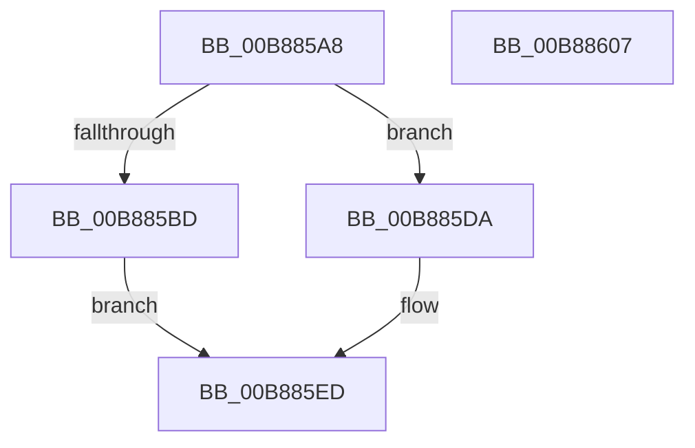

# KdpSysWriteBusData

- RVA: `0x00B885A8`–`0x00B88608` (길이 `96` bytes)
- VA: `0x0000000140B885A8`
- 실행 섹션: `PAGEKD`
- PDB 이름 있음: `예`; PDB Function 태그: `아니요`
- unwind 정보 RVA: `0x00064C80`
- 디코드: `29`개 명령, `96/96` bytes 표시
- 미해석 바이트: `0` (있으면 어셈블리에 `.byte`로 보존)

> 이 문서는 커널 이미지의 기계어와 PDB 기호를 분석해 생성했습니다. 4번과 5번은 함수 원형과 자료형을 바이너리 사용 방식에서 추정한 C 해석이며 원본 소스 복구 결과는 아닙니다.

## 1. Dependencies

- 직접 호출 지점: **2**; 고유 호출 대상: **2**
- 직접 호출자로 확인된 함수: **2**
- RIP 상대 이미지 참조: **1**

### Outgoing calls
- `0x00B885D3` → [guard_dispatch_icall](../../text/6B/guard_dispatch_icall_function_006BAAD0.md) (function, `0x006BAAD0`)
- `0x00B885E8` → [HalSetBusDataByOffset](../../text/46/HalSetBusDataByOffset_function_004614A0.md) (function, `0x004614A0`)

### Direct callers
- [KdSystemDebugControl](../../page/74/KdSystemDebugControl_function_00744700.md) at `0x00744CEA`
- [KdpSetBusData](KdpSetBusData_function_00B88398.md) at `0x00B883E7`

### Static image references
- `0x00B885BD` → RVA `0x00E00898` (`.data`; read)

## 2. Other-region calls and transfers

- 다른 실행 섹션으로 향하는 call: **2**
  - `0x00B885D3` → [guard_dispatch_icall](../../text/6B/guard_dispatch_icall_function_006BAAD0.md) (`PAGEKD` → `.text`)
  - `0x00B885E8` → [HalSetBusDataByOffset](../../text/46/HalSetBusDataByOffset_function_004614A0.md) (`PAGEKD` → `.text`)
- 별도 외부 분기/꼬리 이동을 확인하지 못했습니다.

## 3. Assembly (complete function range)

```asm
00B885A8  40 53                           push rbx
00B885AA  48 83 EC 30                     sub rsp, 0x30
00B885AE  8B 5C 24 68                     mov ebx, dword ptr [rsp + 0x68]
00B885B2  45 8B D0                        mov r10d, r8d
00B885B5  44 8B DA                        mov r11d, edx
00B885B8  83 F9 04                        cmp ecx, 4
00B885BB  75 1D                           jne 0x140b885da
00B885BD  48 8B 05 D4 82 27 00            mov rax, qword ptr [rip + 0x2782d4]
00B885C4  41 8B D2                        mov edx, r10d
00B885C7  4C 8B 44 24 60                  mov r8, qword ptr [rsp + 0x60]
00B885CC  41 8B CB                        mov ecx, r11d
00B885CF  89 5C 24 20                     mov dword ptr [rsp + 0x20], ebx
00B885D3  E8 F8 24 B3 FF                  call 0x1406baad0
00B885D8  EB 13                           jmp 0x140b885ed
00B885DA  89 5C 24 28                     mov dword ptr [rsp + 0x28], ebx
00B885DE  44 89 4C 24 20                  mov dword ptr [rsp + 0x20], r9d
00B885E3  4C 8B 4C 24 60                  mov r9, qword ptr [rsp + 0x60]
00B885E8  E8 B3 8E 8D FF                  call 0x1404614a0
00B885ED  8B C8                           mov ecx, eax
00B885EF  48 8B 44 24 70                  mov rax, qword ptr [rsp + 0x70]
00B885F4  89 08                           mov dword ptr [rax], ecx
00B885F6  2B CB                           sub ecx, ebx
00B885F8  F7 D9                           neg ecx
00B885FA  1B C0                           sbb eax, eax
00B885FC  25 01 00 00 C0                  and eax, 0xc0000001
00B88601  48 83 C4 30                     add rsp, 0x30
00B88605  5B                              pop rbx
00B88606  C3                              ret
00B88607  CC                              int3
```

## 4. C-style interpretation (structured pseudocode)

```c
__int64 __fastcall KdpSysWriteBusData(int a1, int a2, int a3, int a4, __int64 a5, unsigned int a6, __int64 a7)
{
    __int64 result;
    __int64 v_rsp;
    unsigned int v_stack_m10;
    unsigned int v_stack_m18;

    v_rsp = (v_rsp) - (48);
    if (a1 != 4) goto loc_00B885DA;
    v_stack_m18 = (unsigned int)((unsigned int)(a6));
    result = guard_dispatch_icall((unsigned int)((unsigned int)((unsigned int)(a2))), (unsigned int)((unsigned int)((unsigned int)(a3))), a5, a4);
    goto loc_00B885ED;
loc_00B885DA:
    v_stack_m10 = (unsigned int)((unsigned int)(a6));
    v_stack_m18 = a4;
    result = HalSetBusDataByOffset((unsigned int)((unsigned int)((unsigned int)(a2))), (unsigned int)((unsigned int)((unsigned int)(a3))), a5, a5);
loc_00B885ED:
    *(unsigned int *)(a7) = (unsigned int)((unsigned int)((unsigned int)(result)));
    a1 = (unsigned int)(((unsigned int)((unsigned int)(result))) - ((unsigned int)((unsigned int)(a6))));
    a1 = (unsigned int)(-(a1));
    result = (unsigned int)((a7) & (0xC0000001ULL));
    v_rsp = (v_rsp) + (48);
    return result;
}
```

## 5. (Beta) C Style

```c
int64_t KdpSysWriteBusData(int32_t Arg1, int32_t Arg2, int32_t Arg3, int32_t Arg4, int64_t Arg5, uint32_t Arg6, void *Arg7)
{
    uint8_t *arg7 = (uint8_t *)Arg7;

    int64_t result;
    int64_t local_rsp;
    uint32_t v_stack_m10;
    uint32_t v_stack_m18;

    local_rsp = (local_rsp) - (48);
    if (Arg1 != 4) goto loc_00B885DA;
    v_stack_m18 = (uint32_t)((uint32_t)(Arg6));
    result = guard_dispatch_icall((uint32_t)((uint32_t)((uint32_t)(Arg2))), (uint32_t)((uint32_t)((uint32_t)(Arg3))), Arg5, Arg4);
    goto loc_00B885ED;
loc_00B885DA:
    v_stack_m10 = (uint32_t)((uint32_t)(Arg6));
    v_stack_m18 = Arg4;
    result = HalSetBusDataByOffset((uint32_t)((uint32_t)((uint32_t)(Arg2))), (uint32_t)((uint32_t)((uint32_t)(Arg3))), Arg5, Arg5);
loc_00B885ED:
    *(uint32_t *)(arg7) = (uint32_t)((uint32_t)((uint32_t)(result)));
    Arg1 = (uint32_t)(((uint32_t)((uint32_t)(result))) - ((uint32_t)((uint32_t)(Arg6))));
    Arg1 = (uint32_t)(-(Arg1));
    result = (uint32_t)((Arg7) & (0xC0000001ULL));
    local_rsp = (local_rsp) + (48);
    return result;
}
```

### 관측된 메모리 오프셋

구조체 형식이 확인되지 않은 접근은 인자 기준의 오프셋으로만 기록했습니다.

| 기준 인자 | 오프셋 표현 | 폭 (bit) | 접근 |
|---|---:|---:|---|
| `Arg7` | `+ 0x0` | `32` | `W` |

## 6. Execution-region graph

[열기: 2D/3D 그래프와 함수 탐색 컨트롤 패널](../../../control-panel.html?section=pagekd&rva=0x00B885A8&view=graph)

- 2D 그래프는 위에서 아래로 흐르고, 3D 그래프는 빈 공간을 드래그해 회전합니다. Shift+드래그는 이동, 휠은 확대·축소, 함수 노드 선택은 대상 보고서 이동입니다.

### Static fallback


