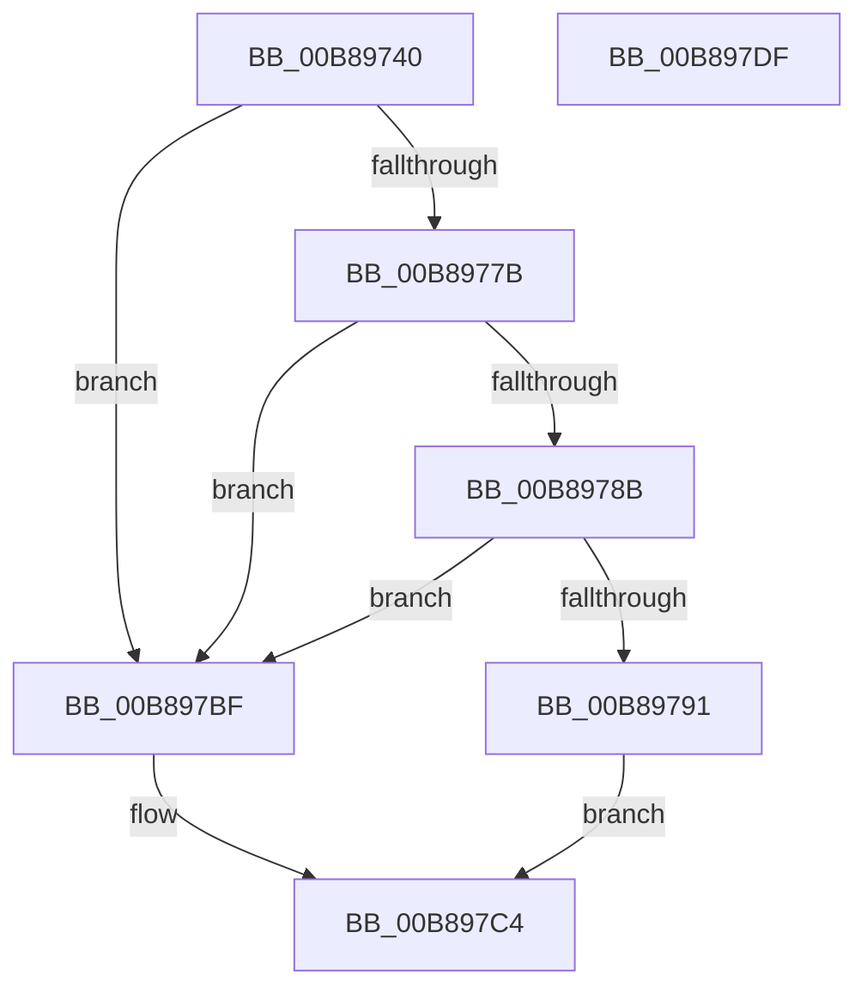

# KdpSysWriteControlSpace

- RVA: `0x00B89740`–`0x00B897E0` (길이 `160` bytes)
- VA: `0x0000000140B89740`
- 실행 섹션: `PAGEKD`
- PDB 이름 있음: `예`; PDB Function 태그: `아니요`
- unwind 정보 RVA: `0x0005D7BC`
- 디코드: `42`개 명령, `160/160` bytes 표시
- 미해석 바이트: `0` (있으면 어셈블리에 `.byte`로 보존)

> 이 문서는 커널 이미지의 기계어와 PDB 기호를 분석해 생성했습니다. 4번과 5번은 함수 원형과 자료형을 바이너리 사용 방식에서 추정한 C 해석이며 원본 소스 복구 결과는 아닙니다.

## 1. Dependencies

- 직접 호출 지점: **2**; 고유 호출 대상: **2**
- 직접 호출자로 확인된 함수: **2**
- RIP 상대 이미지 참조: **1**

### Outgoing calls
- `0x00B89772` → [KeQueryActiveProcessorCountEx](../../text/24/KeQueryActiveProcessorCountEx_function_00249EF0.md) (function, `0x00249EF0`)
- `0x00B897B8` → [KdpCopyMemoryChunks](KdpCopyMemoryChunks_function_00B8AACC.md) (function, `0x00B8AACC`)

### Direct callers
- [KdSystemDebugControl](../../page/74/KdSystemDebugControl_function_00744700.md) at `0x00744820`
- [KdpWriteControlSpace](KdpWriteControlSpace_function_00B8890C.md) at `0x00B88955`

### Static image references
- `0x00B8977B` → RVA `0x00FC8C40` (`ALMOSTRO`; read)

## 2. Other-region calls and transfers

- 다른 실행 섹션으로 향하는 call: **1**
  - `0x00B89772` → [KeQueryActiveProcessorCountEx](../../text/24/KeQueryActiveProcessorCountEx_function_00249EF0.md) (`PAGEKD` → `.text`)
- 별도 외부 분기/꼬리 이동을 확인하지 못했습니다.

## 3. Assembly (complete function range)

```asm
00B89740  48 8B C4                        mov rax, rsp
00B89743  48 89 58 08                     mov qword ptr [rax + 8], rbx
00B89747  48 89 68 10                     mov qword ptr [rax + 0x10], rbp
00B8974B  48 89 70 18                     mov qword ptr [rax + 0x18], rsi
00B8974F  48 89 78 20                     mov qword ptr [rax + 0x20], rdi
00B89753  41 56                           push r14
00B89755  48 83 EC 30                     sub rsp, 0x30
00B89759  4C 8B 74 24 60                  mov r14, qword ptr [rsp + 0x60]
00B8975E  41 8B F1                        mov esi, r9d
00B89761  8B D9                           mov ebx, ecx
00B89763  49 8B E8                        mov rbp, r8
00B89766  B9 FF FF 00 00                  mov ecx, 0xffff
00B8976B  48 8B FA                        mov rdi, rdx
00B8976E  41 83 26 00                     and dword ptr [r14], 0
00B89772  E8 79 07 6C FF                  call 0x140249ef0
00B89777  3B D8                           cmp ebx, eax
00B89779  73 44                           jae 0x140b897bf
00B8977B  48 8D 15 BE F4 43 00            lea rdx, [rip + 0x43f4be]
00B89782  48 8B 14 DA                     mov rdx, qword ptr [rdx + rbx*8]
00B89786  48 85 D2                        test rdx, rdx
00B89789  74 34                           je 0x140b897bf
00B8978B  48 83 FF 02                     cmp rdi, 2
00B8978F  75 2E                           jne 0x140b897bf
00B89791  41 B8 F0 00 00 00               mov r8d, 0xf0
00B89797  4C 89 74 24 28                  mov qword ptr [rsp + 0x28], r14
00B8979C  41 3B F0                        cmp esi, r8d
00B8979F  C7 44 24 20 04 00 00 00         mov dword ptr [rsp + 0x20], 4
00B897A7  48 8B CD                        mov rcx, rbp
00B897AA  44 0F 46 C6                     cmovbe r8d, esi
00B897AE  48 81 C2 00 01 00 00            add rdx, 0x100
00B897B5  45 33 C9                        xor r9d, r9d
00B897B8  E8 0F 13 00 00                  call 0x140b8aacc
00B897BD  EB 05                           jmp 0x140b897c4
00B897BF  B8 01 00 00 C0                  mov eax, 0xc0000001
00B897C4  48 8B 5C 24 40                  mov rbx, qword ptr [rsp + 0x40]
00B897C9  48 8B 6C 24 48                  mov rbp, qword ptr [rsp + 0x48]
00B897CE  48 8B 74 24 50                  mov rsi, qword ptr [rsp + 0x50]
00B897D3  48 8B 7C 24 58                  mov rdi, qword ptr [rsp + 0x58]
00B897D8  48 83 C4 30                     add rsp, 0x30
00B897DC  41 5E                           pop r14
00B897DE  C3                              ret
00B897DF  CC                              int3
```

## 4. C-style interpretation (structured pseudocode)

```c
__int64 __fastcall KdpSysWriteControlSpace(int a1, __int64 a2, __int64 a3, int a4, __int64 a5)
{
    __int64 result;
    __int64 v_rsp;
    unsigned __int64 v_stack_m10;
    unsigned int v_stack_m18;
    unsigned __int64 v_stack_p10;
    unsigned __int64 v_stack_p18;
    unsigned __int64 v_stack_p20;
    unsigned __int64 v_stack_p8;

    *(unsigned __int64 *)(v_rsp + 8) = v_rbx;
    *(unsigned __int64 *)(v_rsp + 16) = v_rbp;
    *(unsigned __int64 *)(v_rsp + 24) = v_rsi;
    *(unsigned __int64 *)(v_rsp + 32) = v_rdi;
    v_rsp = (v_rsp) - (48);
    result = KeQueryActiveProcessorCountEx((unsigned int)(0xFFFFULL), a2, a3, a4);
    if (((unsigned int)((unsigned int)(a1))) >= ((unsigned int)(result))) goto loc_00B897BF;
    if (*(unsigned __int64 *)(v_rip + 4453566 + (unsigned int)(a1) * 8) == 0) goto loc_00B897BF;
    if (a2 != 2) goto loc_00B897BF;
    v_stack_m10 = a5;
    v_stack_m18 = 4;
    a3 = 240;
    if (((unsigned int)((unsigned int)(a4))) <= 240) { a3 = (unsigned int)((unsigned int)(a4)); }
    a2 = (*(unsigned __int64 *)(v_rip + 4453566 + (unsigned int)(a1) * 8)) + (256);
    a4 = 0;
    result = KdpCopyMemoryChunks(a3, a2, a3, a4);
    goto loc_00B897C4;
loc_00B897BF:
loc_00B897C4:
    v_rsp = (v_rsp) + (48);
    return (unsigned int)(0xC0000001ULL);
}
```

## 5. (Beta) C Style

```c
int64_t KdpSysWriteControlSpace(int32_t Arg1, int64_t Arg2, int64_t Arg3, int32_t Arg4, void *Arg5)
{
    uint8_t *arg5 = (uint8_t *)Arg5;

    int64_t result;
    int64_t local_rsp;
    uint64_t v_stack_m10;
    uint32_t v_stack_m18;
    uint64_t v_stack_p10;
    uint64_t v_stack_p18;
    uint64_t v_stack_p20;
    uint64_t v_stack_p8;

    *(uint64_t *)(local_rsp + 0x8) = local_rbx;
    *(uint64_t *)(local_rsp + 0x10) = local_rbp;
    *(uint64_t *)(local_rsp + 0x18) = local_rsi;
    *(uint64_t *)(local_rsp + 0x20) = local_rdi;
    local_rsp = (local_rsp) - (48);
    result = KeQueryActiveProcessorCountEx((uint32_t)(0xFFFFULL), Arg2, Arg3, Arg4);
    if (((uint32_t)((uint32_t)(Arg1))) >= ((uint32_t)(result))) goto loc_00B897BF;
    if (*(uint64_t *)(v_rip + 0x43F4BE + (uint32_t)(Arg1) * 8) == 0) goto loc_00B897BF;
    if (Arg2 != 2) goto loc_00B897BF;
    v_stack_m10 = Arg5;
    v_stack_m18 = 4;
    Arg3 = 240;
    if (((uint32_t)((uint32_t)(Arg4))) <= 240) { Arg3 = (uint32_t)((uint32_t)(Arg4)); }
    Arg2 = (*(uint64_t *)(v_rip + 0x43F4BE + (uint32_t)(Arg1) * 8)) + (256);
    Arg4 = 0;
    result = KdpCopyMemoryChunks(Arg3, Arg2, Arg3, Arg4);
    goto loc_00B897C4;
loc_00B897BF:
loc_00B897C4:
    local_rsp = (local_rsp) + (48);
    return (uint32_t)(0xC0000001ULL);
}
```

### 관측된 메모리 오프셋

구조체 형식이 확인되지 않은 접근은 인자 기준의 오프셋으로만 기록했습니다.

| 기준 인자 | 오프셋 표현 | 폭 (bit) | 접근 |
|---|---:|---:|---|
| `Arg5` | `+ 0x0` | `32` | `R/W` |

## 6. Execution-region graph

[열기: 2D/3D 그래프와 함수 탐색 컨트롤 패널](../../../control-panel.html?section=pagekd&rva=0x00B89740&view=graph)

- 2D 그래프는 위에서 아래로 흐르고, 3D 그래프는 빈 공간을 드래그해 회전합니다. Shift+드래그는 이동, 휠은 확대·축소, 함수 노드 선택은 대상 보고서 이동입니다.

### Static fallback


