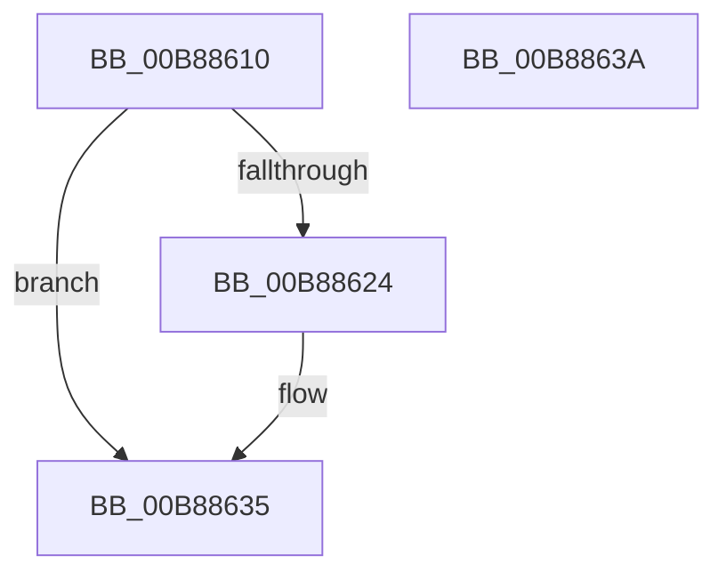

# KdpTimeSlipDpcRoutine

- RVA: `0x00B88610`–`0x00B8863B` (길이 `43` bytes)
- VA: `0x0000000140B88610`
- 실행 섹션: `PAGEKD`
- PDB 이름 있음: `예`; PDB Function 태그: `아니요`
- unwind 정보 RVA: `0x0005C788`
- 디코드: `11`개 명령, `43/43` bytes 표시
- 미해석 바이트: `0` (있으면 어셈블리에 `.byte`로 보존)

> 이 문서는 커널 이미지의 기계어와 PDB 기호를 분석해 생성했습니다. 4번과 5번은 함수 원형과 자료형을 바이너리 사용 방식에서 추정한 C 해석이며 원본 소스 복구 결과는 아닙니다.

## 1. Dependencies

- 직접 호출 지점: **1**; 고유 호출 대상: **1**
- 직접 호출자로 확인된 함수: **0**
- RIP 상대 이미지 참조: **2**

### Outgoing calls
- `0x00B88630` → [ExQueueWorkItem](../../text/2F/ExQueueWorkItem_function_002F9520.md) (function, `0x002F9520`)

### Direct callers
- 이 함수 시작 RVA로 연결되는 직접 call은 확인되지 않았습니다. 간접 호출은 완전히 역산할 수 없습니다.

### Static image references
- `0x00B88617` → RVA `0x00E0AA58` (`.data`; read/write)
- `0x00B88629` → RVA `0x00E66480` (`.data`; read)

## 2. Other-region calls and transfers

- 다른 실행 섹션으로 향하는 call: **1**
  - `0x00B88630` → [ExQueueWorkItem](../../text/2F/ExQueueWorkItem_function_002F9520.md) (`PAGEKD` → `.text`)
- 별도 외부 분기/꼬리 이동을 확인하지 못했습니다.

## 3. Assembly (complete function range)

```asm
00B88610  48 83 EC 28                     sub rsp, 0x28
00B88614  83 C8 FF                        or eax, 0xffffffff
00B88617  F0 0F C1 05 39 24 28 00         lock xadd dword ptr [rip + 0x282439], eax
00B8861F  83 E8 01                        sub eax, 1
00B88622  7E 11                           jle 0x140b88635
00B88624  BA 01 00 00 00                  mov edx, 1
00B88629  48 8D 0D 50 DE 2D 00            lea rcx, [rip + 0x2dde50]
00B88630  E8 EB 0E 77 FF                  call 0x1402f9520
00B88635  48 83 C4 28                     add rsp, 0x28
00B88639  C3                              ret
00B8863A  CC                              int3
```

## 4. C-style interpretation (structured pseudocode)

```c
__int64 __fastcall KdpTimeSlipDpcRoutine(void)
{
    __int64 result;
    __int64 v_rsp;

    v_rsp = (v_rsp) - (40);
    result = (unsigned int)((result) | (0xFFFFFFFFULL));
    result = (unsigned int)((result) - (1));
    if (!(condition_is_less_or_equal)) {
        a2 = 1;
        a1 = v_rip + 3006032;
        result = ExQueueWorkItem(a1, a2, a3, a4);
    }
    v_rsp = (v_rsp) + (40);
    return result;
}
```

## 5. (Beta) C Style

```c
void KdpTimeSlipDpcRoutine(void)
{
    int64_t result;
    int64_t local_rsp;

    local_rsp = (local_rsp) - (40);
    result = (uint32_t)((result) | (0xFFFFFFFFULL));
    result = (uint32_t)((result) - (1));
    if (!(condition_is_less_or_equal)) {
        a2 = 1;
        a1 = v_rip + 3006032;
        result = ExQueueWorkItem(a1, a2, a3, a4);
    }
    local_rsp = (local_rsp) + (40);
    return result;
}
```

## 6. Execution-region graph

[열기: 2D/3D 그래프와 함수 탐색 컨트롤 패널](../../../control-panel.html?section=pagekd&rva=0x00B88610&view=graph)

- 2D 그래프는 위에서 아래로 흐르고, 3D 그래프는 빈 공간을 드래그해 회전합니다. Shift+드래그는 이동, 휠은 확대·축소, 함수 노드 선택은 대상 보고서 이동입니다.

### Static fallback


