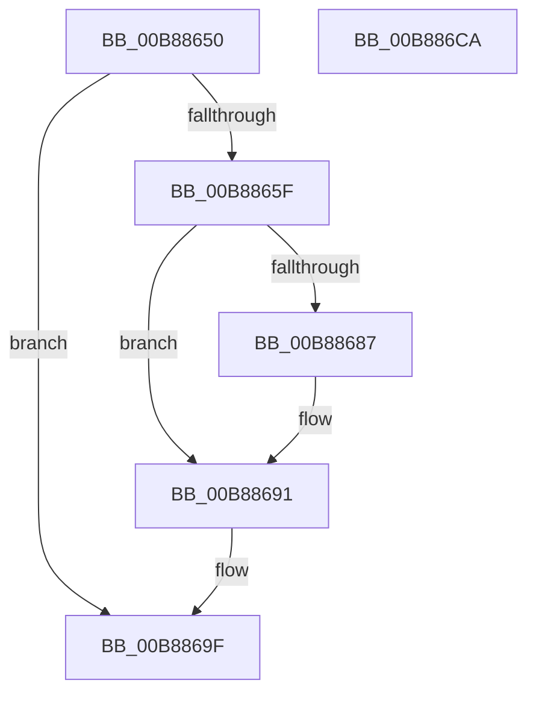

# KdpTimeSlipWork

- RVA: `0x00B88650`–`0x00B886CB` (길이 `123` bytes)
- VA: `0x0000000140B88650`
- 실행 섹션: `PAGEKD`
- PDB 이름 있음: `예`; PDB Function 태그: `아니요`
- unwind 정보 RVA: `0x00064C80`
- 디코드: `32`개 명령, `123/123` bytes 표시
- 미해석 바이트: `0` (있으면 어셈블리에 `.byte`로 보존)

> 이 문서는 커널 이미지의 기계어와 PDB 기호를 분석해 생성했습니다. 4번과 5번은 함수 원형과 자료형을 바이너리 사용 방식에서 추정한 C 해석이며 원본 소스 복구 결과는 아닙니다.

## 1. Dependencies

- 직접 호출 지점: **7**; 고유 호출 대상: **7**
- 직접 호출자로 확인된 함수: **0**
- RIP 상대 이미지 참조: **4**

### Outgoing calls
- `0x00B88656` → [ExTryAcquireTimeRefreshLockExclusive](../../page/7C/ExTryAcquireTimeRefreshLockExclusive_function_007C5A7C.md) (function, `0x007C5A7C`)
- `0x00B88663` → [ExUpdateSystemTimeFromCmos](../../pagelk/B7/ExUpdateSystemTimeFromCmos_function_00B7BD98.md) (function, `0x00B7BD98`)
- `0x00B88668` → [ExReleaseTimeRefreshLockExclusive](../../page/9C/ExReleaseTimeRefreshLockExclusive_function_009C5874.md) (function, `0x009C5874`)
- `0x00B88674` → [KeAcquireSpinLockRaiseToDpc](../../text/20/KeAcquireSpinLockRaiseToDpc_function_00208470.md) (function, `0x00208470`)
- `0x00B8868C` → [KeSetEvent](../../text/33/KeSetEvent_function_0033F310.md) (function, `0x0033F310`)
- `0x00B8869A` → [KeReleaseSpinLock](../../text/39/KeReleaseSpinLock_function_00392BA0.md) (function, `0x00392BA0`)
- `0x00B886BF` → [KiSetTimerEx](../../text/23/KiSetTimerEx_function_00232CB0.md) (function, `0x00232CB0`)

### Direct callers
- 이 함수 시작 RVA로 연결되는 직접 call은 확인되지 않았습니다. 간접 호출은 완전히 역산할 수 없습니다.

### Static image references
- `0x00B8866D` → RVA `0x00E664B0` (`.data`; read)
- `0x00B88679` → RVA `0x00E664B8` (`.data`; read)
- `0x00B8869F` → RVA `0x00E66400` (`.data`; read)
- `0x00B886B8` → RVA `0x00E66440` (`.data`; read)

## 2. Other-region calls and transfers

- 다른 실행 섹션으로 향하는 call: **7**
  - `0x00B88656` → [ExTryAcquireTimeRefreshLockExclusive](../../page/7C/ExTryAcquireTimeRefreshLockExclusive_function_007C5A7C.md) (`PAGEKD` → `PAGE`)
  - `0x00B88663` → [ExUpdateSystemTimeFromCmos](../../pagelk/B7/ExUpdateSystemTimeFromCmos_function_00B7BD98.md) (`PAGEKD` → `PAGELK`)
  - `0x00B88668` → [ExReleaseTimeRefreshLockExclusive](../../page/9C/ExReleaseTimeRefreshLockExclusive_function_009C5874.md) (`PAGEKD` → `PAGE`)
  - `0x00B88674` → [KeAcquireSpinLockRaiseToDpc](../../text/20/KeAcquireSpinLockRaiseToDpc_function_00208470.md) (`PAGEKD` → `.text`)
  - `0x00B8868C` → [KeSetEvent](../../text/33/KeSetEvent_function_0033F310.md) (`PAGEKD` → `.text`)
  - `0x00B8869A` → [KeReleaseSpinLock](../../text/39/KeReleaseSpinLock_function_00392BA0.md) (`PAGEKD` → `.text`)
  - `0x00B886BF` → [KiSetTimerEx](../../text/23/KiSetTimerEx_function_00232CB0.md) (`PAGEKD` → `.text`)
- 별도 외부 분기/꼬리 이동을 확인하지 못했습니다.

## 3. Assembly (complete function range)

```asm
00B88650  40 53                           push rbx
00B88652  48 83 EC 30                     sub rsp, 0x30
00B88656  E8 21 D4 C3 FF                  call 0x1407c5a7c
00B8865B  84 C0                           test al, al
00B8865D  74 40                           je 0x140b8869f
00B8865F  33 D2                           xor edx, edx
00B88661  33 C9                           xor ecx, ecx
00B88663  E8 30 37 FF FF                  call 0x140b7bd98
00B88668  E8 07 D2 E3 FF                  call 0x1409c5874
00B8866D  48 8D 0D 3C DE 2D 00            lea rcx, [rip + 0x2dde3c]
00B88674  E8 F7 FD 67 FF                  call 0x140208470
00B88679  48 8B 0D 38 DE 2D 00            mov rcx, qword ptr [rip + 0x2dde38]
00B88680  8A D8                           mov bl, al
00B88682  48 85 C9                        test rcx, rcx
00B88685  74 0A                           je 0x140b88691
00B88687  45 33 C0                        xor r8d, r8d
00B8868A  33 D2                           xor edx, edx
00B8868C  E8 7F 6C 7B FF                  call 0x14033f310
00B88691  8A D3                           mov dl, bl
00B88693  48 8D 0D 16 DE 2D 00            lea rcx, [rip + 0x2dde16]
00B8869A  E8 01 A5 80 FF                  call 0x140392ba0
00B8869F  48 8D 05 5A DD 2D 00            lea rax, [rip + 0x2ddd5a]
00B886A6  45 33 C9                        xor r9d, r9d
00B886A9  45 33 C0                        xor r8d, r8d
00B886AC  48 89 44 24 20                  mov qword ptr [rsp + 0x20], rax
00B886B1  48 C7 C2 00 2E B6 94            mov rdx, 0xffffffff94b62e00
00B886B8  48 8D 0D 81 DD 2D 00            lea rcx, [rip + 0x2ddd81]
00B886BF  E8 EC A5 6A FF                  call 0x140232cb0
00B886C4  48 83 C4 30                     add rsp, 0x30
00B886C8  5B                              pop rbx
00B886C9  C3                              ret
00B886CA  CC                              int3
```

## 4. C-style interpretation (structured pseudocode)

```c
__int64 __fastcall KdpTimeSlipWork(int a1, int a2, int a3, int a4)
{
    __int64 result;
    __int64 v_rsp;
    unsigned __int64 v_stack_m18;

    v_rsp = (v_rsp) - (48);
    result = ExTryAcquireTimeRefreshLockExclusive(a1, a2, a3, a4);
    if ((unsigned __int8)(result) == 0) goto loc_00B8869F;
    a2 = 0;
    a1 = 0;
    result = ExUpdateSystemTimeFromCmos(a1, a2, a3, a4);
    result = ExReleaseTimeRefreshLockExclusive(a1, a2, a3, a4);
    result = KeAcquireSpinLockRaiseToDpc(v_rip + 3006012, a2, a3, a4);
    if (*(unsigned __int64 *)(v_rip + 3006008) != 0) {
        a3 = 0;
        a2 = 0;
        result = KeSetEvent(*(unsigned __int64 *)(v_rip + 3006008), a2, a3, a4);
    }
    result = KeReleaseSpinLock(v_rip + 3005974, (unsigned __int8)((unsigned __int8)(result)), a3, a4);
loc_00B8869F:
    a4 = 0;
    a3 = 0;
    v_stack_m18 = v_rip + 3005786;
    result = KiSetTimerEx(v_rip + 3005825, 0xFFFFFFFF94B62E00ULL, a3, a4);
    v_rsp = (v_rsp) + (48);
    return result;
}
```

## 5. (Beta) C Style

```c
int64_t KdpTimeSlipWork(int32_t Arg1, int32_t Arg2, int32_t Arg3, int32_t Arg4)
{
    int64_t result;
    int64_t local_rsp;
    uint64_t v_stack_m18;

    local_rsp = (local_rsp) - (48);
    result = ExTryAcquireTimeRefreshLockExclusive(Arg1, Arg2, Arg3, Arg4);
    if ((uint8_t)(result) == 0) goto loc_00B8869F;
    Arg2 = 0;
    Arg1 = 0;
    result = ExUpdateSystemTimeFromCmos(Arg1, Arg2, Arg3, Arg4);
    result = ExReleaseTimeRefreshLockExclusive(Arg1, Arg2, Arg3, Arg4);
    result = KeAcquireSpinLockRaiseToDpc(v_rip + 3006012, Arg2, Arg3, Arg4);
    if (*(uint64_t *)(v_rip + 0x2DDE38) != 0) {
        Arg3 = 0;
        Arg2 = 0;
        result = KeSetEvent(*(uint64_t *)(v_rip + 0x2DDE38), Arg2, Arg3, Arg4);
    }
    result = KeReleaseSpinLock(v_rip + 3005974, (uint8_t)((uint8_t)(result)), Arg3, Arg4);
loc_00B8869F:
    Arg4 = 0;
    Arg3 = 0;
    v_stack_m18 = v_rip + 3005786;
    result = KiSetTimerEx(v_rip + 3005825, 0xFFFFFFFF94B62E00ULL, Arg3, Arg4);
    local_rsp = (local_rsp) + (48);
    return result;
}
```

## 6. Execution-region graph

[열기: 2D/3D 그래프와 함수 탐색 컨트롤 패널](../../../control-panel.html?section=pagekd&rva=0x00B88650&view=graph)

- 2D 그래프는 위에서 아래로 흐르고, 3D 그래프는 빈 공간을 드래그해 회전합니다. Shift+드래그는 이동, 휠은 확대·축소, 함수 노드 선택은 대상 보고서 이동입니다.

### Static fallback


