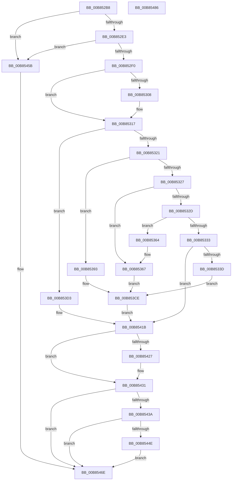

# KdpTrap

- RVA: `0x00B852B8`–`0x00B85487` (길이 `463` bytes)
- VA: `0x0000000140B852B8`
- 실행 섹션: `PAGEKD`
- PDB 이름 있음: `예`; PDB Function 태그: `아니요`
- unwind 정보 RVA: `0x000BF96C`
- 디코드: `107`개 명령, `463/463` bytes 표시
- 미해석 바이트: `0` (있으면 어셈블리에 `.byte`로 보존)

> 이 문서는 커널 이미지의 기계어와 PDB 기호를 분석해 생성했습니다. 4번과 5번은 함수 원형과 자료형을 바이너리 사용 방식에서 추정한 C 해석이며 원본 소스 복구 결과는 아닙니다.

## 1. Dependencies

- 직접 호출 지점: **5**; 고유 호출 대상: **5**
- 직접 호출자로 확인된 함수: **2**
- RIP 상대 이미지 참조: **0**

### Outgoing calls
- `0x00B8535D` → [KdpCommandString](KdpCommandString_function_00B88E2C.md) (function, `0x00B88E2C`)
- `0x00B8538C` → [KdpSymbol](KdpSymbol_function_00B89220.md) (function, `0x00B89220`)
- `0x00B853C2` → [KdpPrompt](KdpPrompt_function_00B890AC.md) (function, `0x00B890AC`)
- `0x00B8540A` → [KdpPrint](KdpPrint_function_00B88F08.md) (function, `0x00B88F08`)
- `0x00B85466` → [KdpReport](../../text/4D/KdpReport_function_004DF360.md) (function, `0x004DF360`)

### Direct callers
- [KdTrap](../../text/43/KdTrap_function_00431680.md) at `0x004316AA`
- [KdpStub](../../text/43/KdpStub_function_004316C0.md) at `0x004317A4`

### Static image references
- 디코드된 RIP-relative 메모리 참조가 없습니다.

## 2. Other-region calls and transfers

- 다른 실행 섹션으로 향하는 call: **1**
  - `0x00B85466` → [KdpReport](../../text/4D/KdpReport_function_004DF360.md) (`PAGEKD` → `.text`)
- 별도 외부 분기/꼬리 이동을 확인하지 못했습니다.

## 3. Assembly (complete function range)

```asm
00B852B8  48 8B C4                        mov rax, rsp
00B852BB  48 89 58 08                     mov qword ptr [rax + 8], rbx
00B852BF  48 89 68 10                     mov qword ptr [rax + 0x10], rbp
00B852C3  48 89 70 20                     mov qword ptr [rax + 0x20], rsi
00B852C7  57                              push rdi
00B852C8  48 83 EC 40                     sub rsp, 0x40
00B852CC  45 33 D2                        xor r10d, r10d
00B852CF  49 8B D9                        mov rbx, r9
00B852D2  41 81 38 03 00 00 80            cmp dword ptr [r8], 0x80000003
00B852D9  44 88 50 18                     mov byte ptr [rax + 0x18], r10b
00B852DD  0F 85 78 01 00 00               jne 0x140b8545b
00B852E3  4D 8B 48 20                     mov r9, qword ptr [r8 + 0x20]
00B852E7  4D 85 C9                        test r9, r9
00B852EA  0F 84 6B 01 00 00               je 0x140b8545b
00B852F0  8B 43 30                        mov eax, dword ptr [rbx + 0x30]
00B852F3  BD 80 00 10 00                  mov ebp, 0x100080
00B852F8  48 8B B3 F8 00 00 00            mov rsi, qword ptr [rbx + 0xf8]
00B852FF  23 C5                           and eax, ebp
00B85301  41 8B FA                        mov edi, r10d
00B85304  3B C5                           cmp eax, ebp
00B85306  75 0F                           jne 0x140b85317
00B85308  48 63 83 E8 04 00 00            movsxd rax, dword ptr [rbx + 0x4e8]
00B8530F  48 8B BC 18 D8 04 00 00         mov rdi, qword ptr [rax + rbx + 0x4d8]
00B85317  49 83 E9 01                     sub r9, 1
00B8531B  0F 84 B2 00 00 00               je 0x140b853d3
00B85321  49 83 E9 01                     sub r9, 1
00B85325  74 6C                           je 0x140b85393
00B85327  49 83 E9 01                     sub r9, 1
00B8532B  74 3A                           je 0x140b85367
00B8532D  49 83 E9 01                     sub r9, 1
00B85331  74 31                           je 0x140b85364
00B85333  49 83 F9 01                     cmp r9, 1
00B85337  0F 85 DE 00 00 00               jne 0x140b8541b
00B8533D  44 8A 44 24 70                  mov r8b, byte ptr [rsp + 0x70]
00B85342  4C 8B CB                        mov r9, rbx
00B85345  48 89 54 24 28                  mov qword ptr [rsp + 0x28], rdx
00B8534A  48 8B 93 88 00 00 00            mov rdx, qword ptr [rbx + 0x88]
00B85351  48 89 4C 24 20                  mov qword ptr [rsp + 0x20], rcx
00B85356  48 8B 8B 80 00 00 00            mov rcx, qword ptr [rbx + 0x80]
00B8535D  E8 CA 3A 00 00                  call 0x140b88e2c
00B85362  EB 6A                           jmp 0x140b853ce
00B85364  41 B2 01                        mov r10b, 1
00B85367  44 8A 4C 24 70                  mov r9b, byte ptr [rsp + 0x70]
00B8536C  45 8A C2                        mov r8b, r10b
00B8536F  48 89 54 24 30                  mov qword ptr [rsp + 0x30], rdx
00B85374  48 8B 93 88 00 00 00            mov rdx, qword ptr [rbx + 0x88]
00B8537B  48 89 4C 24 28                  mov qword ptr [rsp + 0x28], rcx
00B85380  48 8B 8B 80 00 00 00            mov rcx, qword ptr [rbx + 0x80]
00B85387  48 89 5C 24 20                  mov qword ptr [rsp + 0x20], rbx
00B8538C  E8 8F 3E 00 00                  call 0x140b89220
00B85391  EB 3B                           jmp 0x140b853ce
00B85393  8A 44 24 70                     mov al, byte ptr [rsp + 0x70]
00B85397  44 0F B7 8B C0 00 00 00         movzx r9d, word ptr [rbx + 0xc0]
00B8539F  4C 8B 83 B8 00 00 00            mov r8, qword ptr [rbx + 0xb8]
00B853A6  48 89 54 24 30                  mov qword ptr [rsp + 0x30], rdx
00B853AB  0F B7 93 88 00 00 00            movzx edx, word ptr [rbx + 0x88]
00B853B2  48 89 4C 24 28                  mov qword ptr [rsp + 0x28], rcx
00B853B7  48 8B 8B 80 00 00 00            mov rcx, qword ptr [rbx + 0x80]
00B853BE  88 44 24 20                     mov byte ptr [rsp + 0x20], al
00B853C2  E8 E5 3C 00 00                  call 0x140b890ac
00B853C7  0F B7 C0                        movzx eax, ax
00B853CA  48 89 43 78                     mov qword ptr [rbx + 0x78], rax
00B853CE  41 B2 01                        mov r10b, 1
00B853D1  EB 48                           jmp 0x140b8541b
00B853D3  44 0F B7 8B 88 00 00 00         movzx r9d, word ptr [rbx + 0x88]
00B853DB  48 8D 44 24 60                  lea rax, [rsp + 0x60]
00B853E0  4C 8B 83 80 00 00 00            mov r8, qword ptr [rbx + 0x80]
00B853E7  48 89 44 24 38                  mov qword ptr [rsp + 0x38], rax
00B853EC  8A 44 24 70                     mov al, byte ptr [rsp + 0x70]
00B853F0  48 89 54 24 30                  mov qword ptr [rsp + 0x30], rdx
00B853F5  8B 93 C0 00 00 00               mov edx, dword ptr [rbx + 0xc0]
00B853FB  48 89 4C 24 28                  mov qword ptr [rsp + 0x28], rcx
00B85400  8B 8B B8 00 00 00               mov ecx, dword ptr [rbx + 0xb8]
00B85406  88 44 24 20                     mov byte ptr [rsp + 0x20], al
00B8540A  E8 F9 3A 00 00                  call 0x140b88f08
00B8540F  44 8A 54 24 60                  mov r10b, byte ptr [rsp + 0x60]
00B85414  48 63 C8                        movsxd rcx, eax
00B85417  48 89 4B 78                     mov qword ptr [rbx + 0x78], rcx
00B8541B  48 8B 83 F8 00 00 00            mov rax, qword ptr [rbx + 0xf8]
00B85422  48 3B C6                        cmp rax, rsi
00B85425  75 0A                           jne 0x140b85431
00B85427  48 FF C0                        inc rax
00B8542A  48 89 83 F8 00 00 00            mov qword ptr [rbx + 0xf8], rax
00B85431  8B 43 30                        mov eax, dword ptr [rbx + 0x30]
00B85434  23 C5                           and eax, ebp
00B85436  3B C5                           cmp eax, ebp
00B85438  75 34                           jne 0x140b8546e
00B8543A  48 63 8B E8 04 00 00            movsxd rcx, dword ptr [rbx + 0x4e8]
00B85441  48 8B 84 19 D8 04 00 00         mov rax, qword ptr [rcx + rbx + 0x4d8]
00B85449  48 3B C7                        cmp rax, rdi
00B8544C  75 20                           jne 0x140b8546e
00B8544E  48 FF C0                        inc rax
00B85451  48 89 84 19 D8 04 00 00         mov qword ptr [rcx + rbx + 0x4d8], rax
00B85459  EB 13                           jmp 0x140b8546e
00B8545B  8A 44 24 78                     mov al, byte ptr [rsp + 0x78]
00B8545F  4C 8B CB                        mov r9, rbx
00B85462  88 44 24 28                     mov byte ptr [rsp + 0x28], al
00B85466  E8 F5 9E 95 FF                  call 0x1404df360
00B8546B  44 8A D0                        mov r10b, al
00B8546E  48 8B 5C 24 50                  mov rbx, qword ptr [rsp + 0x50]
00B85473  41 8A C2                        mov al, r10b
00B85476  48 8B 6C 24 58                  mov rbp, qword ptr [rsp + 0x58]
00B8547B  48 8B 74 24 68                  mov rsi, qword ptr [rsp + 0x68]
00B85480  48 83 C4 40                     add rsp, 0x40
00B85484  5F                              pop rdi
00B85485  C3                              ret
00B85486  CC                              int3
```

## 4. C-style interpretation (structured pseudocode)

```c
__int64 __fastcall KdpTrap(__int64 a1, __int64 a2, __int64 a3, __int64 a4, unsigned __int8 a5, unsigned __int8 a6)
{
    __int64 result;
    __int64 v_r10;
    __int64 v_rdi;
    __int64 v_rsp;
    unsigned __int64 v_stack_m10;
    unsigned __int64 v_stack_m18;
    unsigned __int64 v_stack_m20;
    unsigned __int64 v_stack_m28;
    unsigned __int64 v_stack_p10;
    unsigned __int64 v_stack_p18;
    unsigned __int64 v_stack_p20;
    unsigned __int64 v_stack_p8;

    *(unsigned __int64 *)(v_rsp + 8) = v_rbx;
    *(unsigned __int64 *)(v_rsp + 16) = v_rbp;
    *(unsigned __int64 *)(v_rsp + 32) = v_rsi;
    v_rsp = (v_rsp) - (64);
    v_r10 = 0;
    *(unsigned __int8 *)(v_rsp + 24) = 0;
    if ((*(unsigned int *)(a3)) != 0x80000003ULL) goto loc_00B8545B;
    if (*(unsigned __int64 *)(a3 + 32) == 0) goto loc_00B8545B;
    result = (unsigned int)(((unsigned int)(*(unsigned int *)(a4 + 48))) & ((unsigned int)((unsigned int)(0x100080ULL))));
    v_rdi = 0;
    if (((unsigned int)(result)) == ((unsigned int)((unsigned int)(0x100080ULL)))) {
        result = (int)(*(unsigned int *)(a4 + 1256));
        v_rdi = *(unsigned __int64 *)(result + a4 * 1 + 1240);
    }
    a4 = (*(unsigned __int64 *)(a3 + 32)) - (1);
    if (condition_is_equal) goto loc_00B853D3;
    a4 = (a4) - (1);
    if (condition_is_equal) goto loc_00B85393;
    a4 = (a4) - (1);
    if (condition_is_equal) goto loc_00B85367;
    a4 = (a4) - (1);
    if (condition_is_equal) goto loc_00B85364;
    if (a4 != 1) goto loc_00B8541B;
    v_stack_m20 = a2;
    v_stack_m28 = a1;
    result = KdpCommandString(*(unsigned __int64 *)(a4 + 128), *(unsigned __int64 *)(a4 + 136), a5, a4);
    goto loc_00B853CE;
loc_00B85364:
loc_00B85367:
    v_stack_m18 = *(unsigned __int64 *)(a4 + 136);
    v_stack_m20 = *(unsigned __int64 *)(a4 + 128);
    v_stack_m28 = a4;
    result = KdpSymbol(*(unsigned __int64 *)(a4 + 128), *(unsigned __int64 *)(a4 + 136), 1, a5);
    goto loc_00B853CE;
loc_00B85393:
    v_stack_m18 = *(unsigned __int64 *)(a4 + 136);
    v_stack_m20 = *(unsigned __int64 *)(a4 + 128);
    v_stack_m28 = a5;
    result = KdpPrompt(*(unsigned __int64 *)(a4 + 128), *(unsigned __int16 *)(a4 + 136), *(unsigned __int64 *)(a4 + 184), *(unsigned __int16 *)(a4 + 192));
    *(unsigned __int64 *)(a4 + 120) = (unsigned __int16)(result);
loc_00B853CE:
    goto loc_00B8541B;
loc_00B853D3:
    v_stack_m10 = v_stack_p18;
    v_stack_m18 = *(unsigned __int16 *)(a4 + 136);
    v_stack_m20 = *(unsigned __int64 *)(a4 + 128);
    v_stack_m28 = a5;
    result = KdpPrint((unsigned int)(*(unsigned int *)(a4 + 184)), (unsigned int)(*(unsigned int *)(a4 + 192)), *(unsigned __int64 *)(a4 + 128), *(unsigned __int16 *)(a4 + 136));
    *(unsigned __int64 *)(a4 + 120) = (int)((unsigned int)(result));
loc_00B8541B:
    result = *(unsigned __int64 *)(a4 + 248);
    if ((*(unsigned __int64 *)(a4 + 248)) == (*(unsigned __int64 *)(a4 + 248))) {
        result = (*(unsigned __int64 *)(a4 + 248)) + 1;
        *(unsigned __int64 *)(a4 + 248) = result;
    }
    result = (unsigned int)(((unsigned int)(*(unsigned int *)(a4 + 48))) & ((unsigned int)((unsigned int)(0x100080ULL))));
    if (((unsigned int)(result)) != ((unsigned int)((unsigned int)(0x100080ULL)))) goto loc_00B8546E;
    if ((*(unsigned __int64 *)((int)(*(unsigned int *)(a4 + 1256)) + a4 * 1 + 1240)) != v_rdi) goto loc_00B8546E;
    result = (*(unsigned __int64 *)((int)(*(unsigned int *)(a4 + 1256)) + a4 * 1 + 1240)) + 1;
    *(unsigned __int64 *)((int)(*(unsigned int *)(a4 + 1256)) + a4 * 1 + 1240) = result;
    goto loc_00B8546E;
loc_00B8545B:
    v_stack_m20 = a6;
    result = KdpReport((int)(*(unsigned int *)(a4 + 1256)), (unsigned int)(*(unsigned int *)(a4 + 192)), *(unsigned __int64 *)(a4 + 128), a4);
loc_00B8546E:
    v_rsp = (v_rsp) + (64);
    return (unsigned __int8)((unsigned __int8)(result));
}
```

## 5. (Beta) C Style

```c
int64_t KdpTrap(int64_t Arg1, int64_t Arg2, void *Arg3, void *Arg4, uint8_t Arg5, uint8_t Arg6)
{
    uint8_t *arg3 = (uint8_t *)Arg3;
    uint8_t *arg4 = (uint8_t *)Arg4;

    int64_t result;
    int64_t local_r10;
    int64_t local_rdi;
    int64_t local_rsp;
    uint64_t v_stack_m10;
    uint64_t v_stack_m18;
    uint64_t v_stack_m20;
    uint64_t v_stack_m28;
    uint64_t v_stack_p10;
    uint64_t v_stack_p18;
    uint64_t v_stack_p20;
    uint64_t v_stack_p8;

    *(uint64_t *)(local_rsp + 0x8) = local_rbx;
    *(uint64_t *)(local_rsp + 0x10) = local_rbp;
    *(uint64_t *)(local_rsp + 0x20) = local_rsi;
    local_rsp = (local_rsp) - (64);
    local_r10 = 0;
    *(uint8_t *)(local_rsp + 0x18) = 0;
    if ((*(uint32_t *)(arg3)) != 0x80000003ULL) goto loc_00B8545B;
    if (*(uint64_t *)(arg3 + 0x20) == 0) goto loc_00B8545B;
    result = (uint32_t)(((uint32_t)(*(uint32_t *)(arg4 + 0x30))) & ((uint32_t)((uint32_t)(0x100080ULL))));
    local_rdi = 0;
    if (((uint32_t)(result)) == ((uint32_t)((uint32_t)(0x100080ULL)))) {
        result = (int32_t)(*(uint32_t *)(arg4 + 0x4E8));
        local_rdi = *(uint64_t *)(result + arg4 * 1 + 0x4D8);
    }
    Arg4 = (*(uint64_t *)(arg3 + 0x20)) - (1);
    if (condition_is_equal) goto loc_00B853D3;
    Arg4 = (Arg4) - (1);
    if (condition_is_equal) goto loc_00B85393;
    Arg4 = (Arg4) - (1);
    if (condition_is_equal) goto loc_00B85367;
    Arg4 = (Arg4) - (1);
    if (condition_is_equal) goto loc_00B85364;
    if (Arg4 != 1) goto loc_00B8541B;
    v_stack_m20 = Arg2;
    v_stack_m28 = Arg1;
    result = KdpCommandString(*(uint64_t *)(arg4 + 0x80), *(uint64_t *)(arg4 + 0x88), Arg5, Arg4);
    goto loc_00B853CE;
loc_00B85364:
loc_00B85367:
    v_stack_m18 = *(uint64_t *)(arg4 + 0x88);
    v_stack_m20 = *(uint64_t *)(arg4 + 0x80);
    v_stack_m28 = Arg4;
    result = KdpSymbol(*(uint64_t *)(arg4 + 0x80), *(uint64_t *)(arg4 + 0x88), 1, Arg5);
    goto loc_00B853CE;
loc_00B85393:
    v_stack_m18 = *(uint64_t *)(arg4 + 0x88);
    v_stack_m20 = *(uint64_t *)(arg4 + 0x80);
    v_stack_m28 = Arg5;
    result = KdpPrompt(*(uint64_t *)(arg4 + 0x80), *(uint16_t *)(arg4 + 0x88), *(uint64_t *)(arg4 + 0xB8), *(uint16_t *)(arg4 + 0xC0));
    *(uint64_t *)(arg4 + 0x78) = (uint16_t)(result);
loc_00B853CE:
    goto loc_00B8541B;
loc_00B853D3:
    v_stack_m10 = v_stack_p18;
    v_stack_m18 = *(uint16_t *)(arg4 + 0x88);
    v_stack_m20 = *(uint64_t *)(arg4 + 0x80);
    v_stack_m28 = Arg5;
    result = KdpPrint((uint32_t)(*(uint32_t *)(arg4 + 0xB8)), (uint32_t)(*(uint32_t *)(arg4 + 0xC0)), *(uint64_t *)(arg4 + 0x80), *(uint16_t *)(arg4 + 0x88));
    *(uint64_t *)(arg4 + 0x78) = (int32_t)((uint32_t)(result));
loc_00B8541B:
    result = *(uint64_t *)(arg4 + 0xF8);
    if ((*(uint64_t *)(arg4 + 0xF8)) == (*(uint64_t *)(arg4 + 0xF8))) {
        result = (*(uint64_t *)(arg4 + 0xF8)) + 1;
        *(uint64_t *)(arg4 + 0xF8) = result;
    }
    result = (uint32_t)(((uint32_t)(*(uint32_t *)(arg4 + 0x30))) & ((uint32_t)((uint32_t)(0x100080ULL))));
    if (((uint32_t)(result)) != ((uint32_t)((uint32_t)(0x100080ULL)))) goto loc_00B8546E;
    if ((*(uint64_t *)((int32_t)(*(uint32_t *)(arg4 + 0x4E8)) + arg4 * 1 + 0x4D8)) != local_rdi) goto loc_00B8546E;
    result = (*(uint64_t *)((int32_t)(*(uint32_t *)(arg4 + 0x4E8)) + arg4 * 1 + 0x4D8)) + 1;
    *(uint64_t *)((int32_t)(*(uint32_t *)(arg4 + 0x4E8)) + arg4 * 1 + 0x4D8) = result;
    goto loc_00B8546E;
loc_00B8545B:
    v_stack_m20 = Arg6;
    result = KdpReport((int32_t)(*(uint32_t *)(arg4 + 0x4E8)), (uint32_t)(*(uint32_t *)(arg4 + 0xC0)), *(uint64_t *)(arg4 + 0x80), Arg4);
loc_00B8546E:
    local_rsp = (local_rsp) + (64);
    return (uint8_t)((uint8_t)(result));
}
```

### 관측된 메모리 오프셋

구조체 형식이 확인되지 않은 접근은 인자 기준의 오프셋으로만 기록했습니다.

| 기준 인자 | 오프셋 표현 | 폭 (bit) | 접근 |
|---|---:|---:|---|
| `Arg3` | `+ 0x0` | `32` | `R` |
| `Arg3` | `+ 0x20` | `64` | `R` |
| `Arg4` | `+ 0x30` | `32` | `R` |
| `Arg4` | `+ 0x78` | `64` | `W` |
| `Arg4` | `+ 0x80` | `64` | `R` |
| `Arg4` | `+ 0x88` | `16` | `R` |
| `Arg4` | `+ 0x88` | `64` | `R` |
| `Arg4` | `+ 0xB8` | `32` | `R` |
| `Arg4` | `+ 0xB8` | `64` | `R` |
| `Arg4` | `+ 0xC0` | `16` | `R` |
| `Arg4` | `+ 0xC0` | `32` | `R` |
| `Arg4` | `+ 0xF8` | `64` | `R` |
| `Arg4` | `+ 0xF8` | `64` | `W` |
| `Arg4` | `+ 0x4E8` | `32` | `R` |

## 6. Execution-region graph

[열기: 2D/3D 그래프와 함수 탐색 컨트롤 패널](../../../control-panel.html?section=pagekd&rva=0x00B852B8&view=graph)

- 2D 그래프는 위에서 아래로 흐르고, 3D 그래프는 빈 공간을 드래그해 회전합니다. Shift+드래그는 이동, 휠은 확대·축소, 함수 노드 선택은 대상 보고서 이동입니다.

### Static fallback


