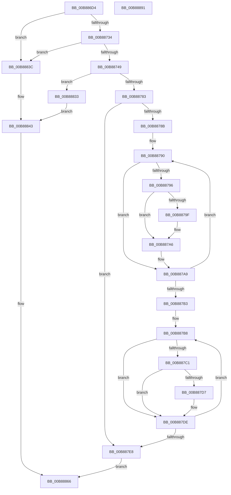

# KdpWriteBreakPointEx

- RVA: `0x00B886D4`–`0x00B88892` (길이 `446` bytes)
- VA: `0x0000000140B886D4`
- 실행 섹션: `PAGEKD`
- PDB 이름 있음: `예`; PDB Function 태그: `아니요`
- unwind 정보 RVA: `0x000C996C`
- 디코드: `112`개 명령, `446/446` bytes 표시
- 미해석 바이트: `0` (있으면 어셈블리에 `.byte`로 보존)

> 이 문서는 커널 이미지의 기계어와 PDB 기호를 분석해 생성했습니다. 4번과 5번은 함수 원형과 자료형을 바이너리 사용 방식에서 추정한 C 해석이며 원본 소스 복구 결과는 아닙니다.

## 1. Dependencies

- 직접 호출 지점: **7**; 고유 호출 대상: **5**
- 직접 호출자로 확인된 함수: **1**
- RIP 상대 이미지 참조: **3**

### Outgoing calls
- `0x00B88771` → [KdpCopyMemoryChunks](KdpCopyMemoryChunks_function_00B8AACC.md) (function, `0x00B8AACC`)
- `0x00B88796` → [KdpDeleteBreakpoint](KdpDeleteBreakpoint_function_00B89988.md) (function, `0x00B89988`)
- `0x00B887CC` → [KdpAddBreakpoint](KdpAddBreakpoint_function_00B897E8.md) (function, `0x00B897E8`)
- `0x00B88809` → [KdpCopyMemoryChunks](KdpCopyMemoryChunks_function_00B8AACC.md) (function, `0x00B8AACC`)
- `0x00B88822` → `kdcom.dll!KdSendPacket` (import, 간접 대상; import `kdcom.dll!KdSendPacket`)
- `0x00B88857` → `kdcom.dll!KdSendPacket` (import, 간접 대상; import `kdcom.dll!KdSendPacket`)
- `0x00B88870` → [_security_check_cookie](../../text/6A/_security_check_cookie_function_006AC640.md) (function, `0x006AC640`)

### Direct callers
- [KdpSendWaitContinue](KdpSendWaitContinue_function_00B8A32C.md) at `0x00B8A612`

### Static image references
- `0x00B886F5` → RVA `0x00E0A740` (`.data`; read)
- `0x00B8880E` → RVA `0x00F475E0` (`.data`; read)
- `0x00B88822` → RVA `0x001516C0` (`kdcom.dll!KdSendPacket (IAT)`; read)

## 2. Other-region calls and transfers

- 다른 실행 섹션으로 향하는 call: **1**
  - `0x00B88870` → [_security_check_cookie](../../text/6A/_security_check_cookie_function_006AC640.md) (`PAGEKD` → `.text`)
- 별도 외부 분기/꼬리 이동을 확인하지 못했습니다.

## 3. Assembly (complete function range)

```asm
00B886D4  48 89 5C 24 18                  mov qword ptr [rsp + 0x18], rbx
00B886D9  48 89 74 24 20                  mov qword ptr [rsp + 0x20], rsi
00B886DE  55                              push rbp
00B886DF  57                              push rdi
00B886E0  41 54                           push r12
00B886E2  41 56                           push r14
00B886E4  41 57                           push r15
00B886E6  48 8D AC 24 A0 FE FF FF         lea rbp, [rsp - 0x160]
00B886EE  48 81 EC 60 02 00 00            sub rsp, 0x260
00B886F5  48 8B 05 44 20 28 00            mov rax, qword ptr [rip + 0x282044]
00B886FC  48 33 C4                        xor rax, rsp
00B886FF  48 89 85 50 01 00 00            mov qword ptr [rbp + 0x150], rax
00B88706  83 64 24 30 00                  and dword ptr [rsp + 0x30], 0
00B8870B  0F 57 C0                        xorps xmm0, xmm0
00B8870E  8B 71 10                        mov esi, dword ptr [rcx + 0x10]
00B88711  B8 38 00 00 00                  mov eax, 0x38
00B88716  4C 8B F2                        mov r14, rdx
00B88719  48 8B D9                        mov rbx, rcx
00B8871C  0F 11 44 24 38                  movups xmmword ptr [rsp + 0x38], xmm0
00B88721  66 89 44 24 38                  mov word ptr [rsp + 0x38], ax
00B88726  48 89 4C 24 40                  mov qword ptr [rsp + 0x40], rcx
00B8872B  83 FE 20                        cmp esi, 0x20
00B8872E  0F 87 08 01 00 00               ja 0x140b8883c
00B88734  0F B7 02                        movzx eax, word ptr [rdx]
00B88737  8B FE                           mov edi, esi
00B88739  48 C1 E7 04                     shl rdi, 4
00B8873D  44 8B FE                        mov r15d, esi
00B88740  48 3B C7                        cmp rax, rdi
00B88743  0F 85 F3 00 00 00               jne 0x140b8883c
00B88749  49 8B 4E 08                     mov rcx, qword ptr [r14 + 8]
00B8874D  48 8D 44 24 30                  lea rax, [rsp + 0x30]
00B88752  48 89 44 24 28                  mov qword ptr [rsp + 0x28], rax
00B88757  48 8D 54 24 50                  lea rdx, [rsp + 0x50]
00B8875C  44 8B E6                        mov r12d, esi
00B8875F  C7 44 24 20 04 00 00 00         mov dword ptr [rsp + 0x20], 4
00B88767  41 C1 E4 04                     shl r12d, 4
00B8876B  45 33 C9                        xor r9d, r9d
00B8876E  45 8B C4                        mov r8d, r12d
00B88771  E8 56 23 00 00                  call 0x140b8aacc
00B88776  8B 44 24 30                     mov eax, dword ptr [rsp + 0x30]
00B8877A  48 3B C7                        cmp rax, rdi
00B8877D  0F 85 B0 00 00 00               jne 0x140b88833
00B88783  83 63 08 00                     and dword ptr [rbx + 8], 0
00B88787  85 F6                           test esi, esi
00B88789  74 5D                           je 0x140b887e8
00B8878B  48 8D 7C 24 58                  lea rdi, [rsp + 0x58]
00B88790  8B 0F                           mov ecx, dword ptr [rdi]
00B88792  85 C9                           test ecx, ecx
00B88794  74 13                           je 0x140b887a9
00B88796  E8 ED 11 00 00                  call 0x140b89988
00B8879B  84 C0                           test al, al
00B8879D  75 07                           jne 0x140b887a6
00B8879F  C7 43 08 01 00 00 C0            mov dword ptr [rbx + 8], 0xc0000001
00B887A6  83 27 00                        and dword ptr [rdi], 0
00B887A9  48 83 C7 10                     add rdi, 0x10
00B887AD  48 83 EE 01                     sub rsi, 1
00B887B1  75 DD                           jne 0x140b88790
00B887B3  48 8D 7C 24 58                  lea rdi, [rsp + 0x58]
00B887B8  48 8B 4F F8                     mov rcx, qword ptr [rdi - 8]
00B887BC  48 85 C9                        test rcx, rcx
00B887BF  74 1D                           je 0x140b887de
00B887C1  45 33 C9                        xor r9d, r9d
00B887C4  41 B0 01                        mov r8b, 1
00B887C7  BA CC 00 00 00                  mov edx, 0xcc
00B887CC  E8 17 10 00 00                  call 0x140b897e8
00B887D1  89 07                           mov dword ptr [rdi], eax
00B887D3  85 C0                           test eax, eax
00B887D5  75 07                           jne 0x140b887de
00B887D7  C7 43 08 01 00 00 C0            mov dword ptr [rbx + 8], 0xc0000001
00B887DE  48 83 C7 10                     add rdi, 0x10
00B887E2  49 83 EF 01                     sub r15, 1
00B887E6  75 D0                           jne 0x140b887b8
00B887E8  49 8B 4E 08                     mov rcx, qword ptr [r14 + 8]
00B887EC  48 8D 44 24 30                  lea rax, [rsp + 0x30]
00B887F1  48 89 44 24 28                  mov qword ptr [rsp + 0x28], rax
00B887F6  48 8D 54 24 50                  lea rdx, [rsp + 0x50]
00B887FB  45 33 C9                        xor r9d, r9d
00B887FE  C7 44 24 20 05 00 00 00         mov dword ptr [rsp + 0x20], 5
00B88806  45 8B C4                        mov r8d, r12d
00B88809  E8 BE 22 00 00                  call 0x140b8aacc
00B8880E  4C 8D 0D CB ED 3B 00            lea r9, [rip + 0x3bedcb]
00B88815  4D 8B C6                        mov r8, r14
00B88818  48 8D 54 24 38                  lea rdx, [rsp + 0x38]
00B8881D  B9 02 00 00 00                  mov ecx, 2
00B88822  48 FF 15 97 8E 5C FF            call qword ptr [rip - 0xa37169]
00B88829  0F 1F 44 00 00                  nop dword ptr [rax + rax]
00B8882E  8B 43 14                        mov eax, dword ptr [rbx + 0x14]
00B88831  EB 33                           jmp 0x140b88866
00B88833  C7 43 08 01 00 00 C0            mov dword ptr [rbx + 8], 0xc0000001
00B8883A  EB 07                           jmp 0x140b88843
00B8883C  C7 41 08 01 00 00 C0            mov dword ptr [rcx + 8], 0xc0000001
00B88843  4C 8D 0D 96 ED 3B 00            lea r9, [rip + 0x3bed96]
00B8884A  4D 8B C6                        mov r8, r14
00B8884D  48 8D 54 24 38                  lea rdx, [rsp + 0x38]
00B88852  B9 02 00 00 00                  mov ecx, 2
00B88857  48 FF 15 62 8E 5C FF            call qword ptr [rip - 0xa3719e]
00B8885E  0F 1F 44 00 00                  nop dword ptr [rax + rax]
00B88863  8B 43 08                        mov eax, dword ptr [rbx + 8]
00B88866  48 8B 8D 50 01 00 00            mov rcx, qword ptr [rbp + 0x150]
00B8886D  48 33 CC                        xor rcx, rsp
00B88870  E8 CB 3D B2 FF                  call 0x1406ac640
00B88875  4C 8D 9C 24 60 02 00 00         lea r11, [rsp + 0x260]
00B8887D  49 8B 5B 40                     mov rbx, qword ptr [r11 + 0x40]
00B88881  49 8B 73 48                     mov rsi, qword ptr [r11 + 0x48]
00B88885  49 8B E3                        mov rsp, r11
00B88888  41 5F                           pop r15
00B8888A  41 5E                           pop r14
00B8888C  41 5C                           pop r12
00B8888E  5F                              pop rdi
00B8888F  5D                              pop rbp
00B88890  C3                              ret
00B88891  CC                              int3
```

## 4. C-style interpretation (structured pseudocode)

```c
__int64 __fastcall KdpWriteBreakPointEx(__int64 a1, __int64 a2, __int64 a3, int a4)
{
    __int64 result;
    __int64 v_r12;
    __int64 v_r15;
    __int64 v_rdi;
    __int64 v_rsi;
    __int64 v_rsp;
    unsigned __int64 v_stack_m188;
    unsigned __int64 v_stack_m230;
    unsigned __int64 v_stack_m238;
    unsigned __int64 v_stack_m248;
    unsigned __int64 v_stack_m250;
    unsigned int v_stack_m258;
    unsigned __int64 v_stack_m260;
    unsigned int v_stack_m268;
    unsigned __int64 v_stack_m28;
    unsigned __int64 v_stack_m38;
    unsigned __int64 v_stack_p18;
    unsigned __int64 v_stack_p20;

    v_stack_p18 = v_rbx;
    v_stack_p20 = v_rsi;
    v_rsp = (v_rsp) - (608);
    result = (*(unsigned __int64 *)(v_rip + 2629700)) ^ (v_rsp);
    v_stack_m38 = result;
    v_stack_m250 = v_xmm0;
    v_stack_m250 = 56;
    v_stack_m248 = a1;
    if (((unsigned int)((unsigned int)(*(unsigned int *)(a1 + 16)))) > 32) goto loc_00B8883C;
    v_rdi = ((unsigned int)((unsigned int)((unsigned int)(*(unsigned int *)(a1 + 16))))) << (4);
    if ((*(unsigned __int16 *)(a2)) != v_rdi) goto loc_00B8883C;
    v_stack_m260 = v_stack_m258;
    v_stack_m268 = 4;
    v_r12 = (unsigned int)(((unsigned int)((unsigned int)((unsigned int)(*(unsigned int *)(a1 + 16))))) << (4));
    a4 = 0;
    result = KdpCopyMemoryChunks(*(unsigned __int64 *)(a2 + 8), v_stack_m238, (unsigned int)((unsigned int)(v_r12)), a4);
    if (((unsigned int)(v_stack_m258)) != v_rdi) goto loc_00B88833;
    if ((unsigned int)((unsigned int)(*(unsigned int *)(a1 + 16))) == 0) goto loc_00B887E8;
loc_00B88790:
    if ((unsigned int)((unsigned int)(*(unsigned int *)(v_stack_m230))) == 0) goto loc_00B887A9;
    result = KdpDeleteBreakpoint((unsigned int)(*(unsigned int *)(v_stack_m230)), v_stack_m238, (unsigned int)((unsigned int)(v_r12)), a4);
    if ((unsigned __int8)(result) == 0) {
        *(unsigned int *)(a1 + 8) = 0xC0000001ULL;
    }
loc_00B887A9:
    v_rdi = (v_stack_m230) + (16);
    v_rsi = ((unsigned int)(*(unsigned int *)(a1 + 16))) - (1);
    if (condition_is_not_equal) goto loc_00B88790;
loc_00B887B8:
    if (*(unsigned __int64 *)(v_stack_m230 - 8) == 0) goto loc_00B887DE;
    a4 = 0;
    result = KdpAddBreakpoint(*(unsigned __int64 *)(v_stack_m230 - 8), 204, 1, a4);
    *(unsigned int *)(v_stack_m230) = (unsigned int)(result);
    if ((unsigned int)(result) == 0) {
        *(unsigned int *)(a1 + 8) = 0xC0000001ULL;
    }
    v_rdi = (v_stack_m230) + (16);
    v_r15 = ((unsigned int)((unsigned int)((unsigned int)(*(unsigned int *)(a1 + 16))))) - (1);
    if (condition_is_not_equal) goto loc_00B887B8;
loc_00B887E8:
    v_stack_m260 = v_stack_m258;
    a4 = 0;
    v_stack_m268 = 5;
    result = KdpCopyMemoryChunks(*(unsigned __int64 *)(a2 + 8), v_stack_m238, (unsigned int)((unsigned int)(v_r12)), a4);
    result = kdcom_dll_KdSendPacket(2, v_stack_m250, a2, v_rip + 3927499);
    goto loc_00B88866;
loc_00B88833:
    *(unsigned int *)(a1 + 8) = 0xC0000001ULL;
    goto loc_00B88843;
loc_00B8883C:
    *(unsigned int *)(2 + 8) = 0xC0000001ULL;
loc_00B88843:
    result = kdcom_dll_KdSendPacket(2, v_stack_m250, a2, v_rip + 3927446);
loc_00B88866:
    a1 = (v_stack_m38) ^ (v_rsp);
    result = _security_check_cookie(a1, v_stack_m250, a2, v_rip + 3927446);
    return result;
}
```

## 5. (Beta) C Style

```c
int64_t KdpWriteBreakPointEx(void *Arg1, void *Arg2, int64_t Arg3, int32_t Arg4)
{
    uint8_t *arg1 = (uint8_t *)Arg1;
    uint8_t *arg2 = (uint8_t *)Arg2;

    int64_t result;
    int64_t local_r12;
    int64_t local_r15;
    int64_t local_rdi;
    int64_t local_rsi;
    int64_t local_rsp;
    uint64_t v_stack_m188;
    uint64_t v_stack_m230;
    uint64_t v_stack_m238;
    uint64_t v_stack_m248;
    uint64_t v_stack_m250;
    uint32_t v_stack_m258;
    uint64_t v_stack_m260;
    uint32_t v_stack_m268;
    uint64_t v_stack_m28;
    uint64_t v_stack_m38;
    uint64_t v_stack_p18;
    uint64_t v_stack_p20;

    v_stack_p18 = local_rbx;
    v_stack_p20 = local_rsi;
    local_rsp = (local_rsp) - (608);
    result = (*(uint64_t *)(v_rip + 0x282044)) ^ (local_rsp);
    v_stack_m38 = result;
    v_stack_m250 = v_xmm0;
    v_stack_m250 = 56;
    v_stack_m248 = Arg1;
    if (((uint32_t)((uint32_t)(*(uint32_t *)(arg1 + 0x10)))) > 32) goto loc_00B8883C;
    local_rdi = ((uint32_t)((uint32_t)((uint32_t)(*(uint32_t *)(arg1 + 0x10))))) << (4);
    if ((*(uint16_t *)(arg2)) != local_rdi) goto loc_00B8883C;
    v_stack_m260 = v_stack_m258;
    v_stack_m268 = 4;
    local_r12 = (uint32_t)(((uint32_t)((uint32_t)((uint32_t)(*(uint32_t *)(arg1 + 0x10))))) << (4));
    Arg4 = 0;
    result = KdpCopyMemoryChunks(*(uint64_t *)(arg2 + 0x8), v_stack_m238, (uint32_t)((uint32_t)(local_r12)), Arg4);
    if (((uint32_t)(v_stack_m258)) != local_rdi) goto loc_00B88833;
    if ((uint32_t)((uint32_t)(*(uint32_t *)(arg1 + 0x10))) == 0) goto loc_00B887E8;
loc_00B88790:
    if ((uint32_t)((uint32_t)(*(uint32_t *)(v_stack_m230))) == 0) goto loc_00B887A9;
    result = KdpDeleteBreakpoint((uint32_t)(*(uint32_t *)(v_stack_m230)), v_stack_m238, (uint32_t)((uint32_t)(local_r12)), Arg4);
    if ((uint8_t)(result) == 0) {
        *(uint32_t *)(arg1 + 0x8) = 0xC0000001ULL;
    }
loc_00B887A9:
    local_rdi = (v_stack_m230) + (16);
    local_rsi = ((uint32_t)(*(uint32_t *)(arg1 + 0x10))) - (1);
    if (condition_is_not_equal) goto loc_00B88790;
loc_00B887B8:
    if (*(uint64_t *)(v_stack_m230 - 0x8) == 0) goto loc_00B887DE;
    Arg4 = 0;
    result = KdpAddBreakpoint(*(uint64_t *)(v_stack_m230 - 0x8), 204, 1, Arg4);
    *(uint32_t *)(v_stack_m230) = (uint32_t)(result);
    if ((uint32_t)(result) == 0) {
        *(uint32_t *)(arg1 + 0x8) = 0xC0000001ULL;
    }
    local_rdi = (v_stack_m230) + (16);
    local_r15 = ((uint32_t)((uint32_t)((uint32_t)(*(uint32_t *)(arg1 + 0x10))))) - (1);
    if (condition_is_not_equal) goto loc_00B887B8;
loc_00B887E8:
    v_stack_m260 = v_stack_m258;
    Arg4 = 0;
    v_stack_m268 = 5;
    result = KdpCopyMemoryChunks(*(uint64_t *)(arg2 + 0x8), v_stack_m238, (uint32_t)((uint32_t)(local_r12)), Arg4);
    result = kernel_indirect_call(2, v_stack_m250, Arg2, v_rip + 3927499);
    goto loc_00B88866;
loc_00B88833:
    *(uint32_t *)(arg1 + 0x8) = 0xC0000001ULL;
    goto loc_00B88843;
loc_00B8883C:
    *(uint32_t *)(2 + 0x8) = 0xC0000001ULL;
loc_00B88843:
    result = kernel_indirect_call(2, v_stack_m250, Arg2, v_rip + 3927446);
loc_00B88866:
    Arg1 = (v_stack_m38) ^ (local_rsp);
    result = _security_check_cookie(Arg1, v_stack_m250, Arg2, v_rip + 3927446);
    return result;
}
```

### 관측된 메모리 오프셋

구조체 형식이 확인되지 않은 접근은 인자 기준의 오프셋으로만 기록했습니다.

| 기준 인자 | 오프셋 표현 | 폭 (bit) | 접근 |
|---|---:|---:|---|
| `Arg1` | `+ 0x8` | `32` | `R` |
| `Arg1` | `+ 0x8` | `32` | `R/W` |
| `Arg1` | `+ 0x8` | `32` | `W` |
| `Arg1` | `+ 0x10` | `32` | `R` |
| `Arg1` | `+ 0x14` | `32` | `R` |
| `Arg2` | `+ 0x0` | `16` | `R` |
| `Arg2` | `+ 0x8` | `64` | `R` |

## 6. Execution-region graph

[열기: 2D/3D 그래프와 함수 탐색 컨트롤 패널](../../../control-panel.html?section=pagekd&rva=0x00B886D4&view=graph)

- 2D 그래프는 위에서 아래로 흐르고, 3D 그래프는 빈 공간을 드래그해 회전합니다. Shift+드래그는 이동, 휠은 확대·축소, 함수 노드 선택은 대상 보고서 이동입니다.

### Static fallback


