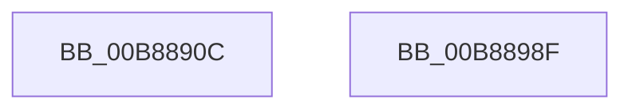

# KdpWriteControlSpace

- RVA: `0x00B8890C`–`0x00B88990` (길이 `132` bytes)
- VA: `0x0000000140B8890C`
- 실행 섹션: `PAGEKD`
- PDB 이름 있음: `예`; PDB Function 태그: `아니요`
- unwind 정보 RVA: `0x000C99AC`
- 디코드: `34`개 명령, `132/132` bytes 표시
- 미해석 바이트: `0` (있으면 어셈블리에 `.byte`로 보존)

> 이 문서는 커널 이미지의 기계어와 PDB 기호를 분석해 생성했습니다. 4번과 5번은 함수 원형과 자료형을 바이너리 사용 방식에서 추정한 C 해석이며 원본 소스 복구 결과는 아닙니다.

## 1. Dependencies

- 직접 호출 지점: **2**; 고유 호출 대상: **2**
- 직접 호출자로 확인된 함수: **1**
- RIP 상대 이미지 참조: **2**

### Outgoing calls
- `0x00B88955` → [KdpSysWriteControlSpace](KdpSysWriteControlSpace_function_00B89740.md) (function, `0x00B89740`)
- `0x00B88978` → `kdcom.dll!KdSendPacket` (import, 간접 대상; import `kdcom.dll!KdSendPacket`)

### Direct callers
- [KdpSendWaitContinue](KdpSendWaitContinue_function_00B8A32C.md) at `0x00B8A541`

### Static image references
- `0x00B8895D` → RVA `0x00F475E0` (`.data`; read)
- `0x00B88978` → RVA `0x001516C0` (`kdcom.dll!KdSendPacket (IAT)`; read)

## 2. Other-region calls and transfers

- 다른 실행 섹션으로 향하는 call: **0**
- 별도 외부 분기/꼬리 이동을 확인하지 못했습니다.

## 3. Assembly (complete function range)

```asm
00B8890C  4C 8B DC                        mov r11, rsp
00B8890F  49 89 5B 08                     mov qword ptr [r11 + 8], rbx
00B88913  4D 89 43 18                     mov qword ptr [r11 + 0x18], r8
00B88917  57                              push rdi
00B88918  48 83 EC 40                     sub rsp, 0x40
00B8891C  44 0F B7 0A                     movzx r9d, word ptr [rdx]
00B88920  48 8B D9                        mov rbx, rcx
00B88923  4C 8B 42 08                     mov r8, qword ptr [rdx + 8]
00B88927  0F 57 C0                        xorps xmm0, xmm0
00B8892A  83 64 24 60 00                  and dword ptr [rsp + 0x60], 0
00B8892F  B8 38 00 00 00                  mov eax, 0x38
00B88934  0F 11 44 24 30                  movups xmmword ptr [rsp + 0x30], xmm0
00B88939  66 89 44 24 30                  mov word ptr [rsp + 0x30], ax
00B8893E  48 8B FA                        mov rdi, rdx
00B88941  48 8B 53 10                     mov rdx, qword ptr [rbx + 0x10]
00B88945  49 8D 43 18                     lea rax, [r11 + 0x18]
00B88949  49 89 4B F0                     mov qword ptr [r11 - 0x10], rcx
00B8894D  0F B7 49 06                     movzx ecx, word ptr [rcx + 6]
00B88951  49 89 43 D8                     mov qword ptr [r11 - 0x28], rax
00B88955  E8 E6 0D 00 00                  call 0x140b89740
00B8895A  89 43 08                        mov dword ptr [rbx + 8], eax
00B8895D  4C 8D 0D 7C EC 3B 00            lea r9, [rip + 0x3bec7c]
00B88964  8B 44 24 60                     mov eax, dword ptr [rsp + 0x60]
00B88968  48 8D 54 24 30                  lea rdx, [rsp + 0x30]
00B8896D  4C 8B C7                        mov r8, rdi
00B88970  89 43 1C                        mov dword ptr [rbx + 0x1c], eax
00B88973  B9 02 00 00 00                  mov ecx, 2
00B88978  48 FF 15 41 8D 5C FF            call qword ptr [rip - 0xa372bf]
00B8897F  0F 1F 44 00 00                  nop dword ptr [rax + rax]
00B88984  48 8B 5C 24 50                  mov rbx, qword ptr [rsp + 0x50]
00B88989  48 83 C4 40                     add rsp, 0x40
00B8898D  5F                              pop rdi
00B8898E  C3                              ret
00B8898F  CC                              int3
```

## 4. C-style interpretation (structured pseudocode)

```c
__int64 __fastcall KdpWriteControlSpace(__int64 a1, __int64 a2, __int64 a3)
{
    __int64 result;
    __int64 v_rsp;
    unsigned __int64 v_stack_m18;
    unsigned int v_stack_p18;
    unsigned __int64 v_stack_p8;

    *(unsigned __int64 *)(v_rsp + 8) = v_rbx;
    *(unsigned __int64 *)(v_rsp + 24) = a3;
    v_rsp = (v_rsp) - (64);
    v_stack_m18 = v_xmm0;
    v_stack_m18 = 56;
    *(unsigned __int64 *)(v_rsp - 16) = a1;
    *(unsigned __int64 *)(v_rsp - 40) = v_rsp + 24;
    result = KdpSysWriteControlSpace(*(unsigned __int16 *)(a1 + 6), *(unsigned __int64 *)(a1 + 16), *(unsigned __int64 *)(a2 + 8), *(unsigned __int16 *)(a2));
    *(unsigned int *)(a1 + 8) = (unsigned int)(result);
    *(unsigned int *)(a1 + 28) = (unsigned int)((unsigned int)(v_stack_p18));
    result = kdcom_dll_KdSendPacket(2, v_stack_m18, a2, v_rip + 3927164);
    v_rsp = (v_rsp) + (64);
    return result;
}
```

## 5. (Beta) C Style

```c
int64_t KdpWriteControlSpace(void *Arg1, void *Arg2, int64_t Arg3)
{
    uint8_t *arg1 = (uint8_t *)Arg1;
    uint8_t *arg2 = (uint8_t *)Arg2;

    int64_t result;
    int64_t local_rsp;
    uint64_t v_stack_m18;
    uint32_t v_stack_p18;
    uint64_t v_stack_p8;

    *(uint64_t *)(local_rsp + 0x8) = local_rbx;
    *(uint64_t *)(local_rsp + 0x18) = Arg3;
    local_rsp = (local_rsp) - (64);
    v_stack_m18 = v_xmm0;
    v_stack_m18 = 56;
    *(void **)(local_rsp - 0x10) = Arg1;
    *(uint64_t *)(local_rsp - 0x28) = local_rsp + 24;
    result = KdpSysWriteControlSpace(*(uint16_t *)(arg1 + 0x6), *(uint64_t *)(arg1 + 0x10), *(uint64_t *)(arg2 + 0x8), *(uint16_t *)(arg2));
    *(uint32_t *)(arg1 + 0x8) = (uint32_t)(result);
    *(uint32_t *)(arg1 + 0x1C) = (uint32_t)((uint32_t)(v_stack_p18));
    result = kernel_indirect_call(2, v_stack_m18, Arg2, v_rip + 3927164);
    local_rsp = (local_rsp) + (64);
    return result;
}
```

### 관측된 메모리 오프셋

구조체 형식이 확인되지 않은 접근은 인자 기준의 오프셋으로만 기록했습니다.

| 기준 인자 | 오프셋 표현 | 폭 (bit) | 접근 |
|---|---:|---:|---|
| `Arg1` | `+ 0x6` | `16` | `R` |
| `Arg1` | `+ 0x8` | `32` | `W` |
| `Arg1` | `+ 0x10` | `64` | `R` |
| `Arg1` | `+ 0x1C` | `32` | `W` |
| `Arg2` | `+ 0x0` | `16` | `R` |
| `Arg2` | `+ 0x8` | `64` | `R` |

## 6. Execution-region graph

[열기: 2D/3D 그래프와 함수 탐색 컨트롤 패널](../../../control-panel.html?section=pagekd&rva=0x00B8890C&view=graph)

- 2D 그래프는 위에서 아래로 흐르고, 3D 그래프는 빈 공간을 드래그해 회전합니다. Shift+드래그는 이동, 휠은 확대·축소, 함수 노드 선택은 대상 보고서 이동입니다.

### Static fallback


