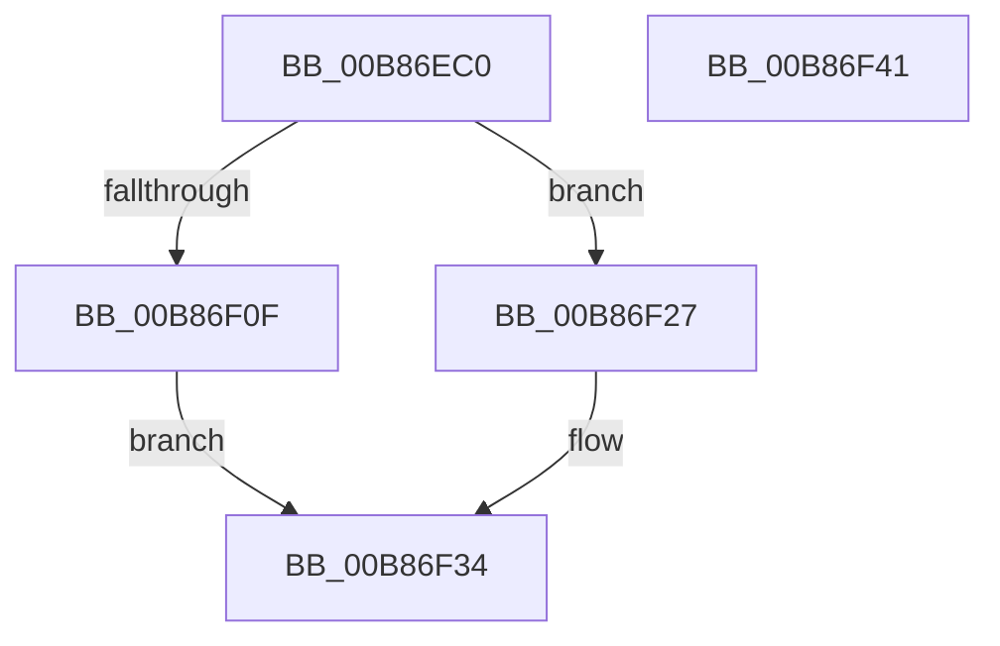

# KdpWriteFileCallback

- RVA: `0x00B86EC0`–`0x00B86F42` (길이 `130` bytes)
- VA: `0x0000000140B86EC0`
- 실행 섹션: `PAGEKD`
- PDB 이름 있음: `예`; PDB Function 태그: `아니요`
- unwind 정보 RVA: `0x000956E8`
- 디코드: `38`개 명령, `130/130` bytes 표시
- 미해석 바이트: `0` (있으면 어셈블리에 `.byte`로 보존)

> 이 문서는 커널 이미지의 기계어와 PDB 기호를 분석해 생성했습니다. 4번과 5번은 함수 원형과 자료형을 바이너리 사용 방식에서 추정한 C 해석이며 원본 소스 복구 결과는 아닙니다.

## 1. Dependencies

- 직접 호출 지점: **2**; 고유 호출 대상: **2**
- 직접 호출자로 확인된 함수: **0**
- RIP 상대 이미지 참조: **1**

### Outgoing calls
- `0x00B86F04` → [ZwWriteFile](../../text/6A/ZwWriteFile_function_006AD1D0.md) (function, `0x006AD1D0`)
- `0x00B86F20` → [DbgPrintEx](../../text/35/DbgPrintEx_function_00359290.md) (function, `0x00359290`)

### Direct callers
- 이 함수 시작 RVA로 연결되는 직접 call은 확인되지 않았습니다. 간접 호출은 완전히 역산할 수 없습니다.

### Static image references
- `0x00B86F12` → RVA `0x00B8AD40` (` ?? ::DFIOBLLK::`string'`; read)

## 2. Other-region calls and transfers

- 다른 실행 섹션으로 향하는 call: **2**
  - `0x00B86F04` → [ZwWriteFile](../../text/6A/ZwWriteFile_function_006AD1D0.md) (`PAGEKD` → `.text`)
  - `0x00B86F20` → [DbgPrintEx](../../text/35/DbgPrintEx_function_00359290.md) (`PAGEKD` → `.text`)
- 별도 외부 분기/꼬리 이동을 확인하지 못했습니다.

## 3. Assembly (complete function range)

```asm
00B86EC0  4C 8B DC                        mov r11, rsp
00B86EC3  49 89 5B 10                     mov qword ptr [r11 + 0x10], rbx
00B86EC7  57                              push rdi
00B86EC8  48 83 EC 60                     sub rsp, 0x60
00B86ECC  49 83 63 D8 00                  and qword ptr [r11 - 0x28], 0
00B86ED1  49 8D 43 08                     lea rax, [r11 + 8]
00B86ED5  48 8B 49 10                     mov rcx, qword ptr [rcx + 0x10]
00B86ED9  0F 57 C0                        xorps xmm0, xmm0
00B86EDC  49 89 43 D0                     mov qword ptr [r11 - 0x30], rax
00B86EE0  49 8D 43 E8                     lea rax, [r11 - 0x18]
00B86EE4  41 8B F9                        mov edi, r9d
00B86EE7  45 33 C9                        xor r9d, r9d
00B86EEA  89 7C 24 30                     mov dword ptr [rsp + 0x30], edi
00B86EEE  4D 89 43 C0                     mov qword ptr [r11 - 0x40], r8
00B86EF2  45 33 C0                        xor r8d, r8d
00B86EF5  49 89 53 08                     mov qword ptr [r11 + 8], rdx
00B86EF9  33 D2                           xor edx, edx
00B86EFB  0F 11 44 24 50                  movups xmmword ptr [rsp + 0x50], xmm0
00B86F00  49 89 43 B8                     mov qword ptr [r11 - 0x48], rax
00B86F04  E8 C7 62 B2 FF                  call 0x1406ad1d0
00B86F09  8B D8                           mov ebx, eax
00B86F0B  85 C0                           test eax, eax
00B86F0D  79 18                           jns 0x140b86f27
00B86F0F  44 8B C8                        mov r9d, eax
00B86F12  4C 8D 05 27 3E 00 00            lea r8, [rip + 0x3e27]
00B86F19  BA 02 00 00 00                  mov edx, 2
00B86F1E  33 C9                           xor ecx, ecx
00B86F20  E8 6B 23 7D FF                  call 0x140359290
00B86F25  EB 0D                           jmp 0x140b86f34
00B86F27  48 39 7C 24 58                  cmp qword ptr [rsp + 0x58], rdi
00B86F2C  B9 01 00 00 C0                  mov ecx, 0xc0000001
00B86F31  0F 42 D9                        cmovb ebx, ecx
00B86F34  8B C3                           mov eax, ebx
00B86F36  48 8B 5C 24 78                  mov rbx, qword ptr [rsp + 0x78]
00B86F3B  48 83 C4 60                     add rsp, 0x60
00B86F3F  5F                              pop rdi
00B86F40  C3                              ret
00B86F41  CC                              int3
```

## 4. C-style interpretation (structured pseudocode)

```c
__int64 __fastcall KdpWriteFileCallback(__int64 a1, __int64 a2, __int64 a3, int a4)
{
    __int64 result;
    __int64 v_rbx;
    __int64 v_rsp;
    unsigned __int64 v_stack_m10;
    unsigned __int64 v_stack_m18;
    unsigned int v_stack_m38;
    unsigned __int64 v_stack_p10;

    *(unsigned __int64 *)(v_rsp + 16) = v_rbx;
    v_rsp = (v_rsp) - (96);
    *(unsigned __int64 *)(v_rsp - 48) = v_rsp + 8;
    a4 = 0;
    v_stack_m38 = (unsigned int)((unsigned int)(a4));
    *(unsigned __int64 *)(v_rsp - 64) = a3;
    a3 = 0;
    *(unsigned __int64 *)(v_rsp + 8) = a2;
    a2 = 0;
    v_stack_m18 = v_xmm0;
    *(unsigned __int64 *)(v_rsp - 72) = v_rsp - 24;
    result = ZwWriteFile(*(unsigned __int64 *)(a1 + 16), a2, a3, a4);
    if (!sign_flag) goto loc_00B86F27;
    a1 = 0;
    result = DbgPrintEx(a1, 2, v_rip + 15911, (unsigned int)((unsigned int)(result)));
    goto loc_00B86F34;
loc_00B86F27:
    v_rbx = (unsigned int)((unsigned int)(result));
    if (v_stack_m10 < ((unsigned int)(a4))) { v_rbx = (unsigned int)((unsigned int)(0xC0000001ULL)); }
loc_00B86F34:
    v_rsp = (v_rsp) + (96);
    return (unsigned int)((unsigned int)(v_rbx));
}
```

## 5. (Beta) C Style

```c
int64_t KdpWriteFileCallback(void *Arg1, int64_t Arg2, int64_t Arg3, int32_t Arg4)
{
    uint8_t *arg1 = (uint8_t *)Arg1;

    int64_t result;
    int64_t local_rbx;
    int64_t local_rsp;
    uint64_t v_stack_m10;
    uint64_t v_stack_m18;
    uint32_t v_stack_m38;
    uint64_t v_stack_p10;

    *(uint64_t *)(local_rsp + 0x10) = local_rbx;
    local_rsp = (local_rsp) - (96);
    *(uint64_t *)(local_rsp - 0x30) = local_rsp + 8;
    Arg4 = 0;
    v_stack_m38 = (uint32_t)((uint32_t)(Arg4));
    *(uint64_t *)(local_rsp - 0x40) = Arg3;
    Arg3 = 0;
    *(uint64_t *)(local_rsp + 0x8) = Arg2;
    Arg2 = 0;
    v_stack_m18 = v_xmm0;
    *(uint64_t *)(local_rsp - 0x48) = local_rsp - 24;
    result = ZwWriteFile(*(uint64_t *)(arg1 + 0x10), Arg2, Arg3, Arg4);
    if (!sign_flag) goto loc_00B86F27;
    Arg1 = 0;
    result = DbgPrintEx(Arg1, 2, v_rip + 15911, (uint32_t)((uint32_t)(result)));
    goto loc_00B86F34;
loc_00B86F27:
    local_rbx = (uint32_t)((uint32_t)(result));
    if (v_stack_m10 < ((uint32_t)(Arg4))) { local_rbx = (uint32_t)((uint32_t)(0xC0000001ULL)); }
loc_00B86F34:
    local_rsp = (local_rsp) + (96);
    return (uint32_t)((uint32_t)(local_rbx));
}
```

### 관측된 메모리 오프셋

구조체 형식이 확인되지 않은 접근은 인자 기준의 오프셋으로만 기록했습니다.

| 기준 인자 | 오프셋 표현 | 폭 (bit) | 접근 |
|---|---:|---:|---|
| `Arg1` | `+ 0x10` | `64` | `R` |

## 6. Execution-region graph

[열기: 2D/3D 그래프와 함수 탐색 컨트롤 패널](../../../control-panel.html?section=pagekd&rva=0x00B86EC0&view=graph)

- 2D 그래프는 위에서 아래로 흐르고, 3D 그래프는 빈 공간을 드래그해 회전합니다. Shift+드래그는 이동, 휠은 확대·축소, 함수 노드 선택은 대상 보고서 이동입니다.

### Static fallback


