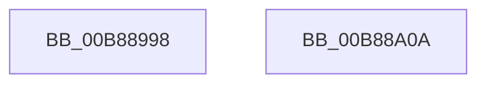

# KdpWriteIoSpace

- RVA: `0x00B88998`–`0x00B88A0B` (길이 `115` bytes)
- VA: `0x0000000140B88998`
- 실행 섹션: `PAGEKD`
- PDB 이름 있음: `예`; PDB Function 태그: `아니요`
- unwind 정보 RVA: `0x000AF0B0`
- 디코드: `31`개 명령, `115/115` bytes 표시
- 미해석 바이트: `0` (있으면 어셈블리에 `.byte`로 보존)

> 이 문서는 커널 이미지의 기계어와 PDB 기호를 분석해 생성했습니다. 4번과 5번은 함수 원형과 자료형을 바이너리 사용 방식에서 추정한 C 해석이며 원본 소스 복구 결과는 아닙니다.

## 1. Dependencies

- 직접 호출 지점: **2**; 고유 호출 대상: **2**
- 직접 호출자로 확인된 함수: **1**
- RIP 상대 이미지 참조: **2**

### Outgoing calls
- `0x00B889DD` → [KdpSysWriteIoSpace](../../text/5B/KdpSysWriteIoSpace_function_005B12E4.md) (function, `0x005B12E4`)
- `0x00B889F8` → `kdcom.dll!KdSendPacket` (import, 간접 대상; import `kdcom.dll!KdSendPacket`)

### Direct callers
- [KdpSendWaitContinue](KdpSendWaitContinue_function_00B8A32C.md) at `0x00B8A55D`

### Static image references
- `0x00B889E8` → RVA `0x00F475E0` (`.data`; read)
- `0x00B889F8` → RVA `0x001516C0` (`kdcom.dll!KdSendPacket (IAT)`; read)

## 2. Other-region calls and transfers

- 다른 실행 섹션으로 향하는 call: **1**
  - `0x00B889DD` → [KdpSysWriteIoSpace](../../text/5B/KdpSysWriteIoSpace_function_005B12E4.md) (`PAGEKD` → `.text`)
- 별도 외부 분기/꼬리 이동을 확인하지 못했습니다.

## 3. Assembly (complete function range)

```asm
00B88998  4C 8B DC                        mov r11, rsp
00B8899B  53                              push rbx
00B8899C  48 83 EC 50                     sub rsp, 0x50
00B889A0  4C 8B 49 10                     mov r9, qword ptr [rcx + 0x10]
00B889A4  48 8D 51 1C                     lea rdx, [rcx + 0x1c]
00B889A8  B8 38 00 00 00                  mov eax, 0x38
00B889AD  48 8B D9                        mov rbx, rcx
00B889B0  0F 57 C0                        xorps xmm0, xmm0
00B889B3  0F 11 44 24 40                  movups xmmword ptr [rsp + 0x40], xmm0
00B889B8  66 89 44 24 40                  mov word ptr [rsp + 0x40], ax
00B889BD  49 8D 43 18                     lea rax, [r11 + 0x18]
00B889C1  49 89 43 D8                     mov qword ptr [r11 - 0x28], rax
00B889C5  8B 41 18                        mov eax, dword ptr [rcx + 0x18]
00B889C8  89 44 24 28                     mov dword ptr [rsp + 0x28], eax
00B889CC  49 89 53 C8                     mov qword ptr [r11 - 0x38], rdx
00B889D0  33 D2                           xor edx, edx
00B889D2  49 89 4B F0                     mov qword ptr [r11 - 0x10], rcx
00B889D6  44 8D 42 01                     lea r8d, [rdx + 1]
00B889DA  41 8B C8                        mov ecx, r8d
00B889DD  E8 02 89 A2 FF                  call 0x1405b12e4
00B889E2  45 33 C0                        xor r8d, r8d
00B889E5  89 43 08                        mov dword ptr [rbx + 8], eax
00B889E8  4C 8D 0D F1 EB 3B 00            lea r9, [rip + 0x3bebf1]
00B889EF  48 8D 54 24 40                  lea rdx, [rsp + 0x40]
00B889F4  41 8D 48 02                     lea ecx, [r8 + 2]
00B889F8  48 FF 15 C1 8C 5C FF            call qword ptr [rip - 0xa3733f]
00B889FF  0F 1F 44 00 00                  nop dword ptr [rax + rax]
00B88A04  48 83 C4 50                     add rsp, 0x50
00B88A08  5B                              pop rbx
00B88A09  C3                              ret
00B88A0A  CC                              int3
```

## 4. C-style interpretation (structured pseudocode)

```c
__int64 __fastcall KdpWriteIoSpace(__int64 a1)
{
    __int64 result;
    __int64 v_rsp;
    unsigned __int64 v_stack_m18;
    unsigned int v_stack_m30;

    v_rsp = (v_rsp) - (80);
    v_stack_m18 = v_xmm0;
    v_stack_m18 = 56;
    *(unsigned __int64 *)(v_rsp - 40) = v_rsp + 24;
    v_stack_m30 = (unsigned int)((unsigned int)(*(unsigned int *)(a1 + 24)));
    *(unsigned __int64 *)(v_rsp - 56) = a1 + 28;
    a2 = 0;
    *(unsigned __int64 *)(v_rsp - 16) = a1;
    result = KdpSysWriteIoSpace((unsigned int)((unsigned int)(a2 + 1)), a2, a2 + 1, *(unsigned __int64 *)(a1 + 16));
    a3 = 0;
    *(unsigned int *)(a1 + 8) = (unsigned int)(result);
    result = kdcom_dll_KdSendPacket(a3 + 2, v_stack_m18, a3, v_rip + 3927025);
    v_rsp = (v_rsp) + (80);
    return result;
}
```

## 5. (Beta) C Style

```c
int64_t KdpWriteIoSpace(void *Arg1)
{
    uint8_t *arg1 = (uint8_t *)Arg1;

    int64_t result;
    int64_t local_rsp;
    uint64_t v_stack_m18;
    uint32_t v_stack_m30;

    local_rsp = (local_rsp) - (80);
    v_stack_m18 = v_xmm0;
    v_stack_m18 = 56;
    *(uint64_t *)(local_rsp - 0x28) = local_rsp + 24;
    v_stack_m30 = (uint32_t)((uint32_t)(*(uint32_t *)(arg1 + 0x18)));
    *(void **)(local_rsp - 0x38) = Arg1 + 28;
    a2 = 0;
    *(void **)(local_rsp - 0x10) = Arg1;
    result = KdpSysWriteIoSpace((uint32_t)((uint32_t)(a2 + 1)), a2, a2 + 1, *(uint64_t *)(arg1 + 0x10));
    a3 = 0;
    *(uint32_t *)(arg1 + 0x8) = (uint32_t)(result);
    result = kernel_indirect_call(a3 + 2, v_stack_m18, a3, v_rip + 3927025);
    local_rsp = (local_rsp) + (80);
    return result;
}
```

### 관측된 메모리 오프셋

구조체 형식이 확인되지 않은 접근은 인자 기준의 오프셋으로만 기록했습니다.

| 기준 인자 | 오프셋 표현 | 폭 (bit) | 접근 |
|---|---:|---:|---|
| `Arg1` | `+ 0x8` | `32` | `W` |
| `Arg1` | `+ 0x10` | `64` | `R` |
| `Arg1` | `+ 0x18` | `32` | `R` |
| `Arg1` | `+ 0x1C` | `64` | `R` |

## 6. Execution-region graph

[열기: 2D/3D 그래프와 함수 탐색 컨트롤 패널](../../../control-panel.html?section=pagekd&rva=0x00B88998&view=graph)

- 2D 그래프는 위에서 아래로 흐르고, 3D 그래프는 빈 공간을 드래그해 회전합니다. Shift+드래그는 이동, 휠은 확대·축소, 함수 노드 선택은 대상 보고서 이동입니다.

### Static fallback


