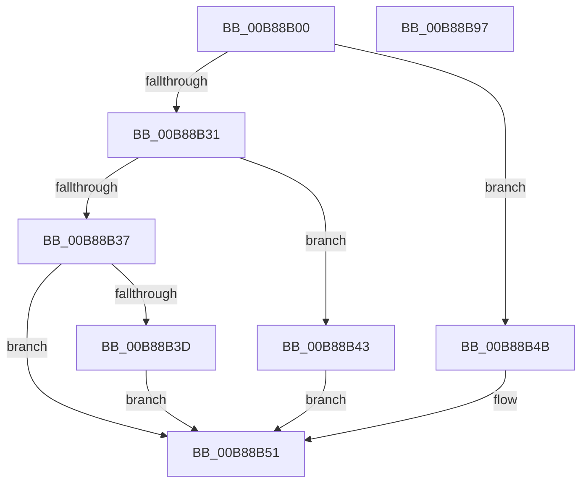

# KdpWritePhysicalMemory

- RVA: `0x00B88B00`–`0x00B88B98` (길이 `152` bytes)
- VA: `0x0000000140B88B00`
- 실행 섹션: `PAGEKD`
- PDB 이름 있음: `예`; PDB Function 태그: `아니요`
- unwind 정보 RVA: `0x000697A4`
- 디코드: `40`개 명령, `152/152` bytes 표시
- 미해석 바이트: `0` (있으면 어셈블리에 `.byte`로 보존)

> 이 문서는 커널 이미지의 기계어와 PDB 기호를 분석해 생성했습니다. 4번과 5번은 함수 원형과 자료형을 바이너리 사용 방식에서 추정한 C 해석이며 원본 소스 복구 결과는 아닙니다.

## 1. Dependencies

- 직접 호출 지점: **2**; 고유 호출 대상: **2**
- 직접 호출자로 확인된 함수: **1**
- RIP 상대 이미지 참조: **2**

### Outgoing calls
- `0x00B88B6A` → [KdpCopyMemoryChunks](KdpCopyMemoryChunks_function_00B8AACC.md) (function, `0x00B8AACC`)
- `0x00B88B85` → `kdcom.dll!KdSendPacket` (import, 간접 대상; import `kdcom.dll!KdSendPacket`)

### Direct callers
- [KdpSendWaitContinue](KdpSendWaitContinue_function_00B8A32C.md) at `0x00B8A49F`

### Static image references
- `0x00B88B75` → RVA `0x00F475E0` (`.data`; read)
- `0x00B88B85` → RVA `0x001516C0` (`kdcom.dll!KdSendPacket (IAT)`; read)

## 2. Other-region calls and transfers

- 다른 실행 섹션으로 향하는 call: **0**
- 별도 외부 분기/꼬리 이동을 확인하지 못했습니다.

## 3. Assembly (complete function range)

```asm
00B88B00  40 53                           push rbx
00B88B02  48 83 EC 40                     sub rsp, 0x40
00B88B06  B8 38 00 00 00                  mov eax, 0x38
00B88B0B  0F 57 C0                        xorps xmm0, xmm0
00B88B0E  0F 11 44 24 30                  movups xmmword ptr [rsp + 0x30], xmm0
00B88B13  48 89 4C 24 38                  mov qword ptr [rsp + 0x38], rcx
00B88B18  48 8B D9                        mov rbx, rcx
00B88B1B  48 83 C1 1C                     add rcx, 0x1c
00B88B1F  66 89 44 24 30                  mov word ptr [rsp + 0x30], ax
00B88B24  44 8D 48 CF                     lea r9d, [rax - 0x31]
00B88B28  44 8B 01                        mov r8d, dword ptr [rcx]
00B88B2B  41 83 E8 01                     sub r8d, 1
00B88B2F  74 1A                           je 0x140b88b4b
00B88B31  41 83 E8 01                     sub r8d, 1
00B88B35  74 0C                           je 0x140b88b43
00B88B37  41 83 F8 01                     cmp r8d, 1
00B88B3B  75 14                           jne 0x140b88b51
00B88B3D  44 8D 48 EF                     lea r9d, [rax - 0x11]
00B88B41  EB 0E                           jmp 0x140b88b51
00B88B43  41 B9 17 00 00 00               mov r9d, 0x17
00B88B49  EB 06                           jmp 0x140b88b51
00B88B4B  41 B9 0F 00 00 00               mov r9d, 0xf
00B88B51  44 8B 43 18                     mov r8d, dword ptr [rbx + 0x18]
00B88B55  48 8B 52 08                     mov rdx, qword ptr [rdx + 8]
00B88B59  48 89 4C 24 28                  mov qword ptr [rsp + 0x28], rcx
00B88B5E  48 8B 4B 10                     mov rcx, qword ptr [rbx + 0x10]
00B88B62  44 89 4C 24 20                  mov dword ptr [rsp + 0x20], r9d
00B88B67  45 33 C9                        xor r9d, r9d
00B88B6A  E8 5D 1F 00 00                  call 0x140b8aacc
00B88B6F  45 33 C0                        xor r8d, r8d
00B88B72  89 43 08                        mov dword ptr [rbx + 8], eax
00B88B75  4C 8D 0D 64 EA 3B 00            lea r9, [rip + 0x3bea64]
00B88B7C  48 8D 54 24 30                  lea rdx, [rsp + 0x30]
00B88B81  41 8D 48 02                     lea ecx, [r8 + 2]
00B88B85  48 FF 15 34 8B 5C FF            call qword ptr [rip - 0xa374cc]
00B88B8C  0F 1F 44 00 00                  nop dword ptr [rax + rax]
00B88B91  48 83 C4 40                     add rsp, 0x40
00B88B95  5B                              pop rbx
00B88B96  C3                              ret
00B88B97  CC                              int3
```

## 4. C-style interpretation (structured pseudocode)

```c
__int64 __fastcall KdpWritePhysicalMemory(__int64 a1, __int64 a2)
{
    __int64 result;
    __int64 v_rsp;
    unsigned __int64 v_stack_m10;
    unsigned __int64 v_stack_m18;
    unsigned __int64 v_stack_m20;
    unsigned int v_stack_m28;

    v_rsp = (v_rsp) - (64);
    v_stack_m18 = v_xmm0;
    v_stack_m10 = a1;
    a1 = (a1) + (28);
    v_stack_m18 = 56;
    a3 = (unsigned int)(((unsigned int)(*(unsigned int *)(a1))) - (1));
    if (condition_is_equal) goto loc_00B88B4B;
    a3 = (unsigned int)((a3) - (1));
    if (condition_is_equal) goto loc_00B88B43;
    if (((unsigned int)(a3)) != 1) goto loc_00B88B51;
    goto loc_00B88B51;
loc_00B88B43:
    goto loc_00B88B51;
loc_00B88B4B:
loc_00B88B51:
    v_stack_m20 = a1;
    v_stack_m28 = 15;
    a4 = 0;
    result = KdpCopyMemoryChunks(*(unsigned __int64 *)(a1 + 16), *(unsigned __int64 *)(a2 + 8), (unsigned int)(*(unsigned int *)(a1 + 24)), a4);
    a3 = 0;
    *(unsigned int *)(a1 + 8) = (unsigned int)(result);
    result = kdcom_dll_KdSendPacket(a3 + 2, v_stack_m18, a3, v_rip + 3926628);
    v_rsp = (v_rsp) + (64);
    return result;
}
```

## 5. (Beta) C Style

```c
int64_t KdpWritePhysicalMemory(void *Arg1, void *Arg2)
{
    uint8_t *arg1 = (uint8_t *)Arg1;
    uint8_t *arg2 = (uint8_t *)Arg2;

    int64_t result;
    int64_t local_rsp;
    uint64_t v_stack_m10;
    uint64_t v_stack_m18;
    uint64_t v_stack_m20;
    uint32_t v_stack_m28;

    local_rsp = (local_rsp) - (64);
    v_stack_m18 = v_xmm0;
    v_stack_m10 = Arg1;
    Arg1 = (Arg1) + (28);
    v_stack_m18 = 56;
    a3 = (uint32_t)(((uint32_t)(*(uint32_t *)(arg1))) - (1));
    if (condition_is_equal) goto loc_00B88B4B;
    a3 = (uint32_t)((a3) - (1));
    if (condition_is_equal) goto loc_00B88B43;
    if (((uint32_t)(a3)) != 1) goto loc_00B88B51;
    goto loc_00B88B51;
loc_00B88B43:
    goto loc_00B88B51;
loc_00B88B4B:
loc_00B88B51:
    v_stack_m20 = Arg1;
    v_stack_m28 = 15;
    a4 = 0;
    result = KdpCopyMemoryChunks(*(uint64_t *)(arg1 + 0x10), *(uint64_t *)(arg2 + 0x8), (uint32_t)(*(uint32_t *)(arg1 + 0x18)), a4);
    a3 = 0;
    *(uint32_t *)(arg1 + 0x8) = (uint32_t)(result);
    result = kernel_indirect_call(a3 + 2, v_stack_m18, a3, v_rip + 3926628);
    local_rsp = (local_rsp) + (64);
    return result;
}
```

### 관측된 메모리 오프셋

구조체 형식이 확인되지 않은 접근은 인자 기준의 오프셋으로만 기록했습니다.

| 기준 인자 | 오프셋 표현 | 폭 (bit) | 접근 |
|---|---:|---:|---|
| `Arg1` | `+ 0x0` | `32` | `R` |
| `Arg1` | `+ 0x8` | `32` | `W` |
| `Arg1` | `+ 0x10` | `64` | `R` |
| `Arg1` | `+ 0x18` | `32` | `R` |
| `Arg2` | `+ 0x8` | `64` | `R` |

## 6. Execution-region graph

[열기: 2D/3D 그래프와 함수 탐색 컨트롤 패널](../../../control-panel.html?section=pagekd&rva=0x00B88B00&view=graph)

- 2D 그래프는 위에서 아래로 흐르고, 3D 그래프는 빈 공간을 드래그해 회전합니다. Shift+드래그는 이동, 휠은 확대·축소, 함수 노드 선택은 대상 보고서 이동입니다.

### Static fallback


