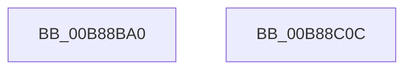

# KdpWriteVirtualMemory

- RVA: `0x00B88BA0`–`0x00B88C0D` (길이 `109` bytes)
- VA: `0x0000000140B88BA0`
- 실행 섹션: `PAGEKD`
- PDB 이름 있음: `예`; PDB Function 태그: `아니요`
- unwind 정보 RVA: `0x000697A4`
- 디코드: `27`개 명령, `109/109` bytes 표시
- 미해석 바이트: `0` (있으면 어셈블리에 `.byte`로 보존)

> 이 문서는 커널 이미지의 기계어와 PDB 기호를 분석해 생성했습니다. 4번과 5번은 함수 원형과 자료형을 바이너리 사용 방식에서 추정한 C 해석이며 원본 소스 복구 결과는 아닙니다.

## 1. Dependencies

- 직접 호출 지점: **2**; 고유 호출 대상: **2**
- 직접 호출자로 확인된 함수: **1**
- RIP 상대 이미지 참조: **2**

### Outgoing calls
- `0x00B88BD1` → [KdpCopyMemoryChunks](KdpCopyMemoryChunks_function_00B8AACC.md) (function, `0x00B8AACC`)
- `0x00B88BFA` → `kdcom.dll!KdSendPacket` (import, 간접 대상; import `kdcom.dll!KdSendPacket`)

### Direct callers
- [KdpSendWaitContinue](KdpSendWaitContinue_function_00B8A32C.md) at `0x00B8A458`

### Static image references
- `0x00B88BD9` → RVA `0x00F475E0` (`.data`; read)
- `0x00B88BFA` → RVA `0x001516C0` (`kdcom.dll!KdSendPacket (IAT)`; read)

## 2. Other-region calls and transfers

- 다른 실행 섹션으로 향하는 call: **0**
- 별도 외부 분기/꼬리 이동을 확인하지 못했습니다.

## 3. Assembly (complete function range)

```asm
00B88BA0  40 53                           push rbx
00B88BA2  48 83 EC 40                     sub rsp, 0x40
00B88BA6  44 0F B7 02                     movzx r8d, word ptr [rdx]
00B88BAA  48 8D 41 1C                     lea rax, [rcx + 0x1c]
00B88BAE  48 8B 52 08                     mov rdx, qword ptr [rdx + 8]
00B88BB2  48 8B D9                        mov rbx, rcx
00B88BB5  48 8B 49 10                     mov rcx, qword ptr [rcx + 0x10]
00B88BB9  0F 57 C0                        xorps xmm0, xmm0
00B88BBC  48 89 44 24 28                  mov qword ptr [rsp + 0x28], rax
00B88BC1  45 33 C9                        xor r9d, r9d
00B88BC4  C7 44 24 20 05 00 00 00         mov dword ptr [rsp + 0x20], 5
00B88BCC  0F 11 44 24 30                  movups xmmword ptr [rsp + 0x30], xmm0
00B88BD1  E8 F6 1E 00 00                  call 0x140b8aacc
00B88BD6  89 43 08                        mov dword ptr [rbx + 8], eax
00B88BD9  4C 8D 0D 00 EA 3B 00            lea r9, [rip + 0x3bea00]
00B88BE0  B8 38 00 00 00                  mov eax, 0x38
00B88BE5  48 89 5C 24 38                  mov qword ptr [rsp + 0x38], rbx
00B88BEA  45 33 C0                        xor r8d, r8d
00B88BED  66 89 44 24 30                  mov word ptr [rsp + 0x30], ax
00B88BF2  48 8D 54 24 30                  lea rdx, [rsp + 0x30]
00B88BF7  8D 48 CA                        lea ecx, [rax - 0x36]
00B88BFA  48 FF 15 BF 8A 5C FF            call qword ptr [rip - 0xa37541]
00B88C01  0F 1F 44 00 00                  nop dword ptr [rax + rax]
00B88C06  48 83 C4 40                     add rsp, 0x40
00B88C0A  5B                              pop rbx
00B88C0B  C3                              ret
00B88C0C  CC                              int3
```

## 4. C-style interpretation (structured pseudocode)

```c
__int64 __fastcall KdpWriteVirtualMemory(__int64 a1, __int64 a2, __int64 a3, int a4)
{
    __int64 result;
    __int64 v_rsp;
    unsigned __int64 v_stack_m10;
    unsigned __int64 v_stack_m18;
    unsigned __int64 v_stack_m20;
    unsigned int v_stack_m28;

    v_rsp = (v_rsp) - (64);
    v_stack_m20 = a1 + 28;
    a4 = 0;
    v_stack_m28 = 5;
    v_stack_m18 = v_xmm0;
    result = KdpCopyMemoryChunks(*(unsigned __int64 *)(a1 + 16), *(unsigned __int64 *)(a2 + 8), *(unsigned __int16 *)(a2), a4);
    *(unsigned int *)(a1 + 8) = (unsigned int)(result);
    v_stack_m10 = a1;
    a3 = 0;
    v_stack_m18 = 56;
    result = kdcom_dll_KdSendPacket(56 - 54, v_stack_m18, a3, v_rip + 3926528);
    v_rsp = (v_rsp) + (64);
    return result;
}
```

## 5. (Beta) C Style

```c
int64_t KdpWriteVirtualMemory(void *Arg1, void *Arg2, int64_t Arg3, int32_t Arg4)
{
    uint8_t *arg1 = (uint8_t *)Arg1;
    uint8_t *arg2 = (uint8_t *)Arg2;

    int64_t result;
    int64_t local_rsp;
    uint64_t v_stack_m10;
    uint64_t v_stack_m18;
    uint64_t v_stack_m20;
    uint32_t v_stack_m28;

    local_rsp = (local_rsp) - (64);
    v_stack_m20 = Arg1 + 28;
    Arg4 = 0;
    v_stack_m28 = 5;
    v_stack_m18 = v_xmm0;
    result = KdpCopyMemoryChunks(*(uint64_t *)(arg1 + 0x10), *(uint64_t *)(arg2 + 0x8), *(uint16_t *)(arg2), Arg4);
    *(uint32_t *)(arg1 + 0x8) = (uint32_t)(result);
    v_stack_m10 = Arg1;
    Arg3 = 0;
    v_stack_m18 = 56;
    result = kernel_indirect_call(56 - 54, v_stack_m18, Arg3, v_rip + 3926528);
    local_rsp = (local_rsp) + (64);
    return result;
}
```

### 관측된 메모리 오프셋

구조체 형식이 확인되지 않은 접근은 인자 기준의 오프셋으로만 기록했습니다.

| 기준 인자 | 오프셋 표현 | 폭 (bit) | 접근 |
|---|---:|---:|---|
| `Arg1` | `+ 0x8` | `32` | `W` |
| `Arg1` | `+ 0x10` | `64` | `R` |
| `Arg1` | `+ 0x1C` | `64` | `R` |
| `Arg2` | `+ 0x0` | `16` | `R` |
| `Arg2` | `+ 0x8` | `64` | `R` |

## 6. Execution-region graph

[열기: 2D/3D 그래프와 함수 탐색 컨트롤 패널](../../../control-panel.html?section=pagekd&rva=0x00B88BA0&view=graph)

- 2D 그래프는 위에서 아래로 흐르고, 3D 그래프는 빈 공간을 드래그해 회전합니다. Shift+드래그는 이동, 휠은 확대·축소, 함수 노드 선택은 대상 보고서 이동입니다.

### Static fallback


