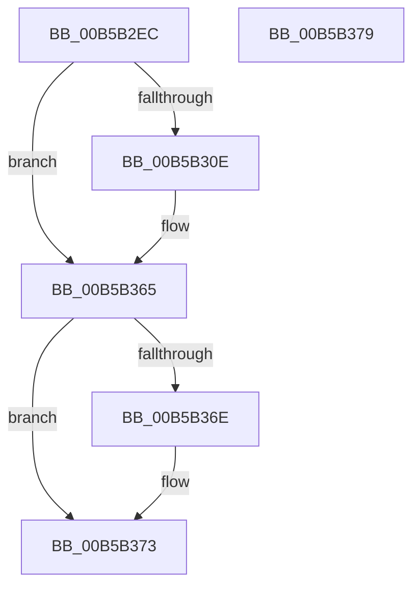

# BapdRemoveWbclData

- RVA: `0x00B5B2EC`–`0x00B5B37A` (길이 `142` bytes)
- VA: `0x0000000140B5B2EC`
- 실행 섹션: `PAGELK`
- PDB 이름 있음: `예`; PDB Function 태그: `아니요`
- unwind 정보 RVA: `0x000BE840`
- 디코드: `36`개 명령, `142/142` bytes 표시
- 미해석 바이트: `0` (있으면 어셈블리에 `.byte`로 보존)

> 이 문서는 커널 이미지의 기계어와 PDB 기호를 분석해 생성했습니다. 4번과 5번은 함수 원형과 자료형을 바이너리 사용 방식에서 추정한 C 해석이며 원본 소스 복구 결과는 아닙니다.

## 1. Dependencies

- 직접 호출 지점: **8**; 고유 호출 대상: **4**
- 직접 호출자로 확인된 함수: **1**
- RIP 상대 이미지 참조: **3**

### Outgoing calls
- `0x00B5B305` → [BapdGetISRegistryKey](../B7/BapdGetISRegistryKey_function_00B7B838.md) (function, `0x00B7B838`)
- `0x00B5B319` → [RtlInitUnicodeString](../../text/42/RtlInitUnicodeString_function_0042A780.md) (function, `0x0042A780`)
- `0x00B5B326` → [ZwDeleteValueKey](../../text/6A/ZwDeleteValueKey_function_006AECB0.md) (function, `0x006AECB0`)
- `0x00B5B336` → [RtlInitUnicodeString](../../text/42/RtlInitUnicodeString_function_0042A780.md) (function, `0x0042A780`)
- `0x00B5B343` → [ZwDeleteValueKey](../../text/6A/ZwDeleteValueKey_function_006AECB0.md) (function, `0x006AECB0`)
- `0x00B5B353` → [RtlInitUnicodeString](../../text/42/RtlInitUnicodeString_function_0042A780.md) (function, `0x0042A780`)
- `0x00B5B360` → [ZwDeleteValueKey](../../text/6A/ZwDeleteValueKey_function_006AECB0.md) (function, `0x006AECB0`)
- `0x00B5B36E` → [ZwClose](../../text/6A/ZwClose_function_006AD2B0.md) (function, `0x006AD2B0`)

### Direct callers
- [PopBootLoaderSiDataProcess](../B7/PopBootLoaderSiDataProcess_function_00B7DFA0.md) at `0x00B7DFCB`

### Static image references
- `0x00B5B30E` → RVA `0x00B80110` (` ?? ::OKHAJAOM::`string'`; read)
- `0x00B5B32B` → RVA `0x00B80040` (` ?? ::OKHAJAOM::`string'`; read)
- `0x00B5B348` → RVA `0x00B80020` (` ?? ::OKHAJAOM::`string'`; read)

## 2. Other-region calls and transfers

- 다른 실행 섹션으로 향하는 call: **7**
  - `0x00B5B319` → [RtlInitUnicodeString](../../text/42/RtlInitUnicodeString_function_0042A780.md) (`PAGELK` → `.text`)
  - `0x00B5B326` → [ZwDeleteValueKey](../../text/6A/ZwDeleteValueKey_function_006AECB0.md) (`PAGELK` → `.text`)
  - `0x00B5B336` → [RtlInitUnicodeString](../../text/42/RtlInitUnicodeString_function_0042A780.md) (`PAGELK` → `.text`)
  - `0x00B5B343` → [ZwDeleteValueKey](../../text/6A/ZwDeleteValueKey_function_006AECB0.md) (`PAGELK` → `.text`)
  - `0x00B5B353` → [RtlInitUnicodeString](../../text/42/RtlInitUnicodeString_function_0042A780.md) (`PAGELK` → `.text`)
  - `0x00B5B360` → [ZwDeleteValueKey](../../text/6A/ZwDeleteValueKey_function_006AECB0.md) (`PAGELK` → `.text`)
  - `0x00B5B36E` → [ZwClose](../../text/6A/ZwClose_function_006AD2B0.md) (`PAGELK` → `.text`)
- 별도 외부 분기/꼬리 이동을 확인하지 못했습니다.

## 3. Assembly (complete function range)

```asm
00B5B2EC  40 55                           push rbp
00B5B2EE  48 8B EC                        mov rbp, rsp
00B5B2F1  48 83 EC 30                     sub rsp, 0x30
00B5B2F5  48 83 65 10 00                  and qword ptr [rbp + 0x10], 0
00B5B2FA  48 8D 4D 10                     lea rcx, [rbp + 0x10]
00B5B2FE  0F 57 C0                        xorps xmm0, xmm0
00B5B301  0F 11 45 F0                     movups xmmword ptr [rbp - 0x10], xmm0
00B5B305  E8 2E 05 02 00                  call 0x140b7b838
00B5B30A  85 C0                           test eax, eax
00B5B30C  78 57                           js 0x140b5b365
00B5B30E  48 8D 15 FB 4D 02 00            lea rdx, [rip + 0x24dfb]
00B5B315  48 8D 4D F0                     lea rcx, [rbp - 0x10]
00B5B319  E8 62 F4 8C FF                  call 0x14042a780
00B5B31E  48 8B 4D 10                     mov rcx, qword ptr [rbp + 0x10]
00B5B322  48 8D 55 F0                     lea rdx, [rbp - 0x10]
00B5B326  E8 85 39 B5 FF                  call 0x1406aecb0
00B5B32B  48 8D 15 0E 4D 02 00            lea rdx, [rip + 0x24d0e]
00B5B332  48 8D 4D F0                     lea rcx, [rbp - 0x10]
00B5B336  E8 45 F4 8C FF                  call 0x14042a780
00B5B33B  48 8B 4D 10                     mov rcx, qword ptr [rbp + 0x10]
00B5B33F  48 8D 55 F0                     lea rdx, [rbp - 0x10]
00B5B343  E8 68 39 B5 FF                  call 0x1406aecb0
00B5B348  48 8D 15 D1 4C 02 00            lea rdx, [rip + 0x24cd1]
00B5B34F  48 8D 4D F0                     lea rcx, [rbp - 0x10]
00B5B353  E8 28 F4 8C FF                  call 0x14042a780
00B5B358  48 8B 4D 10                     mov rcx, qword ptr [rbp + 0x10]
00B5B35C  48 8D 55 F0                     lea rdx, [rbp - 0x10]
00B5B360  E8 4B 39 B5 FF                  call 0x1406aecb0
00B5B365  48 8B 4D 10                     mov rcx, qword ptr [rbp + 0x10]
00B5B369  48 85 C9                        test rcx, rcx
00B5B36C  74 05                           je 0x140b5b373
00B5B36E  E8 3D 1F B5 FF                  call 0x1406ad2b0
00B5B373  48 83 C4 30                     add rsp, 0x30
00B5B377  5D                              pop rbp
00B5B378  C3                              ret
00B5B379  CC                              int3
```

## 4. C-style interpretation (structured pseudocode)

```c
__int64 __fastcall BapdRemoveWbclData(void)
{
    __int64 result;
    __int64 v_rsp;
    unsigned __int64 v_stack_m18;
    unsigned __int64 v_stack_p8;

    v_rsp = (v_rsp) - (48);
    v_stack_m18 = v_xmm0;
    result = BapdGetISRegistryKey(v_stack_p8, a2, a3, a4);
    if (!(sign_flag)) {
        a2 = v_rip + 151035;
        a1 = v_stack_m18;
        result = RtlInitUnicodeString(a1, a2, a3, a4);
        a1 = v_stack_p8;
        a2 = v_stack_m18;
        result = ZwDeleteValueKey(a1, a2, a3, a4);
        a2 = v_rip + 150798;
        a1 = v_stack_m18;
        result = RtlInitUnicodeString(a1, a2, a3, a4);
        a1 = v_stack_p8;
        a2 = v_stack_m18;
        result = ZwDeleteValueKey(a1, a2, a3, a4);
        a2 = v_rip + 150737;
        a1 = v_stack_m18;
        result = RtlInitUnicodeString(a1, a2, a3, a4);
        a1 = v_stack_p8;
        a2 = v_stack_m18;
        result = ZwDeleteValueKey(a1, a2, a3, a4);
    }
    if (v_stack_p8 != 0) {
        result = ZwClose(v_stack_p8, a2, a3, a4);
    }
    v_rsp = (v_rsp) + (48);
    return result;
}
```

## 5. (Beta) C Style

```c
void BapdRemoveWbclData(void)
{
    int64_t result;
    int64_t local_rsp;
    uint64_t v_stack_m18;
    uint64_t v_stack_p8;

    local_rsp = (local_rsp) - (48);
    v_stack_m18 = v_xmm0;
    result = BapdGetISRegistryKey(v_stack_p8, a2, a3, a4);
    if (!(sign_flag)) {
        a2 = v_rip + 151035;
        a1 = v_stack_m18;
        result = RtlInitUnicodeString(a1, a2, a3, a4);
        a1 = v_stack_p8;
        a2 = v_stack_m18;
        result = ZwDeleteValueKey(a1, a2, a3, a4);
        a2 = v_rip + 150798;
        a1 = v_stack_m18;
        result = RtlInitUnicodeString(a1, a2, a3, a4);
        a1 = v_stack_p8;
        a2 = v_stack_m18;
        result = ZwDeleteValueKey(a1, a2, a3, a4);
        a2 = v_rip + 150737;
        a1 = v_stack_m18;
        result = RtlInitUnicodeString(a1, a2, a3, a4);
        a1 = v_stack_p8;
        a2 = v_stack_m18;
        result = ZwDeleteValueKey(a1, a2, a3, a4);
    }
    if (v_stack_p8 != 0) {
        result = ZwClose(v_stack_p8, a2, a3, a4);
    }
    local_rsp = (local_rsp) + (48);
    return result;
}
```

## 6. Execution-region graph

[열기: 2D/3D 그래프와 함수 탐색 컨트롤 패널](../../../control-panel.html?section=pagelk&rva=0x00B5B2EC&view=graph)

- 2D 그래프는 위에서 아래로 흐르고, 3D 그래프는 빈 공간을 드래그해 회전합니다. Shift+드래그는 이동, 휠은 확대·축소, 함수 노드 선택은 대상 보고서 이동입니다.

### Static fallback


