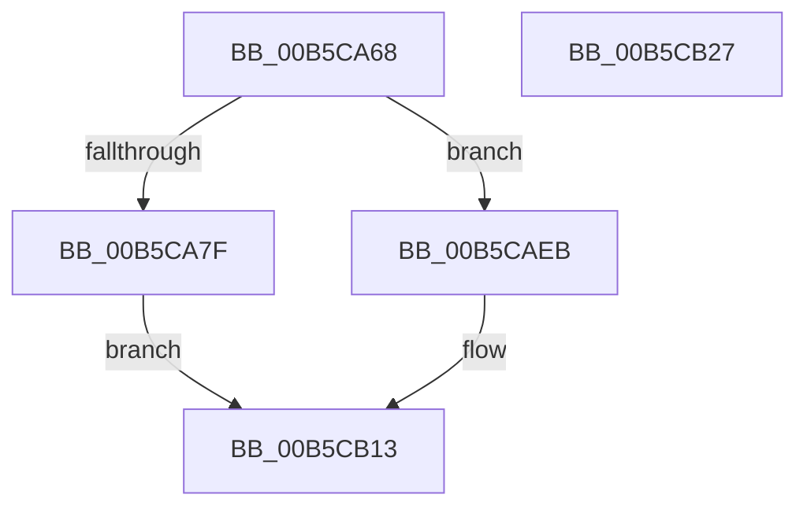

# DefaultInitializeProfilingEnhanced

- RVA: `0x00B5CA68`–`0x00B5CB28` (길이 `192` bytes)
- VA: `0x0000000140B5CA68`
- 실행 섹션: `PAGELK`
- PDB 이름 있음: `예`; PDB Function 태그: `아니요`
- unwind 정보 RVA: `0x0005CF00`
- 디코드: `46`개 명령, `192/192` bytes 표시
- 미해석 바이트: `0` (있으면 어셈블리에 `.byte`로 보존)

> 이 문서는 커널 이미지의 기계어와 PDB 기호를 분석해 생성했습니다. 4번과 5번은 함수 원형과 자료형을 바이너리 사용 방식에서 추정한 C 해석이며 원본 소스 복구 결과는 아닙니다.

## 1. Dependencies

- 직접 호출 지점: **9**; 고유 호출 대상: **3**
- 직접 호출자로 확인된 함수: **1**
- RIP 상대 이미지 참조: **11**

### Outgoing calls
- `0x00B5CAC7` → [InitCounterGroupBspEnhanced](InitCounterGroupBspEnhanced_function_00B5CCC8.md) (function, `0x00B5CCC8`)
- `0x00B5CAD0` → [InitCounterGroupBspEnhanced](InitCounterGroupBspEnhanced_function_00B5CCC8.md) (function, `0x00B5CCC8`)
- `0x00B5CADA` → [InitCounterGroupBspEnhanced](InitCounterGroupBspEnhanced_function_00B5CCC8.md) (function, `0x00B5CCC8`)
- `0x00B5CAE4` → [InitCounterGroupBspEnhanced](InitCounterGroupBspEnhanced_function_00B5CCC8.md) (function, `0x00B5CCC8`)
- `0x00B5CAED` → [InitCounterGroupAps](InitCounterGroupAps_function_00B5CC18.md) (function, `0x00B5CC18`)
- `0x00B5CAF6` → [InitCounterGroupAps](InitCounterGroupAps_function_00B5CC18.md) (function, `0x00B5CC18`)
- `0x00B5CB02` → [InitCounterGroupAps](InitCounterGroupAps_function_00B5CC18.md) (function, `0x00B5CC18`)
- `0x00B5CB0E` → [InitCounterGroupAps](InitCounterGroupAps_function_00B5CC18.md) (function, `0x00B5CC18`)
- `0x00B5CB1C` → [KeAddProcessorAffinityEx](../../text/25/KeAddProcessorAffinityEx_function_0025B6F0.md) (function, `0x0025B6F0`)

### Direct callers
- [DefaultInitializeProfiling](DefaultInitializeProfiling_function_00B5CA40.md) at `0x00B5CA4D`

### Static image references
- `0x00B5CA7F` → RVA `0x00FC2BD0` (`.data`; read/write)
- `0x00B5CA87` → RVA `0x00023F40` (`.rdata`; read)
- `0x00B5CA8E` → RVA `0x00FC2BC8` (`.data`; write)
- `0x00B5CA97` → RVA `0x00FC2C40` (`.data`; read)
- `0x00B5CA9E` → RVA `0x00FC2C20` (`.data`; write)
- `0x00B5CAA4` → RVA `0x00E03B68` (`.data`; write)
- `0x00B5CAAB` → RVA `0x00E03B70` (`.data`; write)
- `0x00B5CAB2` → RVA `0x00E03B68` (`.data`; read)
- `0x00B5CAB9` → RVA `0x00FC2C40` (`.data`; write)
- `0x00B5CAC0` → RVA `0x00FC2C48` (`.data`; write)
- `0x00B5CB15` → RVA `0x00E03B80` (`.data`; read)

## 2. Other-region calls and transfers

- 다른 실행 섹션으로 향하는 call: **1**
  - `0x00B5CB1C` → [KeAddProcessorAffinityEx](../../text/25/KeAddProcessorAffinityEx_function_0025B6F0.md) (`PAGELK` → `.text`)
- 별도 외부 분기/꼬리 이동을 확인하지 못했습니다.

## 3. Assembly (complete function range)

```asm
00B5CA68  40 53                           push rbx
00B5CA6A  48 83 EC 20                     sub rsp, 0x20
00B5CA6E  65 8B 1C 25 A4 01 00 00         mov ebx, dword ptr gs:[0x1a4]
00B5CA76  B9 01 00 00 00                  mov ecx, 1
00B5CA7B  85 DB                           test ebx, ebx
00B5CA7D  75 6C                           jne 0x140b5caeb
00B5CA7F  48 83 25 49 61 46 00 00         and qword ptr [rip + 0x466149], 0
00B5CA87  48 8D 05 B2 74 4C FF            lea rax, [rip - 0xb38b4e]
00B5CA8E  48 89 05 33 61 46 00            mov qword ptr [rip + 0x466133], rax
00B5CA95  8B D1                           mov edx, ecx
00B5CA97  48 8D 05 A2 61 46 00            lea rax, [rip + 0x4661a2]
00B5CA9E  89 0D 7C 61 46 00               mov dword ptr [rip + 0x46617c], ecx
00B5CAA4  48 89 05 BD 70 2A 00            mov qword ptr [rip + 0x2a70bd], rax
00B5CAAB  48 89 05 BE 70 2A 00            mov qword ptr [rip + 0x2a70be], rax
00B5CAB2  48 8D 05 AF 70 2A 00            lea rax, [rip + 0x2a70af]
00B5CAB9  48 89 05 80 61 46 00            mov qword ptr [rip + 0x466180], rax
00B5CAC0  48 89 05 81 61 46 00            mov qword ptr [rip + 0x466181], rax
00B5CAC7  E8 FC 01 00 00                  call 0x140b5ccc8
00B5CACC  33 D2                           xor edx, edx
00B5CACE  33 C9                           xor ecx, ecx
00B5CAD0  E8 F3 01 00 00                  call 0x140b5ccc8
00B5CAD5  33 D2                           xor edx, edx
00B5CAD7  8D 4B 64                        lea ecx, [rbx + 0x64]
00B5CADA  E8 E9 01 00 00                  call 0x140b5ccc8
00B5CADF  33 D2                           xor edx, edx
00B5CAE1  8D 4B 65                        lea ecx, [rbx + 0x65]
00B5CAE4  E8 DF 01 00 00                  call 0x140b5ccc8
00B5CAE9  EB 28                           jmp 0x140b5cb13
00B5CAEB  8B D3                           mov edx, ebx
00B5CAED  E8 26 01 00 00                  call 0x140b5cc18
00B5CAF2  8B D3                           mov edx, ebx
00B5CAF4  33 C9                           xor ecx, ecx
00B5CAF6  E8 1D 01 00 00                  call 0x140b5cc18
00B5CAFB  8B D3                           mov edx, ebx
00B5CAFD  B9 64 00 00 00                  mov ecx, 0x64
00B5CB02  E8 11 01 00 00                  call 0x140b5cc18
00B5CB07  8B D3                           mov edx, ebx
00B5CB09  B9 65 00 00 00                  mov ecx, 0x65
00B5CB0E  E8 05 01 00 00                  call 0x140b5cc18
00B5CB13  8B D3                           mov edx, ebx
00B5CB15  48 8D 0D 64 70 2A 00            lea rcx, [rip + 0x2a7064]
00B5CB1C  E8 CF EB 6F FF                  call 0x14025b6f0
00B5CB21  48 83 C4 20                     add rsp, 0x20
00B5CB25  5B                              pop rbx
00B5CB26  C3                              ret
00B5CB27  CC                              int3
```

## 4. C-style interpretation (structured pseudocode)

```c
__int64 __fastcall DefaultInitializeProfilingEnhanced(void)
{
    __int64 result;
    __int64 v_rsp;

    v_rsp = (v_rsp) - (32);
    if ((unsigned int)((unsigned int)(*(unsigned int *)(gs_base + (0 + 420)))) != 0) goto loc_00B5CAEB;
    *(unsigned __int64 *)(v_rip + 4612403) = v_rip - 11766606;
    *(unsigned int *)(v_rip + 4612476) = 1;
    *(unsigned __int64 *)(v_rip + 2781373) = v_rip + 4612514;
    *(unsigned __int64 *)(v_rip + 2781374) = v_rip + 4612514;
    *(unsigned __int64 *)(v_rip + 4612480) = v_rip + 2781359;
    *(unsigned __int64 *)(v_rip + 4612481) = v_rip + 2781359;
    result = InitCounterGroupBspEnhanced(1, 1, a3, a4);
    a2 = 0;
    a1 = 0;
    result = InitCounterGroupBspEnhanced(a1, a2, a3, a4);
    a2 = 0;
    result = InitCounterGroupBspEnhanced((unsigned int)(*(unsigned int *)(gs_base + (0 + 420))) + 100, a2, a3, a4);
    a2 = 0;
    result = InitCounterGroupBspEnhanced((unsigned int)(*(unsigned int *)(gs_base + (0 + 420))) + 101, a2, a3, a4);
    goto loc_00B5CB13;
loc_00B5CAEB:
    result = InitCounterGroupAps((unsigned int)(*(unsigned int *)(gs_base + (0 + 420))) + 101, (unsigned int)((unsigned int)((unsigned int)(*(unsigned int *)(gs_base + (0 + 420))))), a3, a4);
    a1 = 0;
    result = InitCounterGroupAps(a1, (unsigned int)((unsigned int)((unsigned int)(*(unsigned int *)(gs_base + (0 + 420))))), a3, a4);
    result = InitCounterGroupAps(100, (unsigned int)((unsigned int)((unsigned int)(*(unsigned int *)(gs_base + (0 + 420))))), a3, a4);
    result = InitCounterGroupAps(101, (unsigned int)((unsigned int)((unsigned int)(*(unsigned int *)(gs_base + (0 + 420))))), a3, a4);
loc_00B5CB13:
    result = KeAddProcessorAffinityEx(v_rip + 2781284, (unsigned int)((unsigned int)((unsigned int)(*(unsigned int *)(gs_base + (0 + 420))))), a3, a4);
    v_rsp = (v_rsp) + (32);
    return result;
}
```

## 5. (Beta) C Style

```c
void DefaultInitializeProfilingEnhanced(void)
{
    int64_t result;
    int64_t local_rsp;

    local_rsp = (local_rsp) - (32);
    if ((uint32_t)((uint32_t)(*(uint32_t *)(gs_base + (0 + 0x1A4)))) != 0) goto loc_00B5CAEB;
    *(uint64_t *)(v_rip + 0x466133) = v_rip - 11766606;
    *(uint32_t *)(v_rip + 0x46617C) = 1;
    *(uint64_t *)(v_rip + 0x2A70BD) = v_rip + 4612514;
    *(uint64_t *)(v_rip + 0x2A70BE) = v_rip + 4612514;
    *(uint64_t *)(v_rip + 0x466180) = v_rip + 2781359;
    *(uint64_t *)(v_rip + 0x466181) = v_rip + 2781359;
    result = InitCounterGroupBspEnhanced(1, 1, a3, a4);
    a2 = 0;
    a1 = 0;
    result = InitCounterGroupBspEnhanced(a1, a2, a3, a4);
    a2 = 0;
    result = InitCounterGroupBspEnhanced((uint32_t)(*(uint32_t *)(gs_base + (0 + 0x1A4))) + 100, a2, a3, a4);
    a2 = 0;
    result = InitCounterGroupBspEnhanced((uint32_t)(*(uint32_t *)(gs_base + (0 + 0x1A4))) + 101, a2, a3, a4);
    goto loc_00B5CB13;
loc_00B5CAEB:
    result = InitCounterGroupAps((uint32_t)(*(uint32_t *)(gs_base + (0 + 0x1A4))) + 101, (uint32_t)((uint32_t)((uint32_t)(*(uint32_t *)(gs_base + (0 + 0x1A4))))), a3, a4);
    a1 = 0;
    result = InitCounterGroupAps(a1, (uint32_t)((uint32_t)((uint32_t)(*(uint32_t *)(gs_base + (0 + 0x1A4))))), a3, a4);
    result = InitCounterGroupAps(100, (uint32_t)((uint32_t)((uint32_t)(*(uint32_t *)(gs_base + (0 + 0x1A4))))), a3, a4);
    result = InitCounterGroupAps(101, (uint32_t)((uint32_t)((uint32_t)(*(uint32_t *)(gs_base + (0 + 0x1A4))))), a3, a4);
loc_00B5CB13:
    result = KeAddProcessorAffinityEx(v_rip + 2781284, (uint32_t)((uint32_t)((uint32_t)(*(uint32_t *)(gs_base + (0 + 0x1A4))))), a3, a4);
    local_rsp = (local_rsp) + (32);
    return result;
}
```

## 6. Execution-region graph

[열기: 2D/3D 그래프와 함수 탐색 컨트롤 패널](../../../control-panel.html?section=pagelk&rva=0x00B5CA68&view=graph)

- 2D 그래프는 위에서 아래로 흐르고, 3D 그래프는 빈 공간을 드래그해 회전합니다. Shift+드래그는 이동, 휠은 확대·축소, 함수 노드 선택은 대상 보고서 이동입니다.

### Static fallback


