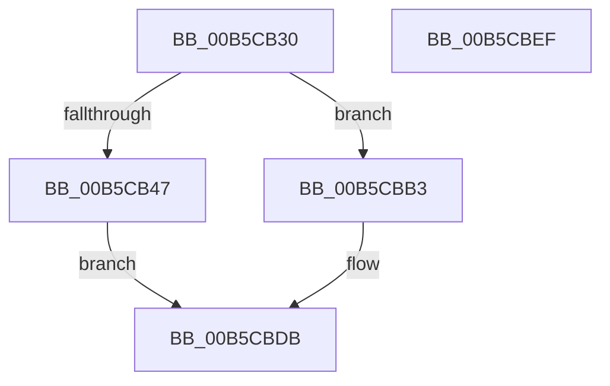

# DefaultInitializeProfilingOriginal

- RVA: `0x00B5CB30`–`0x00B5CBF0` (길이 `192` bytes)
- VA: `0x0000000140B5CB30`
- 실행 섹션: `PAGELK`
- PDB 이름 있음: `예`; PDB Function 태그: `아니요`
- unwind 정보 RVA: `0x0005CF00`
- 디코드: `46`개 명령, `192/192` bytes 표시
- 미해석 바이트: `0` (있으면 어셈블리에 `.byte`로 보존)

> 이 문서는 커널 이미지의 기계어와 PDB 기호를 분석해 생성했습니다. 4번과 5번은 함수 원형과 자료형을 바이너리 사용 방식에서 추정한 C 해석이며 원본 소스 복구 결과는 아닙니다.

## 1. Dependencies

- 직접 호출 지점: **9**; 고유 호출 대상: **3**
- 직접 호출자로 확인된 함수: **1**
- RIP 상대 이미지 참조: **11**

### Outgoing calls
- `0x00B5CB8F` → [InitCounterGroupBspOriginal](InitCounterGroupBspOriginal_function_00B5CDAC.md) (function, `0x00B5CDAC`)
- `0x00B5CB98` → [InitCounterGroupBspOriginal](InitCounterGroupBspOriginal_function_00B5CDAC.md) (function, `0x00B5CDAC`)
- `0x00B5CBA2` → [InitCounterGroupBspOriginal](InitCounterGroupBspOriginal_function_00B5CDAC.md) (function, `0x00B5CDAC`)
- `0x00B5CBAC` → [InitCounterGroupBspOriginal](InitCounterGroupBspOriginal_function_00B5CDAC.md) (function, `0x00B5CDAC`)
- `0x00B5CBB5` → [InitCounterGroupAps](InitCounterGroupAps_function_00B5CC18.md) (function, `0x00B5CC18`)
- `0x00B5CBBE` → [InitCounterGroupAps](InitCounterGroupAps_function_00B5CC18.md) (function, `0x00B5CC18`)
- `0x00B5CBCA` → [InitCounterGroupAps](InitCounterGroupAps_function_00B5CC18.md) (function, `0x00B5CC18`)
- `0x00B5CBD6` → [InitCounterGroupAps](InitCounterGroupAps_function_00B5CC18.md) (function, `0x00B5CC18`)
- `0x00B5CBE4` → [KeAddProcessorAffinityEx](../../text/25/KeAddProcessorAffinityEx_function_0025B6F0.md) (function, `0x0025B6F0`)

### Direct callers
- [DefaultInitializeProfiling](DefaultInitializeProfiling_function_00B5CA40.md) at `0x00B5CA54`

### Static image references
- `0x00B5CB47` → RVA `0x00FC2BD0` (`.data`; read/write)
- `0x00B5CB4F` → RVA `0x00023F40` (`.rdata`; read)
- `0x00B5CB56` → RVA `0x00FC2BC8` (`.data`; write)
- `0x00B5CB5F` → RVA `0x00FC2C40` (`.data`; read)
- `0x00B5CB66` → RVA `0x00FC2C20` (`.data`; write)
- `0x00B5CB6C` → RVA `0x00E03B68` (`.data`; write)
- `0x00B5CB73` → RVA `0x00E03B70` (`.data`; write)
- `0x00B5CB7A` → RVA `0x00E03B68` (`.data`; read)
- `0x00B5CB81` → RVA `0x00FC2C40` (`.data`; write)
- `0x00B5CB88` → RVA `0x00FC2C48` (`.data`; write)
- `0x00B5CBDD` → RVA `0x00E03B80` (`.data`; read)

## 2. Other-region calls and transfers

- 다른 실행 섹션으로 향하는 call: **1**
  - `0x00B5CBE4` → [KeAddProcessorAffinityEx](../../text/25/KeAddProcessorAffinityEx_function_0025B6F0.md) (`PAGELK` → `.text`)
- 별도 외부 분기/꼬리 이동을 확인하지 못했습니다.

## 3. Assembly (complete function range)

```asm
00B5CB30  40 53                           push rbx
00B5CB32  48 83 EC 20                     sub rsp, 0x20
00B5CB36  65 8B 1C 25 A4 01 00 00         mov ebx, dword ptr gs:[0x1a4]
00B5CB3E  B9 01 00 00 00                  mov ecx, 1
00B5CB43  85 DB                           test ebx, ebx
00B5CB45  75 6C                           jne 0x140b5cbb3
00B5CB47  48 83 25 81 60 46 00 00         and qword ptr [rip + 0x466081], 0
00B5CB4F  48 8D 05 EA 73 4C FF            lea rax, [rip - 0xb38c16]
00B5CB56  48 89 05 6B 60 46 00            mov qword ptr [rip + 0x46606b], rax
00B5CB5D  8B D1                           mov edx, ecx
00B5CB5F  48 8D 05 DA 60 46 00            lea rax, [rip + 0x4660da]
00B5CB66  89 0D B4 60 46 00               mov dword ptr [rip + 0x4660b4], ecx
00B5CB6C  48 89 05 F5 6F 2A 00            mov qword ptr [rip + 0x2a6ff5], rax
00B5CB73  48 89 05 F6 6F 2A 00            mov qword ptr [rip + 0x2a6ff6], rax
00B5CB7A  48 8D 05 E7 6F 2A 00            lea rax, [rip + 0x2a6fe7]
00B5CB81  48 89 05 B8 60 46 00            mov qword ptr [rip + 0x4660b8], rax
00B5CB88  48 89 05 B9 60 46 00            mov qword ptr [rip + 0x4660b9], rax
00B5CB8F  E8 18 02 00 00                  call 0x140b5cdac
00B5CB94  33 D2                           xor edx, edx
00B5CB96  33 C9                           xor ecx, ecx
00B5CB98  E8 0F 02 00 00                  call 0x140b5cdac
00B5CB9D  33 D2                           xor edx, edx
00B5CB9F  8D 4B 64                        lea ecx, [rbx + 0x64]
00B5CBA2  E8 05 02 00 00                  call 0x140b5cdac
00B5CBA7  33 D2                           xor edx, edx
00B5CBA9  8D 4B 65                        lea ecx, [rbx + 0x65]
00B5CBAC  E8 FB 01 00 00                  call 0x140b5cdac
00B5CBB1  EB 28                           jmp 0x140b5cbdb
00B5CBB3  8B D3                           mov edx, ebx
00B5CBB5  E8 5E 00 00 00                  call 0x140b5cc18
00B5CBBA  8B D3                           mov edx, ebx
00B5CBBC  33 C9                           xor ecx, ecx
00B5CBBE  E8 55 00 00 00                  call 0x140b5cc18
00B5CBC3  8B D3                           mov edx, ebx
00B5CBC5  B9 64 00 00 00                  mov ecx, 0x64
00B5CBCA  E8 49 00 00 00                  call 0x140b5cc18
00B5CBCF  8B D3                           mov edx, ebx
00B5CBD1  B9 65 00 00 00                  mov ecx, 0x65
00B5CBD6  E8 3D 00 00 00                  call 0x140b5cc18
00B5CBDB  8B D3                           mov edx, ebx
00B5CBDD  48 8D 0D 9C 6F 2A 00            lea rcx, [rip + 0x2a6f9c]
00B5CBE4  E8 07 EB 6F FF                  call 0x14025b6f0
00B5CBE9  48 83 C4 20                     add rsp, 0x20
00B5CBED  5B                              pop rbx
00B5CBEE  C3                              ret
00B5CBEF  CC                              int3
```

## 4. C-style interpretation (structured pseudocode)

```c
__int64 __fastcall DefaultInitializeProfilingOriginal(void)
{
    __int64 result;
    __int64 v_rsp;

    v_rsp = (v_rsp) - (32);
    if ((unsigned int)((unsigned int)(*(unsigned int *)(gs_base + (0 + 420)))) != 0) goto loc_00B5CBB3;
    *(unsigned __int64 *)(v_rip + 4612203) = v_rip - 11766806;
    *(unsigned int *)(v_rip + 4612276) = 1;
    *(unsigned __int64 *)(v_rip + 2781173) = v_rip + 4612314;
    *(unsigned __int64 *)(v_rip + 2781174) = v_rip + 4612314;
    *(unsigned __int64 *)(v_rip + 4612280) = v_rip + 2781159;
    *(unsigned __int64 *)(v_rip + 4612281) = v_rip + 2781159;
    result = InitCounterGroupBspOriginal(1, 1, a3, a4);
    a2 = 0;
    a1 = 0;
    result = InitCounterGroupBspOriginal(a1, a2, a3, a4);
    a2 = 0;
    result = InitCounterGroupBspOriginal((unsigned int)(*(unsigned int *)(gs_base + (0 + 420))) + 100, a2, a3, a4);
    a2 = 0;
    result = InitCounterGroupBspOriginal((unsigned int)(*(unsigned int *)(gs_base + (0 + 420))) + 101, a2, a3, a4);
    goto loc_00B5CBDB;
loc_00B5CBB3:
    result = InitCounterGroupAps((unsigned int)(*(unsigned int *)(gs_base + (0 + 420))) + 101, (unsigned int)((unsigned int)((unsigned int)(*(unsigned int *)(gs_base + (0 + 420))))), a3, a4);
    a1 = 0;
    result = InitCounterGroupAps(a1, (unsigned int)((unsigned int)((unsigned int)(*(unsigned int *)(gs_base + (0 + 420))))), a3, a4);
    result = InitCounterGroupAps(100, (unsigned int)((unsigned int)((unsigned int)(*(unsigned int *)(gs_base + (0 + 420))))), a3, a4);
    result = InitCounterGroupAps(101, (unsigned int)((unsigned int)((unsigned int)(*(unsigned int *)(gs_base + (0 + 420))))), a3, a4);
loc_00B5CBDB:
    result = KeAddProcessorAffinityEx(v_rip + 2781084, (unsigned int)((unsigned int)((unsigned int)(*(unsigned int *)(gs_base + (0 + 420))))), a3, a4);
    v_rsp = (v_rsp) + (32);
    return result;
}
```

## 5. (Beta) C Style

```c
void DefaultInitializeProfilingOriginal(void)
{
    int64_t result;
    int64_t local_rsp;

    local_rsp = (local_rsp) - (32);
    if ((uint32_t)((uint32_t)(*(uint32_t *)(gs_base + (0 + 0x1A4)))) != 0) goto loc_00B5CBB3;
    *(uint64_t *)(v_rip + 0x46606B) = v_rip - 11766806;
    *(uint32_t *)(v_rip + 0x4660B4) = 1;
    *(uint64_t *)(v_rip + 0x2A6FF5) = v_rip + 4612314;
    *(uint64_t *)(v_rip + 0x2A6FF6) = v_rip + 4612314;
    *(uint64_t *)(v_rip + 0x4660B8) = v_rip + 2781159;
    *(uint64_t *)(v_rip + 0x4660B9) = v_rip + 2781159;
    result = InitCounterGroupBspOriginal(1, 1, a3, a4);
    a2 = 0;
    a1 = 0;
    result = InitCounterGroupBspOriginal(a1, a2, a3, a4);
    a2 = 0;
    result = InitCounterGroupBspOriginal((uint32_t)(*(uint32_t *)(gs_base + (0 + 0x1A4))) + 100, a2, a3, a4);
    a2 = 0;
    result = InitCounterGroupBspOriginal((uint32_t)(*(uint32_t *)(gs_base + (0 + 0x1A4))) + 101, a2, a3, a4);
    goto loc_00B5CBDB;
loc_00B5CBB3:
    result = InitCounterGroupAps((uint32_t)(*(uint32_t *)(gs_base + (0 + 0x1A4))) + 101, (uint32_t)((uint32_t)((uint32_t)(*(uint32_t *)(gs_base + (0 + 0x1A4))))), a3, a4);
    a1 = 0;
    result = InitCounterGroupAps(a1, (uint32_t)((uint32_t)((uint32_t)(*(uint32_t *)(gs_base + (0 + 0x1A4))))), a3, a4);
    result = InitCounterGroupAps(100, (uint32_t)((uint32_t)((uint32_t)(*(uint32_t *)(gs_base + (0 + 0x1A4))))), a3, a4);
    result = InitCounterGroupAps(101, (uint32_t)((uint32_t)((uint32_t)(*(uint32_t *)(gs_base + (0 + 0x1A4))))), a3, a4);
loc_00B5CBDB:
    result = KeAddProcessorAffinityEx(v_rip + 2781084, (uint32_t)((uint32_t)((uint32_t)(*(uint32_t *)(gs_base + (0 + 0x1A4))))), a3, a4);
    local_rsp = (local_rsp) + (32);
    return result;
}
```

## 6. Execution-region graph

[열기: 2D/3D 그래프와 함수 탐색 컨트롤 패널](../../../control-panel.html?section=pagelk&rva=0x00B5CB30&view=graph)

- 2D 그래프는 위에서 아래로 흐르고, 3D 그래프는 빈 공간을 드래그해 회전합니다. Shift+드래그는 이동, 휠은 확대·축소, 함수 노드 선택은 대상 보고서 이동입니다.

### Static fallback


