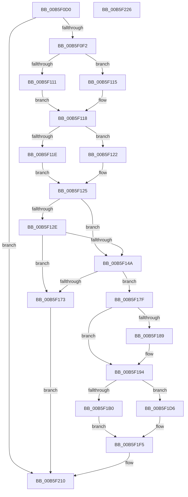

# EmonCompleteInitializeProfiling

- RVA: `0x00B5F0D0`–`0x00B5F227` (길이 `343` bytes)
- VA: `0x0000000140B5F0D0`
- 실행 섹션: `PAGELK`
- PDB 이름 있음: `예`; PDB Function 태그: `아니요`
- unwind 정보 RVA: `0x000A85B0`
- 디코드: `95`개 명령, `343/343` bytes 표시
- 미해석 바이트: `0` (있으면 어셈블리에 `.byte`로 보존)

> 이 문서는 커널 이미지의 기계어와 PDB 기호를 분석해 생성했습니다. 4번과 5번은 함수 원형과 자료형을 바이너리 사용 방식에서 추정한 C 해석이며 원본 소스 복구 결과는 아닙니다.

## 1. Dependencies

- 직접 호출 지점: **6**; 고유 호출 대상: **3**
- 직접 호출자로 확인된 함수: **0**
- RIP 상대 이미지 참조: **6**

### Outgoing calls
- `0x00B5F12E` → [HalpQueryMaximumRegisteredProcessorCount](../../text/54/HalpQueryMaximumRegisteredProcessorCount_function_00543BE8.md) (function, `0x00543BE8`)
- `0x00B5F141` → [KeAllocateProcessorProfileStructures](../../text/5B/KeAllocateProcessorProfileStructures_function_005B14B0.md) (function, `0x005B14B0`)
- `0x00B5F16A` → [KeAllocateProcessorProfileStructures](../../text/5B/KeAllocateProcessorProfileStructures_function_005B14B0.md) (function, `0x005B14B0`)
- `0x00B5F1C8` → [memset](../../text/6C/memset_function_006C6C40.md) (function, `0x006C6C40`)
- `0x00B5F1EC` → [memset](../../text/6C/memset_function_006C6C40.md) (function, `0x006C6C40`)
- `0x00B5F1FA` → [memset](../../text/6C/memset_function_006C6C40.md) (function, `0x006C6C40`)

### Direct callers
- 이 함수 시작 RVA로 연결되는 직접 call은 확인되지 않았습니다. 간접 호출은 완전히 역산할 수 없습니다.

### Static image references
- `0x00B5F0E5` → RVA `0x00F8FDF8` (`.data`; read)
- `0x00B5F0FA` → RVA `0x00FC8C40` (`ALMOSTRO`; read)
- `0x00B5F135` → RVA `0x00F8FDF0` (`.data`; read)
- `0x00B5F173` → RVA `0x00F8FDF8` (`.data`; write)
- `0x00B5F17F` → RVA `0x00F8FE20` (`.data`; read)
- `0x00B5F1A8` → RVA `0x00F8FDF9` (`.data`; read)

## 2. Other-region calls and transfers

- 다른 실행 섹션으로 향하는 call: **6**
  - `0x00B5F12E` → [HalpQueryMaximumRegisteredProcessorCount](../../text/54/HalpQueryMaximumRegisteredProcessorCount_function_00543BE8.md) (`PAGELK` → `.text`)
  - `0x00B5F141` → [KeAllocateProcessorProfileStructures](../../text/5B/KeAllocateProcessorProfileStructures_function_005B14B0.md) (`PAGELK` → `.text`)
  - `0x00B5F16A` → [KeAllocateProcessorProfileStructures](../../text/5B/KeAllocateProcessorProfileStructures_function_005B14B0.md) (`PAGELK` → `.text`)
  - `0x00B5F1C8` → [memset](../../text/6C/memset_function_006C6C40.md) (`PAGELK` → `.text`)
  - `0x00B5F1EC` → [memset](../../text/6C/memset_function_006C6C40.md) (`PAGELK` → `.text`)
  - `0x00B5F1FA` → [memset](../../text/6C/memset_function_006C6C40.md) (`PAGELK` → `.text`)
- 별도 외부 분기/꼬리 이동을 확인하지 못했습니다.

## 3. Assembly (complete function range)

```asm
00B5F0D0  48 89 5C 24 10                  mov qword ptr [rsp + 0x10], rbx
00B5F0D5  48 89 74 24 18                  mov qword ptr [rsp + 0x18], rsi
00B5F0DA  48 89 7C 24 20                  mov qword ptr [rsp + 0x20], rdi
00B5F0DF  41 56                           push r14
00B5F0E1  48 83 EC 20                     sub rsp, 0x20
00B5F0E5  80 3D 0C 0D 43 00 00            cmp byte ptr [rip + 0x430d0c], 0
00B5F0EC  0F 84 1E 01 00 00               je 0x140b5f210
00B5F0F2  65 8B 14 25 A4 01 00 00         mov edx, dword ptr gs:[0x1a4]
00B5F0FA  48 8D 0D 3F 9B 46 00            lea rcx, [rip + 0x469b3f]
00B5F101  44 8B F2                        mov r14d, edx
00B5F104  48 8B 0C D1                     mov rcx, qword ptr [rcx + rdx*8]
00B5F108  48 8B 41 58                     mov rax, qword ptr [rcx + 0x58]
00B5F10C  48 85 C0                        test rax, rax
00B5F10F  75 04                           jne 0x140b5f115
00B5F111  33 FF                           xor edi, edi
00B5F113  EB 03                           jmp 0x140b5f118
00B5F115  8B 78 04                        mov edi, dword ptr [rax + 4]
00B5F118  48 83 C0 18                     add rax, 0x18
00B5F11C  75 04                           jne 0x140b5f122
00B5F11E  33 DB                           xor ebx, ebx
00B5F120  EB 03                           jmp 0x140b5f125
00B5F122  8B 58 04                        mov ebx, dword ptr [rax + 4]
00B5F125  BE 00 10 00 00                  mov esi, 0x1000
00B5F12A  85 D2                           test edx, edx
00B5F12C  75 1C                           jne 0x140b5f14a
00B5F12E  E8 B5 4A 9E FF                  call 0x140543be8
00B5F133  8B C8                           mov ecx, eax
00B5F135  4C 8D 05 B4 0C 43 00            lea r8, [rip + 0x430cb4]
00B5F13C  41 B1 01                        mov r9b, 1
00B5F13F  8B D6                           mov edx, esi
00B5F141  E8 6A 23 A5 FF                  call 0x1405b14b0
00B5F146  85 C0                           test eax, eax
00B5F148  78 29                           js 0x140b5f173
00B5F14A  4B 8D 04 B6                     lea rax, [r14 + r14*4]
00B5F14E  45 33 C9                        xor r9d, r9d
00B5F151  48 C1 E0 05                     shl rax, 5
00B5F155  4C 8D 44 24 30                  lea r8, [rsp + 0x30]
00B5F15A  48 03 05 8F 0C 43 00            add rax, qword ptr [rip + 0x430c8f]
00B5F161  33 D2                           xor edx, edx
00B5F163  33 C9                           xor ecx, ecx
00B5F165  48 89 44 24 30                  mov qword ptr [rsp + 0x30], rax
00B5F16A  E8 41 23 A5 FF                  call 0x1405b14b0
00B5F16F  85 C0                           test eax, eax
00B5F171  79 0C                           jns 0x140b5f17f
00B5F173  C6 05 7E 0C 43 00 00            mov byte ptr [rip + 0x430c7e], 0
00B5F17A  E9 91 00 00 00                  jmp 0x140b5f210
00B5F17F  8B 0D 9B 0C 43 00               mov ecx, dword ptr [rip + 0x430c9b]
00B5F185  85 C9                           test ecx, ecx
00B5F187  74 0B                           je 0x140b5f194
00B5F189  33 D2                           xor edx, edx
00B5F18B  8B C6                           mov eax, esi
00B5F18D  F7 F1                           div ecx
00B5F18F  0F AF C1                        imul eax, ecx
00B5F192  8B F0                           mov esi, eax
00B5F194  44 8B C7                        mov r8d, edi
00B5F197  33 D2                           xor edx, edx
00B5F199  8B FB                           mov edi, ebx
00B5F19B  48 8B 5C 24 30                  mov rbx, qword ptr [rsp + 0x30]
00B5F1A0  48 C1 E7 03                     shl rdi, 3
00B5F1A4  49 C1 E0 03                     shl r8, 3
00B5F1A8  38 15 4B 0C 43 00               cmp byte ptr [rip + 0x430c4b], dl
00B5F1AE  74 26                           je 0x140b5f1d6
00B5F1B0  48 8B 4B 20                     mov rcx, qword ptr [rbx + 0x20]
00B5F1B4  48 89 4B 28                     mov qword ptr [rbx + 0x28], rcx
00B5F1B8  48 8D 04 0E                     lea rax, [rsi + rcx]
00B5F1BC  48 89 43 30                     mov qword ptr [rbx + 0x30], rax
00B5F1C0  48 89 4B 38                     mov qword ptr [rbx + 0x38], rcx
00B5F1C4  48 8D 4B 40                     lea rcx, [rbx + 0x40]
00B5F1C8  E8 73 7A B6 FF                  call 0x1406c6c40
00B5F1CD  48 8D 8B 80 00 00 00            lea rcx, [rbx + 0x80]
00B5F1D4  EB 1F                           jmp 0x140b5f1f5
00B5F1D6  8B 4B 10                        mov ecx, dword ptr [rbx + 0x10]
00B5F1D9  89 4B 10                        mov dword ptr [rbx + 0x10], ecx
00B5F1DC  89 4B 14                        mov dword ptr [rbx + 0x14], ecx
00B5F1DF  8D 04 31                        lea eax, [rcx + rsi]
00B5F1E2  89 43 18                        mov dword ptr [rbx + 0x18], eax
00B5F1E5  89 4B 1C                        mov dword ptr [rbx + 0x1c], ecx
00B5F1E8  48 8D 4B 20                     lea rcx, [rbx + 0x20]
00B5F1EC  E8 4F 7A B6 FF                  call 0x1406c6c40
00B5F1F1  48 8D 4B 60                     lea rcx, [rbx + 0x60]
00B5F1F5  4C 8B C7                        mov r8, rdi
00B5F1F8  33 D2                           xor edx, edx
00B5F1FA  E8 41 7A B6 FF                  call 0x1406c6c40
00B5F1FF  48 8B D3                        mov rdx, rbx
00B5F202  48 8B C3                        mov rax, rbx
00B5F205  48 C1 EA 20                     shr rdx, 0x20
00B5F209  B9 00 06 00 00                  mov ecx, 0x600
00B5F20E  0F 30                           wrmsr
00B5F210  48 8B 5C 24 38                  mov rbx, qword ptr [rsp + 0x38]
00B5F215  48 8B 74 24 40                  mov rsi, qword ptr [rsp + 0x40]
00B5F21A  48 8B 7C 24 48                  mov rdi, qword ptr [rsp + 0x48]
00B5F21F  48 83 C4 20                     add rsp, 0x20
00B5F223  41 5E                           pop r14
00B5F225  C3                              ret
00B5F226  CC                              int3
```

## 4. C-style interpretation (structured pseudocode)

```c
__int64 __fastcall EmonCompleteInitializeProfiling(void)
{
    __int64 result;
    __int64 v_rbx;
    __int64 v_rdi;
    __int64 v_rsi;
    __int64 v_rsp;
    unsigned __int64 v_stack_p10;
    unsigned __int64 v_stack_p18;
    unsigned __int64 v_stack_p20;
    unsigned __int64 v_stack_p8;

    v_stack_p10 = v_rbx;
    v_stack_p18 = v_rsi;
    v_stack_p20 = v_rdi;
    v_rsp = (v_rsp) - (32);
    if ((*(unsigned __int8 *)(v_rip + 4394252)) == 0) goto loc_00B5F210;
    if (*(unsigned __int64 *)(*(unsigned __int64 *)(v_rip + 4627263 + (unsigned int)(*(unsigned int *)(gs_base + (0 + 420))) * 8) + 88) != 0) goto loc_00B5F115;
    v_rdi = 0;
    goto loc_00B5F118;
loc_00B5F115:
loc_00B5F118:
    result = (*(unsigned __int64 *)(*(unsigned __int64 *)(v_rip + 4627263 + (unsigned int)(*(unsigned int *)(gs_base + (0 + 420))) * 8) + 88)) + (24);
    if (condition_is_not_equal) goto loc_00B5F122;
    v_rbx = 0;
    goto loc_00B5F125;
loc_00B5F122:
loc_00B5F125:
    if ((unsigned int)((unsigned int)(*(unsigned int *)(gs_base + (0 + 420)))) != 0) goto loc_00B5F14A;
    result = HalpQueryMaximumRegisteredProcessorCount(*(unsigned __int64 *)(v_rip + 4627263 + (unsigned int)(*(unsigned int *)(gs_base + (0 + 420))) * 8), (unsigned int)(*(unsigned int *)(gs_base + (0 + 420))), a3, a4);
    result = KeAllocateProcessorProfileStructures((unsigned int)((unsigned int)(result)), (unsigned int)((unsigned int)((unsigned int)(0x1000ULL))), v_rip + 4394164, 1);
    if (sign_flag) goto loc_00B5F173;
loc_00B5F14A:
    a4 = 0;
    result = ((unsigned int)((unsigned int)((unsigned int)(*(unsigned int *)(gs_base + (0 + 420))))) + (unsigned int)((unsigned int)((unsigned int)(*(unsigned int *)(gs_base + (0 + 420))))) * 4) << (5);
    result = (result) + (*(unsigned __int64 *)(v_rip + 4394127));
    a2 = 0;
    a1 = 0;
    v_stack_p8 = result;
    result = KeAllocateProcessorProfileStructures(a1, a2, v_stack_p8, a4);
    if (!sign_flag) goto loc_00B5F17F;
loc_00B5F173:
    *(unsigned __int8 *)(v_rip + 4394110) = 0;
    goto loc_00B5F210;
loc_00B5F17F:
    v_rsi = (unsigned int)(0x1000ULL);
    if ((unsigned int)((unsigned int)(*(unsigned int *)(v_rip + 4394139))) != 0) {
        a2 = 0;
        result = (unsigned int)((unsigned int)(0x1000ULL));
        result = (unsigned int)((result) * ((unsigned int)((unsigned int)(*(unsigned int *)(v_rip + 4394139)))));
        v_rsi = (unsigned int)(result);
    }
    a2 = 0;
    v_rdi = ((unsigned int)((unsigned int)((unsigned int)(*(unsigned int *)(result + 4))))) << (3);
    a3 = ((unsigned int)((unsigned int)((unsigned int)(*(unsigned int *)(*(unsigned __int64 *)(*(unsigned __int64 *)(v_rip + 4627263 + (unsigned int)(*(unsigned int *)(gs_base + (0 + 420))) * 8) + 88) + 4))))) << (3);
    if ((*(unsigned __int8 *)(v_rip + 4394059)) == 0) goto loc_00B5F1D6;
    *(unsigned __int64 *)(v_stack_p8 + 40) = *(unsigned __int64 *)(v_stack_p8 + 32);
    *(unsigned __int64 *)(v_stack_p8 + 48) = v_rsi + *(unsigned __int64 *)(v_stack_p8 + 32) * 1;
    *(unsigned __int64 *)(v_stack_p8 + 56) = *(unsigned __int64 *)(v_stack_p8 + 32);
    result = memset(v_stack_p8 + 64, a2, a3, a4);
    goto loc_00B5F1F5;
loc_00B5F1D6:
    *(unsigned int *)(v_stack_p8 + 16) = (unsigned int)((unsigned int)(*(unsigned int *)(v_stack_p8 + 16)));
    *(unsigned int *)(v_stack_p8 + 20) = (unsigned int)((unsigned int)(*(unsigned int *)(v_stack_p8 + 16)));
    *(unsigned int *)(v_stack_p8 + 24) = (unsigned int)((unsigned int)(*(unsigned int *)(v_stack_p8 + 16)) + v_rsi * 1);
    *(unsigned int *)(v_stack_p8 + 28) = (unsigned int)((unsigned int)(*(unsigned int *)(v_stack_p8 + 16)));
    result = memset(v_stack_p8 + 32, a2, a3, a4);
loc_00B5F1F5:
    a2 = 0;
    result = memset(v_stack_p8 + 96, a2, v_rdi, a4);
    a2 = (v_stack_p8) >> (32);
loc_00B5F210:
    v_rsp = (v_rsp) + (32);
    return v_stack_p8;
}
```

## 5. (Beta) C Style

```c
void EmonCompleteInitializeProfiling(void)
{
    int64_t result;
    int64_t local_rbx;
    int64_t local_rdi;
    int64_t local_rsi;
    int64_t local_rsp;
    uint64_t v_stack_p10;
    uint64_t v_stack_p18;
    uint64_t v_stack_p20;
    uint64_t v_stack_p8;

    v_stack_p10 = local_rbx;
    v_stack_p18 = local_rsi;
    v_stack_p20 = local_rdi;
    local_rsp = (local_rsp) - (32);
    if ((*(uint8_t *)(v_rip + 0x430D0C)) == 0) goto loc_00B5F210;
    if (*(uint64_t *)(*(uint64_t *)(v_rip + 0x469B3F + (uint32_t)(*(uint32_t *)(gs_base + (0 + 0x1A4))) * 8) + 0x58) != 0) goto loc_00B5F115;
    local_rdi = 0;
    goto loc_00B5F118;
loc_00B5F115:
loc_00B5F118:
    result = (*(uint64_t *)(*(uint64_t *)(v_rip + 0x469B3F + (uint32_t)(*(uint32_t *)(gs_base + (0 + 0x1A4))) * 8) + 0x58)) + (24);
    if (condition_is_not_equal) goto loc_00B5F122;
    local_rbx = 0;
    goto loc_00B5F125;
loc_00B5F122:
loc_00B5F125:
    if ((uint32_t)((uint32_t)(*(uint32_t *)(gs_base + (0 + 0x1A4)))) != 0) goto loc_00B5F14A;
    result = HalpQueryMaximumRegisteredProcessorCount(*(uint64_t *)(v_rip + 0x469B3F + (uint32_t)(*(uint32_t *)(gs_base + (0 + 0x1A4))) * 8), (uint32_t)(*(uint32_t *)(gs_base + (0 + 0x1A4))), a3, a4);
    result = KeAllocateProcessorProfileStructures((uint32_t)((uint32_t)(result)), (uint32_t)((uint32_t)((uint32_t)(0x1000ULL))), v_rip + 4394164, 1);
    if (sign_flag) goto loc_00B5F173;
loc_00B5F14A:
    a4 = 0;
    result = ((uint32_t)((uint32_t)((uint32_t)(*(uint32_t *)(gs_base + (0 + 0x1A4))))) + (uint32_t)((uint32_t)((uint32_t)(*(uint32_t *)(gs_base + (0 + 0x1A4))))) * 4) << (5);
    result = (result) + (*(uint64_t *)(v_rip + 0x430C8F));
    a2 = 0;
    a1 = 0;
    v_stack_p8 = result;
    result = KeAllocateProcessorProfileStructures(a1, a2, v_stack_p8, a4);
    if (!sign_flag) goto loc_00B5F17F;
loc_00B5F173:
    *(uint8_t *)(v_rip + 0x430C7E) = 0;
    goto loc_00B5F210;
loc_00B5F17F:
    local_rsi = (uint32_t)(0x1000ULL);
    if ((uint32_t)((uint32_t)(*(uint32_t *)(v_rip + 0x430C9B))) != 0) {
        a2 = 0;
        result = (uint32_t)((uint32_t)(0x1000ULL));
        result = (uint32_t)((result) * ((uint32_t)((uint32_t)(*(uint32_t *)(v_rip + 0x430C9B)))));
        local_rsi = (uint32_t)(result);
    }
    a2 = 0;
    local_rdi = ((uint32_t)((uint32_t)((uint32_t)(*(uint32_t *)(result + 0x4))))) << (3);
    a3 = ((uint32_t)((uint32_t)((uint32_t)(*(uint32_t *)(*(uint64_t *)(*(uint64_t *)(v_rip + 0x469B3F + (uint32_t)(*(uint32_t *)(gs_base + (0 + 0x1A4))) * 8) + 0x58) + 0x4))))) << (3);
    if ((*(uint8_t *)(v_rip + 0x430C4B)) == 0) goto loc_00B5F1D6;
    *(uint64_t *)(v_stack_p8 + 0x28) = *(uint64_t *)(v_stack_p8 + 0x20);
    *(uint64_t *)(v_stack_p8 + 0x30) = local_rsi + *(uint64_t *)(v_stack_p8 + 0x20) * 1;
    *(uint64_t *)(v_stack_p8 + 0x38) = *(uint64_t *)(v_stack_p8 + 0x20);
    result = memset(v_stack_p8 + 64, a2, a3, a4);
    goto loc_00B5F1F5;
loc_00B5F1D6:
    *(uint32_t *)(v_stack_p8 + 0x10) = (uint32_t)((uint32_t)(*(uint32_t *)(v_stack_p8 + 0x10)));
    *(uint32_t *)(v_stack_p8 + 0x14) = (uint32_t)((uint32_t)(*(uint32_t *)(v_stack_p8 + 0x10)));
    *(uint32_t *)(v_stack_p8 + 0x18) = (uint32_t)((uint32_t)(*(uint32_t *)(v_stack_p8 + 0x10)) + local_rsi * 1);
    *(uint32_t *)(v_stack_p8 + 0x1C) = (uint32_t)((uint32_t)(*(uint32_t *)(v_stack_p8 + 0x10)));
    result = memset(v_stack_p8 + 32, a2, a3, a4);
loc_00B5F1F5:
    a2 = 0;
    result = memset(v_stack_p8 + 96, a2, local_rdi, a4);
    a2 = (v_stack_p8) >> (32);
loc_00B5F210:
    local_rsp = (local_rsp) + (32);
    return v_stack_p8;
}
```

## 6. Execution-region graph

[열기: 2D/3D 그래프와 함수 탐색 컨트롤 패널](../../../control-panel.html?section=pagelk&rva=0x00B5F0D0&view=graph)

- 2D 그래프는 위에서 아래로 흐르고, 3D 그래프는 빈 공간을 드래그해 회전합니다. Shift+드래그는 이동, 휠은 확대·축소, 함수 노드 선택은 대상 보고서 이동입니다.

### Static fallback


