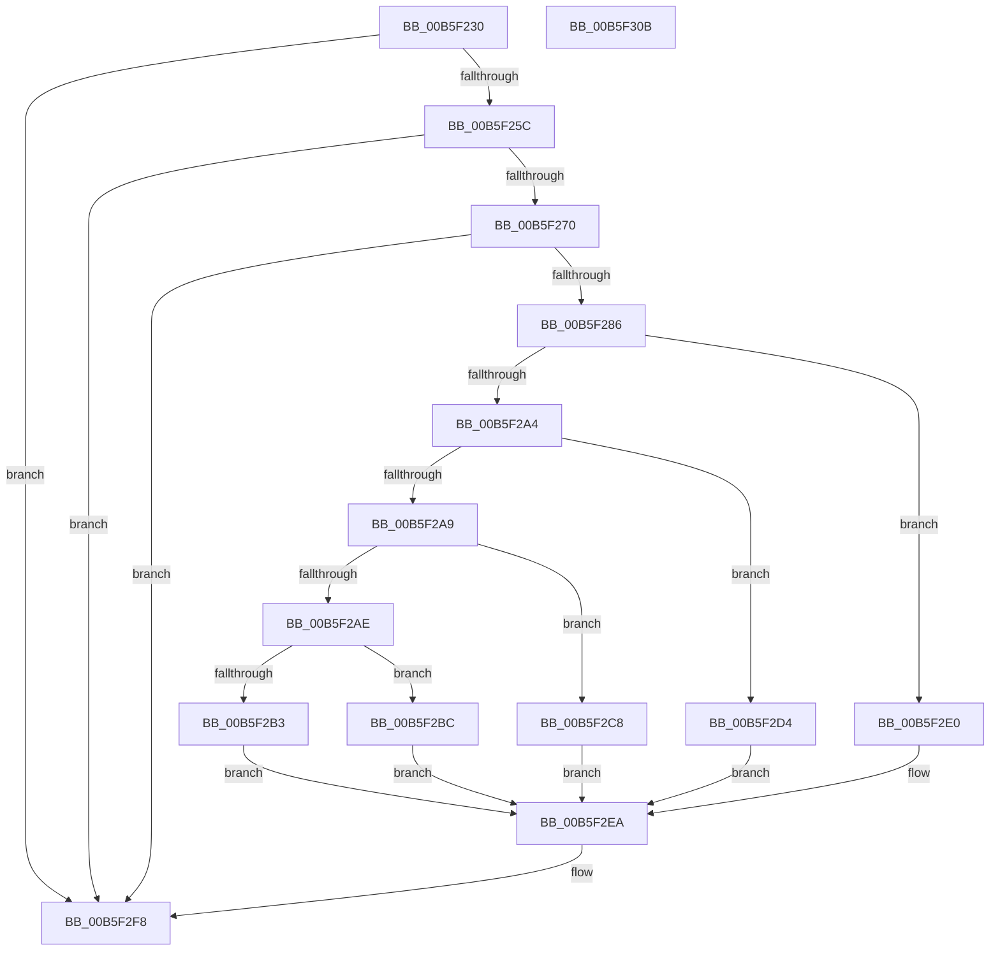

# EmonInitializePebs

- RVA: `0x00B5F230`–`0x00B5F30C` (길이 `220` bytes)
- VA: `0x0000000140B5F230`
- 실행 섹션: `PAGELK`
- PDB 이름 있음: `예`; PDB Function 태그: `아니요`
- unwind 정보 RVA: `0x000B64AC`
- 디코드: `54`개 명령, `220/220` bytes 표시
- 미해석 바이트: `0` (있으면 어셈블리에 `.byte`로 보존)

> 이 문서는 커널 이미지의 기계어와 PDB 기호를 분석해 생성했습니다. 4번과 5번은 함수 원형과 자료형을 바이너리 사용 방식에서 추정한 C 해석이며 원본 소스 복구 결과는 아닙니다.

## 1. Dependencies

- 직접 호출 지점: **1**; 고유 호출 대상: **1**
- 직접 호출자로 확인된 함수: **2**
- RIP 상대 이미지 참조: **6**

### Outgoing calls
- `0x00B5F300` → [_security_check_cookie](../../text/6A/_security_check_cookie_function_006AC640.md) (function, `0x006AC640`)

### Direct callers
- [EmonInitializeProfilingBSP](../../text/55/EmonInitializeProfilingBSP_function_0055D0D8.md) at `0x0055D25E`
- [EmonInitializeProfilingOriginal](EmonInitializeProfilingOriginal_function_00B5F630.md) at `0x00B5F9B7`

### Static image references
- `0x00B5F236` → RVA `0x00E0A740` (`.data`; read)
- `0x00B5F248` → RVA `0x00F8FDE0` (`.data`; read)
- `0x00B5F24F` → RVA `0x00F8FDF8` (`.data`; write)
- `0x00B5F286` → RVA `0x00F8FDF9` (`.data`; write)
- `0x00B5F2B3` → RVA `0x00F8FE20` (`.data`; write)
- `0x00B5F2F1` → RVA `0x00F8FE1C` (`.data`; write)

## 2. Other-region calls and transfers

- 다른 실행 섹션으로 향하는 call: **1**
  - `0x00B5F300` → [_security_check_cookie](../../text/6A/_security_check_cookie_function_006AC640.md) (`PAGELK` → `.text`)
- 별도 외부 분기/꼬리 이동을 확인하지 못했습니다.

## 3. Assembly (complete function range)

```asm
00B5F230  40 53                           push rbx
00B5F232  48 83 EC 20                     sub rsp, 0x20
00B5F236  48 8B 05 03 B5 2A 00            mov rax, qword ptr [rip + 0x2ab503]
00B5F23D  48 33 C4                        xor rax, rsp
00B5F240  48 89 44 24 10                  mov qword ptr [rsp + 0x10], rax
00B5F245  45 33 C0                        xor r8d, r8d
00B5F248  83 3D 91 0B 43 00 02            cmp dword ptr [rip + 0x430b91], 2
00B5F24F  44 88 05 A2 0B 43 00            mov byte ptr [rip + 0x430ba2], r8b
00B5F256  0F 82 9C 00 00 00               jb 0x140b5f2f8
00B5F25C  33 C9                           xor ecx, ecx
00B5F25E  41 8D 40 01                     lea eax, [r8 + 1]
00B5F262  0F A2                           cpuid
00B5F264  C1 EA 15                        shr edx, 0x15
00B5F267  F6 C2 01                        test dl, 1
00B5F26A  0F 84 88 00 00 00               je 0x140b5f2f8
00B5F270  B9 A0 01 00 00                  mov ecx, 0x1a0
00B5F275  0F 32                           rdmsr
00B5F277  48 C1 E2 20                     shl rdx, 0x20
00B5F27B  48 0B C2                        or rax, rdx
00B5F27E  48 C1 E8 0C                     shr rax, 0xc
00B5F282  A8 01                           test al, 1
00B5F284  75 72                           jne 0x140b5f2f8
00B5F286  C6 05 6C 0B 43 00 01            mov byte ptr [rip + 0x430b6c], 1
00B5F28D  B9 45 03 00 00                  mov ecx, 0x345
00B5F292  0F 32                           rdmsr
00B5F294  48 C1 E2 20                     shl rdx, 0x20
00B5F298  48 0B C2                        or rax, rdx
00B5F29B  48 C1 E8 08                     shr rax, 8
00B5F29F  83 E0 0F                        and eax, 0xf
00B5F2A2  74 3C                           je 0x140b5f2e0
00B5F2A4  83 E8 01                        sub eax, 1
00B5F2A7  74 2B                           je 0x140b5f2d4
00B5F2A9  83 E8 01                        sub eax, 1
00B5F2AC  74 1A                           je 0x140b5f2c8
00B5F2AE  83 F8 01                        cmp eax, 1
00B5F2B1  74 09                           je 0x140b5f2bc
00B5F2B3  44 89 05 66 0B 43 00            mov dword ptr [rip + 0x430b66], r8d
00B5F2BA  EB 2E                           jmp 0x140b5f2ea
00B5F2BC  C7 05 5A 0B 43 00 C8 00 00 00   mov dword ptr [rip + 0x430b5a], 0xc8
00B5F2C6  EB 22                           jmp 0x140b5f2ea
00B5F2C8  C7 05 4E 0B 43 00 C0 00 00 00   mov dword ptr [rip + 0x430b4e], 0xc0
00B5F2D2  EB 16                           jmp 0x140b5f2ea
00B5F2D4  C7 05 42 0B 43 00 B0 00 00 00   mov dword ptr [rip + 0x430b42], 0xb0
00B5F2DE  EB 0A                           jmp 0x140b5f2ea
00B5F2E0  C7 05 36 0B 43 00 90 00 00 00   mov dword ptr [rip + 0x430b36], 0x90
00B5F2EA  C6 05 07 0B 43 00 01            mov byte ptr [rip + 0x430b07], 1
00B5F2F1  44 89 05 24 0B 43 00            mov dword ptr [rip + 0x430b24], r8d
00B5F2F8  48 8B 4C 24 10                  mov rcx, qword ptr [rsp + 0x10]
00B5F2FD  48 33 CC                        xor rcx, rsp
00B5F300  E8 3B D3 B4 FF                  call 0x1406ac640
00B5F305  48 83 C4 20                     add rsp, 0x20
00B5F309  5B                              pop rbx
00B5F30A  C3                              ret
00B5F30B  CC                              int3
```

## 4. C-style interpretation (structured pseudocode)

```c
__int64 __fastcall EmonInitializePebs(int a1, int a2, int a3)
{
    __int64 result;
    __int64 v_rsp;
    unsigned __int64 v_stack_m18;

    v_rsp = (v_rsp) - (32);
    result = (*(unsigned __int64 *)(v_rip + 2798851)) ^ (v_rsp);
    v_stack_m18 = result;
    a3 = 0;
    *(unsigned __int8 *)(v_rip + 4393890) = 0;
    if ((*(unsigned int *)(v_rip + 4393873)) < 2) goto loc_00B5F2F8;
    a1 = 0;
    a2 = (unsigned int)((a2) >> (21));
    if ((((unsigned __int8)(a2)) & (1)) == 0) goto loc_00B5F2F8;
    a2 = (a2) << (32);
    result = (a3 + 1) | (a2);
    result = (result) >> (12);
    if ((((unsigned __int8)(result)) & (1)) != 0) goto loc_00B5F2F8;
    *(unsigned __int8 *)(v_rip + 4393836) = 1;
    a2 = (a2) << (32);
    result = (result) | (a2);
    result = (result) >> (8);
    result = (unsigned int)((result) & (15));
    if (condition_is_equal) goto loc_00B5F2E0;
    result = (unsigned int)((result) - (1));
    if (condition_is_equal) goto loc_00B5F2D4;
    result = (unsigned int)((result) - (1));
    if (condition_is_equal) goto loc_00B5F2C8;
    if (((unsigned int)(result)) == 1) goto loc_00B5F2BC;
    *(unsigned int *)(v_rip + 4393830) = 0;
    goto loc_00B5F2EA;
loc_00B5F2BC:
    *(unsigned int *)(v_rip + 4393818) = 200;
    goto loc_00B5F2EA;
loc_00B5F2C8:
    *(unsigned int *)(v_rip + 4393806) = 192;
    goto loc_00B5F2EA;
loc_00B5F2D4:
    *(unsigned int *)(v_rip + 4393794) = 176;
    goto loc_00B5F2EA;
loc_00B5F2E0:
    *(unsigned int *)(v_rip + 4393782) = 144;
loc_00B5F2EA:
    *(unsigned __int8 *)(v_rip + 4393735) = 1;
    *(unsigned int *)(v_rip + 4393764) = 0;
loc_00B5F2F8:
    a1 = (v_stack_m18) ^ (v_rsp);
    result = _security_check_cookie(a1, a2, a3, a4);
    v_rsp = (v_rsp) + (32);
    return result;
}
```

## 5. (Beta) C Style

```c
int64_t EmonInitializePebs(int32_t Arg1, int32_t Arg2, int32_t Arg3)
{
    int64_t result;
    int64_t local_rsp;
    uint64_t v_stack_m18;

    local_rsp = (local_rsp) - (32);
    result = (*(uint64_t *)(v_rip + 0x2AB503)) ^ (local_rsp);
    v_stack_m18 = result;
    Arg3 = 0;
    *(uint8_t *)(v_rip + 0x430BA2) = 0;
    if ((*(uint32_t *)(v_rip + 0x430B91)) < 2) goto loc_00B5F2F8;
    Arg1 = 0;
    Arg2 = (uint32_t)((Arg2) >> (21));
    if ((((uint8_t)(Arg2)) & (1)) == 0) goto loc_00B5F2F8;
    Arg2 = (Arg2) << (32);
    result = (Arg3 + 1) | (Arg2);
    result = (result) >> (12);
    if ((((uint8_t)(result)) & (1)) != 0) goto loc_00B5F2F8;
    *(uint8_t *)(v_rip + 0x430B6C) = 1;
    Arg2 = (Arg2) << (32);
    result = (result) | (Arg2);
    result = (result) >> (8);
    result = (uint32_t)((result) & (15));
    if (condition_is_equal) goto loc_00B5F2E0;
    result = (uint32_t)((result) - (1));
    if (condition_is_equal) goto loc_00B5F2D4;
    result = (uint32_t)((result) - (1));
    if (condition_is_equal) goto loc_00B5F2C8;
    if (((uint32_t)(result)) == 1) goto loc_00B5F2BC;
    *(uint32_t *)(v_rip + 0x430B66) = 0;
    goto loc_00B5F2EA;
loc_00B5F2BC:
    *(uint32_t *)(v_rip + 0x430B5A) = 200;
    goto loc_00B5F2EA;
loc_00B5F2C8:
    *(uint32_t *)(v_rip + 0x430B4E) = 192;
    goto loc_00B5F2EA;
loc_00B5F2D4:
    *(uint32_t *)(v_rip + 0x430B42) = 176;
    goto loc_00B5F2EA;
loc_00B5F2E0:
    *(uint32_t *)(v_rip + 0x430B36) = 144;
loc_00B5F2EA:
    *(uint8_t *)(v_rip + 0x430B07) = 1;
    *(uint32_t *)(v_rip + 0x430B24) = 0;
loc_00B5F2F8:
    Arg1 = (v_stack_m18) ^ (local_rsp);
    result = _security_check_cookie(Arg1, Arg2, Arg3, a4);
    local_rsp = (local_rsp) + (32);
    return result;
}
```

## 6. Execution-region graph

[열기: 2D/3D 그래프와 함수 탐색 컨트롤 패널](../../../control-panel.html?section=pagelk&rva=0x00B5F230&view=graph)

- 2D 그래프는 위에서 아래로 흐르고, 3D 그래프는 빈 공간을 드래그해 회전합니다. Shift+드래그는 이동, 휠은 확대·축소, 함수 노드 선택은 대상 보고서 이동입니다.

### Static fallback


