# EmonInitializeProfilingEnhanced

- RVA: `0x00B5F320`–`0x00B5F620` (길이 `768` bytes)
- VA: `0x0000000140B5F320`
- 실행 섹션: `PAGELK`
- PDB 이름 있음: `예`; PDB Function 태그: `아니요`
- unwind 정보 RVA: `0x000C4980`
- 디코드: `236`개 명령, `768/768` bytes 표시
- 미해석 바이트: `0` (있으면 어셈블리에 `.byte`로 보존)

> 이 문서는 커널 이미지의 기계어와 PDB 기호를 분석해 생성했습니다. 4번과 5번은 함수 원형과 자료형을 바이너리 사용 방식에서 추정한 C 해석이며 원본 소스 복구 결과는 아닙니다.

## 1. Dependencies

- 직접 호출 지점: **7**; 고유 호출 대상: **5**
- 직접 호출자로 확인된 함수: **0**
- RIP 상대 이미지 참조: **5**

### Outgoing calls
- `0x00B5F3D4` → [EmonInitializeProfilingBSP](../../text/55/EmonInitializeProfilingBSP_function_0055D0D8.md) (function, `0x0055D0D8`)
- `0x00B5F49B` → [EmonSetAllocatedCounters](../../text/55/EmonSetAllocatedCounters_function_0055FD64.md) (function, `0x0055FD64`)
- `0x00B5F4A6` → [EmonSetAllocatedCounters](../../text/55/EmonSetAllocatedCounters_function_0055FD64.md) (function, `0x0055FD64`)
- `0x00B5F4E8` → [KeAddProcessorAffinityEx](../../text/25/KeAddProcessorAffinityEx_function_0025B6F0.md) (function, `0x0025B6F0`)
- `0x00B5F54A` → [EmonFreeCounterEnhanced](../../text/55/EmonFreeCounterEnhanced_function_0055CE6C.md) (function, `0x0055CE6C`)
- `0x00B5F5BE` → [EmonFreeCounterEnhanced](../../text/55/EmonFreeCounterEnhanced_function_0055CE6C.md) (function, `0x0055CE6C`)
- `0x00B5F5FC` → [_security_check_cookie](../../text/6A/_security_check_cookie_function_006AC640.md) (function, `0x006AC640`)

### Direct callers
- 이 함수 시작 RVA로 연결되는 직접 call은 확인되지 않았습니다. 간접 호출은 완전히 역산할 수 없습니다.

### Static image references
- `0x00B5F33F` → RVA `0x00E0A740` (`.data`; read)
- `0x00B5F3AA` → RVA `0x00E03C90` (`.data`; read)
- `0x00B5F45D` → RVA `0x00F8FDE0` (`.data`; read)
- `0x00B5F4AB` → RVA `0x00E03DC4` (`.data`; read)
- `0x00B5F4D5` → RVA `0x00F8F980` (`.data`; read)

## 2. Other-region calls and transfers

- 다른 실행 섹션으로 향하는 call: **7**
  - `0x00B5F3D4` → [EmonInitializeProfilingBSP](../../text/55/EmonInitializeProfilingBSP_function_0055D0D8.md) (`PAGELK` → `.text`)
  - `0x00B5F49B` → [EmonSetAllocatedCounters](../../text/55/EmonSetAllocatedCounters_function_0055FD64.md) (`PAGELK` → `.text`)
  - `0x00B5F4A6` → [EmonSetAllocatedCounters](../../text/55/EmonSetAllocatedCounters_function_0055FD64.md) (`PAGELK` → `.text`)
  - `0x00B5F4E8` → [KeAddProcessorAffinityEx](../../text/25/KeAddProcessorAffinityEx_function_0025B6F0.md) (`PAGELK` → `.text`)
  - `0x00B5F54A` → [EmonFreeCounterEnhanced](../../text/55/EmonFreeCounterEnhanced_function_0055CE6C.md) (`PAGELK` → `.text`)
  - `0x00B5F5BE` → [EmonFreeCounterEnhanced](../../text/55/EmonFreeCounterEnhanced_function_0055CE6C.md) (`PAGELK` → `.text`)
  - `0x00B5F5FC` → [_security_check_cookie](../../text/6A/_security_check_cookie_function_006AC640.md) (`PAGELK` → `.text`)
- 별도 외부 분기/꼬리 이동을 확인하지 못했습니다.

## 3. Assembly (complete function range)

```asm
00B5F320  48 89 5C 24 08                  mov qword ptr [rsp + 8], rbx
00B5F325  48 89 74 24 10                  mov qword ptr [rsp + 0x10], rsi
00B5F32A  48 89 7C 24 18                  mov qword ptr [rsp + 0x18], rdi
00B5F32F  55                              push rbp
00B5F330  41 54                           push r12
00B5F332  41 55                           push r13
00B5F334  41 56                           push r14
00B5F336  41 57                           push r15
00B5F338  48 8B EC                        mov rbp, rsp
00B5F33B  48 83 EC 40                     sub rsp, 0x40
00B5F33F  48 8B 05 FA B3 2A 00            mov rax, qword ptr [rip + 0x2ab3fa]
00B5F346  48 33 C4                        xor rax, rsp
00B5F349  48 89 45 F8                     mov qword ptr [rbp - 8], rax
00B5F34D  65 4C 8B 1C 25 20 00 00 00      mov r11, qword ptr gs:[0x20]
00B5F356  41 B8 07 00 00 00               mov r8d, 7
00B5F35C  65 44 8B 2C 25 A4 01 00 00      mov r13d, dword ptr gs:[0x1a4]
00B5F365  33 C9                           xor ecx, ecx
00B5F367  41 8B C0                        mov eax, r8d
00B5F36A  4C 89 5D E0                     mov qword ptr [rbp - 0x20], r11
00B5F36E  0F A2                           cpuid
00B5F370  45 8D 48 FA                     lea r9d, [r8 - 6]
00B5F374  0F 57 C0                        xorps xmm0, xmm0
00B5F377  40 32 F6                        xor sil, sil
00B5F37A  0F 11 45 E8                     movups xmmword ptr [rbp - 0x18], xmm0
00B5F37E  89 5D EC                        mov dword ptr [rbp - 0x14], ebx
00B5F381  41 3B C1                        cmp eax, r9d
00B5F384  72 17                           jb 0x140b5f39d
00B5F386  41 8B C0                        mov eax, r8d
00B5F389  40 0F B6 F6                     movzx esi, sil
00B5F38D  41 8B C9                        mov ecx, r9d
00B5F390  0F A2                           cpuid
00B5F392  0F BA E0 08                     bt eax, 8
00B5F396  89 5D EC                        mov dword ptr [rbp - 0x14], ebx
00B5F399  41 0F 42 F1                     cmovb esi, r9d
00B5F39D  41 BF 12 00 00 00               mov r15d, 0x12
00B5F3A3  45 85 ED                        test r13d, r13d
00B5F3A6  75 3B                           jne 0x140b5f3e3
00B5F3A8  33 C9                           xor ecx, ecx
00B5F3AA  48 8D 1D DF 48 2A 00            lea rbx, [rip + 0x2a48df]
00B5F3B1  41 3B CF                        cmp ecx, r15d
00B5F3B4  73 1B                           jae 0x140b5f3d1
00B5F3B6  48 8D 14 89                     lea rdx, [rcx + rcx*4]
00B5F3BA  48 C1 E2 06                     shl rdx, 6
00B5F3BE  83 3C 1A 20                     cmp dword ptr [rdx + rbx], 0x20
00B5F3C2  74 05                           je 0x140b5f3c9
00B5F3C4  41 03 C9                        add ecx, r9d
00B5F3C7  EB E8                           jmp 0x140b5f3b1
00B5F3C9  C6 84 1A 34 01 00 00 0C         mov byte ptr [rdx + rbx + 0x134], 0xc
00B5F3D1  40 8A CE                        mov cl, sil
00B5F3D4  E8 FF DC 9F FF                  call 0x14055d0d8
00B5F3D9  4C 8B 5D E0                     mov r11, qword ptr [rbp - 0x20]
00B5F3DD  41 B9 01 00 00 00               mov r9d, 1
00B5F3E3  45 33 C0                        xor r8d, r8d
00B5F3E6  33 FF                           xor edi, edi
00B5F3E8  45 33 E4                        xor r12d, r12d
00B5F3EB  45 33 F6                        xor r14d, r14d
00B5F3EE  33 C9                           xor ecx, ecx
00B5F3F0  40 84 F6                        test sil, sil
00B5F3F3  74 47                           je 0x140b5f43c
00B5F3F5  8D 77 23                        lea esi, [rdi + 0x23]
00B5F3F8  8B C6                           mov eax, esi
00B5F3FA  0F A2                           cpuid
00B5F3FC  89 5D EC                        mov dword ptr [rbp - 0x14], ebx
00B5F3FF  44 8B C8                        mov r9d, eax
00B5F402  A8 02                           test al, 2
00B5F404  74 0C                           je 0x140b5f412
00B5F406  8D 4F 01                        lea ecx, [rdi + 1]
00B5F409  8B C6                           mov eax, esi
00B5F40B  0F A2                           cpuid
00B5F40D  8B FB                           mov edi, ebx
00B5F40F  44 8B C0                        mov r8d, eax
00B5F412  41 8B C8                        mov ecx, r8d
00B5F415  F3 4C 0F B8 D1                  popcnt r10, rcx
00B5F41A  8B CF                           mov ecx, edi
00B5F41C  F3 4C 0F B8 E1                  popcnt r12, rcx
00B5F421  4C 89 55 E0                     mov qword ptr [rbp - 0x20], r10
00B5F425  41 F6 C1 08                     test r9b, 8
00B5F429  74 4E                           je 0x140b5f479
00B5F42B  8B C6                           mov eax, esi
00B5F42D  B9 03 00 00 00                  mov ecx, 3
00B5F432  0F A2                           cpuid
00B5F434  44 8B F0                        mov r14d, eax
00B5F437  89 5D EC                        mov dword ptr [rbp - 0x14], ebx
00B5F43A  EB 3D                           jmp 0x140b5f479
00B5F43C  B8 0A 00 00 00                  mov eax, 0xa
00B5F441  45 8B C1                        mov r8d, r9d
00B5F444  0F A2                           cpuid
00B5F446  C1 E8 08                        shr eax, 8
00B5F449  44 8B F3                        mov r14d, ebx
00B5F44C  44 0F B6 D0                     movzx r10d, al
00B5F450  41 8B CA                        mov ecx, r10d
00B5F453  4C 89 55 E0                     mov qword ptr [rbp - 0x20], r10
00B5F457  41 D3 E0                        shl r8d, cl
00B5F45A  45 2B C1                        sub r8d, r9d
00B5F45D  83 3D 7C 09 43 00 02            cmp dword ptr [rip + 0x43097c], 2
00B5F464  72 10                           jb 0x140b5f476
00B5F466  83 E2 0F                        and edx, 0xf
00B5F469  41 8B F9                        mov edi, r9d
00B5F46C  8B CA                           mov ecx, edx
00B5F46E  44 8B E2                        mov r12d, edx
00B5F471  D3 E7                           shl edi, cl
00B5F473  41 2B F9                        sub edi, r9d
00B5F476  41 F7 D6                        not r14d
00B5F479  49 8B 73 58                     mov rsi, qword ptr [r11 + 0x58]
00B5F47D  41 8B D0                        mov edx, r8d
00B5F480  41 8B C0                        mov eax, r8d
00B5F483  8B CF                           mov ecx, edi
00B5F485  48 C1 E1 20                     shl rcx, 0x20
00B5F489  48 0B C8                        or rcx, rax
00B5F48C  44 89 56 04                     mov dword ptr [rsi + 4], r10d
00B5F490  48 89 4D E8                     mov qword ptr [rbp - 0x18], rcx
00B5F494  48 8B CE                        mov rcx, rsi
00B5F497  44 89 66 1C                     mov dword ptr [rsi + 0x1c], r12d
00B5F49B  E8 C4 08 A0 FF                  call 0x14055fd64
00B5F4A0  48 8D 4E 18                     lea rcx, [rsi + 0x18]
00B5F4A4  8B D7                           mov edx, edi
00B5F4A6  E8 B9 08 A0 FF                  call 0x14055fd64
00B5F4AB  48 8D 1D 12 49 2A 00            lea rbx, [rip + 0x2a4912]
00B5F4B2  80 7B 08 00                     cmp byte ptr [rbx + 8], 0
00B5F4B6  0F B6 03                        movzx eax, byte ptr [rbx]
00B5F4B9  74 07                           je 0x140b5f4c2
00B5F4BB  0F A3 C7                        bt edi, eax
00B5F4BE  73 2D                           jae 0x140b5f4ed
00B5F4C0  EB 1C                           jmp 0x140b5f4de
00B5F4C2  3C FF                           cmp al, 0xff
00B5F4C4  74 06                           je 0x140b5f4cc
00B5F4C6  41 0F A3 C6                     bt r14d, eax
00B5F4CA  72 12                           jb 0x140b5f4de
00B5F4CC  83 BB CC FE FF FF 20            cmp dword ptr [rbx - 0x134], 0x20
00B5F4D3  75 18                           jne 0x140b5f4ed
00B5F4D5  80 3D A4 04 43 00 00            cmp byte ptr [rip + 0x4304a4], 0
00B5F4DC  74 0F                           je 0x140b5f4ed
00B5F4DE  41 8B D5                        mov edx, r13d
00B5F4E1  48 8D 8B EC FE FF FF            lea rcx, [rbx - 0x114]
00B5F4E8  E8 03 C2 6F FF                  call 0x14025b6f0
00B5F4ED  48 81 C3 40 01 00 00            add rbx, 0x140
00B5F4F4  49 83 EF 01                     sub r15, 1
00B5F4F8  75 B8                           jne 0x140b5f4b2
00B5F4FA  4C 8B 5D E0                     mov r11, qword ptr [rbp - 0x20]
00B5F4FE  45 33 C9                        xor r9d, r9d
00B5F501  83 CF FF                        or edi, 0xffffffff
00B5F504  45 85 DB                        test r11d, r11d
00B5F507  74 4E                           je 0x140b5f557
00B5F509  44 3B 4E 04                     cmp r9d, dword ptr [rsi + 4]
00B5F50D  73 2B                           jae 0x140b5f53a
00B5F50F  4C 8B 56 10                     mov r10, qword ptr [rsi + 0x10]
00B5F513  33 D2                           xor edx, edx
00B5F515  44 8B 46 08                     mov r8d, dword ptr [rsi + 8]
00B5F519  33 DB                           xor ebx, ebx
00B5F51B  41 3B D8                        cmp ebx, r8d
00B5F51E  77 1A                           ja 0x140b5f53a
00B5F520  48 8D 0C 5B                     lea rcx, [rbx + rbx*2]
00B5F524  48 03 C9                        add rcx, rcx
00B5F527  41 83 7C CA 1C 03               cmp dword ptr [r10 + rcx*8 + 0x1c], 3
00B5F52D  74 07                           je 0x140b5f536
00B5F52F  FF C2                           inc edx
00B5F531  41 3B D1                        cmp edx, r9d
00B5F534  77 06                           ja 0x140b5f53c
00B5F536  FF C3                           inc ebx
00B5F538  EB E1                           jmp 0x140b5f51b
00B5F53A  8B DF                           mov ebx, edi
00B5F53C  33 C0                           xor eax, eax
00B5F53E  8D 8B 86 01 00 00               lea ecx, [rbx + 0x186]
00B5F544  33 D2                           xor edx, edx
00B5F546  0F 30                           wrmsr
00B5F548  8B CB                           mov ecx, ebx
00B5F54A  E8 1D D9 9F FF                  call 0x14055ce6c
00B5F54F  41 FF C1                        inc r9d
00B5F552  45 3B CB                        cmp r9d, r11d
00B5F555  72 B2                           jb 0x140b5f509
00B5F557  45 85 E4                        test r12d, r12d
00B5F55A  74 7E                           je 0x140b5f5da
00B5F55C  33 C0                           xor eax, eax
00B5F55E  B9 8D 03 00 00                  mov ecx, 0x38d
00B5F563  33 D2                           xor edx, edx
00B5F565  0F 30                           wrmsr
00B5F567  44 8D 71 02                     lea r14d, [rcx + 2]
00B5F56B  41 8B CE                        mov ecx, r14d
00B5F56E  0F 32                           rdmsr
00B5F570  48 C1 E2 20                     shl rdx, 0x20
00B5F574  48 0B C2                        or rax, rdx
00B5F577  4C 8B D0                        mov r10, rax
00B5F57A  45 33 C9                        xor r9d, r9d
00B5F57D  44 3B 4E 1C                     cmp r9d, dword ptr [rsi + 0x1c]
00B5F581  73 2B                           jae 0x140b5f5ae
00B5F583  4C 8B 5E 28                     mov r11, qword ptr [rsi + 0x28]
00B5F587  33 D2                           xor edx, edx
00B5F589  44 8B 46 20                     mov r8d, dword ptr [rsi + 0x20]
00B5F58D  33 DB                           xor ebx, ebx
00B5F58F  41 3B D8                        cmp ebx, r8d
00B5F592  77 1A                           ja 0x140b5f5ae
00B5F594  48 8D 0C 5B                     lea rcx, [rbx + rbx*2]
00B5F598  48 03 C9                        add rcx, rcx
00B5F59B  41 83 7C CB 1C 03               cmp dword ptr [r11 + rcx*8 + 0x1c], 3
00B5F5A1  74 07                           je 0x140b5f5aa
00B5F5A3  FF C2                           inc edx
00B5F5A5  41 3B D1                        cmp edx, r9d
00B5F5A8  77 06                           ja 0x140b5f5b0
00B5F5AA  FF C3                           inc ebx
00B5F5AC  EB E1                           jmp 0x140b5f58f
00B5F5AE  8B DF                           mov ebx, edi
00B5F5B0  8D 53 20                        lea edx, [rbx + 0x20]
00B5F5B3  8B CB                           mov ecx, ebx
00B5F5B5  49 0F B3 D2                     btr r10, rdx
00B5F5B9  BA 01 00 00 00                  mov edx, 1
00B5F5BE  E8 A9 D8 9F FF                  call 0x14055ce6c
00B5F5C3  41 FF C1                        inc r9d
00B5F5C6  45 3B CC                        cmp r9d, r12d
00B5F5C9  72 B2                           jb 0x140b5f57d
00B5F5CB  49 8B D2                        mov rdx, r10
00B5F5CE  49 8B C2                        mov rax, r10
00B5F5D1  48 C1 EA 20                     shr rdx, 0x20
00B5F5D5  41 8B CE                        mov ecx, r14d
00B5F5D8  0F 30                           wrmsr
00B5F5DA  83 3D FF 07 43 00 02            cmp dword ptr [rip + 0x4307ff], 2
00B5F5E1  72 12                           jb 0x140b5f5f5
00B5F5E3  48 8B 55 E8                     mov rdx, qword ptr [rbp - 0x18]
00B5F5E7  B9 90 03 00 00                  mov ecx, 0x390
00B5F5EC  48 8B C2                        mov rax, rdx
00B5F5EF  48 C1 EA 20                     shr rdx, 0x20
00B5F5F3  0F 30                           wrmsr
00B5F5F5  48 8B 4D F8                     mov rcx, qword ptr [rbp - 8]
00B5F5F9  48 33 CC                        xor rcx, rsp
00B5F5FC  E8 3F D0 B4 FF                  call 0x1406ac640
00B5F601  4C 8D 5C 24 40                  lea r11, [rsp + 0x40]
00B5F606  49 8B 5B 30                     mov rbx, qword ptr [r11 + 0x30]
00B5F60A  49 8B 73 38                     mov rsi, qword ptr [r11 + 0x38]
00B5F60E  49 8B 7B 40                     mov rdi, qword ptr [r11 + 0x40]
00B5F612  49 8B E3                        mov rsp, r11
00B5F615  41 5F                           pop r15
00B5F617  41 5E                           pop r14
00B5F619  41 5D                           pop r13
00B5F61B  41 5C                           pop r12
00B5F61D  5D                              pop rbp
00B5F61E  C3                              ret
00B5F61F  CC                              int3
```

## 4. C-style interpretation (structured pseudocode)

```c
__int64 __fastcall EmonInitializeProfilingEnhanced(int a1)
{
    __int64 result;
    __int64 v_r12;
    __int64 v_r14;
    __int64 v_r15;
    __int64 v_rbx;
    __int64 v_rdi;
    __int64 v_rsi;
    __int64 v_rsp;
    unsigned __int64 v_stack_m28;
    unsigned __int64 v_stack_m30;
    unsigned int v_stack_m3C;
    unsigned __int64 v_stack_m40;
    unsigned __int64 v_stack_m48;
    unsigned __int64 v_stack_p10;
    unsigned __int64 v_stack_p18;
    unsigned __int64 v_stack_p8;

    v_stack_p8 = v_rbx;
    v_stack_p10 = v_rsi;
    v_stack_p18 = v_rdi;
    v_rsp = (v_rsp) - (64);
    result = (*(unsigned __int64 *)(v_rip + 2798586)) ^ (v_rsp);
    v_stack_m30 = result;
    a1 = 0;
    v_stack_m48 = *(unsigned __int64 *)(gs_base + (0 + 32));
    v_rsi = 0;
    v_stack_m40 = v_xmm0;
    v_stack_m3C = (unsigned int)(v_rbx);
    result = 7;
    if (7 >= ((unsigned int)(7 - 6))) {
        result = 7;
        v_rsi = 0;
        a1 = (unsigned int)(7 - 6);
        v_stack_m3C = (unsigned int)(v_rbx);
        if (7 < ((unsigned int)(7 - 6))) { v_rsi = (unsigned int)(7 - 6); }
    }
    if ((unsigned int)((unsigned int)(*(unsigned int *)(gs_base + (0 + 420)))) != 0) goto loc_00B5F3E3;
    a1 = 0;
loc_00B5F3B1:
    if (0 >= 18) goto loc_00B5F3D1;
    a2 = (a1 + a1 * 4) << (6);
    if ((*(unsigned int *)(a2 + v_rip + 2771167 * 1)) == 32) goto loc_00B5F3C9;
    a1 = (unsigned int)((a1) + ((unsigned int)(7 - 6)));
    goto loc_00B5F3B1;
loc_00B5F3C9:
    *(unsigned __int8 *)(a2 + v_rip + 2771167 * 1 + 308) = 12;
loc_00B5F3D1:
    result = EmonInitializeProfilingBSP((unsigned __int8)(v_rsi), a2, 7, 7 - 6);
loc_00B5F3E3:
    a3 = 0;
    v_rdi = 0;
    v_r12 = 0;
    v_r14 = 0;
    a1 = 0;
    if ((unsigned __int8)(v_rsi) == 0) goto loc_00B5F43C;
    v_stack_m3C = (unsigned int)(v_rip + 2771167);
    result = (unsigned int)((unsigned int)(v_rdi + 35));
    if ((((unsigned __int8)((unsigned int)((unsigned int)(v_rdi + 35)))) & (2)) != 0) {
        a1 = v_rdi + 1;
        result = (unsigned int)(v_rdi + 35);
        v_rdi = (unsigned int)(v_rip + 2771167);
        a3 = (unsigned int)(result);
    }
    v_stack_m48 = v_r10;
    if ((((unsigned __int8)((unsigned int)((unsigned int)((unsigned int)((unsigned int)(v_rdi + 35)))))) & (8)) == 0) goto loc_00B5F479;
    v_stack_m3C = (unsigned int)(v_rip + 2771167);
    goto loc_00B5F479;
loc_00B5F43C:
    result = (unsigned int)((10) >> (8));
    v_stack_m48 = (unsigned __int8)(result);
    a3 = (unsigned int)(((unsigned int)((unsigned int)((unsigned int)((unsigned int)((unsigned int)((unsigned int)(v_rdi + 35))))))) << ((unsigned __int8)((unsigned int)((unsigned int)((unsigned __int8)(result))))));
    a3 = (unsigned int)((a3) - ((unsigned int)((unsigned int)((unsigned int)((unsigned int)((unsigned int)(v_rdi + 35)))))));
    if ((*(unsigned int *)(v_rip + 4393340)) >= 2) {
        a2 = (unsigned int)((a2) & (15));
        v_rdi = (unsigned int)((unsigned int)((unsigned int)((unsigned int)((unsigned int)(v_rdi + 35)))));
        a1 = (unsigned int)(a2);
        v_r12 = (unsigned int)(a2);
        v_rdi = (unsigned int)((v_rdi) << ((unsigned __int8)(a1)));
        v_rdi = (unsigned int)((v_rdi) - ((unsigned int)((unsigned int)((unsigned int)((unsigned int)((unsigned int)(v_rdi + 35)))))));
    }
    v_r14 = (unsigned int)(~((unsigned int)((unsigned int)(v_rip + 2771167))));
loc_00B5F479:
    a1 = ((unsigned int)((unsigned int)(v_rdi))) << (32);
    a1 = (a1) | ((unsigned int)((unsigned int)(a3)));
    *(unsigned int *)(*(unsigned __int64 *)(v_stack_m48 + 88) + 4) = (unsigned int)((unsigned __int8)(result));
    v_stack_m40 = a1;
    *(unsigned int *)(*(unsigned __int64 *)(v_stack_m48 + 88) + 28) = (unsigned int)(v_r12);
    result = EmonSetAllocatedCounters(*(unsigned __int64 *)(v_stack_m48 + 88), (unsigned int)((unsigned int)(a3)), a3, (unsigned int)((unsigned int)((unsigned int)((unsigned int)(v_rdi + 35)))));
    result = EmonSetAllocatedCounters(*(unsigned __int64 *)(v_stack_m48 + 88) + 24, (unsigned int)((unsigned int)(v_rdi)), a3, (unsigned int)((unsigned int)((unsigned int)((unsigned int)(v_rdi + 35)))));
loc_00B5F4B2:
    if ((*(unsigned __int8 *)(v_rip + 2771218 + 8)) == 0) goto loc_00B5F4C2;
    if ((*(unsigned __int8 *)(v_rip + 2771218 + 8)) >= 0) goto loc_00B5F4ED;
    goto loc_00B5F4DE;
loc_00B5F4C2:
    if (((unsigned __int8)(*(unsigned __int8 *)(v_rip + 2771218))) == 255) goto loc_00B5F4CC;
    if (((unsigned __int8)(*(unsigned __int8 *)(v_rip + 2771218))) < 255) goto loc_00B5F4DE;
loc_00B5F4CC:
    if ((*(unsigned int *)(v_rip + 2771218 - 308)) != 32) goto loc_00B5F4ED;
    result = *(unsigned __int8 *)(v_rip + 2771218);
    if ((*(unsigned __int8 *)(v_rip + 4392100)) != 0) {
        a2 = (unsigned int)((unsigned int)(*(unsigned int *)(gs_base + (0 + 420))));
        a1 = v_rip + 2771218 - 276;
        result = KeAddProcessorAffinityEx(a1, a2, a3, (unsigned int)((unsigned int)((unsigned int)((unsigned int)(v_rdi + 35)))));
    }
    v_rbx = (v_rip + 2771218) + (320);
    v_r15 = (18) - (1);
    if (condition_is_not_equal) goto loc_00B5F4B2;
    a4 = 0;
    v_rdi = (unsigned int)((v_rdi) | (0xFFFFFFFFULL));
    if ((unsigned int)(v_stack_m48) == 0) goto loc_00B5F557;
loc_00B5F509:
    if (0 >= (*(unsigned int *)(*(unsigned __int64 *)(v_stack_m48 + 88) + 4))) goto loc_00B5F53A;
    a2 = 0;
    v_rbx = 0;
loc_00B5F51B:
    if (0 > ((unsigned int)((unsigned int)(*(unsigned int *)(*(unsigned __int64 *)(v_stack_m48 + 88) + 8))))) goto loc_00B5F53A;
    a1 = (v_rbx + v_rbx * 2) + (v_rbx + v_rbx * 2);
    if ((*(unsigned int *)(*(unsigned __int64 *)(*(unsigned __int64 *)(v_stack_m48 + 88) + 16) + a1 * 8 + 28)) == 3) goto loc_00B5F536;
    a2 = (unsigned int)((a2) + 1);
    if (((unsigned int)(a2)) > 0) goto loc_00B5F53C;
loc_00B5F536:
    v_rbx = (unsigned int)((v_rbx) + 1);
    goto loc_00B5F51B;
loc_00B5F53A:
loc_00B5F53C:
    result = 0;
    a2 = 0;
    result = EmonFreeCounterEnhanced((unsigned int)((unsigned int)((unsigned int)((unsigned int)(v_rdi)))), a2, (unsigned int)(*(unsigned int *)(*(unsigned __int64 *)(v_stack_m48 + 88) + 8)), a4);
    a4 = (unsigned int)((a4) + 1);
    if (((unsigned int)(a4)) < ((unsigned int)(v_stack_m48))) goto loc_00B5F509;
loc_00B5F557:
    if ((unsigned int)(v_r12) == 0) goto loc_00B5F5DA;
    result = 0;
    a2 = 0;
    a2 = (a2) << (32);
    result = (result) | (a2);
    a4 = 0;
loc_00B5F57D:
    if (0 >= (*(unsigned int *)(*(unsigned __int64 *)(v_stack_m48 + 88) + 28))) goto loc_00B5F5AE;
    a2 = 0;
    v_rbx = 0;
loc_00B5F58F:
    if (0 > ((unsigned int)((unsigned int)(*(unsigned int *)(*(unsigned __int64 *)(v_stack_m48 + 88) + 32))))) goto loc_00B5F5AE;
    a1 = (v_rbx + v_rbx * 2) + (v_rbx + v_rbx * 2);
    if ((*(unsigned int *)(*(unsigned __int64 *)(*(unsigned __int64 *)(v_stack_m48 + 88) + 40) + a1 * 8 + 28)) == 3) goto loc_00B5F5AA;
    a2 = (unsigned int)((a2) + 1);
    if (((unsigned int)(a2)) > 0) goto loc_00B5F5B0;
loc_00B5F5AA:
    v_rbx = (unsigned int)((v_rbx) + 1);
    goto loc_00B5F58F;
loc_00B5F5AE:
loc_00B5F5B0:
    result = EmonFreeCounterEnhanced((unsigned int)((unsigned int)((unsigned int)((unsigned int)(v_rdi)))), 1, (unsigned int)(*(unsigned int *)(*(unsigned __int64 *)(v_stack_m48 + 88) + 32)), a4);
    a4 = (unsigned int)((a4) + 1);
    if (((unsigned int)(a4)) < ((unsigned int)(v_r12))) goto loc_00B5F57D;
    a2 = (result) >> (32);
loc_00B5F5DA:
    if ((*(unsigned int *)(v_rip + 4392959)) >= 2) {
        a2 = v_stack_m40;
        a1 = 912;
        result = a2;
        a2 = (a2) >> (32);
    }
    a1 = (v_stack_m30) ^ (v_rsp);
    result = _security_check_cookie(a1, a2, (unsigned int)(*(unsigned int *)(*(unsigned __int64 *)(v_stack_m48 + 88) + 32)), a4);
    return result;
}
```

## 5. (Beta) C Style

```c
int64_t EmonInitializeProfilingEnhanced(int32_t Arg1)
{
    int64_t result;
    int64_t local_r12;
    int64_t local_r14;
    int64_t local_r15;
    int64_t local_rbx;
    int64_t local_rdi;
    int64_t local_rsi;
    int64_t local_rsp;
    uint64_t v_stack_m28;
    uint64_t v_stack_m30;
    uint32_t v_stack_m3C;
    uint64_t v_stack_m40;
    uint64_t v_stack_m48;
    uint64_t v_stack_p10;
    uint64_t v_stack_p18;
    uint64_t v_stack_p8;

    v_stack_p8 = local_rbx;
    v_stack_p10 = local_rsi;
    v_stack_p18 = local_rdi;
    local_rsp = (local_rsp) - (64);
    result = (*(uint64_t *)(v_rip + 0x2AB3FA)) ^ (local_rsp);
    v_stack_m30 = result;
    Arg1 = 0;
    v_stack_m48 = *(uint64_t *)(gs_base + (0 + 0x20));
    local_rsi = 0;
    v_stack_m40 = v_xmm0;
    v_stack_m3C = (uint32_t)(local_rbx);
    result = 7;
    if (7 >= ((uint32_t)(7 - 6))) {
        result = 7;
        local_rsi = 0;
        Arg1 = (uint32_t)(7 - 6);
        v_stack_m3C = (uint32_t)(local_rbx);
        if (7 < ((uint32_t)(7 - 6))) { local_rsi = (uint32_t)(7 - 6); }
    }
    if ((uint32_t)((uint32_t)(*(uint32_t *)(gs_base + (0 + 0x1A4)))) != 0) goto loc_00B5F3E3;
    Arg1 = 0;
loc_00B5F3B1:
    if (0 >= 18) goto loc_00B5F3D1;
    a2 = (Arg1 + Arg1 * 4) << (6);
    if ((*(uint32_t *)(a2 + v_rip + 0x2A48DF * 1)) == 32) goto loc_00B5F3C9;
    Arg1 = (uint32_t)((Arg1) + ((uint32_t)(7 - 6)));
    goto loc_00B5F3B1;
loc_00B5F3C9:
    *(uint8_t *)(a2 + v_rip + 0x2A48DF * 1 + 0x134) = 12;
loc_00B5F3D1:
    result = EmonInitializeProfilingBSP((uint8_t)(local_rsi), a2, 7, 7 - 6);
loc_00B5F3E3:
    a3 = 0;
    local_rdi = 0;
    local_r12 = 0;
    local_r14 = 0;
    Arg1 = 0;
    if ((uint8_t)(local_rsi) == 0) goto loc_00B5F43C;
    v_stack_m3C = (uint32_t)(v_rip + 2771167);
    result = (uint32_t)((uint32_t)(local_rdi + 35));
    if ((((uint8_t)((uint32_t)((uint32_t)(local_rdi + 35)))) & (2)) != 0) {
        Arg1 = local_rdi + 1;
        result = (uint32_t)(local_rdi + 35);
        local_rdi = (uint32_t)(v_rip + 2771167);
        a3 = (uint32_t)(result);
    }
    v_stack_m48 = local_r10;
    if ((((uint8_t)((uint32_t)((uint32_t)((uint32_t)((uint32_t)(local_rdi + 35)))))) & (8)) == 0) goto loc_00B5F479;
    v_stack_m3C = (uint32_t)(v_rip + 2771167);
    goto loc_00B5F479;
loc_00B5F43C:
    result = (uint32_t)((10) >> (8));
    v_stack_m48 = (uint8_t)(result);
    a3 = (uint32_t)(((uint32_t)((uint32_t)((uint32_t)((uint32_t)((uint32_t)((uint32_t)(local_rdi + 35))))))) << ((uint8_t)((uint32_t)((uint32_t)((uint8_t)(result))))));
    a3 = (uint32_t)((a3) - ((uint32_t)((uint32_t)((uint32_t)((uint32_t)((uint32_t)(local_rdi + 35)))))));
    if ((*(uint32_t *)(v_rip + 0x43097C)) >= 2) {
        a2 = (uint32_t)((a2) & (15));
        local_rdi = (uint32_t)((uint32_t)((uint32_t)((uint32_t)((uint32_t)(local_rdi + 35)))));
        Arg1 = (uint32_t)(a2);
        local_r12 = (uint32_t)(a2);
        local_rdi = (uint32_t)((local_rdi) << ((uint8_t)(Arg1)));
        local_rdi = (uint32_t)((local_rdi) - ((uint32_t)((uint32_t)((uint32_t)((uint32_t)((uint32_t)(local_rdi + 35)))))));
    }
    local_r14 = (uint32_t)(~((uint32_t)((uint32_t)(v_rip + 2771167))));
loc_00B5F479:
    Arg1 = ((uint32_t)((uint32_t)(local_rdi))) << (32);
    Arg1 = (Arg1) | ((uint32_t)((uint32_t)(a3)));
    *(uint32_t *)(*(uint64_t *)(v_stack_m48 + 0x58) + 0x4) = (uint32_t)((uint8_t)(result));
    v_stack_m40 = Arg1;
    *(uint32_t *)(*(uint64_t *)(v_stack_m48 + 0x58) + 0x1C) = (uint32_t)(local_r12);
    result = EmonSetAllocatedCounters(*(uint64_t *)(v_stack_m48 + 0x58), (uint32_t)((uint32_t)(a3)), a3, (uint32_t)((uint32_t)((uint32_t)((uint32_t)(local_rdi + 35)))));
    result = EmonSetAllocatedCounters(*(uint64_t *)(v_stack_m48 + 0x58) + 24, (uint32_t)((uint32_t)(local_rdi)), a3, (uint32_t)((uint32_t)((uint32_t)((uint32_t)(local_rdi + 35)))));
loc_00B5F4B2:
    if ((*(uint8_t *)(v_rip + 0x2A4912 + 0x8)) == 0) goto loc_00B5F4C2;
    if ((*(uint8_t *)(v_rip + 0x2A4912 + 0x8)) >= 0) goto loc_00B5F4ED;
    goto loc_00B5F4DE;
loc_00B5F4C2:
    if (((uint8_t)(*(uint8_t *)(v_rip + 0x2A4912))) == 255) goto loc_00B5F4CC;
    if (((uint8_t)(*(uint8_t *)(v_rip + 0x2A4912))) < 255) goto loc_00B5F4DE;
loc_00B5F4CC:
    if ((*(uint32_t *)(v_rip + 0x2A4912 - 0x134)) != 32) goto loc_00B5F4ED;
    result = *(uint8_t *)(v_rip + 0x2A4912);
    if ((*(uint8_t *)(v_rip + 0x4304A4)) != 0) {
        a2 = (uint32_t)((uint32_t)(*(uint32_t *)(gs_base + (0 + 0x1A4))));
        Arg1 = v_rip + 2771218 - 276;
        result = KeAddProcessorAffinityEx(Arg1, a2, a3, (uint32_t)((uint32_t)((uint32_t)((uint32_t)(local_rdi + 35)))));
    }
    local_rbx = (v_rip + 2771218) + (320);
    local_r15 = (18) - (1);
    if (condition_is_not_equal) goto loc_00B5F4B2;
    a4 = 0;
    local_rdi = (uint32_t)((local_rdi) | (0xFFFFFFFFULL));
    if ((uint32_t)(v_stack_m48) == 0) goto loc_00B5F557;
loc_00B5F509:
    if (0 >= (*(uint32_t *)(*(uint64_t *)(v_stack_m48 + 0x58) + 0x4))) goto loc_00B5F53A;
    a2 = 0;
    local_rbx = 0;
loc_00B5F51B:
    if (0 > ((uint32_t)((uint32_t)(*(uint32_t *)(*(uint64_t *)(v_stack_m48 + 0x58) + 0x8))))) goto loc_00B5F53A;
    Arg1 = (local_rbx + local_rbx * 2) + (local_rbx + local_rbx * 2);
    if ((*(uint32_t *)(*(uint64_t *)(*(uint64_t *)(v_stack_m48 + 0x58) + 0x10) + Arg1 * 8 + 0x1C)) == 3) goto loc_00B5F536;
    a2 = (uint32_t)((a2) + 1);
    if (((uint32_t)(a2)) > 0) goto loc_00B5F53C;
loc_00B5F536:
    local_rbx = (uint32_t)((local_rbx) + 1);
    goto loc_00B5F51B;
loc_00B5F53A:
loc_00B5F53C:
    result = 0;
    a2 = 0;
    result = EmonFreeCounterEnhanced((uint32_t)((uint32_t)((uint32_t)((uint32_t)(local_rdi)))), a2, (uint32_t)(*(uint32_t *)(*(uint64_t *)(v_stack_m48 + 0x58) + 0x8)), a4);
    a4 = (uint32_t)((a4) + 1);
    if (((uint32_t)(a4)) < ((uint32_t)(v_stack_m48))) goto loc_00B5F509;
loc_00B5F557:
    if ((uint32_t)(local_r12) == 0) goto loc_00B5F5DA;
    result = 0;
    a2 = 0;
    a2 = (a2) << (32);
    result = (result) | (a2);
    a4 = 0;
loc_00B5F57D:
    if (0 >= (*(uint32_t *)(*(uint64_t *)(v_stack_m48 + 0x58) + 0x1C))) goto loc_00B5F5AE;
    a2 = 0;
    local_rbx = 0;
loc_00B5F58F:
    if (0 > ((uint32_t)((uint32_t)(*(uint32_t *)(*(uint64_t *)(v_stack_m48 + 0x58) + 0x20))))) goto loc_00B5F5AE;
    Arg1 = (local_rbx + local_rbx * 2) + (local_rbx + local_rbx * 2);
    if ((*(uint32_t *)(*(uint64_t *)(*(uint64_t *)(v_stack_m48 + 0x58) + 0x28) + Arg1 * 8 + 0x1C)) == 3) goto loc_00B5F5AA;
    a2 = (uint32_t)((a2) + 1);
    if (((uint32_t)(a2)) > 0) goto loc_00B5F5B0;
loc_00B5F5AA:
    local_rbx = (uint32_t)((local_rbx) + 1);
    goto loc_00B5F58F;
loc_00B5F5AE:
loc_00B5F5B0:
    result = EmonFreeCounterEnhanced((uint32_t)((uint32_t)((uint32_t)((uint32_t)(local_rdi)))), 1, (uint32_t)(*(uint32_t *)(*(uint64_t *)(v_stack_m48 + 0x58) + 0x20)), a4);
    a4 = (uint32_t)((a4) + 1);
    if (((uint32_t)(a4)) < ((uint32_t)(local_r12))) goto loc_00B5F57D;
    a2 = (result) >> (32);
loc_00B5F5DA:
    if ((*(uint32_t *)(v_rip + 0x4307FF)) >= 2) {
        a2 = v_stack_m40;
        Arg1 = 912;
        result = a2;
        a2 = (a2) >> (32);
    }
    Arg1 = (v_stack_m30) ^ (local_rsp);
    result = _security_check_cookie(Arg1, a2, (uint32_t)(*(uint32_t *)(*(uint64_t *)(v_stack_m48 + 0x58) + 0x20)), a4);
    return result;
}
```

## 6. Execution-region graph

[열기: 2D/3D 그래프와 함수 탐색 컨트롤 패널](../../../control-panel.html?section=pagelk&rva=0x00B5F320&view=graph)

- 2D 그래프는 위에서 아래로 흐르고, 3D 그래프는 빈 공간을 드래그해 회전합니다. Shift+드래그는 이동, 휠은 확대·축소, 함수 노드 선택은 대상 보고서 이동입니다.

### Static fallback

```mermaid
flowchart TD
  bb_00B5F320[BB_00B5F320]
  bb_00B5F386[BB_00B5F386]
  bb_00B5F39D[BB_00B5F39D]
  bb_00B5F3A8[BB_00B5F3A8]
  bb_00B5F3B1[BB_00B5F3B1]
  bb_00B5F3B6[BB_00B5F3B6]
  bb_00B5F3C4[BB_00B5F3C4]
  bb_00B5F3C9[BB_00B5F3C9]
  bb_00B5F3D1[BB_00B5F3D1]
  bb_00B5F3E3[BB_00B5F3E3]
  bb_00B5F3F5[BB_00B5F3F5]
  bb_00B5F406[BB_00B5F406]
  bb_00B5F412[BB_00B5F412]
  bb_00B5F42B[BB_00B5F42B]
  bb_00B5F43C[BB_00B5F43C]
  bb_00B5F466[BB_00B5F466]
  bb_00B5F476[BB_00B5F476]
  bb_00B5F479[BB_00B5F479]
  bb_00B5F4B2[BB_00B5F4B2]
  bb_00B5F4BB[BB_00B5F4BB]
  bb_00B5F4C0[BB_00B5F4C0]
  bb_00B5F4C2[BB_00B5F4C2]
  bb_00B5F4C6[BB_00B5F4C6]
  bb_00B5F4CC[BB_00B5F4CC]
  bb_00B5F4D5[BB_00B5F4D5]
  bb_00B5F4DE[BB_00B5F4DE]
  bb_00B5F4ED[BB_00B5F4ED]
  bb_00B5F4FA[BB_00B5F4FA]
  bb_00B5F509[BB_00B5F509]
  bb_00B5F50F[BB_00B5F50F]
  bb_00B5F51B[BB_00B5F51B]
  bb_00B5F520[BB_00B5F520]
  bb_00B5F52F[BB_00B5F52F]
  bb_00B5F536[BB_00B5F536]
  bb_00B5F53A[BB_00B5F53A]
  bb_00B5F53C[BB_00B5F53C]
  bb_00B5F557[BB_00B5F557]
  bb_00B5F55C[BB_00B5F55C]
  bb_00B5F57D[BB_00B5F57D]
  bb_00B5F583[BB_00B5F583]
  bb_00B5F58F[BB_00B5F58F]
  bb_00B5F594[BB_00B5F594]
  bb_00B5F5A3[BB_00B5F5A3]
  bb_00B5F5AA[BB_00B5F5AA]
  bb_00B5F5AE[BB_00B5F5AE]
  bb_00B5F5B0[BB_00B5F5B0]
  bb_00B5F5CB[BB_00B5F5CB]
  bb_00B5F5DA[BB_00B5F5DA]
  bb_00B5F5E3[BB_00B5F5E3]
  bb_00B5F5F5[BB_00B5F5F5]
  bb_00B5F61F[BB_00B5F61F]
  bb_00B5F320 -->|branch| bb_00B5F39D
  bb_00B5F320 -->|fallthrough| bb_00B5F386
  bb_00B5F386 -->|flow| bb_00B5F39D
  bb_00B5F39D -->|branch| bb_00B5F3E3
  bb_00B5F39D -->|fallthrough| bb_00B5F3A8
  bb_00B5F3A8 -->|flow| bb_00B5F3B1
  bb_00B5F3B1 -->|branch| bb_00B5F3D1
  bb_00B5F3B1 -->|fallthrough| bb_00B5F3B6
  bb_00B5F3B6 -->|branch| bb_00B5F3C9
  bb_00B5F3B6 -->|fallthrough| bb_00B5F3C4
  bb_00B5F3C4 -->|branch| bb_00B5F3B1
  bb_00B5F3C9 -->|flow| bb_00B5F3D1
  bb_00B5F3D1 -->|flow| bb_00B5F3E3
  bb_00B5F3E3 -->|branch| bb_00B5F43C
  bb_00B5F3E3 -->|fallthrough| bb_00B5F3F5
  bb_00B5F3F5 -->|branch| bb_00B5F412
  bb_00B5F3F5 -->|fallthrough| bb_00B5F406
  bb_00B5F406 -->|flow| bb_00B5F412
  bb_00B5F412 -->|branch| bb_00B5F479
  bb_00B5F412 -->|fallthrough| bb_00B5F42B
  bb_00B5F42B -->|branch| bb_00B5F479
  bb_00B5F43C -->|branch| bb_00B5F476
  bb_00B5F43C -->|fallthrough| bb_00B5F466
  bb_00B5F466 -->|flow| bb_00B5F476
  bb_00B5F476 -->|flow| bb_00B5F479
  bb_00B5F479 -->|flow| bb_00B5F4B2
  bb_00B5F4B2 -->|branch| bb_00B5F4C2
  bb_00B5F4B2 -->|fallthrough| bb_00B5F4BB
  bb_00B5F4BB -->|branch| bb_00B5F4ED
  bb_00B5F4BB -->|fallthrough| bb_00B5F4C0
  bb_00B5F4C0 -->|branch| bb_00B5F4DE
  bb_00B5F4C2 -->|branch| bb_00B5F4CC
  bb_00B5F4C2 -->|fallthrough| bb_00B5F4C6
  bb_00B5F4C6 -->|branch| bb_00B5F4DE
  bb_00B5F4C6 -->|fallthrough| bb_00B5F4CC
  bb_00B5F4CC -->|branch| bb_00B5F4ED
  bb_00B5F4CC -->|fallthrough| bb_00B5F4D5
  bb_00B5F4D5 -->|branch| bb_00B5F4ED
  bb_00B5F4D5 -->|fallthrough| bb_00B5F4DE
  bb_00B5F4DE -->|flow| bb_00B5F4ED
  bb_00B5F4ED -->|branch| bb_00B5F4B2
  bb_00B5F4ED -->|fallthrough| bb_00B5F4FA
  bb_00B5F4FA -->|branch| bb_00B5F557
  bb_00B5F4FA -->|fallthrough| bb_00B5F509
  bb_00B5F509 -->|branch| bb_00B5F53A
  bb_00B5F509 -->|fallthrough| bb_00B5F50F
  bb_00B5F50F -->|flow| bb_00B5F51B
  bb_00B5F51B -->|branch| bb_00B5F53A
  bb_00B5F51B -->|fallthrough| bb_00B5F520
  bb_00B5F520 -->|branch| bb_00B5F536
  bb_00B5F520 -->|fallthrough| bb_00B5F52F
  bb_00B5F52F -->|branch| bb_00B5F53C
  bb_00B5F52F -->|fallthrough| bb_00B5F536
  bb_00B5F536 -->|branch| bb_00B5F51B
  bb_00B5F53A -->|flow| bb_00B5F53C
  bb_00B5F53C -->|branch| bb_00B5F509
  bb_00B5F53C -->|fallthrough| bb_00B5F557
  bb_00B5F557 -->|branch| bb_00B5F5DA
  bb_00B5F557 -->|fallthrough| bb_00B5F55C
  bb_00B5F55C -->|flow| bb_00B5F57D
  bb_00B5F57D -->|branch| bb_00B5F5AE
  bb_00B5F57D -->|fallthrough| bb_00B5F583
  bb_00B5F583 -->|flow| bb_00B5F58F
  bb_00B5F58F -->|branch| bb_00B5F5AE
  bb_00B5F58F -->|fallthrough| bb_00B5F594
  bb_00B5F594 -->|branch| bb_00B5F5AA
  bb_00B5F594 -->|fallthrough| bb_00B5F5A3
  bb_00B5F5A3 -->|branch| bb_00B5F5B0
  bb_00B5F5A3 -->|fallthrough| bb_00B5F5AA
  bb_00B5F5AA -->|branch| bb_00B5F58F
  bb_00B5F5AE -->|flow| bb_00B5F5B0
  bb_00B5F5B0 -->|branch| bb_00B5F57D
  bb_00B5F5B0 -->|fallthrough| bb_00B5F5CB
  bb_00B5F5CB -->|flow| bb_00B5F5DA
  bb_00B5F5DA -->|branch| bb_00B5F5F5
  bb_00B5F5DA -->|fallthrough| bb_00B5F5E3
  bb_00B5F5E3 -->|flow| bb_00B5F5F5
```


