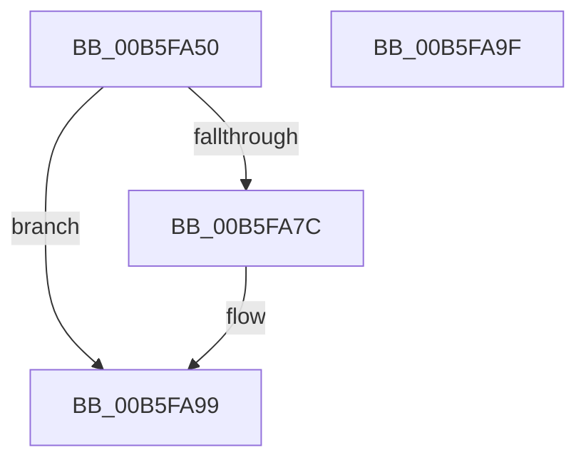

# EmonRestartProfilingEnhanced

- RVA: `0x00B5FA50`–`0x00B5FAA0` (길이 `80` bytes)
- VA: `0x0000000140B5FA50`
- 실행 섹션: `PAGELK`
- PDB 이름 있음: `예`; PDB Function 태그: `아니요`
- unwind 정보 RVA: `0x0005CF00`
- 디코드: `22`개 명령, `80/80` bytes 표시
- 미해석 바이트: `0` (있으면 어셈블리에 `.byte`로 보존)

> 이 문서는 커널 이미지의 기계어와 PDB 기호를 분석해 생성했습니다. 4번과 5번은 함수 원형과 자료형을 바이너리 사용 방식에서 추정한 C 해석이며 원본 소스 복구 결과는 아닙니다.

## 1. Dependencies

- 직접 호출 지점: **2**; 고유 호출 대상: **1**
- 직접 호출자로 확인된 함수: **0**
- RIP 상대 이미지 참조: **2**

### Outgoing calls
- `0x00B5FA62` → [EmonRestartProfilingInternalEnhanced](../../text/55/EmonRestartProfilingInternalEnhanced_function_0055F760.md) (function, `0x0055F760`)
- `0x00B5FA6E` → [EmonRestartProfilingInternalEnhanced](../../text/55/EmonRestartProfilingInternalEnhanced_function_0055F760.md) (function, `0x0055F760`)

### Direct callers
- 이 함수 시작 RVA로 연결되는 직접 call은 확인되지 않았습니다. 간접 호출은 완전히 역산할 수 없습니다.

### Static image references
- `0x00B5FA73` → RVA `0x00F8FDF8` (`.data`; read)
- `0x00B5FA89` → RVA `0x00F8FDF0` (`.data`; read)

## 2. Other-region calls and transfers

- 다른 실행 섹션으로 향하는 call: **2**
  - `0x00B5FA62` → [EmonRestartProfilingInternalEnhanced](../../text/55/EmonRestartProfilingInternalEnhanced_function_0055F760.md) (`PAGELK` → `.text`)
  - `0x00B5FA6E` → [EmonRestartProfilingInternalEnhanced](../../text/55/EmonRestartProfilingInternalEnhanced_function_0055F760.md) (`PAGELK` → `.text`)
- 별도 외부 분기/꼬리 이동을 확인하지 못했습니다.

## 3. Assembly (complete function range)

```asm
00B5FA50  40 53                           push rbx
00B5FA52  48 83 EC 20                     sub rsp, 0x20
00B5FA56  65 8B 1C 25 A4 01 00 00         mov ebx, dword ptr gs:[0x1a4]
00B5FA5E  33 C9                           xor ecx, ecx
00B5FA60  8B D3                           mov edx, ebx
00B5FA62  E8 F9 FC 9F FF                  call 0x14055f760
00B5FA67  8B D3                           mov edx, ebx
00B5FA69  B9 01 00 00 00                  mov ecx, 1
00B5FA6E  E8 ED FC 9F FF                  call 0x14055f760
00B5FA73  80 3D 7E 03 43 00 00            cmp byte ptr [rip + 0x43037e], 0
00B5FA7A  74 1D                           je 0x140b5fa99
00B5FA7C  48 8D 14 9B                     lea rdx, [rbx + rbx*4]
00B5FA80  B9 00 06 00 00                  mov ecx, 0x600
00B5FA85  48 C1 E2 05                     shl rdx, 5
00B5FA89  48 03 15 60 03 43 00            add rdx, qword ptr [rip + 0x430360]
00B5FA90  48 8B C2                        mov rax, rdx
00B5FA93  48 C1 EA 20                     shr rdx, 0x20
00B5FA97  0F 30                           wrmsr
00B5FA99  48 83 C4 20                     add rsp, 0x20
00B5FA9D  5B                              pop rbx
00B5FA9E  C3                              ret
00B5FA9F  CC                              int3
```

## 4. C-style interpretation (structured pseudocode)

```c
__int64 __fastcall EmonRestartProfilingEnhanced(int a1)
{
    __int64 result;
    __int64 v_rsp;

    v_rsp = (v_rsp) - (32);
    a1 = 0;
    result = EmonRestartProfilingInternalEnhanced(a1, (unsigned int)((unsigned int)((unsigned int)(*(unsigned int *)(gs_base + (0 + 420))))), a3, a4);
    result = EmonRestartProfilingInternalEnhanced(1, (unsigned int)((unsigned int)((unsigned int)(*(unsigned int *)(gs_base + (0 + 420))))), a3, a4);
    if ((*(unsigned __int8 *)(v_rip + 4391806)) != 0) {
        a2 = (unsigned int)(*(unsigned int *)(gs_base + (0 + 420))) + (unsigned int)(*(unsigned int *)(gs_base + (0 + 420))) * 4;
        a1 = 0x600ULL;
        a2 = (a2) << (5);
        a2 = (a2) + (*(unsigned __int64 *)(v_rip + 4391776));
        result = a2;
        a2 = (a2) >> (32);
    }
    v_rsp = (v_rsp) + (32);
    return result;
}
```

## 5. (Beta) C Style

```c
int64_t EmonRestartProfilingEnhanced(int32_t Arg1)
{
    int64_t result;
    int64_t local_rsp;

    local_rsp = (local_rsp) - (32);
    Arg1 = 0;
    result = EmonRestartProfilingInternalEnhanced(Arg1, (uint32_t)((uint32_t)((uint32_t)(*(uint32_t *)(gs_base + (0 + 0x1A4))))), a3, a4);
    result = EmonRestartProfilingInternalEnhanced(1, (uint32_t)((uint32_t)((uint32_t)(*(uint32_t *)(gs_base + (0 + 0x1A4))))), a3, a4);
    if ((*(uint8_t *)(v_rip + 0x43037E)) != 0) {
        a2 = (uint32_t)(*(uint32_t *)(gs_base + (0 + 0x1A4))) + (uint32_t)(*(uint32_t *)(gs_base + (0 + 0x1A4))) * 4;
        Arg1 = 0x600ULL;
        a2 = (a2) << (5);
        a2 = (a2) + (*(uint64_t *)(v_rip + 0x430360));
        result = a2;
        a2 = (a2) >> (32);
    }
    local_rsp = (local_rsp) + (32);
    return result;
}
```

## 6. Execution-region graph

[열기: 2D/3D 그래프와 함수 탐색 컨트롤 패널](../../../control-panel.html?section=pagelk&rva=0x00B5FA50&view=graph)

- 2D 그래프는 위에서 아래로 흐르고, 3D 그래프는 빈 공간을 드래그해 회전합니다. Shift+드래그는 이동, 휠은 확대·축소, 함수 노드 선택은 대상 보고서 이동입니다.

### Static fallback


