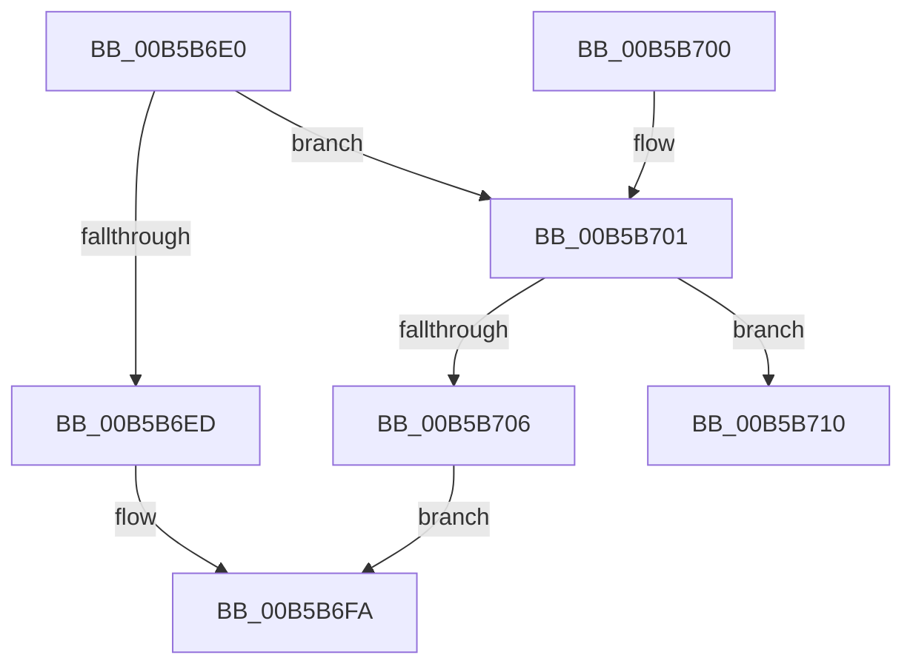

# HalInitSystem

- RVA: `0x00B5B6E0`–`0x00B5B730` (길이 `80` bytes)
- VA: `0x0000000140B5B6E0`
- 실행 섹션: `PAGELK`
- PDB 이름 있음: `예`; PDB Function 태그: `아니요`
- unwind 정보 RVA: `0x000C3928`
- 디코드: `24`개 명령, `80/80` bytes 표시
- 미해석 바이트: `0` (있으면 어셈블리에 `.byte`로 보존)

> 이 문서는 커널 이미지의 기계어와 PDB 기호를 분석해 생성했습니다. 4번과 5번은 함수 원형과 자료형을 바이너리 사용 방식에서 추정한 C 해석이며 원본 소스 복구 결과는 아닙니다.

## 1. Dependencies

- 직접 호출 지점: **4**; 고유 호출 대상: **4**
- 직접 호출자로 확인된 함수: **3**
- RIP 상대 이미지 참조: **0**

### Outgoing calls
- `0x00B5B6ED` → [_security_init_cookie](../../init/BE/_security_init_cookie_function_00BEF22C.md) (function, `0x00BEF22C`)
- `0x00B5B6F5` → [HalpInitSystemPhase0](../../init/C1/HalpInitSystemPhase0_function_00C1DE2C.md) (function, `0x00C1DE2C`)
- `0x00B5B709` → [HalpInitSystemPhase1](HalpInitSystemPhase1_function_00B5B7E4.md) (function, `0x00B5B7E4`)
- `0x00B5B72A` → [KeBugCheckEx](../../text/4F/KeBugCheckEx_function_004FD660.md) (function, `0x004FD660`)

### Direct callers
- [KiInitializeKernel](../B6/KiInitializeKernel_function_00B68D20.md) at `0x00B69529`
- [InitBootProcessor](../../init/C1/InitBootProcessor_function_00C1B1C8.md) at `0x00C1B44B`
- [Phase1InitializationDiscard](../../init/C1/Phase1InitializationDiscard_function_00C1C728.md) at `0x00C1CA8D`

### Static image references
- 디코드된 RIP-relative 메모리 참조가 없습니다.

## 2. Other-region calls and transfers

- 다른 실행 섹션으로 향하는 call: **3**
  - `0x00B5B6ED` → [_security_init_cookie](../../init/BE/_security_init_cookie_function_00BEF22C.md) (`PAGELK` → `INIT`)
  - `0x00B5B6F5` → [HalpInitSystemPhase0](../../init/C1/HalpInitSystemPhase0_function_00C1DE2C.md) (`PAGELK` → `INIT`)
  - `0x00B5B72A` → [KeBugCheckEx](../../text/4F/KeBugCheckEx_function_004FD660.md) (`PAGELK` → `.text`)
- 별도 외부 분기/꼬리 이동을 확인하지 못했습니다.

## 3. Assembly (complete function range)

```asm
00B5B6E0  40 53                           push rbx
00B5B6E2  48 83 EC 30                     sub rsp, 0x30
00B5B6E6  48 8B DA                        mov rbx, rdx
00B5B6E9  85 C9                           test ecx, ecx
00B5B6EB  75 14                           jne 0x140b5b701
00B5B6ED  E8 3A 3B 09 00                  call 0x140bef22c
00B5B6F2  48 8B CB                        mov rcx, rbx
00B5B6F5  E8 32 27 0C 00                  call 0x140c1de2c
00B5B6FA  48 83 C4 30                     add rsp, 0x30
00B5B6FE  5B                              pop rbx
00B5B6FF  C3                              ret
00B5B700  CC                              int3
00B5B701  83 F9 01                        cmp ecx, 1
00B5B704  75 0A                           jne 0x140b5b710
00B5B706  48 8B CB                        mov rcx, rbx
00B5B709  E8 D6 00 00 00                  call 0x140b5b7e4
00B5B70E  EB EA                           jmp 0x140b5b6fa
00B5B710  48 83 64 24 20 00               and qword ptr [rsp + 0x20], 0
00B5B716  BA 00 82 00 00                  mov edx, 0x8200
00B5B71B  44 8B C9                        mov r9d, ecx
00B5B71E  49 C7 C0 0D 00 00 C0            mov r8, 0xffffffffc000000d
00B5B725  B9 5C 00 00 00                  mov ecx, 0x5c
00B5B72A  E8 31 1F 9A FF                  call 0x1404fd660
00B5B72F  CC                              int3
```

## 4. C-style interpretation (structured pseudocode)

```c
__int64 __fastcall HalInitSystem(int a1, __int64 a2)
{
    __int64 result;
    __int64 v_rsp;
    unsigned __int64 v_stack_p20;

    v_rsp = (v_rsp) - (48);
    if (a1 != 0) goto loc_00B5B701;
    result = _security_init_cookie(a1, a2, a3, a4);
    result = HalpInitSystemPhase0(a2, a2, a3, a4);
loc_00B5B6FA:
    v_rsp = (v_rsp) + (48);
    return result;
loc_00B5B701:
    if (((unsigned int)(a2)) != 1) goto loc_00B5B710;
    result = HalpInitSystemPhase1(a2, a2, a3, a4);
    goto loc_00B5B6FA;
loc_00B5B710:
    result = KeBugCheckEx(92, (unsigned int)(0x8200ULL), 0xFFFFFFFFC000000DULL, (unsigned int)((unsigned int)(a2)));
    return result;
}
```

## 5. (Beta) C Style

```c
int64_t HalInitSystem(int32_t Arg1, int64_t Arg2)
{
    int64_t result;
    int64_t local_rsp;
    uint64_t v_stack_p20;

    local_rsp = (local_rsp) - (48);
    if (Arg1 != 0) goto loc_00B5B701;
    result = _security_init_cookie(Arg1, Arg2, a3, a4);
    result = HalpInitSystemPhase0(Arg2, Arg2, a3, a4);
loc_00B5B6FA:
    local_rsp = (local_rsp) + (48);
    return result;
loc_00B5B701:
    if (((uint32_t)(Arg2)) != 1) goto loc_00B5B710;
    result = HalpInitSystemPhase1(Arg2, Arg2, a3, a4);
    goto loc_00B5B6FA;
loc_00B5B710:
    result = KeBugCheckEx(92, (uint32_t)(0x8200ULL), 0xFFFFFFFFC000000DULL, (uint32_t)((uint32_t)(Arg2)));
    return result;
}
```

## 6. Execution-region graph

[열기: 2D/3D 그래프와 함수 탐색 컨트롤 패널](../../../control-panel.html?section=pagelk&rva=0x00B5B6E0&view=graph)

- 2D 그래프는 위에서 아래로 흐르고, 3D 그래프는 빈 공간을 드래그해 회전합니다. Shift+드래그는 이동, 휠은 확대·축소, 함수 노드 선택은 대상 보고서 이동입니다.

### Static fallback


