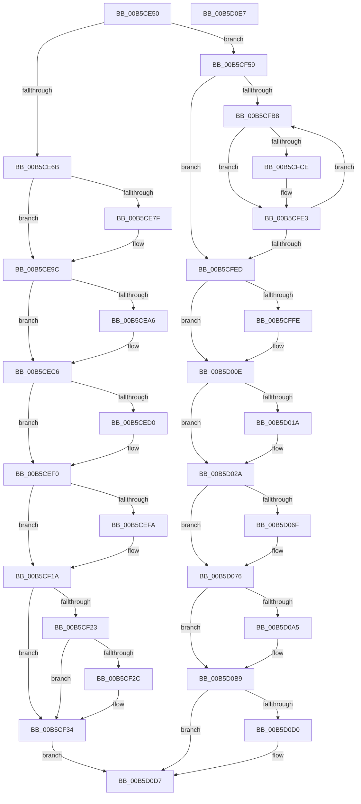

# HaliLocateHiberRanges

- RVA: `0x00B5CE50`–`0x00B5D0E8` (길이 `664` bytes)
- VA: `0x0000000140B5CE50`
- 실행 섹션: `PAGELK`
- PDB 이름 있음: `예`; PDB Function 태그: `아니요`
- unwind 정보 RVA: `0x000794E0`
- 디코드: `171`개 명령, `664/664` bytes 표시
- 미해석 바이트: `0` (있으면 어셈블리에 `.byte`로 보존)

> 이 문서는 커널 이미지의 기계어와 PDB 기호를 분석해 생성했습니다. 4번과 5번은 함수 원형과 자료형을 바이너리 사용 방식에서 추정한 C 해석이며 원본 소스 복구 결과는 아닙니다.

## 1. Dependencies

- 직접 호출 지점: **29**; 고유 호출 대상: **12**
- 직접 호출자로 확인된 함수: **0**
- RIP 상대 이미지 참조: **23**

### Outgoing calls
- `0x00B5CE97` → [PoSetHiberRange](../../text/47/PoSetHiberRange_function_0047C580.md) (function, `0x0047C580`)
- `0x00B5CEC1` → [PoSetHiberRange](../../text/47/PoSetHiberRange_function_0047C580.md) (function, `0x0047C580`)
- `0x00B5CEEB` → [PoSetHiberRange](../../text/47/PoSetHiberRange_function_0047C580.md) (function, `0x0047C580`)
- `0x00B5CF15` → [PoSetHiberRange](../../text/47/PoSetHiberRange_function_0047C580.md) (function, `0x0047C580`)
- `0x00B5CF1A` → [Feature_Servicing_PrmBootPhaseRestore__private_IsEnabledNoReportingNoInline](../../text/54/Feature_Servicing_PrmBootPhaseRestore__private_IsEnabledNoReportingNoInline_function_0054E1C0.md) (function, `0x0054E1C0`)
- `0x00B5CF23` → [Feature_Servicing_PrmSaveRestoreS4__private_IsEnabledNoReportingNoInline](../../text/54/Feature_Servicing_PrmSaveRestoreS4__private_IsEnabledNoReportingNoInline_function_0054E214.md) (function, `0x0054E214`)
- `0x00B5CF2F` → [HalpAcpiMarkHiberPhase](../../text/53/HalpAcpiMarkHiberPhase_function_0053F23C.md) (function, `0x0053F23C`)
- `0x00B5CF37` → [HalpPciMarkHiberPhase](../../text/47/HalpPciMarkHiberPhase_function_0047C544.md) (function, `0x0047C544`)
- `0x00B5CF3F` → [HalpIommuMarkHiberPhase](../B7/HalpIommuMarkHiberPhase_function_00B7BE8C.md) (function, `0x00B7BE8C`)
- `0x00B5CF47` → [HalpExtEnvMarkHiberRegions](../../text/4E/HalpExtEnvMarkHiberRegions_function_004E17D0.md) (function, `0x004E17D0`)
- `0x00B5CF4F` → [HalpDmaMarkHiberAdapter](../../text/4D/HalpDmaMarkHiberAdapter_function_004DA56C.md) (function, `0x004DA56C`)
- `0x00B5CF59` → [HalpMmAllocCtxMarkHiberPhase](HalpMmAllocCtxMarkHiberPhase_function_00B5C254.md) (function, `0x00B5C254`)
- `0x00B5CF60` → [HalpDmaMarkHiberAdapter](../../text/4D/HalpDmaMarkHiberAdapter_function_004DA56C.md) (function, `0x004DA56C`)
- `0x00B5CF67` → [HalpIommuMarkHiberPhase](../B7/HalpIommuMarkHiberPhase_function_00B7BE8C.md) (function, `0x00B7BE8C`)
- `0x00B5CF6E` → [HalpExtEnvMarkHiberRegions](../../text/4E/HalpExtEnvMarkHiberRegions_function_004E17D0.md) (function, `0x004E17D0`)
- `0x00B5CF92` → [PoSetHiberRange](../../text/47/PoSetHiberRange_function_0047C580.md) (function, `0x0047C580`)
- `0x00B5CFA9` → [PoSetHiberRange](../../text/47/PoSetHiberRange_function_0047C580.md) (function, `0x0047C580`)
- `0x00B5CFDE` → [PoSetHiberRange](../../text/47/PoSetHiberRange_function_0047C580.md) (function, `0x0047C580`)
- `0x00B5D009` → [PoSetHiberRange](../../text/47/PoSetHiberRange_function_0047C580.md) (function, `0x0047C580`)
- `0x00B5D025` → [PoSetHiberRange](../../text/47/PoSetHiberRange_function_0047C580.md) (function, `0x0047C580`)
- `0x00B5D02A` → `PSHED.dll!PshedMarkHiberPhase` (import, 간접 대상; import `PSHED.dll!PshedMarkHiberPhase`)
- `0x00B5D051` → [PoSetHiberRange](../../text/47/PoSetHiberRange_function_0047C580.md) (function, `0x0047C580`)
- `0x00B5D061` → [guard_dispatch_icall](../../text/6B/guard_dispatch_icall_function_006BAAD0.md) (function, `0x006BAAD0`)
- `0x00B5D066` → [Feature_Servicing_PrmBootPhaseRestore__private_IsEnabledNoReportingNoInline](../../text/54/Feature_Servicing_PrmBootPhaseRestore__private_IsEnabledNoReportingNoInline_function_0054E1C0.md) (function, `0x0054E1C0`)
- `0x00B5D071` → [HalpAcpiMarkHiberPhase](../../text/53/HalpAcpiMarkHiberPhase_function_0053F23C.md) (function, `0x0053F23C`)
- `0x00B5D088` → [PoSetHiberRange](../../text/47/PoSetHiberRange_function_0047C580.md) (function, `0x0047C580`)
- `0x00B5D094` → [guard_dispatch_icall](../../text/6B/guard_dispatch_icall_function_006BAAD0.md) (function, `0x006BAAD0`)
- `0x00B5D0B4` → [PoSetHiberRange](../../text/47/PoSetHiberRange_function_0047C580.md) (function, `0x0047C580`)
- `0x00B5D0BB` → [HalpTimerMarkHiberPhase](../../text/53/HalpTimerMarkHiberPhase_function_0053D10C.md) (function, `0x0053D10C`)

### Direct callers
- 이 함수 시작 RVA로 연결되는 직접 call은 확인되지 않았습니다. 간접 호출은 완전히 역산할 수 없습니다.

### Static image references
- `0x00B5CE6B` → RVA `0x00FC3AE8` (`.data`; read)
- `0x00B5CE7F` → RVA `0x00FC3AF0` (`.data`; read)
- `0x00B5CE9C` → RVA `0x00FC3CE8` (`.data`; read)
- `0x00B5CEA6` → RVA `0x00FC3CF0` (`.data`; read)
- `0x00B5CEC6` → RVA `0x00FC3BE8` (`.data`; read)
- `0x00B5CED0` → RVA `0x00FC3BF0` (`.data`; read)
- `0x00B5CEF0` → RVA `0x00FC3DE8` (`.data`; read)
- `0x00B5CEFA` → RVA `0x00FC3DF0` (`.data`; read)
- `0x00B5CF73` → RVA `0x00F905E8` (`.data`; read)
- `0x00B5CF9E` → RVA `0x00B5CE50` (`HaliLocateHiberRanges`; read)
- `0x00B5CFB0` → RVA `0x00FC1A10` (`.data`; read)
- `0x00B5CFBE` → RVA `0x00FC1A08` (`.data`; read)
- `0x00B5CFED` → RVA `0x00E0F6F0` (`.data`; read)
- `0x00B5D00E` → RVA `0x00E0F6C8` (`.data`; read)
- `0x00B5D02A` → RVA `0x00151108` (`PSHED.dll!PshedMarkHiberPhase (IAT)`; read)
- `0x00B5D036` → RVA `0x00E11750` (`.data`; read)
- `0x00B5D076` → RVA `0x00E00A20` (`.data`; read)
- `0x00B5D08D` → RVA `0x00E00A60` (`.data`; read)
- `0x00B5D099` → RVA `0x00FC19F8` (`.data`; read)
- `0x00B5D0A5` → RVA `0x00FC19F0` (`.data`; read)
- `0x00B5D0C0` → RVA `0x00FC22C0` (`.data`; read)
- `0x00B5D0C6` → RVA `0x00E10381` (`.data`; write)
- `0x00B5D0D0` → RVA `0x00FC22C0` (`.data`; write)

## 2. Other-region calls and transfers

- 다른 실행 섹션으로 향하는 call: **25**
  - `0x00B5CE97` → [PoSetHiberRange](../../text/47/PoSetHiberRange_function_0047C580.md) (`PAGELK` → `.text`)
  - `0x00B5CEC1` → [PoSetHiberRange](../../text/47/PoSetHiberRange_function_0047C580.md) (`PAGELK` → `.text`)
  - `0x00B5CEEB` → [PoSetHiberRange](../../text/47/PoSetHiberRange_function_0047C580.md) (`PAGELK` → `.text`)
  - `0x00B5CF15` → [PoSetHiberRange](../../text/47/PoSetHiberRange_function_0047C580.md) (`PAGELK` → `.text`)
  - `0x00B5CF1A` → [Feature_Servicing_PrmBootPhaseRestore__private_IsEnabledNoReportingNoInline](../../text/54/Feature_Servicing_PrmBootPhaseRestore__private_IsEnabledNoReportingNoInline_function_0054E1C0.md) (`PAGELK` → `.text`)
  - `0x00B5CF23` → [Feature_Servicing_PrmSaveRestoreS4__private_IsEnabledNoReportingNoInline](../../text/54/Feature_Servicing_PrmSaveRestoreS4__private_IsEnabledNoReportingNoInline_function_0054E214.md) (`PAGELK` → `.text`)
  - `0x00B5CF2F` → [HalpAcpiMarkHiberPhase](../../text/53/HalpAcpiMarkHiberPhase_function_0053F23C.md) (`PAGELK` → `.text`)
  - `0x00B5CF37` → [HalpPciMarkHiberPhase](../../text/47/HalpPciMarkHiberPhase_function_0047C544.md) (`PAGELK` → `.text`)
  - `0x00B5CF47` → [HalpExtEnvMarkHiberRegions](../../text/4E/HalpExtEnvMarkHiberRegions_function_004E17D0.md) (`PAGELK` → `.text`)
  - `0x00B5CF4F` → [HalpDmaMarkHiberAdapter](../../text/4D/HalpDmaMarkHiberAdapter_function_004DA56C.md) (`PAGELK` → `.text`)
  - `0x00B5CF60` → [HalpDmaMarkHiberAdapter](../../text/4D/HalpDmaMarkHiberAdapter_function_004DA56C.md) (`PAGELK` → `.text`)
  - `0x00B5CF6E` → [HalpExtEnvMarkHiberRegions](../../text/4E/HalpExtEnvMarkHiberRegions_function_004E17D0.md) (`PAGELK` → `.text`)
  - `0x00B5CF92` → [PoSetHiberRange](../../text/47/PoSetHiberRange_function_0047C580.md) (`PAGELK` → `.text`)
  - `0x00B5CFA9` → [PoSetHiberRange](../../text/47/PoSetHiberRange_function_0047C580.md) (`PAGELK` → `.text`)
  - `0x00B5CFDE` → [PoSetHiberRange](../../text/47/PoSetHiberRange_function_0047C580.md) (`PAGELK` → `.text`)
  - `0x00B5D009` → [PoSetHiberRange](../../text/47/PoSetHiberRange_function_0047C580.md) (`PAGELK` → `.text`)
  - `0x00B5D025` → [PoSetHiberRange](../../text/47/PoSetHiberRange_function_0047C580.md) (`PAGELK` → `.text`)
  - `0x00B5D051` → [PoSetHiberRange](../../text/47/PoSetHiberRange_function_0047C580.md) (`PAGELK` → `.text`)
  - `0x00B5D061` → [guard_dispatch_icall](../../text/6B/guard_dispatch_icall_function_006BAAD0.md) (`PAGELK` → `.text`)
  - `0x00B5D066` → [Feature_Servicing_PrmBootPhaseRestore__private_IsEnabledNoReportingNoInline](../../text/54/Feature_Servicing_PrmBootPhaseRestore__private_IsEnabledNoReportingNoInline_function_0054E1C0.md) (`PAGELK` → `.text`)
  - `0x00B5D071` → [HalpAcpiMarkHiberPhase](../../text/53/HalpAcpiMarkHiberPhase_function_0053F23C.md) (`PAGELK` → `.text`)
  - `0x00B5D088` → [PoSetHiberRange](../../text/47/PoSetHiberRange_function_0047C580.md) (`PAGELK` → `.text`)
  - `0x00B5D094` → [guard_dispatch_icall](../../text/6B/guard_dispatch_icall_function_006BAAD0.md) (`PAGELK` → `.text`)
  - `0x00B5D0B4` → [PoSetHiberRange](../../text/47/PoSetHiberRange_function_0047C580.md) (`PAGELK` → `.text`)
  - `0x00B5D0BB` → [HalpTimerMarkHiberPhase](../../text/53/HalpTimerMarkHiberPhase_function_0053D10C.md) (`PAGELK` → `.text`)
- 별도 외부 분기/꼬리 이동을 확인하지 못했습니다.

## 3. Assembly (complete function range)

```asm
00B5CE50  48 89 5C 24 08                  mov qword ptr [rsp + 8], rbx
00B5CE55  48 89 74 24 10                  mov qword ptr [rsp + 0x10], rsi
00B5CE5A  57                              push rdi
00B5CE5B  48 83 EC 30                     sub rsp, 0x30
00B5CE5F  48 8B D9                        mov rbx, rcx
00B5CE62  48 85 C9                        test rcx, rcx
00B5CE65  0F 84 EE 00 00 00               je 0x140b5cf59
00B5CE6B  8B 05 77 6C 46 00               mov eax, dword ptr [rip + 0x466c77]
00B5CE71  BF 68 61 6C 6D                  mov edi, 0x6d6c6168
00B5CE76  BE 00 C0 00 00                  mov esi, 0xc000
00B5CE7B  85 C0                           test eax, eax
00B5CE7D  74 1D                           je 0x140b5ce9c
00B5CE7F  44 8B 05 6A 6C 46 00            mov r8d, dword ptr [rip + 0x466c6a]
00B5CE86  44 8B C8                        mov r9d, eax
00B5CE89  49 C1 E9 0C                     shr r9, 0xc
00B5CE8D  8B D6                           mov edx, esi
00B5CE8F  49 C1 E8 0C                     shr r8, 0xc
00B5CE93  89 7C 24 20                     mov dword ptr [rsp + 0x20], edi
00B5CE97  E8 E4 F6 91 FF                  call 0x14047c580
00B5CE9C  8B 05 46 6E 46 00               mov eax, dword ptr [rip + 0x466e46]
00B5CEA2  85 C0                           test eax, eax
00B5CEA4  74 20                           je 0x140b5cec6
00B5CEA6  44 8B 05 43 6E 46 00            mov r8d, dword ptr [rip + 0x466e43]
00B5CEAD  44 8B C8                        mov r9d, eax
00B5CEB0  49 C1 E9 0C                     shr r9, 0xc
00B5CEB4  8B D6                           mov edx, esi
00B5CEB6  49 C1 E8 0C                     shr r8, 0xc
00B5CEBA  48 8B CB                        mov rcx, rbx
00B5CEBD  89 7C 24 20                     mov dword ptr [rsp + 0x20], edi
00B5CEC1  E8 BA F6 91 FF                  call 0x14047c580
00B5CEC6  8B 05 1C 6D 46 00               mov eax, dword ptr [rip + 0x466d1c]
00B5CECC  85 C0                           test eax, eax
00B5CECE  74 20                           je 0x140b5cef0
00B5CED0  4C 8B 05 19 6D 46 00            mov r8, qword ptr [rip + 0x466d19]
00B5CED7  44 8B C8                        mov r9d, eax
00B5CEDA  49 C1 E9 0C                     shr r9, 0xc
00B5CEDE  8B D6                           mov edx, esi
00B5CEE0  49 C1 F8 0C                     sar r8, 0xc
00B5CEE4  48 8B CB                        mov rcx, rbx
00B5CEE7  89 7C 24 20                     mov dword ptr [rsp + 0x20], edi
00B5CEEB  E8 90 F6 91 FF                  call 0x14047c580
00B5CEF0  8B 05 F2 6E 46 00               mov eax, dword ptr [rip + 0x466ef2]
00B5CEF6  85 C0                           test eax, eax
00B5CEF8  74 20                           je 0x140b5cf1a
00B5CEFA  4C 8B 05 EF 6E 46 00            mov r8, qword ptr [rip + 0x466eef]
00B5CF01  44 8B C8                        mov r9d, eax
00B5CF04  49 C1 E9 0C                     shr r9, 0xc
00B5CF08  8B D6                           mov edx, esi
00B5CF0A  49 C1 F8 0C                     sar r8, 0xc
00B5CF0E  48 8B CB                        mov rcx, rbx
00B5CF11  89 7C 24 20                     mov dword ptr [rsp + 0x20], edi
00B5CF15  E8 66 F6 91 FF                  call 0x14047c580
00B5CF1A  E8 A1 12 9F FF                  call 0x14054e1c0
00B5CF1F  85 C0                           test eax, eax
00B5CF21  75 11                           jne 0x140b5cf34
00B5CF23  E8 EC 12 9F FF                  call 0x14054e214
00B5CF28  85 C0                           test eax, eax
00B5CF2A  74 08                           je 0x140b5cf34
00B5CF2C  48 8B CB                        mov rcx, rbx
00B5CF2F  E8 08 23 9E FF                  call 0x14053f23c
00B5CF34  48 8B CB                        mov rcx, rbx
00B5CF37  E8 08 F6 91 FF                  call 0x14047c544
00B5CF3C  48 8B CB                        mov rcx, rbx
00B5CF3F  E8 48 EF 01 00                  call 0x140b7be8c
00B5CF44  48 8B CB                        mov rcx, rbx
00B5CF47  E8 84 48 98 FF                  call 0x1404e17d0
00B5CF4C  48 8B CB                        mov rcx, rbx
00B5CF4F  E8 18 D6 97 FF                  call 0x1404da56c
00B5CF54  E9 7E 01 00 00                  jmp 0x140b5d0d7
00B5CF59  E8 F6 F2 FF FF                  call 0x140b5c254
00B5CF5E  33 C9                           xor ecx, ecx
00B5CF60  E8 07 D6 97 FF                  call 0x1404da56c
00B5CF65  33 C9                           xor ecx, ecx
00B5CF67  E8 20 EF 01 00                  call 0x140b7be8c
00B5CF6C  33 C9                           xor ecx, ecx
00B5CF6E  E8 5D 48 98 FF                  call 0x1404e17d0
00B5CF73  4C 8B 05 6E 36 43 00            mov r8, qword ptr [rip + 0x43366e]
00B5CF7A  BF 00 00 01 00                  mov edi, 0x10000
00B5CF7F  BE 68 61 6C 74                  mov esi, 0x746c6168
00B5CF84  8B D7                           mov edx, edi
00B5CF86  41 B9 00 10 00 00               mov r9d, 0x1000
00B5CF8C  89 74 24 20                     mov dword ptr [rsp + 0x20], esi
00B5CF90  33 C9                           xor ecx, ecx
00B5CF92  E8 E9 F5 91 FF                  call 0x14047c580
00B5CF97  45 33 C9                        xor r9d, r9d
00B5CF9A  89 74 24 20                     mov dword ptr [rsp + 0x20], esi
00B5CF9E  4C 8D 05 AB FE FF FF            lea r8, [rip - 0x155]
00B5CFA5  8B D7                           mov edx, edi
00B5CFA7  33 C9                           xor ecx, ecx
00B5CFA9  E8 D2 F5 91 FF                  call 0x14047c580
00B5CFAE  33 DB                           xor ebx, ebx
00B5CFB0  39 1D 5A 4A 46 00               cmp dword ptr [rip + 0x464a5a], ebx
00B5CFB6  74 35                           je 0x140b5cfed
00B5CFB8  8B C3                           mov eax, ebx
00B5CFBA  48 C1 E0 06                     shl rax, 6
00B5CFBE  48 03 05 43 4A 46 00            add rax, qword ptr [rip + 0x464a43]
00B5CFC5  4C 8B 40 30                     mov r8, qword ptr [rax + 0x30]
00B5CFC9  4D 85 C0                        test r8, r8
00B5CFCC  74 15                           je 0x140b5cfe3
00B5CFCE  44 8B 48 38                     mov r9d, dword ptr [rax + 0x38]
00B5CFD2  8B D7                           mov edx, edi
00B5CFD4  33 C9                           xor ecx, ecx
00B5CFD6  C7 44 24 20 48 61 6C 45         mov dword ptr [rsp + 0x20], 0x456c6148
00B5CFDE  E8 9D F5 91 FF                  call 0x14047c580
00B5CFE3  FF C3                           inc ebx
00B5CFE5  3B 1D 25 4A 46 00               cmp ebx, dword ptr [rip + 0x464a25]
00B5CFEB  72 CB                           jb 0x140b5cfb8
00B5CFED  4C 8B 05 FC 26 2B 00            mov r8, qword ptr [rip + 0x2b26fc]
00B5CFF4  BB CC 03 00 00                  mov ebx, 0x3cc
00B5CFF9  4D 85 C0                        test r8, r8
00B5CFFC  74 10                           je 0x140b5d00e
00B5CFFE  44 8B CB                        mov r9d, ebx
00B5D001  89 74 24 20                     mov dword ptr [rsp + 0x20], esi
00B5D005  8B D7                           mov edx, edi
00B5D007  33 C9                           xor ecx, ecx
00B5D009  E8 72 F5 91 FF                  call 0x14047c580
00B5D00E  4C 8B 05 B3 26 2B 00            mov r8, qword ptr [rip + 0x2b26b3]
00B5D015  4D 85 C0                        test r8, r8
00B5D018  74 10                           je 0x140b5d02a
00B5D01A  4C 8B CB                        mov r9, rbx
00B5D01D  89 74 24 20                     mov dword ptr [rsp + 0x20], esi
00B5D021  8B D7                           mov edx, edi
00B5D023  33 C9                           xor ecx, ecx
00B5D025  E8 56 F5 91 FF                  call 0x14047c580
00B5D02A  48 FF 15 D7 40 5F FF            call qword ptr [rip - 0xa0bf29]
00B5D031  0F 1F 44 00 00                  nop dword ptr [rax + rax]
00B5D036  4C 8B 05 13 47 2B 00            mov r8, qword ptr [rip + 0x2b4713]
00B5D03D  BB 68 61 6C 63                  mov ebx, 0x636c6168
00B5D042  45 33 C9                        xor r9d, r9d
00B5D045  89 5C 24 20                     mov dword ptr [rsp + 0x20], ebx
00B5D049  8B D7                           mov edx, edi
00B5D04B  33 C9                           xor ecx, ecx
00B5D04D  4D 8B 40 08                     mov r8, qword ptr [r8 + 8]
00B5D051  E8 2A F5 91 FF                  call 0x14047c580
00B5D056  48 8B 05 F3 46 2B 00            mov rax, qword ptr [rip + 0x2b46f3]
00B5D05D  48 8B 40 20                     mov rax, qword ptr [rax + 0x20]
00B5D061  E8 6A DA B5 FF                  call 0x1406baad0
00B5D066  E8 55 11 9F FF                  call 0x14054e1c0
00B5D06B  85 C0                           test eax, eax
00B5D06D  74 07                           je 0x140b5d076
00B5D06F  33 C9                           xor ecx, ecx
00B5D071  E8 C6 21 9E FF                  call 0x14053f23c
00B5D076  4C 8B 05 A3 39 2A 00            mov r8, qword ptr [rip + 0x2a39a3]
00B5D07D  45 33 C9                        xor r9d, r9d
00B5D080  8B D7                           mov edx, edi
00B5D082  89 5C 24 20                     mov dword ptr [rsp + 0x20], ebx
00B5D086  33 C9                           xor ecx, ecx
00B5D088  E8 F3 F4 91 FF                  call 0x14047c580
00B5D08D  48 8B 05 CC 39 2A 00            mov rax, qword ptr [rip + 0x2a39cc]
00B5D094  E8 37 DA B5 FF                  call 0x1406baad0
00B5D099  4C 8B 05 58 49 46 00            mov r8, qword ptr [rip + 0x464958]
00B5D0A0  4D 85 C0                        test r8, r8
00B5D0A3  74 14                           je 0x140b5d0b9
00B5D0A5  44 8B 0D 44 49 46 00            mov r9d, dword ptr [rip + 0x464944]
00B5D0AC  8B D7                           mov edx, edi
00B5D0AE  33 C9                           xor ecx, ecx
00B5D0B0  89 5C 24 20                     mov dword ptr [rsp + 0x20], ebx
00B5D0B4  E8 C7 F4 91 FF                  call 0x14047c580
00B5D0B9  33 C9                           xor ecx, ecx
00B5D0BB  E8 4C 00 9E FF                  call 0x14053d10c
00B5D0C0  8A 05 FA 51 46 00               mov al, byte ptr [rip + 0x4651fa]
00B5D0C6  88 05 B5 32 2B 00               mov byte ptr [rip + 0x2b32b5], al
00B5D0CC  84 C0                           test al, al
00B5D0CE  74 07                           je 0x140b5d0d7
00B5D0D0  C6 05 E9 51 46 00 00            mov byte ptr [rip + 0x4651e9], 0
00B5D0D7  48 8B 5C 24 40                  mov rbx, qword ptr [rsp + 0x40]
00B5D0DC  48 8B 74 24 48                  mov rsi, qword ptr [rsp + 0x48]
00B5D0E1  48 83 C4 30                     add rsp, 0x30
00B5D0E5  5F                              pop rdi
00B5D0E6  C3                              ret
00B5D0E7  CC                              int3
```

## 4. C-style interpretation (structured pseudocode)

```c
__int64 __fastcall HaliLocateHiberRanges(__int64 a1)
{
    __int64 result;
    __int64 v_rbx;
    __int64 v_rsp;
    unsigned int v_stack_m18;
    unsigned __int64 v_stack_p10;
    unsigned __int64 v_stack_p8;

    v_stack_p8 = v_rbx;
    v_stack_p10 = v_rsi;
    v_rsp = (v_rsp) - (48);
    if (a1 == 0) goto loc_00B5CF59;
    result = (unsigned int)(*(unsigned int *)(v_rip + 4615287));
    if ((unsigned int)((unsigned int)(*(unsigned int *)(v_rip + 4615287))) != 0) {
        a3 = *(unsigned int *)(v_rip + 4615274);
        a4 = (unsigned int)((unsigned int)(*(unsigned int *)(v_rip + 4615287)));
        a4 = (a4) >> (12);
        a2 = (unsigned int)((unsigned int)(0xC000ULL));
        a3 = (a3) >> (12);
        v_stack_m18 = (unsigned int)((unsigned int)(0x6D6C6168ULL));
        result = PoSetHiberRange(a1, a2, a3, a4);
    }
    result = (unsigned int)(*(unsigned int *)(v_rip + 4615750));
    if ((unsigned int)((unsigned int)(*(unsigned int *)(v_rip + 4615750))) != 0) {
        a3 = *(unsigned int *)(v_rip + 4615747);
        a4 = (unsigned int)((unsigned int)(*(unsigned int *)(v_rip + 4615750)));
        a4 = (a4) >> (12);
        a2 = (unsigned int)((unsigned int)(0xC000ULL));
        a3 = (a3) >> (12);
        a1 = a1;
        v_stack_m18 = (unsigned int)((unsigned int)(0x6D6C6168ULL));
        result = PoSetHiberRange(a1, a2, a3, a4);
    }
    result = (unsigned int)(*(unsigned int *)(v_rip + 4615452));
    if ((unsigned int)((unsigned int)(*(unsigned int *)(v_rip + 4615452))) != 0) {
        a3 = *(unsigned __int64 *)(v_rip + 4615449);
        a4 = (unsigned int)((unsigned int)(*(unsigned int *)(v_rip + 4615452)));
        a4 = (a4) >> (12);
        a2 = (unsigned int)((unsigned int)(0xC000ULL));
        a3 = (a3) >> (12);
        a1 = a1;
        v_stack_m18 = (unsigned int)((unsigned int)(0x6D6C6168ULL));
        result = PoSetHiberRange(a1, a2, a3, a4);
    }
    result = (unsigned int)(*(unsigned int *)(v_rip + 4615922));
    if ((unsigned int)((unsigned int)(*(unsigned int *)(v_rip + 4615922))) != 0) {
        a3 = *(unsigned __int64 *)(v_rip + 4615919);
        a4 = (unsigned int)((unsigned int)(*(unsigned int *)(v_rip + 4615922)));
        a4 = (a4) >> (12);
        a2 = (unsigned int)((unsigned int)(0xC000ULL));
        a3 = (a3) >> (12);
        a1 = a1;
        v_stack_m18 = (unsigned int)((unsigned int)(0x6D6C6168ULL));
        result = PoSetHiberRange(a1, a2, a3, a4);
    }
    result = Feature_Servicing_PrmBootPhaseRestore__private_IsEnabledNoReportingNoInline(a1, a2, a3, a4);
    if ((unsigned int)(result) != 0) goto loc_00B5CF34;
    result = Feature_Servicing_PrmSaveRestoreS4__private_IsEnabledNoReportingNoInline(a1, a2, a3, a4);
    if ((unsigned int)(result) != 0) {
        a1 = a1;
        result = HalpAcpiMarkHiberPhase(a1, a2, a3, a4);
    }
    result = HalpPciMarkHiberPhase(a1, a2, a3, a4);
    result = HalpIommuMarkHiberPhase(a1, a2, a3, a4);
    result = HalpExtEnvMarkHiberRegions(a1, a2, a3, a4);
    result = HalpDmaMarkHiberAdapter(a1, a2, a3, a4);
    goto loc_00B5D0D7;
loc_00B5CF59:
    result = HalpMmAllocCtxMarkHiberPhase(a1, a2, a3, a4);
    a1 = 0;
    result = HalpDmaMarkHiberAdapter(a1, a2, a3, a4);
    a1 = 0;
    result = HalpIommuMarkHiberPhase(a1, a2, a3, a4);
    a1 = 0;
    result = HalpExtEnvMarkHiberRegions(a1, a2, a3, a4);
    v_stack_m18 = (unsigned int)((unsigned int)(0x746C6168ULL));
    a1 = 0;
    result = PoSetHiberRange(a1, (unsigned int)((unsigned int)((unsigned int)(0x10000ULL))), *(unsigned __int64 *)(v_rip + 4404846), (unsigned int)(0x1000ULL));
    a4 = 0;
    v_stack_m18 = (unsigned int)((unsigned int)(0x746C6168ULL));
    a1 = 0;
    result = PoSetHiberRange(a1, (unsigned int)((unsigned int)((unsigned int)(0x10000ULL))), v_rip - 341, a4);
    v_rbx = 0;
    if ((*(unsigned int *)(v_rip + 4606554)) == 0) goto loc_00B5CFED;
loc_00B5CFB8:
    result = (0) << (6);
    result = (result) + (*(unsigned __int64 *)(v_rip + 4606531));
    if (*(unsigned __int64 *)(result + 48) != 0) {
        a4 = *(unsigned int *)(result + 56);
        a2 = (unsigned int)((unsigned int)(0x10000ULL));
        a1 = 0;
        v_stack_m18 = 0x456C6148ULL;
        result = PoSetHiberRange(a1, a2, *(unsigned __int64 *)(result + 48), a4);
    }
    v_rbx = (unsigned int)((v_rbx) + 1);
    if (((unsigned int)(v_rbx)) < (*(unsigned int *)(v_rip + 4606501))) goto loc_00B5CFB8;
loc_00B5CFED:
    if (*(unsigned __int64 *)(v_rip + 2828028) != 0) {
        a4 = 972;
        v_stack_m18 = (unsigned int)((unsigned int)(0x746C6168ULL));
        a2 = (unsigned int)((unsigned int)(0x10000ULL));
        a1 = 0;
        result = PoSetHiberRange(a1, a2, *(unsigned __int64 *)(v_rip + 2828028), a4);
    }
    if (*(unsigned __int64 *)(v_rip + 2827955) != 0) {
        a4 = 972;
        v_stack_m18 = (unsigned int)((unsigned int)(0x746C6168ULL));
        a2 = (unsigned int)((unsigned int)(0x10000ULL));
        a1 = 0;
        result = PoSetHiberRange(a1, a2, *(unsigned __int64 *)(v_rip + 2827955), a4);
    }
    result = PSHED_dll_PshedMarkHiberPhase(a1, a2, *(unsigned __int64 *)(v_rip + 2827955), a4);
    a4 = 0;
    v_stack_m18 = (unsigned int)((unsigned int)(0x636C6168ULL));
    a1 = 0;
    result = PoSetHiberRange(a1, (unsigned int)((unsigned int)((unsigned int)(0x10000ULL))), *(unsigned __int64 *)(*(unsigned __int64 *)(v_rip + 2836243) + 8), a4);
    result = guard_dispatch_icall(a1, (unsigned int)((unsigned int)((unsigned int)(0x10000ULL))), *(unsigned __int64 *)(*(unsigned __int64 *)(v_rip + 2836243) + 8), a4);
    result = Feature_Servicing_PrmBootPhaseRestore__private_IsEnabledNoReportingNoInline(a1, (unsigned int)((unsigned int)((unsigned int)(0x10000ULL))), *(unsigned __int64 *)(*(unsigned __int64 *)(v_rip + 2836243) + 8), a4);
    if ((unsigned int)(result) != 0) {
        a1 = 0;
        result = HalpAcpiMarkHiberPhase(a1, (unsigned int)((unsigned int)((unsigned int)(0x10000ULL))), *(unsigned __int64 *)(*(unsigned __int64 *)(v_rip + 2836243) + 8), a4);
    }
    a4 = 0;
    v_stack_m18 = (unsigned int)((unsigned int)(0x636C6168ULL));
    a1 = 0;
    result = PoSetHiberRange(a1, (unsigned int)((unsigned int)((unsigned int)(0x10000ULL))), *(unsigned __int64 *)(v_rip + 2767267), a4);
    result = guard_dispatch_icall(a1, (unsigned int)((unsigned int)((unsigned int)(0x10000ULL))), *(unsigned __int64 *)(v_rip + 2767267), a4);
    if (*(unsigned __int64 *)(v_rip + 4606296) != 0) {
        a4 = *(unsigned int *)(v_rip + 4606276);
        a2 = (unsigned int)((unsigned int)(0x10000ULL));
        a1 = 0;
        v_stack_m18 = (unsigned int)((unsigned int)(0x636C6168ULL));
        result = PoSetHiberRange(a1, a2, *(unsigned __int64 *)(v_rip + 4606296), a4);
    }
    a1 = 0;
    result = HalpTimerMarkHiberPhase(a1, a2, *(unsigned __int64 *)(v_rip + 4606296), a4);
    *(unsigned __int8 *)(v_rip + 2831029) = (unsigned __int8)(*(unsigned __int8 *)(v_rip + 4608506));
    if ((unsigned __int8)(*(unsigned __int8 *)(v_rip + 4608506)) != 0) {
        *(unsigned __int8 *)(v_rip + 4608489) = 0;
    }
    v_rsp = (v_rsp) + (48);
    return *(unsigned __int8 *)(v_rip + 4608506);
}
```

## 5. (Beta) C Style

```c
int64_t HaliLocateHiberRanges(int64_t Arg1)
{
    int64_t result;
    int64_t local_rbx;
    int64_t local_rsp;
    uint32_t v_stack_m18;
    uint64_t v_stack_p10;
    uint64_t v_stack_p8;

    v_stack_p8 = local_rbx;
    v_stack_p10 = local_rsi;
    local_rsp = (local_rsp) - (48);
    if (Arg1 == 0) goto loc_00B5CF59;
    result = (uint32_t)(*(uint32_t *)(v_rip + 0x466C77));
    if ((uint32_t)((uint32_t)(*(uint32_t *)(v_rip + 0x466C77))) != 0) {
        a3 = *(uint32_t *)(v_rip + 0x466C6A);
        a4 = (uint32_t)((uint32_t)(*(uint32_t *)(v_rip + 0x466C77)));
        a4 = (a4) >> (12);
        a2 = (uint32_t)((uint32_t)(0xC000ULL));
        a3 = (a3) >> (12);
        v_stack_m18 = (uint32_t)((uint32_t)(0x6D6C6168ULL));
        result = PoSetHiberRange(Arg1, a2, a3, a4);
    }
    result = (uint32_t)(*(uint32_t *)(v_rip + 0x466E46));
    if ((uint32_t)((uint32_t)(*(uint32_t *)(v_rip + 0x466E46))) != 0) {
        a3 = *(uint32_t *)(v_rip + 0x466E43);
        a4 = (uint32_t)((uint32_t)(*(uint32_t *)(v_rip + 0x466E46)));
        a4 = (a4) >> (12);
        a2 = (uint32_t)((uint32_t)(0xC000ULL));
        a3 = (a3) >> (12);
        Arg1 = Arg1;
        v_stack_m18 = (uint32_t)((uint32_t)(0x6D6C6168ULL));
        result = PoSetHiberRange(Arg1, a2, a3, a4);
    }
    result = (uint32_t)(*(uint32_t *)(v_rip + 0x466D1C));
    if ((uint32_t)((uint32_t)(*(uint32_t *)(v_rip + 0x466D1C))) != 0) {
        a3 = *(uint64_t *)(v_rip + 0x466D19);
        a4 = (uint32_t)((uint32_t)(*(uint32_t *)(v_rip + 0x466D1C)));
        a4 = (a4) >> (12);
        a2 = (uint32_t)((uint32_t)(0xC000ULL));
        a3 = (a3) >> (12);
        Arg1 = Arg1;
        v_stack_m18 = (uint32_t)((uint32_t)(0x6D6C6168ULL));
        result = PoSetHiberRange(Arg1, a2, a3, a4);
    }
    result = (uint32_t)(*(uint32_t *)(v_rip + 0x466EF2));
    if ((uint32_t)((uint32_t)(*(uint32_t *)(v_rip + 0x466EF2))) != 0) {
        a3 = *(uint64_t *)(v_rip + 0x466EEF);
        a4 = (uint32_t)((uint32_t)(*(uint32_t *)(v_rip + 0x466EF2)));
        a4 = (a4) >> (12);
        a2 = (uint32_t)((uint32_t)(0xC000ULL));
        a3 = (a3) >> (12);
        Arg1 = Arg1;
        v_stack_m18 = (uint32_t)((uint32_t)(0x6D6C6168ULL));
        result = PoSetHiberRange(Arg1, a2, a3, a4);
    }
    result = Feature_Servicing_PrmBootPhaseRestore__private_IsEnabledNoReportingNoInline(Arg1, a2, a3, a4);
    if ((uint32_t)(result) != 0) goto loc_00B5CF34;
    result = Feature_Servicing_PrmSaveRestoreS4__private_IsEnabledNoReportingNoInline(Arg1, a2, a3, a4);
    if ((uint32_t)(result) != 0) {
        Arg1 = Arg1;
        result = HalpAcpiMarkHiberPhase(Arg1, a2, a3, a4);
    }
    result = HalpPciMarkHiberPhase(Arg1, a2, a3, a4);
    result = HalpIommuMarkHiberPhase(Arg1, a2, a3, a4);
    result = HalpExtEnvMarkHiberRegions(Arg1, a2, a3, a4);
    result = HalpDmaMarkHiberAdapter(Arg1, a2, a3, a4);
    goto loc_00B5D0D7;
loc_00B5CF59:
    result = HalpMmAllocCtxMarkHiberPhase(Arg1, a2, a3, a4);
    Arg1 = 0;
    result = HalpDmaMarkHiberAdapter(Arg1, a2, a3, a4);
    Arg1 = 0;
    result = HalpIommuMarkHiberPhase(Arg1, a2, a3, a4);
    Arg1 = 0;
    result = HalpExtEnvMarkHiberRegions(Arg1, a2, a3, a4);
    v_stack_m18 = (uint32_t)((uint32_t)(0x746C6168ULL));
    Arg1 = 0;
    result = PoSetHiberRange(Arg1, (uint32_t)((uint32_t)((uint32_t)(0x10000ULL))), *(uint64_t *)(v_rip + 0x43366E), (uint32_t)(0x1000ULL));
    a4 = 0;
    v_stack_m18 = (uint32_t)((uint32_t)(0x746C6168ULL));
    Arg1 = 0;
    result = PoSetHiberRange(Arg1, (uint32_t)((uint32_t)((uint32_t)(0x10000ULL))), v_rip - 341, a4);
    local_rbx = 0;
    if ((*(uint32_t *)(v_rip + 0x464A5A)) == 0) goto loc_00B5CFED;
loc_00B5CFB8:
    result = (0) << (6);
    result = (result) + (*(uint64_t *)(v_rip + 0x464A43));
    if (*(uint64_t *)(result + 0x30) != 0) {
        a4 = *(uint32_t *)(result + 0x38);
        a2 = (uint32_t)((uint32_t)(0x10000ULL));
        Arg1 = 0;
        v_stack_m18 = 0x456C6148ULL;
        result = PoSetHiberRange(Arg1, a2, *(uint64_t *)(result + 0x30), a4);
    }
    local_rbx = (uint32_t)((local_rbx) + 1);
    if (((uint32_t)(local_rbx)) < (*(uint32_t *)(v_rip + 0x464A25))) goto loc_00B5CFB8;
loc_00B5CFED:
    if (*(uint64_t *)(v_rip + 0x2B26FC) != 0) {
        a4 = 972;
        v_stack_m18 = (uint32_t)((uint32_t)(0x746C6168ULL));
        a2 = (uint32_t)((uint32_t)(0x10000ULL));
        Arg1 = 0;
        result = PoSetHiberRange(Arg1, a2, *(uint64_t *)(v_rip + 0x2B26FC), a4);
    }
    if (*(uint64_t *)(v_rip + 0x2B26B3) != 0) {
        a4 = 972;
        v_stack_m18 = (uint32_t)((uint32_t)(0x746C6168ULL));
        a2 = (uint32_t)((uint32_t)(0x10000ULL));
        Arg1 = 0;
        result = PoSetHiberRange(Arg1, a2, *(uint64_t *)(v_rip + 0x2B26B3), a4);
    }
    result = kernel_indirect_call(Arg1, a2, *(uint64_t *)(v_rip + 0x2B26B3), a4);
    a4 = 0;
    v_stack_m18 = (uint32_t)((uint32_t)(0x636C6168ULL));
    Arg1 = 0;
    result = PoSetHiberRange(Arg1, (uint32_t)((uint32_t)((uint32_t)(0x10000ULL))), *(uint64_t *)(*(uint64_t *)(v_rip + 0x2B4713) + 0x8), a4);
    result = guard_dispatch_icall(Arg1, (uint32_t)((uint32_t)((uint32_t)(0x10000ULL))), *(uint64_t *)(*(uint64_t *)(v_rip + 0x2B4713) + 0x8), a4);
    result = Feature_Servicing_PrmBootPhaseRestore__private_IsEnabledNoReportingNoInline(Arg1, (uint32_t)((uint32_t)((uint32_t)(0x10000ULL))), *(uint64_t *)(*(uint64_t *)(v_rip + 0x2B4713) + 0x8), a4);
    if ((uint32_t)(result) != 0) {
        Arg1 = 0;
        result = HalpAcpiMarkHiberPhase(Arg1, (uint32_t)((uint32_t)((uint32_t)(0x10000ULL))), *(uint64_t *)(*(uint64_t *)(v_rip + 0x2B4713) + 0x8), a4);
    }
    a4 = 0;
    v_stack_m18 = (uint32_t)((uint32_t)(0x636C6168ULL));
    Arg1 = 0;
    result = PoSetHiberRange(Arg1, (uint32_t)((uint32_t)((uint32_t)(0x10000ULL))), *(uint64_t *)(v_rip + 0x2A39A3), a4);
    result = guard_dispatch_icall(Arg1, (uint32_t)((uint32_t)((uint32_t)(0x10000ULL))), *(uint64_t *)(v_rip + 0x2A39A3), a4);
    if (*(uint64_t *)(v_rip + 0x464958) != 0) {
        a4 = *(uint32_t *)(v_rip + 0x464944);
        a2 = (uint32_t)((uint32_t)(0x10000ULL));
        Arg1 = 0;
        v_stack_m18 = (uint32_t)((uint32_t)(0x636C6168ULL));
        result = PoSetHiberRange(Arg1, a2, *(uint64_t *)(v_rip + 0x464958), a4);
    }
    Arg1 = 0;
    result = HalpTimerMarkHiberPhase(Arg1, a2, *(uint64_t *)(v_rip + 0x464958), a4);
    *(uint8_t *)(v_rip + 0x2B32B5) = (uint8_t)(*(uint8_t *)(v_rip + 0x4651FA));
    if ((uint8_t)(*(uint8_t *)(v_rip + 0x4651FA)) != 0) {
        *(uint8_t *)(v_rip + 0x4651E9) = 0;
    }
    local_rsp = (local_rsp) + (48);
    return *(uint8_t *)(v_rip + 0x4651FA);
}
```

## 6. Execution-region graph

[열기: 2D/3D 그래프와 함수 탐색 컨트롤 패널](../../../control-panel.html?section=pagelk&rva=0x00B5CE50&view=graph)

- 2D 그래프는 위에서 아래로 흐르고, 3D 그래프는 빈 공간을 드래그해 회전합니다. Shift+드래그는 이동, 휠은 확대·축소, 함수 노드 선택은 대상 보고서 이동입니다.

### Static fallback


