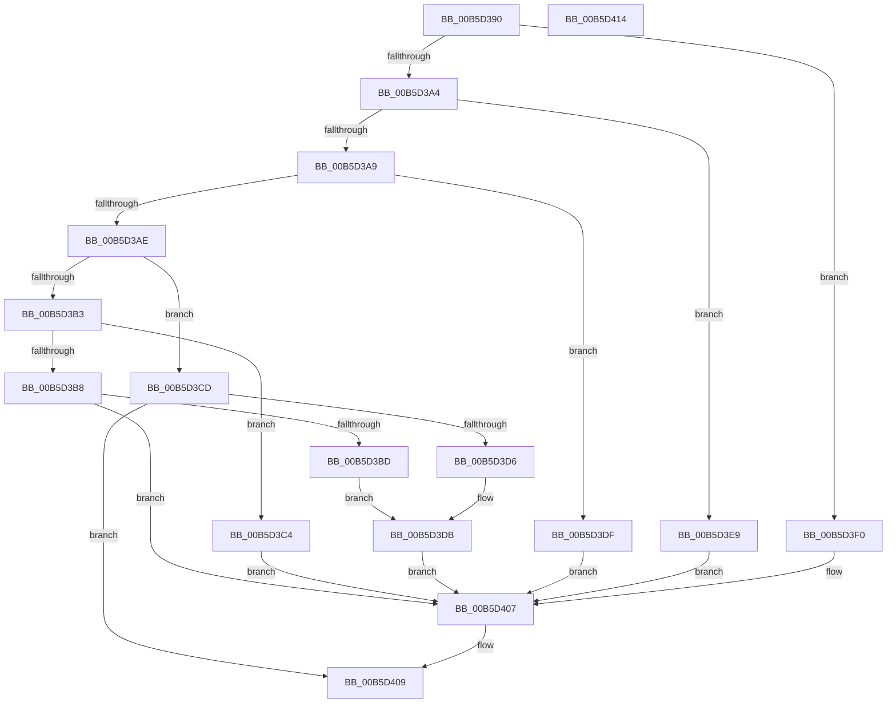

# HalpAcpiInitSystem

- RVA: `0x00B5D390`–`0x00B5D415` (길이 `133` bytes)
- VA: `0x0000000140B5D390`
- 실행 섹션: `PAGELK`
- PDB 이름 있음: `예`; PDB Function 태그: `아니요`
- unwind 정보 RVA: `0x0005CAAC`
- 디코드: `43`개 명령, `133/133` bytes 표시
- 미해석 바이트: `0` (있으면 어셈블리에 `.byte`로 보존)

> 이 문서는 커널 이미지의 기계어와 PDB 기호를 분석해 생성했습니다. 4번과 5번은 함수 원형과 자료형을 바이너리 사용 방식에서 추정한 C 해석이며 원본 소스 복구 결과는 아닙니다.

## 1. Dependencies

- 직접 호출 지점: **7**; 고유 호출 대상: **7**
- 직접 호출자로 확인된 함수: **0**
- RIP 상대 이미지 참조: **1**

### Outgoing calls
- `0x00B5D3BD` → [HalpAcpiDetectPiix4](../../init/C1/HalpAcpiDetectPiix4_function_00C1F9E0.md) (function, `0x00C1F9E0`)
- `0x00B5D3CD` → [HalpAcpiPrmCacheInit](../../init/C1/HalpAcpiPrmCacheInit_function_00C1E040.md) (function, `0x00C1E040`)
- `0x00B5D3D6` → [HalpAcpiPopulateTableCache](../../init/C1/HalpAcpiPopulateTableCache_function_00C1FA88.md) (function, `0x00C1FA88`)
- `0x00B5D3E2` → [HalpAuditAcpiTables](../../init/C2/HalpAuditAcpiTables_function_00C244D4.md) (function, `0x00C244D4`)
- `0x00B5D3E9` → [HalpNumaSwapP0NodeToFront](../../text/55/HalpNumaSwapP0NodeToFront_function_00559D80.md) (function, `0x00559D80`)
- `0x00B5D3FA` → [HalpAcpiInitDiscard](../../init/C1/HalpAcpiInitDiscard_function_00C1FA54.md) (function, `0x00C1FA54`)
- `0x00B5D402` → [HalpAcpiPrmFwBufferInit](../../init/C1/HalpAcpiPrmFwBufferInit_function_00C1E2F4.md) (function, `0x00C1E2F4`)

### Direct callers
- 이 함수 시작 RVA로 연결되는 직접 call은 확인되지 않았습니다. 간접 호출은 완전히 역산할 수 없습니다.

### Static image references
- `0x00B5D3C4` → RVA `0x00FC1A00` (`.data`; write)

## 2. Other-region calls and transfers

- 다른 실행 섹션으로 향하는 call: **7**
  - `0x00B5D3BD` → [HalpAcpiDetectPiix4](../../init/C1/HalpAcpiDetectPiix4_function_00C1F9E0.md) (`PAGELK` → `INIT`)
  - `0x00B5D3CD` → [HalpAcpiPrmCacheInit](../../init/C1/HalpAcpiPrmCacheInit_function_00C1E040.md) (`PAGELK` → `INIT`)
  - `0x00B5D3D6` → [HalpAcpiPopulateTableCache](../../init/C1/HalpAcpiPopulateTableCache_function_00C1FA88.md) (`PAGELK` → `INIT`)
  - `0x00B5D3E2` → [HalpAuditAcpiTables](../../init/C2/HalpAuditAcpiTables_function_00C244D4.md) (`PAGELK` → `INIT`)
  - `0x00B5D3E9` → [HalpNumaSwapP0NodeToFront](../../text/55/HalpNumaSwapP0NodeToFront_function_00559D80.md) (`PAGELK` → `.text`)
  - `0x00B5D3FA` → [HalpAcpiInitDiscard](../../init/C1/HalpAcpiInitDiscard_function_00C1FA54.md) (`PAGELK` → `INIT`)
  - `0x00B5D402` → [HalpAcpiPrmFwBufferInit](../../init/C1/HalpAcpiPrmFwBufferInit_function_00C1E2F4.md) (`PAGELK` → `INIT`)
- 별도 외부 분기/꼬리 이동을 확인하지 못했습니다.

## 3. Assembly (complete function range)

```asm
00B5D390  48 89 5C 24 08                  mov qword ptr [rsp + 8], rbx
00B5D395  57                              push rdi
00B5D396  48 83 EC 20                     sub rsp, 0x20
00B5D39A  33 DB                           xor ebx, ebx
00B5D39C  49 8B F8                        mov rdi, r8
00B5D39F  83 E9 07                        sub ecx, 7
00B5D3A2  74 4C                           je 0x140b5d3f0
00B5D3A4  83 E9 05                        sub ecx, 5
00B5D3A7  74 40                           je 0x140b5d3e9
00B5D3A9  83 E9 05                        sub ecx, 5
00B5D3AC  74 31                           je 0x140b5d3df
00B5D3AE  83 E9 06                        sub ecx, 6
00B5D3B1  74 1A                           je 0x140b5d3cd
00B5D3B3  83 E9 01                        sub ecx, 1
00B5D3B6  74 0C                           je 0x140b5d3c4
00B5D3B8  83 F9 04                        cmp ecx, 4
00B5D3BB  75 4A                           jne 0x140b5d407
00B5D3BD  E8 1E 26 0C 00                  call 0x140c1f9e0
00B5D3C2  EB 17                           jmp 0x140b5d3db
00B5D3C4  48 89 1D 35 46 46 00            mov qword ptr [rip + 0x464635], rbx
00B5D3CB  EB 3A                           jmp 0x140b5d407
00B5D3CD  E8 6E 0C 0C 00                  call 0x140c1e040
00B5D3D2  85 C0                           test eax, eax
00B5D3D4  78 33                           js 0x140b5d409
00B5D3D6  E8 AD 26 0C 00                  call 0x140c1fa88
00B5D3DB  8B D8                           mov ebx, eax
00B5D3DD  EB 28                           jmp 0x140b5d407
00B5D3DF  48 8B CF                        mov rcx, rdi
00B5D3E2  E8 ED 70 0C 00                  call 0x140c244d4
00B5D3E7  EB 1E                           jmp 0x140b5d407
00B5D3E9  E8 92 C9 9F FF                  call 0x140559d80
00B5D3EE  EB 17                           jmp 0x140b5d407
00B5D3F0  48 8B CF                        mov rcx, rdi
00B5D3F3  48 89 3D 06 46 46 00            mov qword ptr [rip + 0x464606], rdi
00B5D3FA  E8 55 26 0C 00                  call 0x140c1fa54
00B5D3FF  48 8B CF                        mov rcx, rdi
00B5D402  E8 ED 0E 0C 00                  call 0x140c1e2f4
00B5D407  8B C3                           mov eax, ebx
00B5D409  48 8B 5C 24 30                  mov rbx, qword ptr [rsp + 0x30]
00B5D40E  48 83 C4 20                     add rsp, 0x20
00B5D412  5F                              pop rdi
00B5D413  C3                              ret
00B5D414  CC                              int3
```

## 4. C-style interpretation (structured pseudocode)

```c
__int64 __fastcall HalpAcpiInitSystem(int a1, __int64 a2, __int64 a3)
{
    __int64 result;
    __int64 v_rbx;
    __int64 v_rsp;
    unsigned __int64 v_stack_p8;

    v_stack_p8 = v_rbx;
    v_rsp = (v_rsp) - (32);
    v_rbx = 0;
    a1 = (unsigned int)((a1) - (7));
    if (condition_is_equal) goto loc_00B5D3F0;
    a1 = (unsigned int)((a1) - (5));
    if (condition_is_equal) goto loc_00B5D3E9;
    a1 = (unsigned int)((a1) - (5));
    if (condition_is_equal) goto loc_00B5D3DF;
    a1 = (unsigned int)((a1) - (6));
    if (condition_is_equal) goto loc_00B5D3CD;
    a1 = (unsigned int)((a1) - (1));
    if (condition_is_equal) goto loc_00B5D3C4;
    if (a1 != 4) goto loc_00B5D407;
    result = HalpAcpiDetectPiix4(a1, a2, a3, a4);
    goto loc_00B5D3DB;
loc_00B5D3C4:
    *(unsigned __int64 *)(v_rip + 4605493) = 0;
    goto loc_00B5D407;
loc_00B5D3CD:
    result = HalpAcpiPrmCacheInit(a1, a2, a3, a4);
    if (sign_flag) goto loc_00B5D409;
    result = HalpAcpiPopulateTableCache(a1, a2, a3, a4);
loc_00B5D3DB:
    goto loc_00B5D407;
loc_00B5D3DF:
    result = HalpAuditAcpiTables(a3, a2, a3, a4);
    goto loc_00B5D407;
loc_00B5D3E9:
    result = HalpNumaSwapP0NodeToFront(a3, a2, a3, a4);
    goto loc_00B5D407;
loc_00B5D3F0:
    *(unsigned __int64 *)(v_rip + 4605446) = a3;
    result = HalpAcpiInitDiscard(a3, a2, a3, a4);
    result = HalpAcpiPrmFwBufferInit(a3, a2, a3, a4);
loc_00B5D407:
loc_00B5D409:
    v_rsp = (v_rsp) + (32);
    return (unsigned int)((unsigned int)((unsigned int)((unsigned int)(result))));
}
```

## 5. (Beta) C Style

```c
int64_t HalpAcpiInitSystem(int32_t Arg1, int64_t Arg2, int64_t Arg3)
{
    int64_t result;
    int64_t local_rbx;
    int64_t local_rsp;
    uint64_t v_stack_p8;

    v_stack_p8 = local_rbx;
    local_rsp = (local_rsp) - (32);
    local_rbx = 0;
    Arg1 = (uint32_t)((Arg1) - (7));
    if (condition_is_equal) goto loc_00B5D3F0;
    Arg1 = (uint32_t)((Arg1) - (5));
    if (condition_is_equal) goto loc_00B5D3E9;
    Arg1 = (uint32_t)((Arg1) - (5));
    if (condition_is_equal) goto loc_00B5D3DF;
    Arg1 = (uint32_t)((Arg1) - (6));
    if (condition_is_equal) goto loc_00B5D3CD;
    Arg1 = (uint32_t)((Arg1) - (1));
    if (condition_is_equal) goto loc_00B5D3C4;
    if (Arg1 != 4) goto loc_00B5D407;
    result = HalpAcpiDetectPiix4(Arg1, Arg2, Arg3, a4);
    goto loc_00B5D3DB;
loc_00B5D3C4:
    *(uint64_t *)(v_rip + 0x464635) = 0;
    goto loc_00B5D407;
loc_00B5D3CD:
    result = HalpAcpiPrmCacheInit(Arg1, Arg2, Arg3, a4);
    if (sign_flag) goto loc_00B5D409;
    result = HalpAcpiPopulateTableCache(Arg1, Arg2, Arg3, a4);
loc_00B5D3DB:
    goto loc_00B5D407;
loc_00B5D3DF:
    result = HalpAuditAcpiTables(Arg3, Arg2, Arg3, a4);
    goto loc_00B5D407;
loc_00B5D3E9:
    result = HalpNumaSwapP0NodeToFront(Arg3, Arg2, Arg3, a4);
    goto loc_00B5D407;
loc_00B5D3F0:
    *(uint64_t *)(v_rip + 0x464606) = Arg3;
    result = HalpAcpiInitDiscard(Arg3, Arg2, Arg3, a4);
    result = HalpAcpiPrmFwBufferInit(Arg3, Arg2, Arg3, a4);
loc_00B5D407:
loc_00B5D409:
    local_rsp = (local_rsp) + (32);
    return (uint32_t)((uint32_t)((uint32_t)((uint32_t)(result))));
}
```

## 6. Execution-region graph

[열기: 2D/3D 그래프와 함수 탐색 컨트롤 패널](../../../control-panel.html?section=pagelk&rva=0x00B5D390&view=graph)

- 2D 그래프는 위에서 아래로 흐르고, 3D 그래프는 빈 공간을 드래그해 회전합니다. Shift+드래그는 이동, 휠은 확대·축소, 함수 노드 선택은 대상 보고서 이동입니다.

### Static fallback


