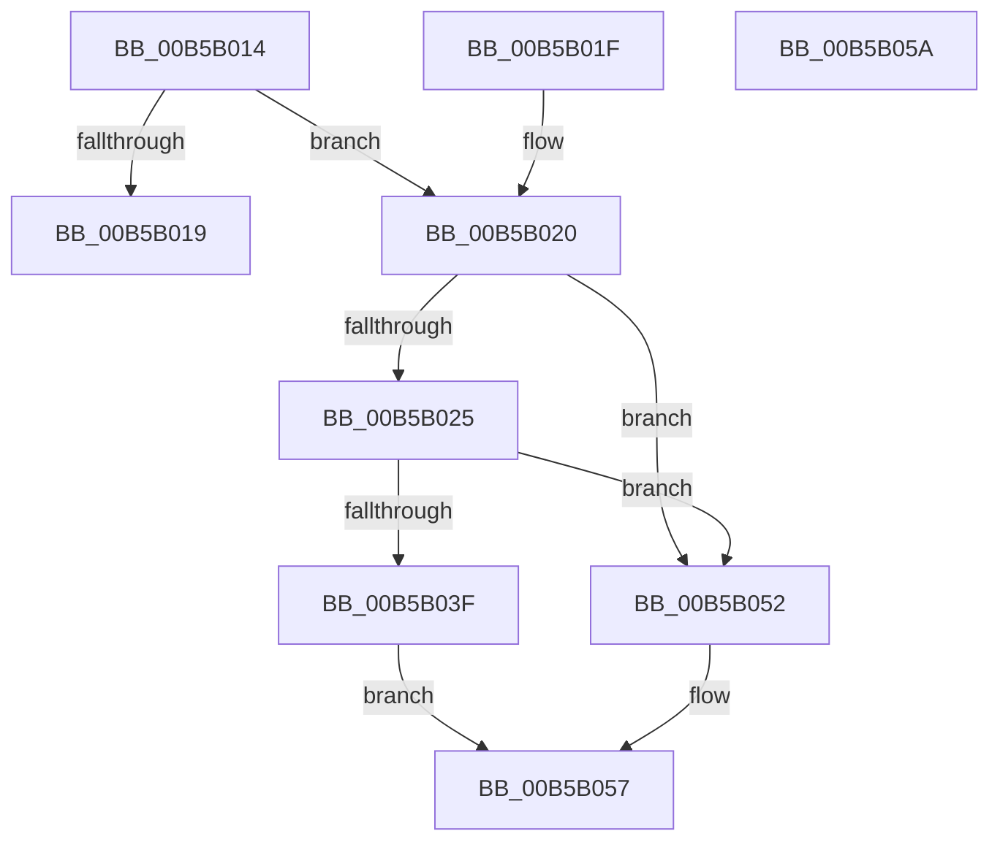

# HalpAdjustWakeSecondsDue

- RVA: `0x00B5B014`–`0x00B5B05B` (길이 `71` bytes)
- VA: `0x0000000140B5B014`
- 실행 섹션: `PAGELK`
- PDB 이름 있음: `예`; PDB Function 태그: `아니요`
- unwind 정보 RVA: `0x000DB714`
- 디코드: `22`개 명령, `71/71` bytes 표시
- 미해석 바이트: `0` (있으면 어셈블리에 `.byte`로 보존)

> 이 문서는 커널 이미지의 기계어와 PDB 기호를 분석해 생성했습니다. 4번과 5번은 함수 원형과 자료형을 바이너리 사용 방식에서 추정한 C 해석이며 원본 소스 복구 결과는 아닙니다.

## 1. Dependencies

- 직접 호출 지점: **0**; 고유 호출 대상: **0**
- 직접 호출자로 확인된 함수: **1**
- RIP 상대 이미지 참조: **0**

### Outgoing calls
- 직접 디코드된 call 명령이 없습니다.

### Direct callers
- [HaliSetWakeAlarm](../B7/HaliSetWakeAlarm_function_00B7D300.md) at `0x00B7D334`
- [HaliSetWakeAlarm](../B7/HaliSetWakeAlarm_function_00B7D300.md) at `0x00B7D341`

### Static image references
- 디코드된 RIP-relative 메모리 참조가 없습니다.

## 2. Other-region calls and transfers

- 다른 실행 섹션으로 향하는 call: **0**
- 별도 외부 분기/꼬리 이동을 확인하지 못했습니다.

## 3. Assembly (complete function range)

```asm
00B5B014  48 85 C9                        test rcx, rcx
00B5B017  75 07                           jne 0x140b5b020
00B5B019  B8 FF FF FF FF                  mov eax, 0xffffffff
00B5B01E  C3                              ret
00B5B01F  CC                              int3
00B5B020  48 3B D1                        cmp rdx, rcx
00B5B023  73 2D                           jae 0x140b5b052
00B5B025  48 2B CA                        sub rcx, rdx
00B5B028  48 B8 BD 42 7A E5 D5 94 BF D6   movabs rax, 0xd6bf94d5e57a42bd
00B5B032  48 F7 E1                        mul rcx
00B5B035  48 C1 EA 17                     shr rdx, 0x17
00B5B039  48 83 FA 1E                     cmp rdx, 0x1e
00B5B03D  7C 13                           jl 0x140b5b052
00B5B03F  B8 FF FF FF FF                  mov eax, 0xffffffff
00B5B044  B9 FE FF FF FF                  mov ecx, 0xfffffffe
00B5B049  48 3B D0                        cmp rdx, rax
00B5B04C  48 0F 4D D1                     cmovge rdx, rcx
00B5B050  EB 05                           jmp 0x140b5b057
00B5B052  BA 1E 00 00 00                  mov edx, 0x1e
00B5B057  8B C2                           mov eax, edx
00B5B059  C3                              ret
00B5B05A  CC                              int3
```

## 4. C-style interpretation (structured pseudocode)

```c
__int64 __fastcall HalpAdjustWakeSecondsDue(__int64 a1, __int64 a2)
{
    if (a1 != 0) goto loc_00B5B020;
    return (unsigned int)(0xFFFFFFFFULL);
loc_00B5B020:
    if (a2 >= a1) goto loc_00B5B052;
    a1 = (a1) - (a2);
    a2 = (a2) >> (23);
    if (a2 < 30) goto loc_00B5B052;
    if (a2 >= ((unsigned int)(0xFFFFFFFFULL))) { a2 = (unsigned int)(0xFFFFFFFEULL); }
    goto loc_00B5B057;
loc_00B5B052:
loc_00B5B057:
    return 30;
}
```

## 5. (Beta) C Style

```c
int64_t HalpAdjustWakeSecondsDue(int64_t Arg1, int64_t Arg2)
{
    if (Arg1 != 0) goto loc_00B5B020;
    return (uint32_t)(0xFFFFFFFFULL);
loc_00B5B020:
    if (Arg2 >= Arg1) goto loc_00B5B052;
    Arg1 = (Arg1) - (Arg2);
    Arg2 = (Arg2) >> (23);
    if (Arg2 < 30) goto loc_00B5B052;
    if (Arg2 >= ((uint32_t)(0xFFFFFFFFULL))) { Arg2 = (uint32_t)(0xFFFFFFFEULL); }
    goto loc_00B5B057;
loc_00B5B052:
loc_00B5B057:
    return 30;
}
```

## 6. Execution-region graph

[열기: 2D/3D 그래프와 함수 탐색 컨트롤 패널](../../../control-panel.html?section=pagelk&rva=0x00B5B014&view=graph)

- 2D 그래프는 위에서 아래로 흐르고, 3D 그래프는 빈 공간을 드래그해 회전합니다. Shift+드래그는 이동, 휠은 확대·축소, 함수 노드 선택은 대상 보고서 이동입니다.

### Static fallback


