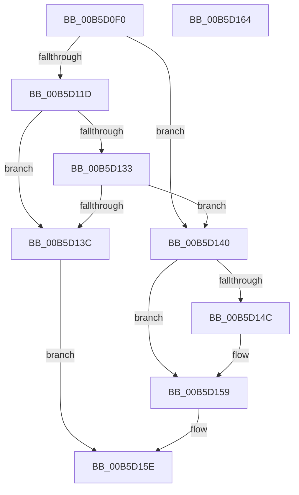

# HalpBuildResumeStructures

- RVA: `0x00B5D0F0`–`0x00B5D165` (길이 `117` bytes)
- VA: `0x0000000140B5D0F0`
- 실행 섹션: `PAGELK`
- PDB 이름 있음: `예`; PDB Function 태그: `아니요`
- unwind 정보 RVA: `0x0005CF00`
- 디코드: `32`개 명령, `117/117` bytes 표시
- 미해석 바이트: `0` (있으면 어셈블리에 `.byte`로 보존)

> 이 문서는 커널 이미지의 기계어와 PDB 기호를 분석해 생성했습니다. 4번과 5번은 함수 원형과 자료형을 바이너리 사용 방식에서 추정한 C 해석이며 원본 소스 복구 결과는 아닙니다.

## 1. Dependencies

- 직접 호출 지점: **5**; 고유 호출 대상: **5**
- 직접 호출자로 확인된 함수: **2**
- RIP 상대 이미지 참조: **4**

### Outgoing calls
- `0x00B5D0FB` → [KeQueryActiveProcessorCountEx](../../text/24/KeQueryActiveProcessorCountEx_function_00249EF0.md) (function, `0x00249EF0`)
- `0x00B5D10C` → [HalpMmAllocCtxAlloc](../../text/3E/HalpMmAllocCtxAlloc_function_003E10B8.md) (function, `0x003E10B8`)
- `0x00B5D125` → [memset](../../text/6C/memset_function_006C6C40.md) (function, `0x006C6C40`)
- `0x00B5D133` → [HalpMmUpdateTiledMemoryMapTargetStub](../../text/55/HalpMmUpdateTiledMemoryMapTargetStub_function_0055A974.md) (function, `0x0055A974`)
- `0x00B5D14C` → [HalpMmAllocCtxFree](../../text/3E/HalpMmAllocCtxFree_function_003E1904.md) (function, `0x003E1904`)

### Direct callers
- [HalpDispatchSystemStateTransition](../../text/4C/HalpDispatchSystemStateTransition_function_004C8E34.md) at `0x004C8E6E`
- [HalpDpReplaceBegin](../../page/70/HalpDpReplaceBegin_function_0070C130.md) at `0x0070C2A7`

### Static image references
- `0x00B5D111` → RVA `0x00FC1A90` (`.data`; write)
- `0x00B5D12A` → RVA `0x00FC3E28` (`.data`; read)
- `0x00B5D140` → RVA `0x00FC1A90` (`.data`; read)
- `0x00B5D151` → RVA `0x00FC1A90` (`.data`; read/write)

## 2. Other-region calls and transfers

- 다른 실행 섹션으로 향하는 call: **5**
  - `0x00B5D0FB` → [KeQueryActiveProcessorCountEx](../../text/24/KeQueryActiveProcessorCountEx_function_00249EF0.md) (`PAGELK` → `.text`)
  - `0x00B5D10C` → [HalpMmAllocCtxAlloc](../../text/3E/HalpMmAllocCtxAlloc_function_003E10B8.md) (`PAGELK` → `.text`)
  - `0x00B5D125` → [memset](../../text/6C/memset_function_006C6C40.md) (`PAGELK` → `.text`)
  - `0x00B5D133` → [HalpMmUpdateTiledMemoryMapTargetStub](../../text/55/HalpMmUpdateTiledMemoryMapTargetStub_function_0055A974.md) (`PAGELK` → `.text`)
  - `0x00B5D14C` → [HalpMmAllocCtxFree](../../text/3E/HalpMmAllocCtxFree_function_003E1904.md) (`PAGELK` → `.text`)
- 별도 외부 분기/꼬리 이동을 확인하지 못했습니다.

## 3. Assembly (complete function range)

```asm
00B5D0F0  40 53                           push rbx
00B5D0F2  48 83 EC 20                     sub rsp, 0x20
00B5D0F6  B9 FF FF 00 00                  mov ecx, 0xffff
00B5D0FB  E8 F0 CD 6E FF                  call 0x140249ef0
00B5D100  8B C0                           mov eax, eax
00B5D102  48 69 D8 C0 05 00 00            imul rbx, rax, 0x5c0
00B5D109  48 8B D3                        mov rdx, rbx
00B5D10C  E8 A7 3F 88 FF                  call 0x1403e10b8
00B5D111  48 89 05 78 49 46 00            mov qword ptr [rip + 0x464978], rax
00B5D118  48 85 C0                        test rax, rax
00B5D11B  74 23                           je 0x140b5d140
00B5D11D  4C 8B C3                        mov r8, rbx
00B5D120  33 D2                           xor edx, edx
00B5D122  48 8B C8                        mov rcx, rax
00B5D125  E8 16 9B B6 FF                  call 0x1406c6c40
00B5D12A  80 3D F7 6C 46 00 00            cmp byte ptr [rip + 0x466cf7], 0
00B5D131  74 09                           je 0x140b5d13c
00B5D133  E8 3C D8 9F FF                  call 0x14055a974
00B5D138  85 C0                           test eax, eax
00B5D13A  78 04                           js 0x140b5d140
00B5D13C  33 C0                           xor eax, eax
00B5D13E  EB 1E                           jmp 0x140b5d15e
00B5D140  48 8B 15 49 49 46 00            mov rdx, qword ptr [rip + 0x464949]
00B5D147  48 85 D2                        test rdx, rdx
00B5D14A  74 0D                           je 0x140b5d159
00B5D14C  E8 B3 47 88 FF                  call 0x1403e1904
00B5D151  48 83 25 37 49 46 00 00         and qword ptr [rip + 0x464937], 0
00B5D159  B8 9A 00 00 C0                  mov eax, 0xc000009a
00B5D15E  48 83 C4 20                     add rsp, 0x20
00B5D162  5B                              pop rbx
00B5D163  C3                              ret
00B5D164  CC                              int3
```

## 4. C-style interpretation (structured pseudocode)

```c
__int64 __fastcall HalpBuildResumeStructures(void)
{
    __int64 result;
    __int64 v_rbx;
    __int64 v_rsp;

    v_rsp = (v_rsp) - (32);
    result = KeQueryActiveProcessorCountEx((unsigned int)(0xFFFFULL), a2, a3, a4);
    v_rbx = (v_rbx) * ((unsigned int)((unsigned int)(result)));
    result = HalpMmAllocCtxAlloc((unsigned int)(0xFFFFULL), v_rbx, a3, a4);
    *(unsigned __int64 *)(v_rip + 4606328) = result;
    if (result == 0) goto loc_00B5D140;
    a2 = 0;
    result = memset(result, a2, v_rbx, a4);
    if ((*(unsigned __int8 *)(v_rip + 4615415)) == 0) goto loc_00B5D13C;
    result = HalpMmUpdateTiledMemoryMapTargetStub(result, a2, v_rbx, a4);
    if (sign_flag) goto loc_00B5D140;
loc_00B5D13C:
    result = 0;
    goto loc_00B5D15E;
loc_00B5D140:
    if (*(unsigned __int64 *)(v_rip + 4606281) != 0) {
        result = HalpMmAllocCtxFree(result, *(unsigned __int64 *)(v_rip + 4606281), v_rbx, a4);
    }
loc_00B5D15E:
    v_rsp = (v_rsp) + (32);
    return (unsigned int)(0xC000009AULL);
}
```

## 5. (Beta) C Style

```c
void HalpBuildResumeStructures(void)
{
    int64_t result;
    int64_t local_rbx;
    int64_t local_rsp;

    local_rsp = (local_rsp) - (32);
    result = KeQueryActiveProcessorCountEx((uint32_t)(0xFFFFULL), a2, a3, a4);
    local_rbx = (local_rbx) * ((uint32_t)((uint32_t)(result)));
    result = HalpMmAllocCtxAlloc((uint32_t)(0xFFFFULL), local_rbx, a3, a4);
    *(uint64_t *)(v_rip + 0x464978) = result;
    if (result == 0) goto loc_00B5D140;
    a2 = 0;
    result = memset(result, a2, local_rbx, a4);
    if ((*(uint8_t *)(v_rip + 0x466CF7)) == 0) goto loc_00B5D13C;
    result = HalpMmUpdateTiledMemoryMapTargetStub(result, a2, local_rbx, a4);
    if (sign_flag) goto loc_00B5D140;
loc_00B5D13C:
    result = 0;
    goto loc_00B5D15E;
loc_00B5D140:
    if (*(uint64_t *)(v_rip + 0x464949) != 0) {
        result = HalpMmAllocCtxFree(result, *(uint64_t *)(v_rip + 0x464949), local_rbx, a4);
    }
loc_00B5D15E:
    local_rsp = (local_rsp) + (32);
    return (uint32_t)(0xC000009AULL);
}
```

## 6. Execution-region graph

[열기: 2D/3D 그래프와 함수 탐색 컨트롤 패널](../../../control-panel.html?section=pagelk&rva=0x00B5D0F0&view=graph)

- 2D 그래프는 위에서 아래로 흐르고, 3D 그래프는 빈 공간을 드래그해 회전합니다. Shift+드래그는 이동, 휠은 확대·축소, 함수 노드 선택은 대상 보고서 이동입니다.

### Static fallback


