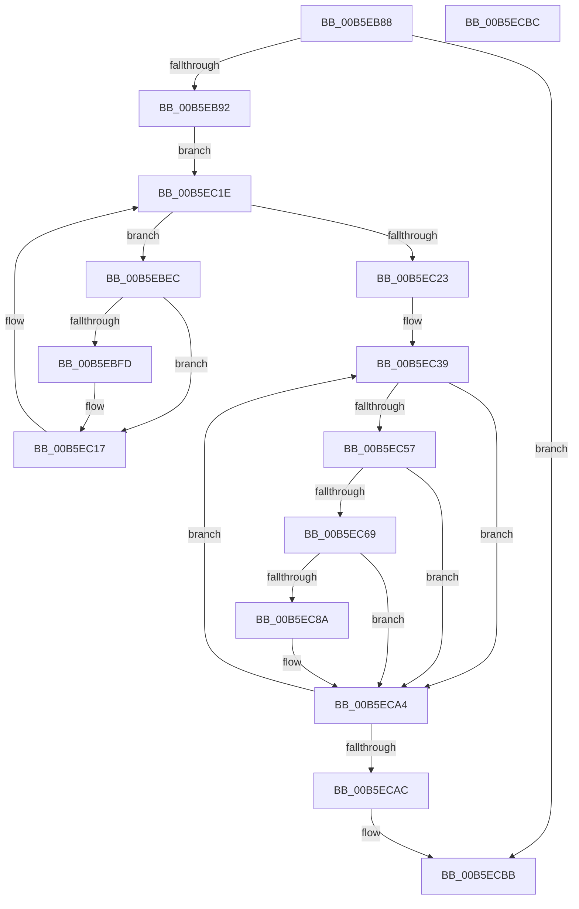

# HalpCheckLowMemoryPreSleep

- RVA: `0x00B5EB88`–`0x00B5ECBD` (길이 `309` bytes)
- VA: `0x0000000140B5EB88`
- 실행 섹션: `PAGELK`
- PDB 이름 있음: `예`; PDB Function 태그: `아니요`
- unwind 정보 RVA: `0x000C485C`
- 디코드: `83`개 명령, `309/309` bytes 표시
- 미해석 바이트: `0` (있으면 어셈블리에 `.byte`로 보존)

> 이 문서는 커널 이미지의 기계어와 PDB 기호를 분석해 생성했습니다. 4번과 5번은 함수 원형과 자료형을 바이너리 사용 방식에서 추정한 C 해석이며 원본 소스 복구 결과는 아닙니다.

## 1. Dependencies

- 직접 호출 지점: **7**; 고유 호출 대상: **7**
- 직접 호출자로 확인된 함수: **1**
- RIP 상대 이미지 참조: **4**

### Outgoing calls
- `0x00B5EBB3` → [RtlClearAllBits](../../text/45/RtlClearAllBits_function_00450230.md) (function, `0x00450230`)
- `0x00B5EBC2` → [IoGetStackLimits](../../text/41/IoGetStackLimits_function_0041FD70.md) (function, `0x0041FD70`)
- `0x00B5EBEF` → [MmGetPhysicalAddress](../../text/23/MmGetPhysicalAddress_function_0023A500.md) (function, `0x0023A500`)
- `0x00B5EC32` → [memset](../../text/6C/memset_function_006C6C40.md) (function, `0x006C6C40`)
- `0x00B5EC7D` → [HalpMapPhysicalMemory64](../../text/3F/HalpMapPhysicalMemory64_function_003F88C8.md) (function, `0x003F88C8`)
- `0x00B5EC8D` → [HalpSimpleCheck](HalpSimpleCheck_function_00B5EE7C.md) (function, `0x00B5EE7C`)
- `0x00B5EC9F` → [HalpUnmapVirtualAddress](../../text/3F/HalpUnmapVirtualAddress_function_003F8C30.md) (function, `0x003F8C30`)

### Direct callers
- [HaliAcpiSleep](../../text/56/HaliAcpiSleep_function_0056AD60.md) at `0x0056AFA1`

### Static image references
- `0x00B5EBA7` → RVA `0x00F901A0` (`.data`; read)
- `0x00B5EC08` → RVA `0x00F901A8` (`.data`; read)
- `0x00B5EC23` → RVA `0x00F90040` (`.data`; read)
- `0x00B5EC39` → RVA `0x00F901B8` (`.data`; read)

## 2. Other-region calls and transfers

- 다른 실행 섹션으로 향하는 call: **6**
  - `0x00B5EBB3` → [RtlClearAllBits](../../text/45/RtlClearAllBits_function_00450230.md) (`PAGELK` → `.text`)
  - `0x00B5EBC2` → [IoGetStackLimits](../../text/41/IoGetStackLimits_function_0041FD70.md) (`PAGELK` → `.text`)
  - `0x00B5EBEF` → [MmGetPhysicalAddress](../../text/23/MmGetPhysicalAddress_function_0023A500.md) (`PAGELK` → `.text`)
  - `0x00B5EC32` → [memset](../../text/6C/memset_function_006C6C40.md) (`PAGELK` → `.text`)
  - `0x00B5EC7D` → [HalpMapPhysicalMemory64](../../text/3F/HalpMapPhysicalMemory64_function_003F88C8.md) (`PAGELK` → `.text`)
  - `0x00B5EC9F` → [HalpUnmapVirtualAddress](../../text/3F/HalpUnmapVirtualAddress_function_003F8C30.md) (`PAGELK` → `.text`)
- 별도 외부 분기/꼬리 이동을 확인하지 못했습니다.

## 3. Assembly (complete function range)

```asm
00B5EB88  0F BA E1 11                     bt ecx, 0x11
00B5EB8C  0F 83 29 01 00 00               jae 0x140b5ecbb
00B5EB92  48 8B C4                        mov rax, rsp
00B5EB95  48 89 58 08                     mov qword ptr [rax + 8], rbx
00B5EB99  48 89 70 20                     mov qword ptr [rax + 0x20], rsi
00B5EB9D  57                              push rdi
00B5EB9E  48 83 EC 20                     sub rsp, 0x20
00B5EBA2  48 83 60 18 00                  and qword ptr [rax + 0x18], 0
00B5EBA7  48 8D 0D F2 15 43 00            lea rcx, [rip + 0x4315f2]
00B5EBAE  48 83 60 10 00                  and qword ptr [rax + 0x10], 0
00B5EBB3  E8 78 16 8F FF                  call 0x140450230
00B5EBB8  48 8D 54 24 40                  lea rdx, [rsp + 0x40]
00B5EBBD  48 8D 4C 24 38                  lea rcx, [rsp + 0x38]
00B5EBC2  E8 A9 11 8C FF                  call 0x14041fd70
00B5EBC7  48 8B 5C 24 38                  mov rbx, qword ptr [rsp + 0x38]
00B5EBCC  48 C7 C1 00 F0 FF FF            mov rcx, 0xfffffffffffff000
00B5EBD3  48 8B 7C 24 40                  mov rdi, qword ptr [rsp + 0x40]
00B5EBD8  48 23 D9                        and rbx, rcx
00B5EBDB  48 81 C7 FF 0F 00 00            add rdi, 0xfff
00B5EBE2  BE 00 01 00 00                  mov esi, 0x100
00B5EBE7  48 23 F9                        and rdi, rcx
00B5EBEA  EB 32                           jmp 0x140b5ec1e
00B5EBEC  48 8B CB                        mov rcx, rbx
00B5EBEF  E8 0C B9 6D FF                  call 0x14023a500
00B5EBF4  48 C1 F8 0C                     sar rax, 0xc
00B5EBF8  48 3B C6                        cmp rax, rsi
00B5EBFB  73 1A                           jae 0x140b5ec17
00B5EBFD  8B D0                           mov edx, eax
00B5EBFF  8B C8                           mov ecx, eax
00B5EC01  48 C1 EA 03                     shr rdx, 3
00B5EC05  83 E1 07                        and ecx, 7
00B5EC08  48 03 15 99 15 43 00            add rdx, qword ptr [rip + 0x431599]
00B5EC0F  0F BE 02                        movsx eax, byte ptr [rdx]
00B5EC12  0F AB C8                        bts eax, ecx
00B5EC15  88 02                           mov byte ptr [rdx], al
00B5EC17  48 81 C3 00 10 00 00            add rbx, 0x1000
00B5EC1E  48 3B DF                        cmp rbx, rdi
00B5EC21  72 C9                           jb 0x140b5ebec
00B5EC23  48 8D 3D 16 14 43 00            lea rdi, [rip + 0x431416]
00B5EC2A  4C 8B C6                        mov r8, rsi
00B5EC2D  48 8B CF                        mov rcx, rdi
00B5EC30  33 D2                           xor edx, edx
00B5EC32  E8 09 80 B6 FF                  call 0x1406c6c40
00B5EC37  33 DB                           xor ebx, ebx
00B5EC39  48 8B 05 78 15 43 00            mov rax, qword ptr [rip + 0x431578]
00B5EC40  8A CB                           mov cl, bl
00B5EC42  80 E1 07                        and cl, 7
00B5EC45  44 8B C3                        mov r8d, ebx
00B5EC48  49 C1 E8 03                     shr r8, 3
00B5EC4C  41 8A 14 00                     mov dl, byte ptr [r8 + rax]
00B5EC50  D2 FA                           sar dl, cl
00B5EC52  F6 C2 01                        test dl, 1
00B5EC55  75 4D                           jne 0x140b5eca4
00B5EC57  48 8B 05 4A 15 43 00            mov rax, qword ptr [rip + 0x43154a]
00B5EC5E  41 8A 14 00                     mov dl, byte ptr [r8 + rax]
00B5EC62  D2 FA                           sar dl, cl
00B5EC64  F6 C2 01                        test dl, 1
00B5EC67  75 3B                           jne 0x140b5eca4
00B5EC69  41 B9 04 00 00 00               mov r9d, 4
00B5EC6F  48 8B CB                        mov rcx, rbx
00B5EC72  48 C1 E1 0C                     shl rcx, 0xc
00B5EC76  45 33 C0                        xor r8d, r8d
00B5EC79  41 8D 51 FD                     lea edx, [r9 - 3]
00B5EC7D  E8 46 9C 89 FF                  call 0x1403f88c8
00B5EC82  4C 8B C8                        mov r9, rax
00B5EC85  48 85 C0                        test rax, rax
00B5EC88  74 1A                           je 0x140b5eca4
00B5EC8A  48 8B C8                        mov rcx, rax
00B5EC8D  E8 EA 01 00 00                  call 0x140b5ee7c
00B5EC92  45 33 C0                        xor r8d, r8d
00B5EC95  88 04 3B                        mov byte ptr [rbx + rdi], al
00B5EC98  49 8B C9                        mov rcx, r9
00B5EC9B  41 8D 50 01                     lea edx, [r8 + 1]
00B5EC9F  E8 8C 9F 89 FF                  call 0x1403f8c30
00B5ECA4  48 FF C3                        inc rbx
00B5ECA7  48 3B DE                        cmp rbx, rsi
00B5ECAA  72 8D                           jb 0x140b5ec39
00B5ECAC  48 8B 5C 24 30                  mov rbx, qword ptr [rsp + 0x30]
00B5ECB1  48 8B 74 24 48                  mov rsi, qword ptr [rsp + 0x48]
00B5ECB6  48 83 C4 20                     add rsp, 0x20
00B5ECBA  5F                              pop rdi
00B5ECBB  C3                              ret
00B5ECBC  CC                              int3
```

## 4. C-style interpretation (structured pseudocode)

```c
__int64 __fastcall HalpCheckLowMemoryPreSleep(int a1)
{
    __int64 result;
    __int64 v_rbx;
    __int64 v_rdi;
    __int64 v_rsp;
    unsigned __int64 v_stack_p10;
    unsigned __int64 v_stack_p18;
    unsigned __int64 v_stack_p20;
    unsigned __int64 v_stack_p8;

    if (condition_is_above_or_equal) goto loc_00B5ECBB;
    *(unsigned __int64 *)(v_rsp + 8) = v_rbx;
    *(unsigned __int64 *)(v_rsp + 32) = v_rsi;
    v_rsp = (v_rsp) - (32);
    result = RtlClearAllBits(v_rip + 4396530, a2, a3, a4);
    result = IoGetStackLimits(v_stack_p10, v_stack_p18, a3, a4);
    v_rbx = (v_stack_p10) & (0xFFFFFFFFFFFFF000ULL);
    v_rdi = (v_stack_p18) + (0xFFFULL);
    v_rdi = (v_rdi) & (0xFFFFFFFFFFFFF000ULL);
    goto loc_00B5EC1E;
loc_00B5EBEC:
    result = MmGetPhysicalAddress(v_rbx, v_stack_p18, a3, a4);
    result = (result) >> (12);
    if (result < 256) {
        a2 = (unsigned int)(result);
        a1 = (unsigned int)(result);
        a2 = (a2) >> (3);
        a1 = (unsigned int)((a1) & (7));
        a2 = (a2) + (*(unsigned __int64 *)(v_rip + 4396441));
        result = (__int8)(*(unsigned __int8 *)(a2));
        *(unsigned __int8 *)(a2) = (unsigned __int8)(result);
    }
    v_rbx = (v_rbx) + (0x1000ULL);
loc_00B5EC1E:
    if (v_rbx < v_rdi) goto loc_00B5EBEC;
    a2 = 0;
    result = memset(v_rip + 4396054, a2, 256, a4);
    v_rbx = 0;
loc_00B5EC39:
    a1 = (unsigned __int8)((0) & (7));
    a3 = (0) >> (3);
    a2 = (unsigned __int8)((*(unsigned __int8 *)(a3 + *(unsigned __int64 *)(v_rip + 4396408) * 1)) >> ((unsigned __int8)(a1)));
    if ((((unsigned __int8)(a2)) & (1)) != 0) goto loc_00B5ECA4;
    a2 = (unsigned __int8)((*(unsigned __int8 *)(a3 + *(unsigned __int64 *)(v_rip + 4396362) * 1)) >> ((unsigned __int8)(a1)));
    if ((((unsigned __int8)(a2)) & (1)) != 0) goto loc_00B5ECA4;
    a1 = (0) << (12);
    a3 = 0;
    result = HalpMapPhysicalMemory64(a1, 4 - 3, a3, 4);
    if (result != 0) {
        a1 = result;
        result = HalpSimpleCheck(a1, 4 - 3, a3, result);
        a3 = 0;
        *(unsigned __int8 *)(v_rbx + v_rip + 4396054 * 1) = (unsigned __int8)(result);
        a1 = result;
        a2 = a3 + 1;
        result = HalpUnmapVirtualAddress(a1, a2, a3, result);
    }
    v_rbx = (v_rbx) + 1;
    if (v_rbx < 256) goto loc_00B5EC39;
    v_rsp = (v_rsp) + (32);
loc_00B5ECBB:
    return result;
}
```

## 5. (Beta) C Style

```c
int64_t HalpCheckLowMemoryPreSleep(int32_t Arg1)
{
    int64_t result;
    int64_t local_rbx;
    int64_t local_rdi;
    int64_t local_rsp;
    uint64_t v_stack_p10;
    uint64_t v_stack_p18;
    uint64_t v_stack_p20;
    uint64_t v_stack_p8;

    if (condition_is_above_or_equal) goto loc_00B5ECBB;
    *(uint64_t *)(local_rsp + 0x8) = local_rbx;
    *(uint64_t *)(local_rsp + 0x20) = local_rsi;
    local_rsp = (local_rsp) - (32);
    result = RtlClearAllBits(v_rip + 4396530, a2, a3, a4);
    result = IoGetStackLimits(v_stack_p10, v_stack_p18, a3, a4);
    local_rbx = (v_stack_p10) & (0xFFFFFFFFFFFFF000ULL);
    local_rdi = (v_stack_p18) + (0xFFFULL);
    local_rdi = (local_rdi) & (0xFFFFFFFFFFFFF000ULL);
    goto loc_00B5EC1E;
loc_00B5EBEC:
    result = MmGetPhysicalAddress(local_rbx, v_stack_p18, a3, a4);
    result = (result) >> (12);
    if (result < 256) {
        a2 = (uint32_t)(result);
        Arg1 = (uint32_t)(result);
        a2 = (a2) >> (3);
        Arg1 = (uint32_t)((Arg1) & (7));
        a2 = (a2) + (*(uint64_t *)(v_rip + 0x431599));
        result = (int8_t)(*(uint8_t *)(a2));
        *(uint8_t *)(a2) = (uint8_t)(result);
    }
    local_rbx = (local_rbx) + (0x1000ULL);
loc_00B5EC1E:
    if (local_rbx < local_rdi) goto loc_00B5EBEC;
    a2 = 0;
    result = memset(v_rip + 4396054, a2, 256, a4);
    local_rbx = 0;
loc_00B5EC39:
    Arg1 = (uint8_t)((0) & (7));
    a3 = (0) >> (3);
    a2 = (uint8_t)((*(uint8_t *)(a3 + *(uint64_t *)(v_rip + 0x431578) * 1)) >> ((uint8_t)(Arg1)));
    if ((((uint8_t)(a2)) & (1)) != 0) goto loc_00B5ECA4;
    a2 = (uint8_t)((*(uint8_t *)(a3 + *(uint64_t *)(v_rip + 0x43154A) * 1)) >> ((uint8_t)(Arg1)));
    if ((((uint8_t)(a2)) & (1)) != 0) goto loc_00B5ECA4;
    Arg1 = (0) << (12);
    a3 = 0;
    result = HalpMapPhysicalMemory64(Arg1, 4 - 3, a3, 4);
    if (result != 0) {
        Arg1 = result;
        result = HalpSimpleCheck(Arg1, 4 - 3, a3, result);
        a3 = 0;
        *(uint8_t *)(local_rbx + v_rip + 0x431416 * 1) = (uint8_t)(result);
        Arg1 = result;
        a2 = a3 + 1;
        result = HalpUnmapVirtualAddress(Arg1, a2, a3, result);
    }
    local_rbx = (local_rbx) + 1;
    if (local_rbx < 256) goto loc_00B5EC39;
    local_rsp = (local_rsp) + (32);
loc_00B5ECBB:
    return result;
}
```

## 6. Execution-region graph

[열기: 2D/3D 그래프와 함수 탐색 컨트롤 패널](../../../control-panel.html?section=pagelk&rva=0x00B5EB88&view=graph)

- 2D 그래프는 위에서 아래로 흐르고, 3D 그래프는 빈 공간을 드래그해 회전합니다. Shift+드래그는 이동, 휠은 확대·축소, 함수 노드 선택은 대상 보고서 이동입니다.

### Static fallback


