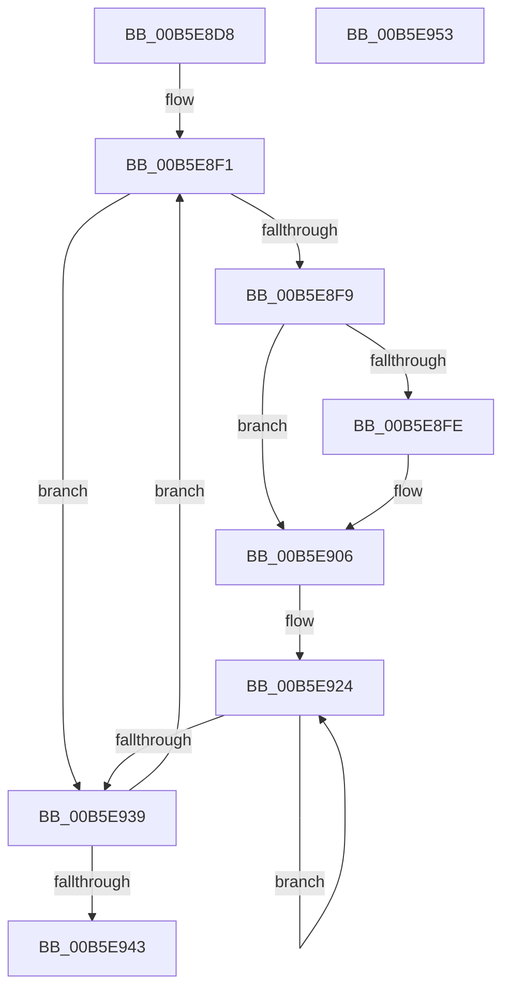

# HalpCommitCR3Worker

- RVA: `0x00B5E8D8`–`0x00B5E954` (길이 `124` bytes)
- VA: `0x0000000140B5E8D8`
- 실행 섹션: `PAGELK`
- PDB 이름 있음: `예`; PDB Function 태그: `아니요`
- unwind 정보 RVA: `0x00060BC4`
- 디코드: `36`개 명령, `124/124` bytes 표시
- 미해석 바이트: `0` (있으면 어셈블리에 `.byte`로 보존)

> 이 문서는 커널 이미지의 기계어와 PDB 기호를 분석해 생성했습니다. 4번과 5번은 함수 원형과 자료형을 바이너리 사용 방식에서 추정한 C 해석이며 원본 소스 복구 결과는 아닙니다.

## 1. Dependencies

- 직접 호출 지점: **2**; 고유 호출 대상: **2**
- 직접 호출자로 확인된 함수: **2**
- RIP 상대 이미지 참조: **0**

### Outgoing calls
- `0x00B5E901` → [HalpCommitCR3Worker](HalpCommitCR3Worker_function_00B5E8D8.md) (function, `0x00B5E8D8`)
- `0x00B5E909` → [MmGetPhysicalAddress](../../text/23/MmGetPhysicalAddress_function_0023A500.md) (function, `0x0023A500`)

### Direct callers
- [HalpCommitCR3Worker](HalpCommitCR3Worker_function_00B5E8D8.md) at `0x00B5E901`
- [HalpMmBuildTiledMemoryMap](HalpMmBuildTiledMemoryMap_function_00B5EA50.md) at `0x00B5EAC1`

### Static image references
- 디코드된 RIP-relative 메모리 참조가 없습니다.

## 2. Other-region calls and transfers

- 다른 실행 섹션으로 향하는 call: **1**
  - `0x00B5E909` → [MmGetPhysicalAddress](../../text/23/MmGetPhysicalAddress_function_0023A500.md) (`PAGELK` → `.text`)
- 별도 외부 분기/꼬리 이동을 확인하지 못했습니다.

## 3. Assembly (complete function range)

```asm
00B5E8D8  48 89 5C 24 08                  mov qword ptr [rsp + 8], rbx
00B5E8DD  48 89 74 24 10                  mov qword ptr [rsp + 0x10], rsi
00B5E8E2  57                              push rdi
00B5E8E3  48 83 EC 20                     sub rsp, 0x20
00B5E8E7  8B F2                           mov esi, edx
00B5E8E9  48 8B D9                        mov rbx, rcx
00B5E8EC  BF 00 02 00 00                  mov edi, 0x200
00B5E8F1  48 8B 0B                        mov rcx, qword ptr [rbx]
00B5E8F4  48 85 C9                        test rcx, rcx
00B5E8F7  74 40                           je 0x140b5e939
00B5E8F9  83 FE 02                        cmp esi, 2
00B5E8FC  72 08                           jb 0x140b5e906
00B5E8FE  8D 56 FF                        lea edx, [rsi - 1]
00B5E901  E8 D2 FF FF FF                  call 0x140b5e8d8
00B5E906  48 8B 0B                        mov rcx, qword ptr [rbx]
00B5E909  E8 F2 BB 6D FF                  call 0x14023a500
00B5E90E  BA 01 00 00 00                  mov edx, 1
00B5E913  48 B9 00 F0 FF FF FF FF 0F 00   movabs rcx, 0xffffffffff000
00B5E91D  48 23 C1                        and rax, rcx
00B5E920  44 8D 42 01                     lea r8d, [rdx + 1]
00B5E924  48 8B CA                        mov rcx, rdx
00B5E927  48 FF C2                        inc rdx
00B5E92A  48 0B C8                        or rcx, rax
00B5E92D  48 89 0B                        mov qword ptr [rbx], rcx
00B5E930  48 8B C1                        mov rax, rcx
00B5E933  49 83 E8 01                     sub r8, 1
00B5E937  75 EB                           jne 0x140b5e924
00B5E939  48 83 C3 08                     add rbx, 8
00B5E93D  48 83 EF 01                     sub rdi, 1
00B5E941  75 AE                           jne 0x140b5e8f1
00B5E943  48 8B 5C 24 30                  mov rbx, qword ptr [rsp + 0x30]
00B5E948  48 8B 74 24 38                  mov rsi, qword ptr [rsp + 0x38]
00B5E94D  48 83 C4 20                     add rsp, 0x20
00B5E951  5F                              pop rdi
00B5E952  C3                              ret
00B5E953  CC                              int3
```

## 4. C-style interpretation (structured pseudocode)

```c
__int64 __fastcall HalpCommitCR3Worker(__int64 a1, int a2)
{
    __int64 result;
    __int64 v_rbx;
    __int64 v_rdi;
    __int64 v_rsp;
    unsigned __int64 v_stack_p10;
    unsigned __int64 v_stack_p8;

    v_stack_p8 = v_rbx;
    v_stack_p10 = v_rsi;
    v_rsp = (v_rsp) - (32);
loc_00B5E8F1:
    if (*(unsigned __int64 *)(a1) == 0) goto loc_00B5E939;
    if (((unsigned int)((unsigned int)(a2))) >= 2) {
        a2 = (unsigned int)(a2) - 1;
        result = HalpCommitCR3Worker(*(unsigned __int64 *)(a1), a2, a3, a4);
    }
    result = MmGetPhysicalAddress(*(unsigned __int64 *)(a1), a2, a3, a4);
    result = (result) & (*(unsigned __int64 *)(a1));
loc_00B5E924:
    a2 = (1) + 1;
    a1 = (1) | (result);
    *(unsigned __int64 *)(a1) = a1;
    a3 = (1 + 1) - (1);
    if (condition_is_not_equal) goto loc_00B5E924;
loc_00B5E939:
    v_rbx = (a1) + (8);
    v_rdi = (512) - (1);
    if (condition_is_not_equal) goto loc_00B5E8F1;
    v_rsp = (v_rsp) + (32);
    return a1;
}
```

## 5. (Beta) C Style

```c
void *HalpCommitCR3Worker(void *Arg1, int32_t Arg2)
{
    uint8_t *arg1 = (uint8_t *)Arg1;

    int64_t result;
    int64_t local_rbx;
    int64_t local_rdi;
    int64_t local_rsp;
    uint64_t v_stack_p10;
    uint64_t v_stack_p8;

    v_stack_p8 = local_rbx;
    v_stack_p10 = local_rsi;
    local_rsp = (local_rsp) - (32);
loc_00B5E8F1:
    if (*(uint64_t *)(arg1) == 0) goto loc_00B5E939;
    if (((uint32_t)((uint32_t)(Arg2))) >= 2) {
        Arg2 = (uint32_t)(Arg2) - 1;
        result = HalpCommitCR3Worker(*(uint64_t *)(arg1), Arg2, a3, a4);
    }
    result = MmGetPhysicalAddress(*(uint64_t *)(arg1), Arg2, a3, a4);
    result = (result) & (*(uint64_t *)(arg1));
loc_00B5E924:
    Arg2 = (1) + 1;
    Arg1 = (1) | (result);
    *(void **)(arg1) = Arg1;
    a3 = (1 + 1) - (1);
    if (condition_is_not_equal) goto loc_00B5E924;
loc_00B5E939:
    local_rbx = (Arg1) + (8);
    local_rdi = (512) - (1);
    if (condition_is_not_equal) goto loc_00B5E8F1;
    local_rsp = (local_rsp) + (32);
    return Arg1;
}
```

### 관측된 메모리 오프셋

구조체 형식이 확인되지 않은 접근은 인자 기준의 오프셋으로만 기록했습니다.

| 기준 인자 | 오프셋 표현 | 폭 (bit) | 접근 |
|---|---:|---:|---|
| `Arg1` | `+ 0x0` | `64` | `R` |
| `Arg1` | `+ 0x0` | `64` | `W` |

## 6. Execution-region graph

[열기: 2D/3D 그래프와 함수 탐색 컨트롤 패널](../../../control-panel.html?section=pagelk&rva=0x00B5E8D8&view=graph)

- 2D 그래프는 위에서 아래로 흐르고, 3D 그래프는 빈 공간을 드래그해 회전합니다. Shift+드래그는 이동, 휠은 확대·축소, 함수 노드 선택은 대상 보고서 이동입니다.

### Static fallback


