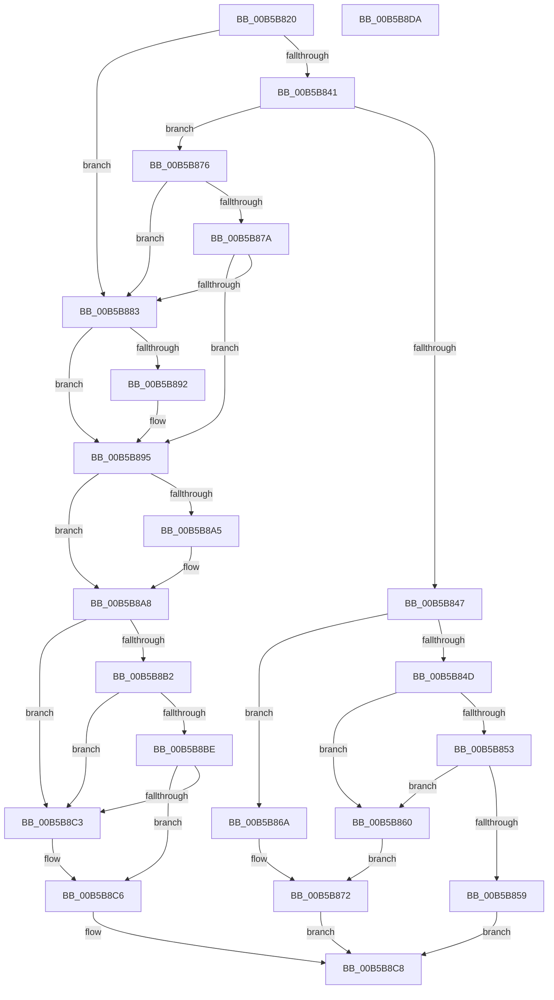

# HalpCorrectErrSrc

- RVA: `0x00B5B820`–`0x00B5B8DB` (길이 `187` bytes)
- VA: `0x0000000140B5B820`
- 실행 섹션: `PAGELK`
- PDB 이름 있음: `예`; PDB Function 태그: `아니요`
- unwind 정보 RVA: `0x00060BC4`
- 디코드: `61`개 명령, `187/187` bytes 표시
- 미해석 바이트: `0` (있으면 어셈블리에 `.byte`로 보존)

> 이 문서는 커널 이미지의 기계어와 PDB 기호를 분석해 생성했습니다. 4번과 5번은 함수 원형과 자료형을 바이너리 사용 방식에서 추정한 C 해석이며 원본 소스 복구 결과는 아닙니다.

## 1. Dependencies

- 직접 호출 지점: **6**; 고유 호출 대상: **6**
- 직접 호출자로 확인된 함수: **0**
- RIP 상대 이미지 참조: **0**

### Outgoing calls
- `0x00B5B863` → [HalpCorrectGenericErrSrc](../../text/55/HalpCorrectGenericErrSrc_function_00555B10.md) (function, `0x00555B10`)
- `0x00B5B86D` → [HalpCorrectNMIErrSrc](../../text/54/HalpCorrectNMIErrSrc_function_00545980.md) (function, `0x00545980`)
- `0x00B5B87A` → [HalpIsCmciImplemented](HalpIsCmciImplemented_function_00B5C314.md) (function, `0x00B5C314`)
- `0x00B5B888` → [KeQueryActiveProcessorCountEx](../../text/24/KeQueryActiveProcessorCountEx_function_00249EF0.md) (function, `0x00249EF0`)
- `0x00B5B895` → [HalpGetMcaVendorSpecificSections](../../text/54/HalpGetMcaVendorSpecificSections_function_00545408.md) (function, `0x00545408`)
- `0x00B5B8B2` → [HalpGetMcaMaxVendorSpecificSectionLength](../../text/54/HalpGetMcaMaxVendorSpecificSectionLength_function_005453E4.md) (function, `0x005453E4`)

### Direct callers
- 이 함수 시작 RVA로 연결되는 직접 call은 확인되지 않았습니다. 간접 호출은 완전히 역산할 수 없습니다.

### Static image references
- 디코드된 RIP-relative 메모리 참조가 없습니다.

## 2. Other-region calls and transfers

- 다른 실행 섹션으로 향하는 call: **5**
  - `0x00B5B863` → [HalpCorrectGenericErrSrc](../../text/55/HalpCorrectGenericErrSrc_function_00555B10.md) (`PAGELK` → `.text`)
  - `0x00B5B86D` → [HalpCorrectNMIErrSrc](../../text/54/HalpCorrectNMIErrSrc_function_00545980.md) (`PAGELK` → `.text`)
  - `0x00B5B888` → [KeQueryActiveProcessorCountEx](../../text/24/KeQueryActiveProcessorCountEx_function_00249EF0.md) (`PAGELK` → `.text`)
  - `0x00B5B895` → [HalpGetMcaVendorSpecificSections](../../text/54/HalpGetMcaVendorSpecificSections_function_00545408.md) (`PAGELK` → `.text`)
  - `0x00B5B8B2` → [HalpGetMcaMaxVendorSpecificSectionLength](../../text/54/HalpGetMcaMaxVendorSpecificSectionLength_function_005453E4.md) (`PAGELK` → `.text`)
- 별도 외부 분기/꼬리 이동을 확인하지 못했습니다.

## 3. Assembly (complete function range)

```asm
00B5B820  48 89 5C 24 08                  mov qword ptr [rsp + 8], rbx
00B5B825  48 89 74 24 10                  mov qword ptr [rsp + 0x10], rsi
00B5B82A  57                              push rdi
00B5B82B  48 83 EC 20                     sub rsp, 0x20
00B5B82F  48 8B F9                        mov rdi, rcx
00B5B832  33 DB                           xor ebx, ebx
00B5B834  8B 49 08                        mov ecx, dword ptr [rcx + 8]
00B5B837  48 8B F2                        mov rsi, rdx
00B5B83A  44 8B C1                        mov r8d, ecx
00B5B83D  85 C9                           test ecx, ecx
00B5B83F  74 42                           je 0x140b5b883
00B5B841  41 83 E8 01                     sub r8d, 1
00B5B845  74 2F                           je 0x140b5b876
00B5B847  41 83 E8 02                     sub r8d, 2
00B5B84B  74 1D                           je 0x140b5b86a
00B5B84D  41 83 E8 02                     sub r8d, 2
00B5B851  74 0D                           je 0x140b5b860
00B5B853  41 83 F8 07                     cmp r8d, 7
00B5B857  74 07                           je 0x140b5b860
00B5B859  BB BB 00 00 C0                  mov ebx, 0xc00000bb
00B5B85E  EB 68                           jmp 0x140b5b8c8
00B5B860  48 8B CF                        mov rcx, rdi
00B5B863  E8 A8 A2 9F FF                  call 0x140555b10
00B5B868  EB 08                           jmp 0x140b5b872
00B5B86A  48 8B CF                        mov rcx, rdi
00B5B86D  E8 0E A1 9E FF                  call 0x140545980
00B5B872  8B D8                           mov ebx, eax
00B5B874  EB 52                           jmp 0x140b5b8c8
00B5B876  85 C9                           test ecx, ecx
00B5B878  74 09                           je 0x140b5b883
00B5B87A  E8 95 0A 00 00                  call 0x140b5c314
00B5B87F  84 C0                           test al, al
00B5B881  74 12                           je 0x140b5b895
00B5B883  B9 FF FF 00 00                  mov ecx, 0xffff
00B5B888  E8 63 E6 6E FF                  call 0x140249ef0
00B5B88D  39 47 14                        cmp dword ptr [rdi + 0x14], eax
00B5B890  73 03                           jae 0x140b5b895
00B5B892  89 47 14                        mov dword ptr [rdi + 0x14], eax
00B5B895  E8 6E 9B 9E FF                  call 0x140545408
00B5B89A  0F B7 D0                        movzx edx, ax
00B5B89D  8D 42 05                        lea eax, [rdx + 5]
00B5B8A0  39 47 18                        cmp dword ptr [rdi + 0x18], eax
00B5B8A3  73 03                           jae 0x140b5b8a8
00B5B8A5  89 47 18                        mov dword ptr [rdi + 0x18], eax
00B5B8A8  41 B8 F8 04 00 00               mov r8d, 0x4f8
00B5B8AE  85 D2                           test edx, edx
00B5B8B0  74 11                           je 0x140b5b8c3
00B5B8B2  E8 2D 9B 9E FF                  call 0x1405453e4
00B5B8B7  3D A8 04 00 00                  cmp eax, 0x4a8
00B5B8BC  72 05                           jb 0x140b5b8c3
00B5B8BE  41 3B C0                        cmp eax, r8d
00B5B8C1  77 03                           ja 0x140b5b8c6
00B5B8C3  41 8B C0                        mov eax, r8d
00B5B8C6  89 06                           mov dword ptr [rsi], eax
00B5B8C8  48 8B 74 24 38                  mov rsi, qword ptr [rsp + 0x38]
00B5B8CD  8B C3                           mov eax, ebx
00B5B8CF  48 8B 5C 24 30                  mov rbx, qword ptr [rsp + 0x30]
00B5B8D4  48 83 C4 20                     add rsp, 0x20
00B5B8D8  5F                              pop rdi
00B5B8D9  C3                              ret
00B5B8DA  CC                              int3
```

## 4. C-style interpretation (structured pseudocode)

```c
__int64 __fastcall HalpCorrectErrSrc(__int64 a1, __int64 a2)
{
    __int64 result;
    __int64 v_rbx;
    __int64 v_rsp;
    unsigned __int64 v_stack_p10;
    unsigned __int64 v_stack_p8;

    v_stack_p8 = v_rbx;
    v_stack_p10 = v_rsi;
    v_rsp = (v_rsp) - (32);
    v_rbx = 0;
    if ((unsigned int)((unsigned int)(*(unsigned int *)(a1 + 8))) == 0) goto loc_00B5B883;
    a3 = (unsigned int)(((unsigned int)((unsigned int)((unsigned int)(*(unsigned int *)(a1 + 8))))) - (1));
    if (condition_is_equal) goto loc_00B5B876;
    a3 = (unsigned int)((a3) - (2));
    if (condition_is_equal) goto loc_00B5B86A;
    a3 = (unsigned int)((a3) - (2));
    if (condition_is_equal) goto loc_00B5B860;
    if (((unsigned int)(a3)) == 7) goto loc_00B5B860;
    goto loc_00B5B8C8;
loc_00B5B860:
    result = HalpCorrectGenericErrSrc(a1, a2, a3, a4);
    goto loc_00B5B872;
loc_00B5B86A:
    result = HalpCorrectNMIErrSrc(a1, a2, a3, a4);
loc_00B5B872:
    goto loc_00B5B8C8;
loc_00B5B876:
    if ((unsigned int)(a1) == 0) goto loc_00B5B883;
    result = HalpIsCmciImplemented(a1, a2, a3, a4);
    if ((unsigned __int8)(result) == 0) goto loc_00B5B895;
loc_00B5B883:
    result = KeQueryActiveProcessorCountEx((unsigned int)(0xFFFFULL), a2, a3, a4);
    if ((*(unsigned int *)(a1 + 20)) < ((unsigned int)(result))) {
        *(unsigned int *)(a1 + 20) = (unsigned int)(result);
    }
    result = HalpGetMcaVendorSpecificSections((unsigned int)(0xFFFFULL), a2, a3, a4);
    if ((*(unsigned int *)(a1 + 24)) < ((unsigned int)((unsigned __int16)(result) + 5))) {
        *(unsigned int *)(a1 + 24) = (unsigned int)((unsigned __int16)(result) + 5);
    }
    if ((unsigned int)((unsigned __int16)(result)) == 0) goto loc_00B5B8C3;
    result = HalpGetMcaMaxVendorSpecificSectionLength((unsigned int)(0xFFFFULL), (unsigned __int16)(result), (unsigned int)(0x4F8ULL), a4);
    if (((unsigned int)(result)) < 0x4A8ULL) goto loc_00B5B8C3;
    if (((unsigned int)(result)) <= ((unsigned int)((unsigned int)(0x4F8ULL)))) {
        result = (unsigned int)((unsigned int)(0x4F8ULL));
    }
    *(unsigned int *)(a2) = (unsigned int)(result);
loc_00B5B8C8:
    v_rsp = (v_rsp) + (32);
    return (unsigned int)((unsigned int)((unsigned int)((unsigned int)(result))));
}
```

## 5. (Beta) C Style

```c
int64_t HalpCorrectErrSrc(void *Arg1, void *Arg2)
{
    uint8_t *arg1 = (uint8_t *)Arg1;
    uint8_t *arg2 = (uint8_t *)Arg2;

    int64_t result;
    int64_t local_rbx;
    int64_t local_rsp;
    uint64_t v_stack_p10;
    uint64_t v_stack_p8;

    v_stack_p8 = local_rbx;
    v_stack_p10 = local_rsi;
    local_rsp = (local_rsp) - (32);
    local_rbx = 0;
    if ((uint32_t)((uint32_t)(*(uint32_t *)(arg1 + 0x8))) == 0) goto loc_00B5B883;
    a3 = (uint32_t)(((uint32_t)((uint32_t)((uint32_t)(*(uint32_t *)(arg1 + 0x8))))) - (1));
    if (condition_is_equal) goto loc_00B5B876;
    a3 = (uint32_t)((a3) - (2));
    if (condition_is_equal) goto loc_00B5B86A;
    a3 = (uint32_t)((a3) - (2));
    if (condition_is_equal) goto loc_00B5B860;
    if (((uint32_t)(a3)) == 7) goto loc_00B5B860;
    goto loc_00B5B8C8;
loc_00B5B860:
    result = HalpCorrectGenericErrSrc(Arg1, Arg2, a3, a4);
    goto loc_00B5B872;
loc_00B5B86A:
    result = HalpCorrectNMIErrSrc(Arg1, Arg2, a3, a4);
loc_00B5B872:
    goto loc_00B5B8C8;
loc_00B5B876:
    if ((uint32_t)(Arg1) == 0) goto loc_00B5B883;
    result = HalpIsCmciImplemented(Arg1, Arg2, a3, a4);
    if ((uint8_t)(result) == 0) goto loc_00B5B895;
loc_00B5B883:
    result = KeQueryActiveProcessorCountEx((uint32_t)(0xFFFFULL), Arg2, a3, a4);
    if ((*(uint32_t *)(arg1 + 0x14)) < ((uint32_t)(result))) {
        *(uint32_t *)(arg1 + 0x14) = (uint32_t)(result);
    }
    result = HalpGetMcaVendorSpecificSections((uint32_t)(0xFFFFULL), Arg2, a3, a4);
    if ((*(uint32_t *)(arg1 + 0x18)) < ((uint32_t)((uint16_t)(result) + 5))) {
        *(uint32_t *)(arg1 + 0x18) = (uint32_t)((uint16_t)(result) + 5);
    }
    if ((uint32_t)((uint16_t)(result)) == 0) goto loc_00B5B8C3;
    result = HalpGetMcaMaxVendorSpecificSectionLength((uint32_t)(0xFFFFULL), (uint16_t)(result), (uint32_t)(0x4F8ULL), a4);
    if (((uint32_t)(result)) < 0x4A8ULL) goto loc_00B5B8C3;
    if (((uint32_t)(result)) <= ((uint32_t)((uint32_t)(0x4F8ULL)))) {
        result = (uint32_t)((uint32_t)(0x4F8ULL));
    }
    *(uint32_t *)(arg2) = (uint32_t)(result);
loc_00B5B8C8:
    local_rsp = (local_rsp) + (32);
    return (uint32_t)((uint32_t)((uint32_t)((uint32_t)(result))));
}
```

### 관측된 메모리 오프셋

구조체 형식이 확인되지 않은 접근은 인자 기준의 오프셋으로만 기록했습니다.

| 기준 인자 | 오프셋 표현 | 폭 (bit) | 접근 |
|---|---:|---:|---|
| `Arg1` | `+ 0x8` | `32` | `R` |
| `Arg1` | `+ 0x14` | `32` | `R` |
| `Arg1` | `+ 0x14` | `32` | `W` |
| `Arg1` | `+ 0x18` | `32` | `R` |
| `Arg1` | `+ 0x18` | `32` | `W` |
| `Arg2` | `+ 0x0` | `32` | `W` |

## 6. Execution-region graph

[열기: 2D/3D 그래프와 함수 탐색 컨트롤 패널](../../../control-panel.html?section=pagelk&rva=0x00B5B820&view=graph)

- 2D 그래프는 위에서 아래로 흐르고, 3D 그래프는 빈 공간을 드래그해 회전합니다. Shift+드래그는 이동, 휠은 확대·축소, 함수 노드 선택은 대상 보고서 이동입니다.

### Static fallback


