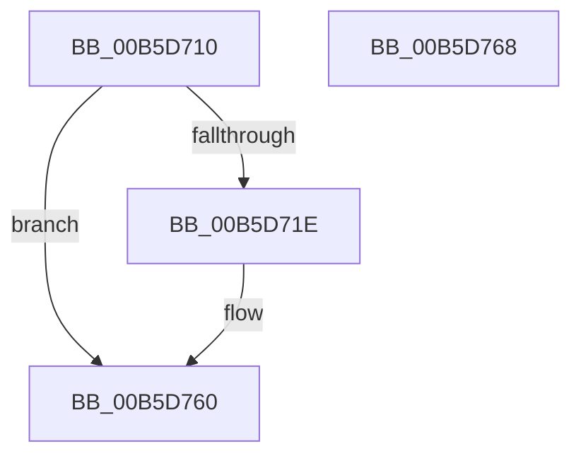

# HalpDbgInitSystem

- RVA: `0x00B5D710`–`0x00B5D769` (길이 `89` bytes)
- VA: `0x0000000140B5D710`
- 실행 섹션: `PAGELK`
- PDB 이름 있음: `예`; PDB Function 태그: `아니요`
- unwind 정보 RVA: `0x0005CF00`
- 디코드: `22`개 명령, `89/89` bytes 표시
- 미해석 바이트: `0` (있으면 어셈블리에 `.byte`로 보존)

> 이 문서는 커널 이미지의 기계어와 PDB 기호를 분석해 생성했습니다. 4번과 5번은 함수 원형과 자료형을 바이너리 사용 방식에서 추정한 C 해석이며 원본 소스 복구 결과는 아닙니다.

## 1. Dependencies

- 직접 호출 지점: **4**; 고유 호출 대상: **4**
- 직접 호출자로 확인된 함수: **0**
- RIP 상대 이미지 참조: **3**

### Outgoing calls
- `0x00B5D72C` → [HalpCopyDebugDescriptor](../../init/C2/HalpCopyDebugDescriptor_function_00C24CC0.md) (function, `0x00C24CC0`)
- `0x00B5D738` → [HalpRegisterKdSupportFunctions](../../init/C2/HalpRegisterKdSupportFunctions_function_00C24DFC.md) (function, `0x00C24DFC`)
- `0x00B5D745` → [HalAcpiGetTable](../../text/53/HalAcpiGetTable_function_0053EA00.md) (function, `0x0053EA00`)
- `0x00B5D751` → [KdGetDebugDevice](../../text/5B/KdGetDebugDevice_function_005B0710.md) (function, `0x005B0710`)

### Direct callers
- 이 함수 시작 RVA로 연결되는 직접 call은 확인되지 않았습니다. 간접 호출은 완전히 역산할 수 없습니다.

### Static image references
- `0x00B5D731` → RVA `0x00FC19A0` (`.data`; write)
- `0x00B5D74A` → RVA `0x00FC1998` (`.data`; write)
- `0x00B5D756` → RVA `0x00FC19A0` (`.data`; read)

## 2. Other-region calls and transfers

- 다른 실행 섹션으로 향하는 call: **4**
  - `0x00B5D72C` → [HalpCopyDebugDescriptor](../../init/C2/HalpCopyDebugDescriptor_function_00C24CC0.md) (`PAGELK` → `INIT`)
  - `0x00B5D738` → [HalpRegisterKdSupportFunctions](../../init/C2/HalpRegisterKdSupportFunctions_function_00C24DFC.md) (`PAGELK` → `INIT`)
  - `0x00B5D745` → [HalAcpiGetTable](../../text/53/HalAcpiGetTable_function_0053EA00.md) (`PAGELK` → `.text`)
  - `0x00B5D751` → [KdGetDebugDevice](../../text/5B/KdGetDebugDevice_function_005B0710.md) (`PAGELK` → `.text`)
- 별도 외부 분기/꼬리 이동을 확인하지 못했습니다.

## 3. Assembly (complete function range)

```asm
00B5D710  40 53                           push rbx
00B5D712  48 83 EC 20                     sub rsp, 0x20
00B5D716  49 8B D8                        mov rbx, r8
00B5D719  83 F9 01                        cmp ecx, 1
00B5D71C  75 42                           jne 0x140b5d760
00B5D71E  49 8B 88 F0 00 00 00            mov rcx, qword ptr [r8 + 0xf0]
00B5D725  48 8B 89 F0 0A 00 00            mov rcx, qword ptr [rcx + 0xaf0]
00B5D72C  E8 8F 75 0C 00                  call 0x140c24cc0
00B5D731  48 89 05 68 42 46 00            mov qword ptr [rip + 0x464268], rax
00B5D738  E8 BF 76 0C 00                  call 0x140c24dfc
00B5D73D  48 8B CB                        mov rcx, rbx
00B5D740  BA 44 42 47 50                  mov edx, 0x50474244
00B5D745  E8 B6 12 9E FF                  call 0x14053ea00
00B5D74A  48 89 05 47 42 46 00            mov qword ptr [rip + 0x464247], rax
00B5D751  E8 BA 2F A5 FF                  call 0x1405b0710
00B5D756  48 8B 0D 43 42 46 00            mov rcx, qword ptr [rip + 0x464243]
00B5D75D  48 89 08                        mov qword ptr [rax], rcx
00B5D760  33 C0                           xor eax, eax
00B5D762  48 83 C4 20                     add rsp, 0x20
00B5D766  5B                              pop rbx
00B5D767  C3                              ret
00B5D768  CC                              int3
```

## 4. C-style interpretation (structured pseudocode)

```c
__int64 __fastcall HalpDbgInitSystem(int a1, __int64 a2, __int64 a3)
{
    __int64 result;
    __int64 v_rsp;

    v_rsp = (v_rsp) - (32);
    if (a1 == 1) {
        a1 = *(unsigned __int64 *)(a3 + 240);
        a1 = *(unsigned __int64 *)(a1 + 2800);
        result = HalpCopyDebugDescriptor(a1, a2, a3, a4);
        *(unsigned __int64 *)(v_rip + 4604520) = result;
        result = HalpRegisterKdSupportFunctions(a1, a2, a3, a4);
        a1 = a3;
        a2 = 0x50474244ULL;
        result = HalAcpiGetTable(a1, a2, a3, a4);
        *(unsigned __int64 *)(v_rip + 4604487) = result;
        result = KdGetDebugDevice(a1, a2, a3, a4);
        a1 = *(unsigned __int64 *)(v_rip + 4604483);
        *(unsigned __int64 *)(result) = a1;
    }
    result = 0;
    v_rsp = (v_rsp) + (32);
    return result;
}
```

## 5. (Beta) C Style

```c
int64_t HalpDbgInitSystem(int32_t Arg1, int64_t Arg2, void *Arg3)
{
    uint8_t *arg3 = (uint8_t *)Arg3;

    int64_t result;
    int64_t local_rsp;

    local_rsp = (local_rsp) - (32);
    if (Arg1 == 1) {
        Arg1 = *(uint64_t *)(arg3 + 0xF0);
        Arg1 = *(uint64_t *)(Arg1 + 0xAF0);
        result = HalpCopyDebugDescriptor(Arg1, Arg2, Arg3, a4);
        *(uint64_t *)(v_rip + 0x464268) = result;
        result = HalpRegisterKdSupportFunctions(Arg1, Arg2, Arg3, a4);
        Arg1 = Arg3;
        Arg2 = 0x50474244ULL;
        result = HalAcpiGetTable(Arg1, Arg2, Arg3, a4);
        *(uint64_t *)(v_rip + 0x464247) = result;
        result = KdGetDebugDevice(Arg1, Arg2, Arg3, a4);
        Arg1 = *(uint64_t *)(v_rip + 0x464243);
        *(uint64_t *)(result) = Arg1;
    }
    result = 0;
    local_rsp = (local_rsp) + (32);
    return result;
}
```

### 관측된 메모리 오프셋

구조체 형식이 확인되지 않은 접근은 인자 기준의 오프셋으로만 기록했습니다.

| 기준 인자 | 오프셋 표현 | 폭 (bit) | 접근 |
|---|---:|---:|---|
| `Arg3` | `+ 0xF0` | `64` | `R` |

## 6. Execution-region graph

[열기: 2D/3D 그래프와 함수 탐색 컨트롤 패널](../../../control-panel.html?section=pagelk&rva=0x00B5D710&view=graph)

- 2D 그래프는 위에서 아래로 흐르고, 3D 그래프는 빈 공간을 드래그해 회전합니다. Shift+드래그는 이동, 휠은 확대·축소, 함수 노드 선택은 대상 보고서 이동입니다.

### Static fallback


