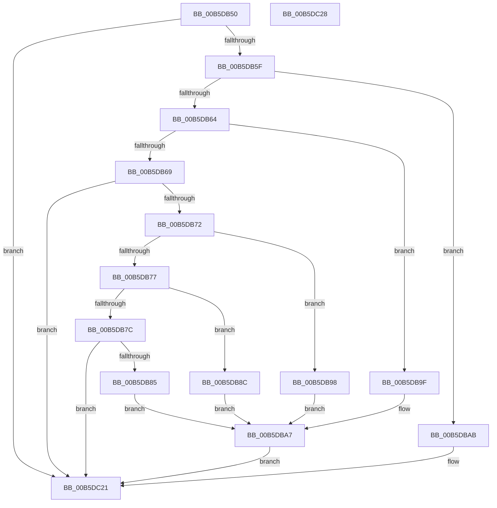

# HalpDmaInitSystem

- RVA: `0x00B5DB50`–`0x00B5DC29` (길이 `217` bytes)
- VA: `0x0000000140B5DB50`
- 실행 섹션: `PAGELK`
- PDB 이름 있음: `예`; PDB Function 태그: `아니요`
- unwind 정보 RVA: `0x0005C788`
- 디코드: `48`개 명령, `217/217` bytes 표시
- 미해석 바이트: `0` (있으면 어셈블리에 `.byte`로 보존)

> 이 문서는 커널 이미지의 기계어와 PDB 기호를 분석해 생성했습니다. 4번과 5번은 함수 원형과 자료형을 바이너리 사용 방식에서 추정한 C 해석이며 원본 소스 복구 결과는 아닙니다.

## 1. Dependencies

- 직접 호출 지점: **5**; 고유 호출 대상: **5**
- 직접 호출자로 확인된 함수: **0**
- RIP 상대 이미지 참조: **17**

### Outgoing calls
- `0x00B5DB85` → [HalpDmaInitPowerManagement](../../text/55/HalpDmaInitPowerManagement_function_005530E0.md) (function, `0x005530E0`)
- `0x00B5DB8C` → [HalpDmaFinalizeDoubleBufferingDisposition](../../init/C1/HalpDmaFinalizeDoubleBufferingDisposition_function_00C1E354.md) (function, `0x00C1E354`)
- `0x00B5DB91` → [HalpDmaInitEarly](../../init/C2/HalpDmaInitEarly_function_00C20F3C.md) (function, `0x00C20F3C`)
- `0x00B5DB98` → [HalpDmaInit](../../init/C2/HalpDmaInit_function_00C20D34.md) (function, `0x00C20D34`)
- `0x00B5DBA2` → [HalpDmaInitDiscard](../../init/C2/HalpDmaInitDiscard_function_00C206B4.md) (function, `0x00C206B4`)

### Direct callers
- 이 함수 시작 RVA로 연결되는 직접 call은 확인되지 않았습니다. 간접 호출은 완전히 역산할 수 없습니다.

### Static image references
- `0x00B5DBAB` → RVA `0x00FC16F0` (`.data`; read)
- `0x00B5DBB2` → RVA `0x00FC3E80` (`.data`; write)
- `0x00B5DBB9` → RVA `0x00FC16F8` (`.data`; write)
- `0x00B5DBC0` → RVA `0x00FC16F0` (`.data`; write)
- `0x00B5DBC7` → RVA `0x00FC3EA0` (`.data`; read)
- `0x00B5DBCE` → RVA `0x00FC3EA8` (`.data`; write)
- `0x00B5DBD5` → RVA `0x00FC3EA0` (`.data`; write)
- `0x00B5DBDC` → RVA `0x00FC3EB0` (`.data`; read)
- `0x00B5DBE3` → RVA `0x00FC3EB8` (`.data`; write)
- `0x00B5DBEA` → RVA `0x00FC3EB0` (`.data`; write)
- `0x00B5DBF1` → RVA `0x00FC3E70` (`.data`; read)
- `0x00B5DBF8` → RVA `0x00FC3E78` (`.data`; write)
- `0x00B5DBFF` → RVA `0x00FC3E70` (`.data`; write)
- `0x00B5DC06` → RVA `0x00FC3EC8` (`.data`; write)
- `0x00B5DC0D` → RVA `0x00FC3EC0` (`.data`; write)
- `0x00B5DC14` → RVA `0x00FC1780` (`.data`; write)
- `0x00B5DC1B` → RVA `0x00FC1788` (`.data`; write)

## 2. Other-region calls and transfers

- 다른 실행 섹션으로 향하는 call: **5**
  - `0x00B5DB85` → [HalpDmaInitPowerManagement](../../text/55/HalpDmaInitPowerManagement_function_005530E0.md) (`PAGELK` → `.text`)
  - `0x00B5DB8C` → [HalpDmaFinalizeDoubleBufferingDisposition](../../init/C1/HalpDmaFinalizeDoubleBufferingDisposition_function_00C1E354.md) (`PAGELK` → `INIT`)
  - `0x00B5DB91` → [HalpDmaInitEarly](../../init/C2/HalpDmaInitEarly_function_00C20F3C.md) (`PAGELK` → `INIT`)
  - `0x00B5DB98` → [HalpDmaInit](../../init/C2/HalpDmaInit_function_00C20D34.md) (`PAGELK` → `INIT`)
  - `0x00B5DBA2` → [HalpDmaInitDiscard](../../init/C2/HalpDmaInitDiscard_function_00C206B4.md) (`PAGELK` → `INIT`)
- 별도 외부 분기/꼬리 이동을 확인하지 못했습니다.

## 3. Assembly (complete function range)

```asm
00B5DB50  48 83 EC 28                     sub rsp, 0x28
00B5DB54  33 D2                           xor edx, edx
00B5DB56  83 E9 04                        sub ecx, 4
00B5DB59  0F 84 C2 00 00 00               je 0x140b5dc21
00B5DB5F  83 E9 03                        sub ecx, 3
00B5DB62  74 47                           je 0x140b5dbab
00B5DB64  83 E9 01                        sub ecx, 1
00B5DB67  74 36                           je 0x140b5db9f
00B5DB69  83 E9 01                        sub ecx, 1
00B5DB6C  0F 84 AF 00 00 00               je 0x140b5dc21
00B5DB72  83 E9 10                        sub ecx, 0x10
00B5DB75  74 21                           je 0x140b5db98
00B5DB77  83 E9 02                        sub ecx, 2
00B5DB7A  74 10                           je 0x140b5db8c
00B5DB7C  83 F9 02                        cmp ecx, 2
00B5DB7F  0F 85 9C 00 00 00               jne 0x140b5dc21
00B5DB85  E8 56 55 9F FF                  call 0x1405530e0
00B5DB8A  EB 1B                           jmp 0x140b5dba7
00B5DB8C  E8 C3 07 0C 00                  call 0x140c1e354
00B5DB91  E8 A6 33 0C 00                  call 0x140c20f3c
00B5DB96  EB 0F                           jmp 0x140b5dba7
00B5DB98  E8 97 31 0C 00                  call 0x140c20d34
00B5DB9D  EB 08                           jmp 0x140b5dba7
00B5DB9F  49 8B C8                        mov rcx, r8
00B5DBA2  E8 0D 2B 0C 00                  call 0x140c206b4
00B5DBA7  8B D0                           mov edx, eax
00B5DBA9  EB 76                           jmp 0x140b5dc21
00B5DBAB  48 8D 05 3E 3B 46 00            lea rax, [rip + 0x463b3e]
00B5DBB2  48 89 15 C7 62 46 00            mov qword ptr [rip + 0x4662c7], rdx
00B5DBB9  48 89 05 38 3B 46 00            mov qword ptr [rip + 0x463b38], rax
00B5DBC0  48 89 05 29 3B 46 00            mov qword ptr [rip + 0x463b29], rax
00B5DBC7  48 8D 05 D2 62 46 00            lea rax, [rip + 0x4662d2]
00B5DBCE  48 89 05 D3 62 46 00            mov qword ptr [rip + 0x4662d3], rax
00B5DBD5  48 89 05 C4 62 46 00            mov qword ptr [rip + 0x4662c4], rax
00B5DBDC  48 8D 05 CD 62 46 00            lea rax, [rip + 0x4662cd]
00B5DBE3  48 89 05 CE 62 46 00            mov qword ptr [rip + 0x4662ce], rax
00B5DBEA  48 89 05 BF 62 46 00            mov qword ptr [rip + 0x4662bf], rax
00B5DBF1  48 8D 05 78 62 46 00            lea rax, [rip + 0x466278]
00B5DBF8  48 89 05 79 62 46 00            mov qword ptr [rip + 0x466279], rax
00B5DBFF  48 89 05 6A 62 46 00            mov qword ptr [rip + 0x46626a], rax
00B5DC06  48 89 15 BB 62 46 00            mov qword ptr [rip + 0x4662bb], rdx
00B5DC0D  48 89 15 AC 62 46 00            mov qword ptr [rip + 0x4662ac], rdx
00B5DC14  48 89 15 65 3B 46 00            mov qword ptr [rip + 0x463b65], rdx
00B5DC1B  89 15 67 3B 46 00               mov dword ptr [rip + 0x463b67], edx
00B5DC21  8B C2                           mov eax, edx
00B5DC23  48 83 C4 28                     add rsp, 0x28
00B5DC27  C3                              ret
00B5DC28  CC                              int3
```

## 4. C-style interpretation (structured pseudocode)

```c
__int64 __fastcall HalpDmaInitSystem(int a1, int a2, __int64 a3)
{
    __int64 result;
    __int64 v_rsp;

    v_rsp = (v_rsp) - (40);
    a2 = 0;
    a1 = (unsigned int)((a1) - (4));
    if (condition_is_equal) goto loc_00B5DC21;
    a1 = (unsigned int)((a1) - (3));
    if (condition_is_equal) goto loc_00B5DBAB;
    a1 = (unsigned int)((a1) - (1));
    if (condition_is_equal) goto loc_00B5DB9F;
    a1 = (unsigned int)((a1) - (1));
    if (condition_is_equal) goto loc_00B5DC21;
    a1 = (unsigned int)((a1) - (16));
    if (condition_is_equal) goto loc_00B5DB98;
    a1 = (unsigned int)((a1) - (2));
    if (condition_is_equal) goto loc_00B5DB8C;
    if (a1 != 2) goto loc_00B5DC21;
    result = HalpDmaInitPowerManagement(a1, a2, a3, a4);
    goto loc_00B5DBA7;
loc_00B5DB8C:
    result = HalpDmaFinalizeDoubleBufferingDisposition(a1, a2, a3, a4);
    result = HalpDmaInitEarly(a1, a2, a3, a4);
    goto loc_00B5DBA7;
loc_00B5DB98:
    result = HalpDmaInit(a1, a2, a3, a4);
    goto loc_00B5DBA7;
loc_00B5DB9F:
    result = HalpDmaInitDiscard(a3, a2, a3, a4);
loc_00B5DBA7:
    goto loc_00B5DC21;
loc_00B5DBAB:
    *(unsigned __int64 *)(v_rip + 4612807) = (unsigned int)((unsigned int)(result));
    *(unsigned __int64 *)(v_rip + 4602680) = v_rip + 4602686;
    *(unsigned __int64 *)(v_rip + 4602665) = v_rip + 4602686;
    *(unsigned __int64 *)(v_rip + 4612819) = v_rip + 4612818;
    *(unsigned __int64 *)(v_rip + 4612804) = v_rip + 4612818;
    *(unsigned __int64 *)(v_rip + 4612814) = v_rip + 4612813;
    *(unsigned __int64 *)(v_rip + 4612799) = v_rip + 4612813;
    *(unsigned __int64 *)(v_rip + 4612729) = v_rip + 4612728;
    *(unsigned __int64 *)(v_rip + 4612714) = v_rip + 4612728;
    *(unsigned __int64 *)(v_rip + 4612795) = (unsigned int)((unsigned int)(result));
    *(unsigned __int64 *)(v_rip + 4612780) = (unsigned int)((unsigned int)(result));
    *(unsigned __int64 *)(v_rip + 4602725) = (unsigned int)((unsigned int)(result));
    *(unsigned int *)(v_rip + 4602727) = (unsigned int)((unsigned int)((unsigned int)(result)));
loc_00B5DC21:
    v_rsp = (v_rsp) + (40);
    return (unsigned int)((unsigned int)((unsigned int)((unsigned int)(result))));
}
```

## 5. (Beta) C Style

```c
int64_t HalpDmaInitSystem(int32_t Arg1, int32_t Arg2, int64_t Arg3)
{
    int64_t result;
    int64_t local_rsp;

    local_rsp = (local_rsp) - (40);
    Arg2 = 0;
    Arg1 = (uint32_t)((Arg1) - (4));
    if (condition_is_equal) goto loc_00B5DC21;
    Arg1 = (uint32_t)((Arg1) - (3));
    if (condition_is_equal) goto loc_00B5DBAB;
    Arg1 = (uint32_t)((Arg1) - (1));
    if (condition_is_equal) goto loc_00B5DB9F;
    Arg1 = (uint32_t)((Arg1) - (1));
    if (condition_is_equal) goto loc_00B5DC21;
    Arg1 = (uint32_t)((Arg1) - (16));
    if (condition_is_equal) goto loc_00B5DB98;
    Arg1 = (uint32_t)((Arg1) - (2));
    if (condition_is_equal) goto loc_00B5DB8C;
    if (Arg1 != 2) goto loc_00B5DC21;
    result = HalpDmaInitPowerManagement(Arg1, Arg2, Arg3, a4);
    goto loc_00B5DBA7;
loc_00B5DB8C:
    result = HalpDmaFinalizeDoubleBufferingDisposition(Arg1, Arg2, Arg3, a4);
    result = HalpDmaInitEarly(Arg1, Arg2, Arg3, a4);
    goto loc_00B5DBA7;
loc_00B5DB98:
    result = HalpDmaInit(Arg1, Arg2, Arg3, a4);
    goto loc_00B5DBA7;
loc_00B5DB9F:
    result = HalpDmaInitDiscard(Arg3, Arg2, Arg3, a4);
loc_00B5DBA7:
    goto loc_00B5DC21;
loc_00B5DBAB:
    *(uint64_t *)(v_rip + 0x4662C7) = (uint32_t)((uint32_t)(result));
    *(uint64_t *)(v_rip + 0x463B38) = v_rip + 4602686;
    *(uint64_t *)(v_rip + 0x463B29) = v_rip + 4602686;
    *(uint64_t *)(v_rip + 0x4662D3) = v_rip + 4612818;
    *(uint64_t *)(v_rip + 0x4662C4) = v_rip + 4612818;
    *(uint64_t *)(v_rip + 0x4662CE) = v_rip + 4612813;
    *(uint64_t *)(v_rip + 0x4662BF) = v_rip + 4612813;
    *(uint64_t *)(v_rip + 0x466279) = v_rip + 4612728;
    *(uint64_t *)(v_rip + 0x46626A) = v_rip + 4612728;
    *(uint64_t *)(v_rip + 0x4662BB) = (uint32_t)((uint32_t)(result));
    *(uint64_t *)(v_rip + 0x4662AC) = (uint32_t)((uint32_t)(result));
    *(uint64_t *)(v_rip + 0x463B65) = (uint32_t)((uint32_t)(result));
    *(uint32_t *)(v_rip + 0x463B67) = (uint32_t)((uint32_t)((uint32_t)(result)));
loc_00B5DC21:
    local_rsp = (local_rsp) + (40);
    return (uint32_t)((uint32_t)((uint32_t)((uint32_t)(result))));
}
```

## 6. Execution-region graph

[열기: 2D/3D 그래프와 함수 탐색 컨트롤 패널](../../../control-panel.html?section=pagelk&rva=0x00B5DB50&view=graph)

- 2D 그래프는 위에서 아래로 흐르고, 3D 그래프는 빈 공간을 드래그해 회전합니다. Shift+드래그는 이동, 휠은 확대·축소, 함수 노드 선택은 대상 보고서 이동입니다.

### Static fallback


