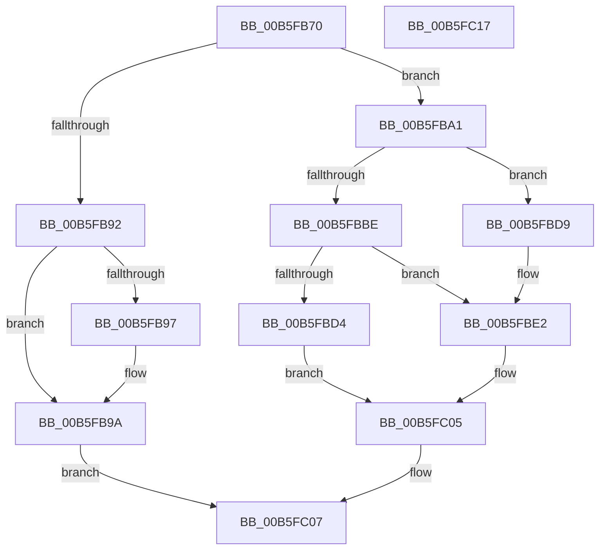

# HalpDpGetInterruptReplayState

- RVA: `0x00B5FB70`–`0x00B5FC18` (길이 `168` bytes)
- VA: `0x0000000140B5FB70`
- 실행 섹션: `PAGELK`
- PDB 이름 있음: `예`; PDB Function 태그: `아니요`
- unwind 정보 RVA: `0x000794E0`
- 디코드: `46`개 명령, `168/168` bytes 표시
- 미해석 바이트: `0` (있으면 어셈블리에 `.byte`로 보존)

> 이 문서는 커널 이미지의 기계어와 PDB 기호를 분석해 생성했습니다. 4번과 5번은 함수 원형과 자료형을 바이너리 사용 방식에서 추정한 C 해석이며 원본 소스 복구 결과는 아닙니다.

## 1. Dependencies

- 직접 호출 지점: **2**; 고유 호출 대상: **2**
- 직접 호출자로 확인된 함수: **0**
- RIP 상대 이미지 참조: **2**

### Outgoing calls
- `0x00B5FBC5` → [guard_dispatch_icall](../../text/6B/guard_dispatch_icall_function_006BAAD0.md) (function, `0x006BAAD0`)
- `0x00B5FBFD` → [HalpInterruptSetProblemEx](../../text/48/HalpInterruptSetProblemEx_function_0048AC8C.md) (function, `0x0048AC8C`)

### Direct callers
- 이 함수 시작 RVA로 연결되는 직접 call은 확인되지 않았습니다. 간접 호출은 완전히 역산할 수 없습니다.

### Static image references
- `0x00B5FBAB` → RVA `0x00E101F0` (`.data`; read)
- `0x00B5FBE9` → RVA `0x00025F20` (`.rdata`; read)

## 2. Other-region calls and transfers

- 다른 실행 섹션으로 향하는 call: **2**
  - `0x00B5FBC5` → [guard_dispatch_icall](../../text/6B/guard_dispatch_icall_function_006BAAD0.md) (`PAGELK` → `.text`)
  - `0x00B5FBFD` → [HalpInterruptSetProblemEx](../../text/48/HalpInterruptSetProblemEx_function_0048AC8C.md) (`PAGELK` → `.text`)
- 별도 외부 분기/꼬리 이동을 확인하지 못했습니다.

## 3. Assembly (complete function range)

```asm
00B5FB70  48 89 5C 24 08                  mov qword ptr [rsp + 8], rbx
00B5FB75  48 89 74 24 10                  mov qword ptr [rsp + 0x10], rsi
00B5FB7A  57                              push rdi
00B5FB7B  48 83 EC 30                     sub rsp, 0x30
00B5FB7F  48 8B FA                        mov rdi, rdx
00B5FB82  B8 01 00 00 00                  mov eax, 1
00B5FB87  F0 0F C1 41 04                  lock xadd dword ptr [rcx + 4], eax
00B5FB8C  33 DB                           xor ebx, ebx
00B5FB8E  3B 01                           cmp eax, dword ptr [rcx]
00B5FB90  72 0F                           jb 0x140b5fba1
00B5FB92  48 85 D2                        test rdx, rdx
00B5FB95  74 03                           je 0x140b5fb9a
00B5FB97  48 89 1A                        mov qword ptr [rdx], rbx
00B5FB9A  B8 9A 00 00 C0                  mov eax, 0xc000009a
00B5FB9F  EB 66                           jmp 0x140b5fc07
00B5FBA1  0F AF 41 28                     imul eax, dword ptr [rcx + 0x28]
00B5FBA5  8B F0                           mov esi, eax
00B5FBA7  48 03 71 20                     add rsi, qword ptr [rcx + 0x20]
00B5FBAB  48 8B 0D 3E 06 2B 00            mov rcx, qword ptr [rip + 0x2b063e]
00B5FBB2  48 8B 81 98 00 00 00            mov rax, qword ptr [rcx + 0x98]
00B5FBB9  48 85 C0                        test rax, rax
00B5FBBC  74 1B                           je 0x140b5fbd9
00B5FBBE  48 8B 49 10                     mov rcx, qword ptr [rcx + 0x10]
00B5FBC2  48 8B D6                        mov rdx, rsi
00B5FBC5  E8 06 AF B5 FF                  call 0x1406baad0
00B5FBCA  44 8B D0                        mov r10d, eax
00B5FBCD  44 8B C0                        mov r8d, eax
00B5FBD0  85 C0                           test eax, eax
00B5FBD2  78 0E                           js 0x140b5fbe2
00B5FBD4  48 89 37                        mov qword ptr [rdi], rsi
00B5FBD7  EB 2C                           jmp 0x140b5fc05
00B5FBD9  41 B8 BB 00 00 C0               mov r8d, 0xc00000bb
00B5FBDF  45 8B D0                        mov r10d, r8d
00B5FBE2  48 8B 0D 07 06 2B 00            mov rcx, qword ptr [rip + 0x2b0607]
00B5FBE9  4C 8D 0D 30 63 4C FF            lea r9, [rip - 0xb39cd0]
00B5FBF0  BA 1C 00 00 00                  mov edx, 0x1c
00B5FBF5  C7 44 24 20 30 03 00 00         mov dword ptr [rsp + 0x20], 0x330
00B5FBFD  E8 8A B0 92 FF                  call 0x14048ac8c
00B5FC02  41 8B DA                        mov ebx, r10d
00B5FC05  8B C3                           mov eax, ebx
00B5FC07  48 8B 5C 24 40                  mov rbx, qword ptr [rsp + 0x40]
00B5FC0C  48 8B 74 24 48                  mov rsi, qword ptr [rsp + 0x48]
00B5FC11  48 83 C4 30                     add rsp, 0x30
00B5FC15  5F                              pop rdi
00B5FC16  C3                              ret
00B5FC17  CC                              int3
```

## 4. C-style interpretation (structured pseudocode)

```c
__int64 __fastcall HalpDpGetInterruptReplayState(__int64 a1, __int64 a2)
{
    __int64 result;
    __int64 v_rbx;
    __int64 v_rsi;
    __int64 v_rsp;
    unsigned int v_stack_m18;
    unsigned __int64 v_stack_p10;
    unsigned __int64 v_stack_p8;

    v_stack_p8 = v_rbx;
    v_stack_p10 = v_rsi;
    v_rsp = (v_rsp) - (48);
    v_rbx = 0;
    if (1 < (*(unsigned int *)(a1))) goto loc_00B5FBA1;
    if (a2 != 0) {
        *(unsigned __int64 *)(a2) = 0;
    }
    goto loc_00B5FC07;
loc_00B5FBA1:
    result = (unsigned int)(((unsigned int)(0xC000009AULL)) * (*(unsigned int *)(a1 + 40)));
    v_rsi = ((unsigned int)((unsigned int)(result))) + (*(unsigned __int64 *)(a1 + 32));
    if (*(unsigned __int64 *)(*(unsigned __int64 *)(v_rip + 2819646) + 152) == 0) goto loc_00B5FBD9;
    result = guard_dispatch_icall(*(unsigned __int64 *)(*(unsigned __int64 *)(v_rip + 2819646) + 16), v_rsi, a3, a4);
    if (sign_flag) goto loc_00B5FBE2;
    *(unsigned __int64 *)(a2) = v_rsi;
    goto loc_00B5FC05;
loc_00B5FBD9:
loc_00B5FBE2:
    v_stack_m18 = 816;
    result = HalpInterruptSetProblemEx(*(unsigned __int64 *)(v_rip + 2819591), 28, (unsigned int)(0xC00000BBULL), v_rip - 11771088);
loc_00B5FC05:
loc_00B5FC07:
    v_rsp = (v_rsp) + (48);
    return (unsigned int)((unsigned int)((unsigned int)((unsigned int)((unsigned int)((unsigned int)((unsigned int)(0xC00000BBULL)))))));
}
```

## 5. (Beta) C Style

```c
int64_t HalpDpGetInterruptReplayState(void *Arg1, void *Arg2)
{
    uint8_t *arg1 = (uint8_t *)Arg1;
    uint8_t *arg2 = (uint8_t *)Arg2;

    int64_t result;
    int64_t local_rbx;
    int64_t local_rsi;
    int64_t local_rsp;
    uint32_t v_stack_m18;
    uint64_t v_stack_p10;
    uint64_t v_stack_p8;

    v_stack_p8 = local_rbx;
    v_stack_p10 = local_rsi;
    local_rsp = (local_rsp) - (48);
    local_rbx = 0;
    if (1 < (*(uint32_t *)(arg1))) goto loc_00B5FBA1;
    if (Arg2 != NULL) {
        *(uint64_t *)(arg2) = 0;
    }
    goto loc_00B5FC07;
loc_00B5FBA1:
    result = (uint32_t)(((uint32_t)(0xC000009AULL)) * (*(uint32_t *)(arg1 + 0x28)));
    local_rsi = ((uint32_t)((uint32_t)(result))) + (*(uint64_t *)(arg1 + 0x20));
    if (*(uint64_t *)(*(uint64_t *)(v_rip + 0x2B063E) + 0x98) == 0) goto loc_00B5FBD9;
    result = guard_dispatch_icall(*(uint64_t *)(*(uint64_t *)(v_rip + 0x2B063E) + 0x10), local_rsi, a3, a4);
    if (sign_flag) goto loc_00B5FBE2;
    *(uint64_t *)(arg2) = local_rsi;
    goto loc_00B5FC05;
loc_00B5FBD9:
loc_00B5FBE2:
    v_stack_m18 = 816;
    result = HalpInterruptSetProblemEx(*(uint64_t *)(v_rip + 0x2B0607), 28, (uint32_t)(0xC00000BBULL), v_rip - 11771088);
loc_00B5FC05:
loc_00B5FC07:
    local_rsp = (local_rsp) + (48);
    return (uint32_t)((uint32_t)((uint32_t)((uint32_t)((uint32_t)((uint32_t)((uint32_t)(0xC00000BBULL)))))));
}
```

### 관측된 메모리 오프셋

구조체 형식이 확인되지 않은 접근은 인자 기준의 오프셋으로만 기록했습니다.

| 기준 인자 | 오프셋 표현 | 폭 (bit) | 접근 |
|---|---:|---:|---|
| `Arg1` | `+ 0x0` | `32` | `R` |
| `Arg1` | `+ 0x4` | `32` | `R/W` |
| `Arg1` | `+ 0x20` | `64` | `R` |
| `Arg1` | `+ 0x28` | `32` | `R` |
| `Arg2` | `+ 0x0` | `64` | `W` |

## 6. Execution-region graph

[열기: 2D/3D 그래프와 함수 탐색 컨트롤 패널](../../../control-panel.html?section=pagelk&rva=0x00B5FB70&view=graph)

- 2D 그래프는 위에서 아래로 흐르고, 3D 그래프는 빈 공간을 드래그해 회전합니다. Shift+드래그는 이동, 휠은 확대·축소, 함수 노드 선택은 대상 보고서 이동입니다.

### Static fallback


