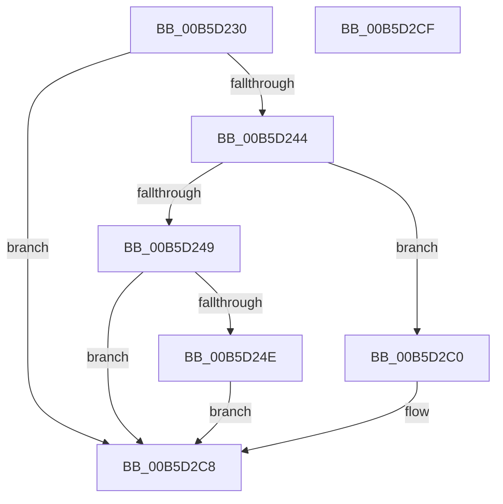

# HalpDpInitSystem

- RVA: `0x00B5D230`–`0x00B5D2D0` (길이 `160` bytes)
- VA: `0x0000000140B5D230`
- 실행 섹션: `PAGELK`
- PDB 이름 있음: `예`; PDB Function 태그: `아니요`
- unwind 정보 RVA: `0x0005C788`
- 디코드: `32`개 명령, `160/160` bytes 표시
- 미해석 바이트: `0` (있으면 어셈블리에 `.byte`로 보존)

> 이 문서는 커널 이미지의 기계어와 PDB 기호를 분석해 생성했습니다. 4번과 5번은 함수 원형과 자료형을 바이너리 사용 방식에서 추정한 C 해석이며 원본 소스 복구 결과는 아닙니다.

## 1. Dependencies

- 직접 호출 지점: **2**; 고유 호출 대상: **2**
- 직접 호출자로 확인된 함수: **0**
- RIP 상대 이미지 참조: **16**

### Outgoing calls
- `0x00B5D236` → [HalpInterruptModel](../../text/4A/HalpInterruptModel_function_004ACA38.md) (function, `0x004ACA38`)
- `0x00B5D2C3` → [HalpDpInitDiscard](../../init/C1/HalpDpInitDiscard_function_00C1F7D0.md) (function, `0x00C1F7D0`)

### Direct callers
- 이 함수 시작 RVA로 연결되는 직접 call은 확인되지 않았습니다. 간접 호출은 완전히 역산할 수 없습니다.

### Static image references
- `0x00B5D24E` → RVA `0x0070C130` (`HalpDpReplaceBegin`; read)
- `0x00B5D255` → RVA `0x00E008D8` (`.data`; write)
- `0x00B5D25C` → RVA `0x00B60280` (`HalpDpReplaceTarget`; read)
- `0x00B5D263` → RVA `0x00E008E0` (`.data`; write)
- `0x00B5D26A` → RVA `0x00B600B0` (`HalpDpReplaceControl`; read)
- `0x00B5D271` → RVA `0x00E008E8` (`.data`; write)
- `0x00B5D278` → RVA `0x0070C2E0` (`HalpDpReplaceEnd`; read)
- `0x00B5D27F` → RVA `0x00E008F0` (`.data`; write)
- `0x00B5D286` → RVA `0x00563590` (`HalpInterruptMaskLevelTriggeredLines`; read)
- `0x00B5D28D` → RVA `0x00E00938` (`.data`; write)
- `0x00B5D294` → RVA `0x00B5FB70` (`HalpDpGetInterruptReplayState`; read)
- `0x00B5D29B` → RVA `0x00E00948` (`.data`; write)
- `0x00B5D2A2` → RVA `0x00B60320` (`HalpDpReplayInterrupts`; read)
- `0x00B5D2A9` → RVA `0x00E00950` (`.data`; write)
- `0x00B5D2B0` → RVA `0x00563740` (`HalpInterruptUnmaskLevelTriggeredLines`; read)
- `0x00B5D2B7` → RVA `0x00E00940` (`.data`; write)

## 2. Other-region calls and transfers

- 다른 실행 섹션으로 향하는 call: **2**
  - `0x00B5D236` → [HalpInterruptModel](../../text/4A/HalpInterruptModel_function_004ACA38.md) (`PAGELK` → `.text`)
  - `0x00B5D2C3` → [HalpDpInitDiscard](../../init/C1/HalpDpInitDiscard_function_00C1F7D0.md) (`PAGELK` → `INIT`)
- 별도 외부 분기/꼬리 이동을 확인하지 못했습니다.

## 3. Assembly (complete function range)

```asm
00B5D230  48 83 EC 28                     sub rsp, 0x28
00B5D234  8B D1                           mov edx, ecx
00B5D236  E8 FD F7 94 FF                  call 0x1404aca38
00B5D23B  83 F8 01                        cmp eax, 1
00B5D23E  0F 85 84 00 00 00               jne 0x140b5d2c8
00B5D244  83 FA 07                        cmp edx, 7
00B5D247  74 77                           je 0x140b5d2c0
00B5D249  83 FA 11                        cmp edx, 0x11
00B5D24C  75 7A                           jne 0x140b5d2c8
00B5D24E  48 8D 05 DB EE BA FF            lea rax, [rip - 0x451125]
00B5D255  48 89 05 7C 36 2A 00            mov qword ptr [rip + 0x2a367c], rax
00B5D25C  48 8D 05 1D 30 00 00            lea rax, [rip + 0x301d]
00B5D263  48 89 05 76 36 2A 00            mov qword ptr [rip + 0x2a3676], rax
00B5D26A  48 8D 05 3F 2E 00 00            lea rax, [rip + 0x2e3f]
00B5D271  48 89 05 70 36 2A 00            mov qword ptr [rip + 0x2a3670], rax
00B5D278  48 8D 05 61 F0 BA FF            lea rax, [rip - 0x450f9f]
00B5D27F  48 89 05 6A 36 2A 00            mov qword ptr [rip + 0x2a366a], rax
00B5D286  48 8D 05 03 63 A0 FF            lea rax, [rip - 0x5f9cfd]
00B5D28D  48 89 05 A4 36 2A 00            mov qword ptr [rip + 0x2a36a4], rax
00B5D294  48 8D 05 D5 28 00 00            lea rax, [rip + 0x28d5]
00B5D29B  48 89 05 A6 36 2A 00            mov qword ptr [rip + 0x2a36a6], rax
00B5D2A2  48 8D 05 77 30 00 00            lea rax, [rip + 0x3077]
00B5D2A9  48 89 05 A0 36 2A 00            mov qword ptr [rip + 0x2a36a0], rax
00B5D2B0  48 8D 05 89 64 A0 FF            lea rax, [rip - 0x5f9b77]
00B5D2B7  48 89 05 82 36 2A 00            mov qword ptr [rip + 0x2a3682], rax
00B5D2BE  EB 08                           jmp 0x140b5d2c8
00B5D2C0  49 8B C8                        mov rcx, r8
00B5D2C3  E8 08 25 0C 00                  call 0x140c1f7d0
00B5D2C8  33 C0                           xor eax, eax
00B5D2CA  48 83 C4 28                     add rsp, 0x28
00B5D2CE  C3                              ret
00B5D2CF  CC                              int3
```

## 4. C-style interpretation (structured pseudocode)

```c
__int64 __fastcall HalpDpInitSystem(int a1, __int64 a2, __int64 a3)
{
    __int64 result;
    __int64 v_rsp;

    v_rsp = (v_rsp) - (40);
    result = HalpInterruptModel(a1, (unsigned int)(a1), a3, a4);
    if (((unsigned int)(result)) != 1) goto loc_00B5D2C8;
    if (((unsigned int)((unsigned int)(a1))) == 7) goto loc_00B5D2C0;
    if (((unsigned int)((unsigned int)(a1))) != 17) goto loc_00B5D2C8;
    *(unsigned __int64 *)(v_rip + 2766460) = v_rip - 4526373;
    *(unsigned __int64 *)(v_rip + 2766454) = v_rip + 12317;
    *(unsigned __int64 *)(v_rip + 2766448) = v_rip + 11839;
    *(unsigned __int64 *)(v_rip + 2766442) = v_rip - 4525983;
    *(unsigned __int64 *)(v_rip + 2766500) = v_rip - 6266109;
    *(unsigned __int64 *)(v_rip + 2766502) = v_rip + 10453;
    *(unsigned __int64 *)(v_rip + 2766496) = v_rip + 12407;
    *(unsigned __int64 *)(v_rip + 2766466) = v_rip - 6265719;
    goto loc_00B5D2C8;
loc_00B5D2C0:
    result = HalpDpInitDiscard(a3, (unsigned int)(a1), a3, a4);
loc_00B5D2C8:
    result = 0;
    v_rsp = (v_rsp) + (40);
    return result;
}
```

## 5. (Beta) C Style

```c
int64_t HalpDpInitSystem(int32_t Arg1, int64_t Arg2, int64_t Arg3)
{
    int64_t result;
    int64_t local_rsp;

    local_rsp = (local_rsp) - (40);
    result = HalpInterruptModel(Arg1, (uint32_t)(Arg1), Arg3, a4);
    if (((uint32_t)(result)) != 1) goto loc_00B5D2C8;
    if (((uint32_t)((uint32_t)(Arg1))) == 7) goto loc_00B5D2C0;
    if (((uint32_t)((uint32_t)(Arg1))) != 17) goto loc_00B5D2C8;
    *(uint64_t *)(v_rip + 0x2A367C) = v_rip - 4526373;
    *(uint64_t *)(v_rip + 0x2A3676) = v_rip + 12317;
    *(uint64_t *)(v_rip + 0x2A3670) = v_rip + 11839;
    *(uint64_t *)(v_rip + 0x2A366A) = v_rip - 4525983;
    *(uint64_t *)(v_rip + 0x2A36A4) = v_rip - 6266109;
    *(uint64_t *)(v_rip + 0x2A36A6) = v_rip + 10453;
    *(uint64_t *)(v_rip + 0x2A36A0) = v_rip + 12407;
    *(uint64_t *)(v_rip + 0x2A3682) = v_rip - 6265719;
    goto loc_00B5D2C8;
loc_00B5D2C0:
    result = HalpDpInitDiscard(Arg3, (uint32_t)(Arg1), Arg3, a4);
loc_00B5D2C8:
    result = 0;
    local_rsp = (local_rsp) + (40);
    return result;
}
```

## 6. Execution-region graph

[열기: 2D/3D 그래프와 함수 탐색 컨트롤 패널](../../../control-panel.html?section=pagelk&rva=0x00B5D230&view=graph)

- 2D 그래프는 위에서 아래로 흐르고, 3D 그래프는 빈 공간을 드래그해 회전합니다. Shift+드래그는 이동, 휠은 확대·축소, 함수 노드 선택은 대상 보고서 이동입니다.

### Static fallback


