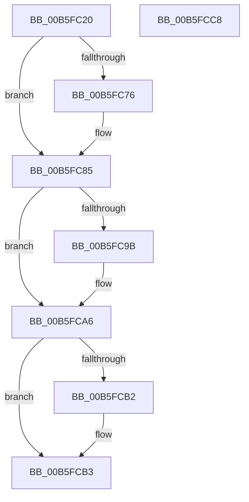

# HalpDpOfflineProcessorForReplace

- RVA: `0x00B5FC20`–`0x00B5FCC9` (길이 `169` bytes)
- VA: `0x0000000140B5FC20`
- 실행 섹션: `PAGELK`
- PDB 이름 있음: `예`; PDB Function 태그: `아니요`
- unwind 정보 RVA: `0x0006C8E8`
- 디코드: `45`개 명령, `169/169` bytes 표시
- 미해석 바이트: `0` (있으면 어셈블리에 `.byte`로 보존)

> 이 문서는 커널 이미지의 기계어와 PDB 기호를 분석해 생성했습니다. 4번과 5번은 함수 원형과 자료형을 바이너리 사용 방식에서 추정한 C 해석이며 원본 소스 복구 결과는 아닙니다.

## 1. Dependencies

- 직접 호출 지점: **6**; 고유 호출 대상: **6**
- 직접 호출자로 확인된 함수: **1**
- RIP 상대 이미지 참조: **2**

### Outgoing calls
- `0x00B5FC37` → [HalpDisableInterrupts](../../text/25/HalpDisableInterrupts_function_002521A0.md) (function, `0x002521A0`)
- `0x00B5FC6A` → [KeSaveStateForHibernate](../../text/6B/KeSaveStateForHibernate_function_006B1A50.md) (function, `0x006B1A50`)
- `0x00B5FC76` → [HalpAcpiFlushCache](../../text/48/HalpAcpiFlushCache_function_00484CD0.md) (function, `0x00484CD0`)
- `0x00B5FC7F` → [HalpInterruptOfflineProcessor](../../text/56/HalpInterruptOfflineProcessor_function_005636C0.md) (function, `0x005636C0`)
- `0x00B5FC8D` → [HalpDpPostReplaceInitialization](HalpDpPostReplaceInitialization_function_00B5FE3C.md) (function, `0x00B5FE3C`)
- `0x00B5FCA1` → [KiLowerIrqlProcessIrqlFlags](../../text/4F/KiLowerIrqlProcessIrqlFlags_function_004F5698.md) (function, `0x004F5698`)

### Direct callers
- [HalpDpReplaceTarget](../B6/HalpDpReplaceTarget_function_00B60280.md) at `0x00B602D3`

### Static image references
- `0x00B5FC63` → RVA `0x00FC1A90` (`.data`; read)
- `0x00B5FC92` → RVA `0x00FC6D20` (`ALMOSTRO`; read)

## 2. Other-region calls and transfers

- 다른 실행 섹션으로 향하는 call: **5**
  - `0x00B5FC37` → [HalpDisableInterrupts](../../text/25/HalpDisableInterrupts_function_002521A0.md) (`PAGELK` → `.text`)
  - `0x00B5FC6A` → [KeSaveStateForHibernate](../../text/6B/KeSaveStateForHibernate_function_006B1A50.md) (`PAGELK` → `.text`)
  - `0x00B5FC76` → [HalpAcpiFlushCache](../../text/48/HalpAcpiFlushCache_function_00484CD0.md) (`PAGELK` → `.text`)
  - `0x00B5FC7F` → [HalpInterruptOfflineProcessor](../../text/56/HalpInterruptOfflineProcessor_function_005636C0.md) (`PAGELK` → `.text`)
  - `0x00B5FCA1` → [KiLowerIrqlProcessIrqlFlags](../../text/4F/KiLowerIrqlProcessIrqlFlags_function_004F5698.md) (`PAGELK` → `.text`)
- 별도 외부 분기/꼬리 이동을 확인하지 못했습니다.

## 3. Assembly (complete function range)

```asm
00B5FC20  48 89 5C 24 10                  mov qword ptr [rsp + 0x10], rbx
00B5FC25  48 89 6C 24 18                  mov qword ptr [rsp + 0x18], rbp
00B5FC2A  48 89 74 24 20                  mov qword ptr [rsp + 0x20], rsi
00B5FC2F  57                              push rdi
00B5FC30  48 83 EC 20                     sub rsp, 0x20
00B5FC34  48 8B F9                        mov rdi, rcx
00B5FC37  E8 64 25 6F FF                  call 0x1402521a0
00B5FC3C  40 8A E8                        mov bpl, al
00B5FC3F  44 0F 20 C3                     mov rbx, cr8
00B5FC43  0F 31                           rdtsc
00B5FC45  48 C1 E2 20                     shl rdx, 0x20
00B5FC49  48 0B C2                        or rax, rdx
00B5FC4C  65 8B 14 25 A4 01 00 00         mov edx, dword ptr gs:[0x1a4]
00B5FC54  44 8B C2                        mov r8d, edx
00B5FC57  49 69 C8 C0 05 00 00            imul rcx, r8, 0x5c0
00B5FC5E  48 89 44 24 30                  mov qword ptr [rsp + 0x30], rax
00B5FC63  48 03 0D 26 1E 46 00            add rcx, qword ptr [rip + 0x461e26]
00B5FC6A  E8 E1 1D B5 FF                  call 0x1406b1a50
00B5FC6F  8B 57 38                        mov edx, dword ptr [rdi + 0x38]
00B5FC72  3B 17                           cmp edx, dword ptr [rdi]
00B5FC74  7D 0F                           jge 0x140b5fc85
00B5FC76  E8 55 50 92 FF                  call 0x140484cd0
00B5FC7B  48 8D 4F 38                     lea rcx, [rdi + 0x38]
00B5FC7F  E8 3C 3A A0 FF                  call 0x1405636c0
00B5FC84  CC                              int3
00B5FC85  48 8D 54 24 30                  lea rdx, [rsp + 0x30]
00B5FC8A  48 8B CF                        mov rcx, rdi
00B5FC8D  E8 AA 01 00 00                  call 0x140b5fe3c
00B5FC92  83 3D 87 70 46 00 00            cmp dword ptr [rip + 0x467087], 0
00B5FC99  74 0B                           je 0x140b5fca6
00B5FC9B  44 0F 20 C1                     mov rcx, cr8
00B5FC9F  8A D3                           mov dl, bl
00B5FCA1  E8 F2 59 99 FF                  call 0x1404f5698
00B5FCA6  0F B6 C3                        movzx eax, bl
00B5FCA9  44 0F 22 C0                     mov cr8, rax
00B5FCAD  40 84 ED                        test bpl, bpl
00B5FCB0  74 01                           je 0x140b5fcb3
00B5FCB2  FB                              sti
00B5FCB3  48 8B 5C 24 38                  mov rbx, qword ptr [rsp + 0x38]
00B5FCB8  48 8B 6C 24 40                  mov rbp, qword ptr [rsp + 0x40]
00B5FCBD  48 8B 74 24 48                  mov rsi, qword ptr [rsp + 0x48]
00B5FCC2  48 83 C4 20                     add rsp, 0x20
00B5FCC6  5F                              pop rdi
00B5FCC7  C3                              ret
00B5FCC8  CC                              int3
```

## 4. C-style interpretation (structured pseudocode)

```c
__int64 __fastcall HalpDpOfflineProcessorForReplace(__int64 a1, __int64 a2)
{
    __int64 result;
    __int64 v_rsp;
    unsigned __int64 v_stack_p10;
    unsigned __int64 v_stack_p18;
    unsigned __int64 v_stack_p20;
    unsigned __int64 v_stack_p8;

    v_stack_p10 = v_rbx;
    v_stack_p18 = v_rbp;
    v_stack_p20 = v_rsi;
    v_rsp = (v_rsp) - (32);
    result = HalpDisableInterrupts(a1, a2, a3, a4);
    a2 = (a2) << (32);
    result = (result) | (a2);
    a1 = (a1) * ((unsigned int)((unsigned int)((unsigned int)(*(unsigned int *)(gs_base + (0 + 420))))));
    v_stack_p8 = result;
    a1 = (a1) + (*(unsigned __int64 *)(v_rip + 4595238));
    result = KeSaveStateForHibernate(a1, (unsigned int)(*(unsigned int *)(gs_base + (0 + 420))), (unsigned int)((unsigned int)((unsigned int)(*(unsigned int *)(gs_base + (0 + 420))))), a4);
    if (((unsigned int)((unsigned int)(*(unsigned int *)(a1 + 56)))) < (*(unsigned int *)(a1))) {
        result = HalpAcpiFlushCache(a1, (unsigned int)(*(unsigned int *)(a1 + 56)), (unsigned int)((unsigned int)((unsigned int)(*(unsigned int *)(gs_base + (0 + 420))))), a4);
        a1 = a1 + 56;
        result = HalpInterruptOfflineProcessor(a1, (unsigned int)(*(unsigned int *)(a1 + 56)), (unsigned int)((unsigned int)((unsigned int)(*(unsigned int *)(gs_base + (0 + 420))))), a4);
    }
    result = HalpDpPostReplaceInitialization(a1, v_stack_p8, (unsigned int)((unsigned int)((unsigned int)(*(unsigned int *)(gs_base + (0 + 420))))), a4);
    if ((*(unsigned int *)(v_rip + 4616327)) != 0) {
        a1 = v_cr8;
        a2 = (unsigned __int8)(v_cr8);
        result = KiLowerIrqlProcessIrqlFlags(a1, a2, (unsigned int)((unsigned int)((unsigned int)(*(unsigned int *)(gs_base + (0 + 420))))), a4);
    }
    if ((unsigned __int8)((unsigned __int8)(result)) != 0) {
    }
    v_rsp = (v_rsp) + (32);
    return (unsigned __int8)(v_cr8);
}
```

## 5. (Beta) C Style

```c
int64_t HalpDpOfflineProcessorForReplace(void *Arg1, int64_t Arg2)
{
    uint8_t *arg1 = (uint8_t *)Arg1;

    int64_t result;
    int64_t local_rsp;
    uint64_t v_stack_p10;
    uint64_t v_stack_p18;
    uint64_t v_stack_p20;
    uint64_t v_stack_p8;

    v_stack_p10 = local_rbx;
    v_stack_p18 = local_rbp;
    v_stack_p20 = local_rsi;
    local_rsp = (local_rsp) - (32);
    result = HalpDisableInterrupts(Arg1, Arg2, a3, a4);
    Arg2 = (Arg2) << (32);
    result = (result) | (Arg2);
    Arg1 = (Arg1) * ((uint32_t)((uint32_t)((uint32_t)(*(uint32_t *)(gs_base + (0 + 0x1A4))))));
    v_stack_p8 = result;
    Arg1 = (Arg1) + (*(uint64_t *)(v_rip + 0x461E26));
    result = KeSaveStateForHibernate(Arg1, (uint32_t)(*(uint32_t *)(gs_base + (0 + 0x1A4))), (uint32_t)((uint32_t)((uint32_t)(*(uint32_t *)(gs_base + (0 + 0x1A4))))), a4);
    if (((uint32_t)((uint32_t)(*(uint32_t *)(arg1 + 0x38)))) < (*(uint32_t *)(arg1))) {
        result = HalpAcpiFlushCache(Arg1, (uint32_t)(*(uint32_t *)(arg1 + 0x38)), (uint32_t)((uint32_t)((uint32_t)(*(uint32_t *)(gs_base + (0 + 0x1A4))))), a4);
        Arg1 = Arg1 + 56;
        result = HalpInterruptOfflineProcessor(Arg1, (uint32_t)(*(uint32_t *)(arg1 + 0x38)), (uint32_t)((uint32_t)((uint32_t)(*(uint32_t *)(gs_base + (0 + 0x1A4))))), a4);
    }
    result = HalpDpPostReplaceInitialization(Arg1, v_stack_p8, (uint32_t)((uint32_t)((uint32_t)(*(uint32_t *)(gs_base + (0 + 0x1A4))))), a4);
    if ((*(uint32_t *)(v_rip + 0x467087)) != 0) {
        Arg1 = v_cr8;
        Arg2 = (uint8_t)(v_cr8);
        result = KiLowerIrqlProcessIrqlFlags(Arg1, Arg2, (uint32_t)((uint32_t)((uint32_t)(*(uint32_t *)(gs_base + (0 + 0x1A4))))), a4);
    }
    if ((uint8_t)((uint8_t)(result)) != 0) {
    }
    local_rsp = (local_rsp) + (32);
    return (uint8_t)(v_cr8);
}
```

### 관측된 메모리 오프셋

구조체 형식이 확인되지 않은 접근은 인자 기준의 오프셋으로만 기록했습니다.

| 기준 인자 | 오프셋 표현 | 폭 (bit) | 접근 |
|---|---:|---:|---|
| `Arg1` | `+ 0x0` | `32` | `R` |
| `Arg1` | `+ 0x38` | `32` | `R` |
| `Arg1` | `+ 0x38` | `64` | `R` |

## 6. Execution-region graph

[열기: 2D/3D 그래프와 함수 탐색 컨트롤 패널](../../../control-panel.html?section=pagelk&rva=0x00B5FC20&view=graph)

- 2D 그래프는 위에서 아래로 흐르고, 3D 그래프는 빈 공간을 드래그해 회전합니다. Shift+드래그는 이동, 휠은 확대·축소, 함수 노드 선택은 대상 보고서 이동입니다.

### Static fallback


