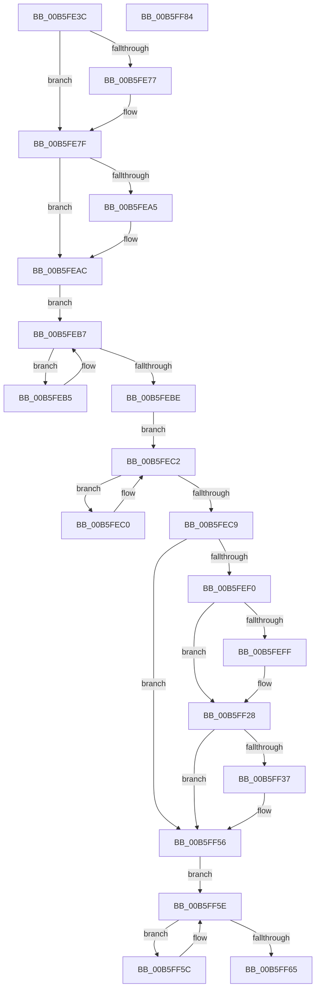

# HalpDpPostReplaceInitialization

- RVA: `0x00B5FE3C`–`0x00B5FF85` (길이 `329` bytes)
- VA: `0x0000000140B5FE3C`
- 실행 섹션: `PAGELK`
- PDB 이름 있음: `예`; PDB Function 태그: `아니요`
- unwind 정보 RVA: `0x0006C8E8`
- 디코드: `95`개 명령, `329/329` bytes 표시
- 미해석 바이트: `0` (있으면 어셈블리에 `.byte`로 보존)

> 이 문서는 커널 이미지의 기계어와 PDB 기호를 분석해 생성했습니다. 4번과 5번은 함수 원형과 자료형을 바이너리 사용 방식에서 추정한 C 해석이며 원본 소스 복구 결과는 아닙니다.

## 1. Dependencies

- 직접 호출 지점: **8**; 고유 호출 대상: **8**
- 직접 호출자로 확인된 함수: **1**
- RIP 상대 이미지 참조: **2**

### Outgoing calls
- `0x00B5FE5C` → [HalpInterruptReinitializeThisProcessor](../../text/4E/HalpInterruptReinitializeThisProcessor_function_004E29E0.md) (function, `0x004E29E0`)
- `0x00B5FE7A` → [KiRaiseIrqlProcessIrqlFlags](../../text/4F/KiRaiseIrqlProcessIrqlFlags_function_004F56FC.md) (function, `0x004F56FC`)
- `0x00B5FE95` → [HalpMcaResumeProcessorConfig](../B7/HalpMcaResumeProcessorConfig_function_00B7B31C.md) (function, `0x00B7B31C`)
- `0x00B5FEA7` → [HalpInterruptEnablePerformanceEvents](../../text/2D/HalpInterruptEnablePerformanceEvents_function_002D3420.md) (function, `0x002D3420`)
- `0x00B5FEC9` → [HalpMcUpdateMicrocode](../../text/4D/HalpMcUpdateMicrocode_function_004DB3FC.md) (function, `0x004DB3FC`)
- `0x00B5FEDA` → [HalpGetCpuInfo](../../text/49/HalpGetCpuInfo_function_00498A70.md) (function, `0x00498A70`)
- `0x00B5FF65` → [HalpRestartProfiling](../../text/4B/HalpRestartProfiling_function_004BD0A4.md) (function, `0x004BD0A4`)
- `0x00B5FF6A` → [HalpInterruptEnableNmi](../../text/4A/HalpInterruptEnableNmi_function_004AD9E0.md) (function, `0x004AD9E0`)

### Direct callers
- [HalpDpOfflineProcessorForReplace](HalpDpOfflineProcessorForReplace_function_00B5FC20.md) at `0x00B5FC8D`

### Static image references
- `0x00B5FE6E` → RVA `0x00FC6D20` (`ALMOSTRO`; read)
- `0x00B5FE9A` → RVA `0x00FC1C44` (`.data`; read)

## 2. Other-region calls and transfers

- 다른 실행 섹션으로 향하는 call: **7**
  - `0x00B5FE5C` → [HalpInterruptReinitializeThisProcessor](../../text/4E/HalpInterruptReinitializeThisProcessor_function_004E29E0.md) (`PAGELK` → `.text`)
  - `0x00B5FE7A` → [KiRaiseIrqlProcessIrqlFlags](../../text/4F/KiRaiseIrqlProcessIrqlFlags_function_004F56FC.md) (`PAGELK` → `.text`)
  - `0x00B5FEA7` → [HalpInterruptEnablePerformanceEvents](../../text/2D/HalpInterruptEnablePerformanceEvents_function_002D3420.md) (`PAGELK` → `.text`)
  - `0x00B5FEC9` → [HalpMcUpdateMicrocode](../../text/4D/HalpMcUpdateMicrocode_function_004DB3FC.md) (`PAGELK` → `.text`)
  - `0x00B5FEDA` → [HalpGetCpuInfo](../../text/49/HalpGetCpuInfo_function_00498A70.md) (`PAGELK` → `.text`)
  - `0x00B5FF65` → [HalpRestartProfiling](../../text/4B/HalpRestartProfiling_function_004BD0A4.md) (`PAGELK` → `.text`)
  - `0x00B5FF6A` → [HalpInterruptEnableNmi](../../text/4A/HalpInterruptEnableNmi_function_004AD9E0.md) (`PAGELK` → `.text`)
- 별도 외부 분기/꼬리 이동을 확인하지 못했습니다.

## 3. Assembly (complete function range)

```asm
00B5FE3C  48 8B C4                        mov rax, rsp
00B5FE3F  48 89 58 10                     mov qword ptr [rax + 0x10], rbx
00B5FE43  48 89 68 18                     mov qword ptr [rax + 0x18], rbp
00B5FE47  48 89 70 20                     mov qword ptr [rax + 0x20], rsi
00B5FE4B  57                              push rdi
00B5FE4C  48 83 EC 20                     sub rsp, 0x20
00B5FE50  8B 39                           mov edi, dword ptr [rcx]
00B5FE52  48 8B F2                        mov rsi, rdx
00B5FE55  48 8B D9                        mov rbx, rcx
00B5FE58  C6 40 08 00                     mov byte ptr [rax + 8], 0
00B5FE5C  E8 7F 2B 98 FF                  call 0x1404e29e0
00B5FE61  44 0F 20 C1                     mov rcx, cr8
00B5FE65  BD 0F 00 00 00                  mov ebp, 0xf
00B5FE6A  44 0F 22 C5                     mov cr8, rbp
00B5FE6E  83 3D AB 6E 46 00 00            cmp dword ptr [rip + 0x466eab], 0
00B5FE75  74 08                           je 0x140b5fe7f
00B5FE77  40 8A D5                        mov dl, bpl
00B5FE7A  E8 7D 58 99 FF                  call 0x1404f56fc
00B5FE7F  48 8B 16                        mov rdx, qword ptr [rsi]
00B5FE82  B9 10 00 00 00                  mov ecx, 0x10
00B5FE87  48 8B C2                        mov rax, rdx
00B5FE8A  48 C1 EA 20                     shr rdx, 0x20
00B5FE8E  0F 30                           wrmsr
00B5FE90  8D 71 F1                        lea esi, [rcx - 0xf]
00B5FE93  8B CE                           mov ecx, esi
00B5FE95  E8 82 B4 01 00                  call 0x140b7b31c
00B5FE9A  8B 05 A4 1D 46 00               mov eax, dword ptr [rip + 0x461da4]
00B5FEA0  40 84 C6                        test sil, al
00B5FEA3  74 07                           je 0x140b5feac
00B5FEA5  33 C9                           xor ecx, ecx
00B5FEA7  E8 74 35 77 FF                  call 0x1402d3420
00B5FEAC  8B CE                           mov ecx, esi
00B5FEAE  F0 0F C1 4B 3C                  lock xadd dword ptr [rbx + 0x3c], ecx
00B5FEB3  EB 02                           jmp 0x140b5feb7
00B5FEB5  F3 90                           pause
00B5FEB7  8B 43 3C                        mov eax, dword ptr [rbx + 0x3c]
00B5FEBA  3B C7                           cmp eax, edi
00B5FEBC  7C F7                           jl 0x140b5feb5
00B5FEBE  EB 02                           jmp 0x140b5fec2
00B5FEC0  F3 90                           pause
00B5FEC2  8B 43 40                        mov eax, dword ptr [rbx + 0x40]
00B5FEC5  3B C1                           cmp eax, ecx
00B5FEC7  7C F7                           jl 0x140b5fec0
00B5FEC9  E8 2E B5 97 FF                  call 0x1404db3fc
00B5FECE  4C 8D 4C 24 30                  lea r9, [rsp + 0x30]
00B5FED3  45 33 C0                        xor r8d, r8d
00B5FED6  33 D2                           xor edx, edx
00B5FED8  33 C9                           xor ecx, ecx
00B5FEDA  E8 91 8B 93 FF                  call 0x140498a70
00B5FEDF  F6 D8                           neg al
00B5FEE1  1A C9                           sbb cl, cl
00B5FEE3  22 4C 24 30                     and cl, byte ptr [rsp + 0x30]
00B5FEE7  88 4C 24 30                     mov byte ptr [rsp + 0x30], cl
00B5FEEB  40 3A CE                        cmp cl, sil
00B5FEEE  75 66                           jne 0x140b5ff56
00B5FEF0  65 48 8B 04 25 20 00 00 00      mov rax, qword ptr gs:[0x20]
00B5FEF9  40 38 68 40                     cmp byte ptr [rax + 0x40], bpl
00B5FEFD  75 29                           jne 0x140b5ff28
00B5FEFF  B9 1F 00 01 C0                  mov ecx, 0xc001001f
00B5FF04  0F 32                           rdmsr
00B5FF06  48 C1 E2 20                     shl rdx, 0x20
00B5FF0A  48 0B C2                        or rax, rdx
00B5FF0D  48 BA 00 00 00 00 01 00 00 00   movabs rdx, 0x100000000
00B5FF17  48 0F BA F0 14                  btr rax, 0x14
00B5FF1C  48 0B C2                        or rax, rdx
00B5FF1F  48 8B D0                        mov rdx, rax
00B5FF22  48 C1 EA 20                     shr rdx, 0x20
00B5FF26  0F 30                           wrmsr
00B5FF28  65 48 8B 04 25 20 00 00 00      mov rax, qword ptr gs:[0x20]
00B5FF31  80 78 40 12                     cmp byte ptr [rax + 0x40], 0x12
00B5FF35  75 1F                           jne 0x140b5ff56
00B5FF37  B9 29 10 01 C0                  mov ecx, 0xc0011029
00B5FF3C  0F 32                           rdmsr
00B5FF3E  48 C1 E2 20                     shl rdx, 0x20
00B5FF42  48 0B C2                        or rax, rdx
00B5FF45  BA 00 00 00 80                  mov edx, 0x80000000
00B5FF4A  48 0B C2                        or rax, rdx
00B5FF4D  48 8B D0                        mov rdx, rax
00B5FF50  48 C1 EA 20                     shr rdx, 0x20
00B5FF54  0F 30                           wrmsr
00B5FF56  F0 01 73 40                     lock add dword ptr [rbx + 0x40], esi
00B5FF5A  EB 02                           jmp 0x140b5ff5e
00B5FF5C  F3 90                           pause
00B5FF5E  8B 43 40                        mov eax, dword ptr [rbx + 0x40]
00B5FF61  3B C7                           cmp eax, edi
00B5FF63  7C F7                           jl 0x140b5ff5c
00B5FF65  E8 3A D1 95 FF                  call 0x1404bd0a4
00B5FF6A  E8 71 DA 94 FF                  call 0x1404ad9e0
00B5FF6F  48 8B 5C 24 38                  mov rbx, qword ptr [rsp + 0x38]
00B5FF74  48 8B 6C 24 40                  mov rbp, qword ptr [rsp + 0x40]
00B5FF79  48 8B 74 24 48                  mov rsi, qword ptr [rsp + 0x48]
00B5FF7E  48 83 C4 20                     add rsp, 0x20
00B5FF82  5F                              pop rdi
00B5FF83  C3                              ret
00B5FF84  CC                              int3
```

## 4. C-style interpretation (structured pseudocode)

```c
__int64 __fastcall HalpDpPostReplaceInitialization(__int64 a1, __int64 a2, int a3)
{
    __int64 result;
    __int64 v_rsp;
    unsigned __int64 v_stack_p10;
    unsigned __int64 v_stack_p18;
    unsigned __int64 v_stack_p20;
    unsigned __int64 v_stack_p8;

    *(unsigned __int64 *)(v_rsp + 16) = v_rbx;
    *(unsigned __int64 *)(v_rsp + 24) = v_rbp;
    *(unsigned __int64 *)(v_rsp + 32) = v_rsi;
    v_rsp = (v_rsp) - (32);
    *(unsigned __int8 *)(v_rsp + 8) = 0;
    result = HalpInterruptReinitializeThisProcessor(a1, a2, a3, a4);
    if ((*(unsigned int *)(v_rip + 4615851)) != 0) {
        a2 = 15;
        result = KiRaiseIrqlProcessIrqlFlags(v_cr8, a2, a3, a4);
    }
    a2 = (*(unsigned __int64 *)(a2)) >> (32);
    result = HalpMcaResumeProcessorConfig((unsigned int)((unsigned int)(16 - 15)), a2, a3, a4);
    result = (unsigned int)(*(unsigned int *)(v_rip + 4595108));
    if ((((unsigned __int8)(16 - 15)) & ((unsigned __int8)((unsigned int)(*(unsigned int *)(v_rip + 4595108))))) != 0) {
        a1 = 0;
        result = HalpInterruptEnablePerformanceEvents(a1, a2, a3, a4);
    }
    goto loc_00B5FEB7;
loc_00B5FEB5:
loc_00B5FEB7:
    if (((unsigned int)((unsigned int)(*(unsigned int *)(a1 + 60)))) < ((unsigned int)((unsigned int)(*(unsigned int *)(a1))))) goto loc_00B5FEB5;
    goto loc_00B5FEC2;
loc_00B5FEC0:
loc_00B5FEC2:
    if (((unsigned int)((unsigned int)(*(unsigned int *)(a1 + 64)))) < ((unsigned int)((unsigned int)((unsigned int)(16 - 15))))) goto loc_00B5FEC0;
    result = HalpMcUpdateMicrocode((unsigned int)((unsigned int)(16 - 15)), a2, a3, a4);
    a3 = 0;
    a2 = 0;
    a1 = 0;
    result = HalpGetCpuInfo(a1, a2, a3, v_stack_p8);
    result = (unsigned __int8)(-(result));
    a1 = (unsigned __int8)((a1) & (v_stack_p8));
    v_stack_p8 = (unsigned __int8)(a1);
    if (((unsigned __int8)(a1)) != ((unsigned __int8)(16 - 15))) goto loc_00B5FF56;
    result = *(unsigned __int64 *)(gs_base + (0 + 32));
    if ((*(unsigned __int8 *)(*(unsigned __int64 *)(gs_base + (0 + 32)) + 64)) == 15) {
        a1 = 0xC001001FULL;
        a2 = (a2) << (32);
        result = (*(unsigned __int64 *)(gs_base + (0 + 32))) | (a2);
        result = (result) | (a2);
        a2 = result;
        a2 = (a2) >> (32);
    }
    result = *(unsigned __int64 *)(gs_base + (0 + 32));
    if ((*(unsigned __int8 *)(*(unsigned __int64 *)(gs_base + (0 + 32)) + 64)) == 18) {
        a1 = 0xC0011029ULL;
        a2 = (a2) << (32);
        result = (*(unsigned __int64 *)(gs_base + (0 + 32))) | (a2);
        a2 = 0x80000000ULL;
        result = (result) | (a2);
        a2 = result;
        a2 = (a2) >> (32);
    }
    goto loc_00B5FF5E;
loc_00B5FF5C:
loc_00B5FF5E:
    if (((unsigned int)((unsigned int)(*(unsigned int *)(a1 + 64)))) < ((unsigned int)((unsigned int)(*(unsigned int *)(a1))))) goto loc_00B5FF5C;
    result = HalpRestartProfiling(a1, a2, a3, v_stack_p8);
    result = HalpInterruptEnableNmi(a1, a2, a3, v_stack_p8);
    v_rsp = (v_rsp) + (32);
    return result;
}
```

## 5. (Beta) C Style

```c
int64_t HalpDpPostReplaceInitialization(void *Arg1, void *Arg2, int32_t Arg3)
{
    uint8_t *arg1 = (uint8_t *)Arg1;
    uint8_t *arg2 = (uint8_t *)Arg2;

    int64_t result;
    int64_t local_rsp;
    uint64_t v_stack_p10;
    uint64_t v_stack_p18;
    uint64_t v_stack_p20;
    uint64_t v_stack_p8;

    *(uint64_t *)(local_rsp + 0x10) = local_rbx;
    *(uint64_t *)(local_rsp + 0x18) = local_rbp;
    *(uint64_t *)(local_rsp + 0x20) = local_rsi;
    local_rsp = (local_rsp) - (32);
    *(uint8_t *)(local_rsp + 0x8) = 0;
    result = HalpInterruptReinitializeThisProcessor(Arg1, Arg2, Arg3, a4);
    if ((*(uint32_t *)(v_rip + 0x466EAB)) != 0) {
        Arg2 = 15;
        result = KiRaiseIrqlProcessIrqlFlags(v_cr8, Arg2, Arg3, a4);
    }
    Arg2 = (*(uint64_t *)(arg2)) >> (32);
    result = HalpMcaResumeProcessorConfig((uint32_t)((uint32_t)(16 - 15)), Arg2, Arg3, a4);
    result = (uint32_t)(*(uint32_t *)(v_rip + 0x461DA4));
    if ((((uint8_t)(16 - 15)) & ((uint8_t)((uint32_t)(*(uint32_t *)(v_rip + 0x461DA4))))) != 0) {
        Arg1 = 0;
        result = HalpInterruptEnablePerformanceEvents(Arg1, Arg2, Arg3, a4);
    }
    goto loc_00B5FEB7;
loc_00B5FEB5:
loc_00B5FEB7:
    if (((uint32_t)((uint32_t)(*(uint32_t *)(arg1 + 0x3C)))) < ((uint32_t)((uint32_t)(*(uint32_t *)(arg1))))) goto loc_00B5FEB5;
    goto loc_00B5FEC2;
loc_00B5FEC0:
loc_00B5FEC2:
    if (((uint32_t)((uint32_t)(*(uint32_t *)(arg1 + 0x40)))) < ((uint32_t)((uint32_t)((uint32_t)(16 - 15))))) goto loc_00B5FEC0;
    result = HalpMcUpdateMicrocode((uint32_t)((uint32_t)(16 - 15)), Arg2, Arg3, a4);
    Arg3 = 0;
    Arg2 = 0;
    Arg1 = 0;
    result = HalpGetCpuInfo(Arg1, Arg2, Arg3, v_stack_p8);
    result = (uint8_t)(-(result));
    Arg1 = (uint8_t)((Arg1) & (v_stack_p8));
    v_stack_p8 = (uint8_t)(Arg1);
    if (((uint8_t)(Arg1)) != ((uint8_t)(16 - 15))) goto loc_00B5FF56;
    result = *(uint64_t *)(gs_base + (0 + 0x20));
    if ((*(uint8_t *)(*(uint64_t *)(gs_base + (0 + 0x20)) + 0x40)) == 15) {
        Arg1 = 0xC001001FULL;
        Arg2 = (Arg2) << (32);
        result = (*(uint64_t *)(gs_base + (0 + 0x20))) | (Arg2);
        result = (result) | (Arg2);
        Arg2 = result;
        Arg2 = (Arg2) >> (32);
    }
    result = *(uint64_t *)(gs_base + (0 + 0x20));
    if ((*(uint8_t *)(*(uint64_t *)(gs_base + (0 + 0x20)) + 0x40)) == 18) {
        Arg1 = 0xC0011029ULL;
        Arg2 = (Arg2) << (32);
        result = (*(uint64_t *)(gs_base + (0 + 0x20))) | (Arg2);
        Arg2 = 0x80000000ULL;
        result = (result) | (Arg2);
        Arg2 = result;
        Arg2 = (Arg2) >> (32);
    }
    goto loc_00B5FF5E;
loc_00B5FF5C:
loc_00B5FF5E:
    if (((uint32_t)((uint32_t)(*(uint32_t *)(arg1 + 0x40)))) < ((uint32_t)((uint32_t)(*(uint32_t *)(arg1))))) goto loc_00B5FF5C;
    result = HalpRestartProfiling(Arg1, Arg2, Arg3, v_stack_p8);
    result = HalpInterruptEnableNmi(Arg1, Arg2, Arg3, v_stack_p8);
    local_rsp = (local_rsp) + (32);
    return result;
}
```

### 관측된 메모리 오프셋

구조체 형식이 확인되지 않은 접근은 인자 기준의 오프셋으로만 기록했습니다.

| 기준 인자 | 오프셋 표현 | 폭 (bit) | 접근 |
|---|---:|---:|---|
| `Arg1` | `+ 0x0` | `32` | `R` |
| `Arg1` | `+ 0x3C` | `32` | `R` |
| `Arg1` | `+ 0x3C` | `32` | `R/W` |
| `Arg1` | `+ 0x40` | `32` | `R` |
| `Arg1` | `+ 0x40` | `32` | `R/W` |
| `Arg2` | `+ 0x0` | `64` | `R` |

## 6. Execution-region graph

[열기: 2D/3D 그래프와 함수 탐색 컨트롤 패널](../../../control-panel.html?section=pagelk&rva=0x00B5FE3C&view=graph)

- 2D 그래프는 위에서 아래로 흐르고, 3D 그래프는 빈 공간을 드래그해 회전합니다. Shift+드래그는 이동, 휠은 확대·축소, 함수 노드 선택은 대상 보고서 이동입니다.

### Static fallback


