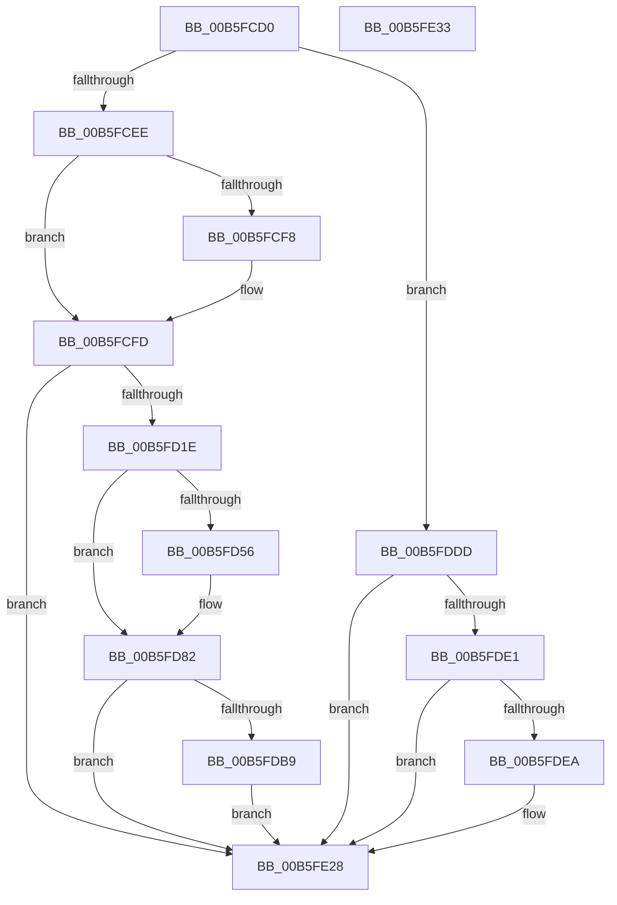

# HalpDpPostReplace

- RVA: `0x00B5FCD0`–`0x00B5FE34` (길이 `356` bytes)
- VA: `0x0000000140B5FCD0`
- 실행 섹션: `PAGELK`
- PDB 이름 있음: `예`; PDB Function 태그: `아니요`
- unwind 정보 RVA: `0x00097BC4`
- 디코드: `89`개 명령, `356/356` bytes 표시
- 미해석 바이트: `0` (있으면 어셈블리에 `.byte`로 보존)

> 이 문서는 커널 이미지의 기계어와 PDB 기호를 분석해 생성했습니다. 4번과 5번은 함수 원형과 자료형을 바이너리 사용 방식에서 추정한 C 해석이며 원본 소스 복구 결과는 아닙니다.

## 1. Dependencies

- 직접 호출 지점: **9**; 고유 호출 대상: **5**
- 직접 호출자로 확인된 함수: **1**
- RIP 상대 이미지 참조: **3**

### Outgoing calls
- `0x00B5FCF8` → [HalpSetClockAfterSleep](../../text/42/HalpSetClockAfterSleep_function_0042D4A4.md) (function, `0x0042D4A4`)
- `0x00B5FD0A` → [guard_dispatch_icall](../../text/6B/guard_dispatch_icall_function_006BAAD0.md) (function, `0x006BAAD0`)
- `0x00B5FD11` → [HalpAcpiPmRegisterAvailable](../../text/43/HalpAcpiPmRegisterAvailable_function_0043F330.md) (function, `0x0043F330`)
- `0x00B5FD39` → [HalpAcpiPmRegisterRead](../../text/41/HalpAcpiPmRegisterRead_function_0041DB30.md) (function, `0x0041DB30`)
- `0x00B5FD4D` → [HalpAcpiPmRegisterAvailable](../../text/43/HalpAcpiPmRegisterAvailable_function_0043F330.md) (function, `0x0043F330`)
- `0x00B5FD73` → [HalpAcpiPmRegisterRead](../../text/41/HalpAcpiPmRegisterRead_function_0041DB30.md) (function, `0x0041DB30`)
- `0x00B5FDA6` → [HalpAcpiPmRegisterWrite](../../text/41/HalpAcpiPmRegisterWrite_function_0041C760.md) (function, `0x0041C760`)
- `0x00B5FDB0` → [HalpAcpiPmRegisterAvailable](../../text/43/HalpAcpiPmRegisterAvailable_function_0043F330.md) (function, `0x0043F330`)
- `0x00B5FDD6` → [HalpAcpiPmRegisterWrite](../../text/41/HalpAcpiPmRegisterWrite_function_0041C760.md) (function, `0x0041C760`)

### Direct callers
- [HalpDpReplaceControl](../B6/HalpDpReplaceControl_function_00B600B0.md) at `0x00B60169`

### Static image references
- `0x00B5FCEE` → RVA `0x00E0A808` (`.data`; read)
- `0x00B5FCFD` → RVA `0x00E11750` (`.data`; read)
- `0x00B5FD1E` → RVA `0x00FC1B38` (`.data`; read)

## 2. Other-region calls and transfers

- 다른 실행 섹션으로 향하는 call: **9**
  - `0x00B5FCF8` → [HalpSetClockAfterSleep](../../text/42/HalpSetClockAfterSleep_function_0042D4A4.md) (`PAGELK` → `.text`)
  - `0x00B5FD0A` → [guard_dispatch_icall](../../text/6B/guard_dispatch_icall_function_006BAAD0.md) (`PAGELK` → `.text`)
  - `0x00B5FD11` → [HalpAcpiPmRegisterAvailable](../../text/43/HalpAcpiPmRegisterAvailable_function_0043F330.md) (`PAGELK` → `.text`)
  - `0x00B5FD39` → [HalpAcpiPmRegisterRead](../../text/41/HalpAcpiPmRegisterRead_function_0041DB30.md) (`PAGELK` → `.text`)
  - `0x00B5FD4D` → [HalpAcpiPmRegisterAvailable](../../text/43/HalpAcpiPmRegisterAvailable_function_0043F330.md) (`PAGELK` → `.text`)
  - `0x00B5FD73` → [HalpAcpiPmRegisterRead](../../text/41/HalpAcpiPmRegisterRead_function_0041DB30.md) (`PAGELK` → `.text`)
  - `0x00B5FDA6` → [HalpAcpiPmRegisterWrite](../../text/41/HalpAcpiPmRegisterWrite_function_0041C760.md) (`PAGELK` → `.text`)
  - `0x00B5FDB0` → [HalpAcpiPmRegisterAvailable](../../text/43/HalpAcpiPmRegisterAvailable_function_0043F330.md) (`PAGELK` → `.text`)
  - `0x00B5FDD6` → [HalpAcpiPmRegisterWrite](../../text/41/HalpAcpiPmRegisterWrite_function_0041C760.md) (`PAGELK` → `.text`)
- 별도 외부 분기/꼬리 이동을 확인하지 못했습니다.

## 3. Assembly (complete function range)

```asm
00B5FCD0  48 89 5C 24 18                  mov qword ptr [rsp + 0x18], rbx
00B5FCD5  57                              push rdi
00B5FCD6  48 83 EC 30                     sub rsp, 0x30
00B5FCDA  33 FF                           xor edi, edi
00B5FCDC  4C 8B C9                        mov r9, rcx
00B5FCDF  66 89 7C 24 40                  mov word ptr [rsp + 0x40], di
00B5FCE4  40 38 79 2D                     cmp byte ptr [rcx + 0x2d], dil
00B5FCE8  0F 85 EF 00 00 00               jne 0x140b5fddd
00B5FCEE  8B 05 14 AB 2A 00               mov eax, dword ptr [rip + 0x2aab14]
00B5FCF4  A8 04                           test al, 4
00B5FCF6  74 05                           je 0x140b5fcfd
00B5FCF8  E8 A7 D7 8C FF                  call 0x14042d4a4
00B5FCFD  48 8B 05 4C 1A 2B 00            mov rax, qword ptr [rip + 0x2b1a4c]
00B5FD04  B1 01                           mov cl, 1
00B5FD06  48 8B 40 08                     mov rax, qword ptr [rax + 8]
00B5FD0A  E8 C1 AD B5 FF                  call 0x1406baad0
00B5FD0F  33 C9                           xor ecx, ecx
00B5FD11  E8 1A F6 8D FF                  call 0x14043f330
00B5FD16  85 C0                           test eax, eax
00B5FD18  0F 88 0A 01 00 00               js 0x140b5fe28
00B5FD1E  0F B6 15 13 1E 46 00            movzx edx, byte ptr [rip + 0x461e13]
00B5FD25  4C 8D 44 24 40                  lea r8, [rsp + 0x40]
00B5FD2A  D1 EA                           shr edx, 1
00B5FD2C  41 B9 02 00 00 00               mov r9d, 2
00B5FD32  33 C9                           xor ecx, ecx
00B5FD34  48 89 7C 24 20                  mov qword ptr [rsp + 0x20], rdi
00B5FD39  E8 F2 DD 8B FF                  call 0x14041db30
00B5FD3E  0F B7 5C 24 40                  movzx ebx, word ptr [rsp + 0x40]
00B5FD43  B9 03 00 00 00                  mov ecx, 3
00B5FD48  66 89 5C 24 48                  mov word ptr [rsp + 0x48], bx
00B5FD4D  E8 DE F5 8D FF                  call 0x14043f330
00B5FD52  85 C0                           test eax, eax
00B5FD54  78 2C                           js 0x140b5fd82
00B5FD56  0F B6 15 DB 1D 46 00            movzx edx, byte ptr [rip + 0x461ddb]
00B5FD5D  4C 8D 44 24 40                  lea r8, [rsp + 0x40]
00B5FD62  41 B9 02 00 00 00               mov r9d, 2
00B5FD68  D1 EA                           shr edx, 1
00B5FD6A  48 89 7C 24 20                  mov qword ptr [rsp + 0x20], rdi
00B5FD6F  41 8D 49 01                     lea ecx, [r9 + 1]
00B5FD73  E8 B8 DD 8B FF                  call 0x14041db30
00B5FD78  0F B7 5C 24 48                  movzx ebx, word ptr [rsp + 0x48]
00B5FD7D  66 0B 5C 24 40                  or bx, word ptr [rsp + 0x40]
00B5FD82  0F B6 15 AF 1D 46 00            movzx edx, byte ptr [rip + 0x461daf]
00B5FD89  4C 8D 44 24 48                  lea r8, [rsp + 0x48]
00B5FD8E  66 83 CB 20                     or bx, 0x20
00B5FD92  D1 EA                           shr edx, 1
00B5FD94  41 B9 02 00 00 00               mov r9d, 2
00B5FD9A  66 89 5C 24 48                  mov word ptr [rsp + 0x48], bx
00B5FD9F  33 C9                           xor ecx, ecx
00B5FDA1  48 89 7C 24 20                  mov qword ptr [rsp + 0x20], rdi
00B5FDA6  E8 B5 C9 8B FF                  call 0x14041c760
00B5FDAB  B9 03 00 00 00                  mov ecx, 3
00B5FDB0  E8 7B F5 8D FF                  call 0x14043f330
00B5FDB5  85 C0                           test eax, eax
00B5FDB7  78 6F                           js 0x140b5fe28
00B5FDB9  0F B6 15 78 1D 46 00            movzx edx, byte ptr [rip + 0x461d78]
00B5FDC0  4C 8D 44 24 48                  lea r8, [rsp + 0x48]
00B5FDC5  41 B9 02 00 00 00               mov r9d, 2
00B5FDCB  D1 EA                           shr edx, 1
00B5FDCD  48 89 7C 24 20                  mov qword ptr [rsp + 0x20], rdi
00B5FDD2  41 8D 49 01                     lea ecx, [r9 + 1]
00B5FDD6  E8 85 C9 8B FF                  call 0x14041c760
00B5FDDB  EB 4B                           jmp 0x140b5fe28
00B5FDDD  39 39                           cmp dword ptr [rcx], edi
00B5FDDF  76 47                           jbe 0x140b5fe28
00B5FDE1  4C 8B 51 48                     mov r10, qword ptr [rcx + 0x48]
00B5FDE5  4D 85 D2                        test r10, r10
00B5FDE8  74 3E                           je 0x140b5fe28
00B5FDEA  48 69 41 50 E8 03 00 00         imul rax, qword ptr [rcx + 0x50], 0x3e8
00B5FDF2  48 99                           cqo
00B5FDF4  49 F7 FA                        idiv r10
00B5FDF7  4C 8B C0                        mov r8, rax
00B5FDFA  48 69 41 60 E8 03 00 00         imul rax, qword ptr [rcx + 0x60], 0x3e8
00B5FE02  44 89 41 58                     mov dword ptr [rcx + 0x58], r8d
00B5FE06  48 99                           cqo
00B5FE08  49 F7 FA                        idiv r10
00B5FE0B  48 8B C8                        mov rcx, rax
00B5FE0E  49 69 41 70 E8 03 00 00         imul rax, qword ptr [r9 + 0x70], 0x3e8
00B5FE16  48 99                           cqo
00B5FE18  49 F7 FA                        idiv r10
00B5FE1B  2B C1                           sub eax, ecx
00B5FE1D  41 2B C8                        sub ecx, r8d
00B5FE20  41 89 41 78                     mov dword ptr [r9 + 0x78], eax
00B5FE24  41 89 49 68                     mov dword ptr [r9 + 0x68], ecx
00B5FE28  48 8B 5C 24 50                  mov rbx, qword ptr [rsp + 0x50]
00B5FE2D  48 83 C4 30                     add rsp, 0x30
00B5FE31  5F                              pop rdi
00B5FE32  C3                              ret
00B5FE33  CC                              int3
```

## 4. C-style interpretation (structured pseudocode)

```c
__int64 __fastcall HalpDpPostReplace(__int64 a1)
{
    __int64 result;
    __int64 v_rbx;
    __int64 v_rdi;
    __int64 v_rsp;
    unsigned __int64 v_stack_m18;
    unsigned __int16 v_stack_p10;
    unsigned __int64 v_stack_p18;
    unsigned __int16 v_stack_p8;

    v_stack_p18 = v_rbx;
    v_rsp = (v_rsp) - (48);
    v_rdi = 0;
    v_stack_p8 = 0;
    if ((*(unsigned __int8 *)(a1 + 45)) != 0) goto loc_00B5FDDD;
    result = (unsigned int)(*(unsigned int *)(v_rip + 2796308));
    if ((((unsigned __int8)((unsigned int)(*(unsigned int *)(v_rip + 2796308)))) & (4)) != 0) {
        result = HalpSetClockAfterSleep(a1, a2, a3, a1);
    }
    result = guard_dispatch_icall(1, a2, a3, a1);
    a1 = 0;
    result = HalpAcpiPmRegisterAvailable(a1, a2, a3, a1);
    if (sign_flag) goto loc_00B5FE28;
    a2 = (unsigned int)((*(unsigned __int8 *)(v_rip + 4595219)) >> (1));
    a1 = 0;
    v_stack_m18 = 0;
    result = HalpAcpiPmRegisterRead(a1, a2, v_stack_p8, 2);
    v_stack_p10 = (unsigned __int16)(v_stack_p8);
    result = HalpAcpiPmRegisterAvailable(3, a2, v_stack_p8, 2);
    v_rbx = v_stack_p8;
    if (!(sign_flag)) {
        a2 = *(unsigned __int8 *)(v_rip + 4595163);
        a3 = v_stack_p8;
        a4 = 2;
        a2 = (unsigned int)((a2) >> (1));
        v_stack_m18 = 0;
        a1 = a4 + 1;
        result = HalpAcpiPmRegisterRead(a1, a2, a3, a4);
        v_rbx = v_stack_p10;
        v_rbx = (unsigned __int16)((v_rbx) | (v_stack_p8));
    }
    v_rbx = (unsigned __int16)((v_rbx) | (32));
    a2 = (unsigned int)((*(unsigned __int8 *)(v_rip + 4595119)) >> (1));
    v_stack_p10 = (unsigned __int16)(v_rbx);
    a1 = 0;
    v_stack_m18 = 0;
    result = HalpAcpiPmRegisterWrite(a1, a2, v_stack_p10, 2);
    result = HalpAcpiPmRegisterAvailable(3, a2, v_stack_p10, 2);
    if (sign_flag) goto loc_00B5FE28;
    a2 = (unsigned int)((*(unsigned __int8 *)(v_rip + 4595064)) >> (1));
    v_stack_m18 = 0;
    result = HalpAcpiPmRegisterWrite(2 + 1, a2, v_stack_p10, 2);
    goto loc_00B5FE28;
loc_00B5FDDD:
    if ((*(unsigned int *)(2 + 1)) <= 0) goto loc_00B5FE28;
    if (*(unsigned __int64 *)(2 + 1 + 72) != 0) {
        result = (result) * (*(unsigned __int64 *)(2 + 1 + 80));
        a3 = result;
        result = (result) * (*(unsigned __int64 *)(2 + 1 + 96));
        *(unsigned int *)(2 + 1 + 88) = (unsigned int)(a3);
        a1 = result;
        result = (result) * (*(unsigned __int64 *)(2 + 112));
        result = (unsigned int)((result) - ((unsigned int)(a1)));
        a1 = (unsigned int)((a1) - ((unsigned int)(a3)));
        *(unsigned int *)(2 + 120) = (unsigned int)(result);
        *(unsigned int *)(2 + 104) = (unsigned int)(a1);
    }
    v_rsp = (v_rsp) + (48);
    return result;
}
```

## 5. (Beta) C Style

```c
int64_t HalpDpPostReplace(void *Arg1)
{
    uint8_t *arg1 = (uint8_t *)Arg1;

    int64_t result;
    int64_t local_rbx;
    int64_t local_rdi;
    int64_t local_rsp;
    uint64_t v_stack_m18;
    uint16_t v_stack_p10;
    uint64_t v_stack_p18;
    uint16_t v_stack_p8;

    v_stack_p18 = local_rbx;
    local_rsp = (local_rsp) - (48);
    local_rdi = 0;
    v_stack_p8 = 0;
    if ((*(uint8_t *)(arg1 + 0x2D)) != 0) goto loc_00B5FDDD;
    result = (uint32_t)(*(uint32_t *)(v_rip + 0x2AAB14));
    if ((((uint8_t)((uint32_t)(*(uint32_t *)(v_rip + 0x2AAB14)))) & (4)) != 0) {
        result = HalpSetClockAfterSleep(Arg1, a2, a3, Arg1);
    }
    result = guard_dispatch_icall(1, a2, a3, Arg1);
    Arg1 = 0;
    result = HalpAcpiPmRegisterAvailable(Arg1, a2, a3, Arg1);
    if (sign_flag) goto loc_00B5FE28;
    a2 = (uint32_t)((*(uint8_t *)(v_rip + 0x461E13)) >> (1));
    Arg1 = 0;
    v_stack_m18 = 0;
    result = HalpAcpiPmRegisterRead(Arg1, a2, v_stack_p8, 2);
    v_stack_p10 = (uint16_t)(v_stack_p8);
    result = HalpAcpiPmRegisterAvailable(3, a2, v_stack_p8, 2);
    local_rbx = v_stack_p8;
    if (!(sign_flag)) {
        a2 = *(uint8_t *)(v_rip + 0x461DDB);
        a3 = v_stack_p8;
        a4 = 2;
        a2 = (uint32_t)((a2) >> (1));
        v_stack_m18 = 0;
        Arg1 = a4 + 1;
        result = HalpAcpiPmRegisterRead(Arg1, a2, a3, a4);
        local_rbx = v_stack_p10;
        local_rbx = (uint16_t)((local_rbx) | (v_stack_p8));
    }
    local_rbx = (uint16_t)((local_rbx) | (32));
    a2 = (uint32_t)((*(uint8_t *)(v_rip + 0x461DAF)) >> (1));
    v_stack_p10 = (uint16_t)(local_rbx);
    Arg1 = 0;
    v_stack_m18 = 0;
    result = HalpAcpiPmRegisterWrite(Arg1, a2, v_stack_p10, 2);
    result = HalpAcpiPmRegisterAvailable(3, a2, v_stack_p10, 2);
    if (sign_flag) goto loc_00B5FE28;
    a2 = (uint32_t)((*(uint8_t *)(v_rip + 0x461D78)) >> (1));
    v_stack_m18 = 0;
    result = HalpAcpiPmRegisterWrite(2 + 1, a2, v_stack_p10, 2);
    goto loc_00B5FE28;
loc_00B5FDDD:
    if ((*(uint32_t *)(2 + 0x1)) <= 0) goto loc_00B5FE28;
    if (*(uint64_t *)(2 + 0x1 + 0x48) != 0) {
        result = (result) * (*(uint64_t *)(2 + 0x1 + 0x50));
        a3 = result;
        result = (result) * (*(uint64_t *)(2 + 0x1 + 0x60));
        *(uint32_t *)(2 + 0x1 + 0x58) = (uint32_t)(a3);
        Arg1 = result;
        result = (result) * (*(uint64_t *)(2 + 0x70));
        result = (uint32_t)((result) - ((uint32_t)(Arg1)));
        Arg1 = (uint32_t)((Arg1) - ((uint32_t)(a3)));
        *(uint32_t *)(2 + 0x78) = (uint32_t)(result);
        *(uint32_t *)(2 + 0x68) = (uint32_t)(Arg1);
    }
    local_rsp = (local_rsp) + (48);
    return result;
}
```

### 관측된 메모리 오프셋

구조체 형식이 확인되지 않은 접근은 인자 기준의 오프셋으로만 기록했습니다.

| 기준 인자 | 오프셋 표현 | 폭 (bit) | 접근 |
|---|---:|---:|---|
| `Arg1` | `+ 0x0` | `32` | `R` |
| `Arg1` | `+ 0x2D` | `8` | `R` |
| `Arg1` | `+ 0x48` | `64` | `R` |
| `Arg1` | `+ 0x50` | `64` | `R` |
| `Arg1` | `+ 0x58` | `32` | `W` |
| `Arg1` | `+ 0x60` | `64` | `R` |
| `Arg1` | `+ 0x68` | `32` | `W` |
| `Arg1` | `+ 0x70` | `64` | `R` |
| `Arg1` | `+ 0x78` | `32` | `W` |

## 6. Execution-region graph

[열기: 2D/3D 그래프와 함수 탐색 컨트롤 패널](../../../control-panel.html?section=pagelk&rva=0x00B5FCD0&view=graph)

- 2D 그래프는 위에서 아래로 흐르고, 3D 그래프는 빈 공간을 드래그해 회전합니다. Shift+드래그는 이동, 휠은 확대·축소, 함수 노드 선택은 대상 보고서 이동입니다.

### Static fallback


