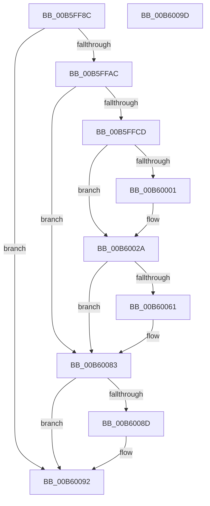

# HalpDpPreReplace

- RVA: `0x00B5FF8C`–`0x00B6009E` (길이 `274` bytes)
- VA: `0x0000000140B5FF8C`
- 실행 섹션: `PAGELK`
- PDB 이름 있음: `예`; PDB Function 태그: `아니요`
- unwind 정보 RVA: `0x00097BC4`
- 디코드: `67`개 명령, `274/274` bytes 표시
- 미해석 바이트: `0` (있으면 어셈블리에 `.byte`로 보존)

> 이 문서는 커널 이미지의 기계어와 PDB 기호를 분석해 생성했습니다. 4번과 5번은 함수 원형과 자료형을 바이너리 사용 방식에서 추정한 C 해석이며 원본 소스 복구 결과는 아닙니다.

## 1. Dependencies

- 직접 호출 지점: **9**; 고유 호출 대상: **5**
- 직접 호출자로 확인된 함수: **1**
- RIP 상대 이미지 참조: **3**

### Outgoing calls
- `0x00B5FFB9` → [guard_dispatch_icall](../../text/6B/guard_dispatch_icall_function_006BAAD0.md) (function, `0x006BAAD0`)
- `0x00B5FFC0` → [HalpAcpiPmRegisterAvailable](../../text/43/HalpAcpiPmRegisterAvailable_function_0043F330.md) (function, `0x0043F330`)
- `0x00B5FFE6` → [HalpAcpiPmRegisterRead](../../text/41/HalpAcpiPmRegisterRead_function_0041DB30.md) (function, `0x0041DB30`)
- `0x00B5FFF8` → [HalpAcpiPmRegisterAvailable](../../text/43/HalpAcpiPmRegisterAvailable_function_0043F330.md) (function, `0x0043F330`)
- `0x00B6001B` → [HalpAcpiPmRegisterRead](../../text/41/HalpAcpiPmRegisterRead_function_0041DB30.md) (function, `0x0041DB30`)
- `0x00B6004E` → [HalpAcpiPmRegisterWrite](../../text/41/HalpAcpiPmRegisterWrite_function_0041C760.md) (function, `0x0041C760`)
- `0x00B60058` → [HalpAcpiPmRegisterAvailable](../../text/43/HalpAcpiPmRegisterAvailable_function_0043F330.md) (function, `0x0043F330`)
- `0x00B6007E` → [HalpAcpiPmRegisterWrite](../../text/41/HalpAcpiPmRegisterWrite_function_0041C760.md) (function, `0x0041C760`)
- `0x00B6008D` → [HalpSetClockBeforeSleep](../../text/42/HalpSetClockBeforeSleep_function_0042D518.md) (function, `0x0042D518`)

### Direct callers
- [HalpDpReplaceControl](../B6/HalpDpReplaceControl_function_00B600B0.md) at `0x00B60256`

### Static image references
- `0x00B5FFAC` → RVA `0x00E11750` (`.data`; read)
- `0x00B5FFCD` → RVA `0x00FC1B38` (`.data`; read)
- `0x00B60083` → RVA `0x00E0A808` (`.data`; read)

## 2. Other-region calls and transfers

- 다른 실행 섹션으로 향하는 call: **9**
  - `0x00B5FFB9` → [guard_dispatch_icall](../../text/6B/guard_dispatch_icall_function_006BAAD0.md) (`PAGELK` → `.text`)
  - `0x00B5FFC0` → [HalpAcpiPmRegisterAvailable](../../text/43/HalpAcpiPmRegisterAvailable_function_0043F330.md) (`PAGELK` → `.text`)
  - `0x00B5FFE6` → [HalpAcpiPmRegisterRead](../../text/41/HalpAcpiPmRegisterRead_function_0041DB30.md) (`PAGELK` → `.text`)
  - `0x00B5FFF8` → [HalpAcpiPmRegisterAvailable](../../text/43/HalpAcpiPmRegisterAvailable_function_0043F330.md) (`PAGELK` → `.text`)
  - `0x00B6001B` → [HalpAcpiPmRegisterRead](../../text/41/HalpAcpiPmRegisterRead_function_0041DB30.md) (`PAGELK` → `.text`)
  - `0x00B6004E` → [HalpAcpiPmRegisterWrite](../../text/41/HalpAcpiPmRegisterWrite_function_0041C760.md) (`PAGELK` → `.text`)
  - `0x00B60058` → [HalpAcpiPmRegisterAvailable](../../text/43/HalpAcpiPmRegisterAvailable_function_0043F330.md) (`PAGELK` → `.text`)
  - `0x00B6007E` → [HalpAcpiPmRegisterWrite](../../text/41/HalpAcpiPmRegisterWrite_function_0041C760.md) (`PAGELK` → `.text`)
  - `0x00B6008D` → [HalpSetClockBeforeSleep](../../text/42/HalpSetClockBeforeSleep_function_0042D518.md) (`PAGELK` → `.text`)
- 별도 외부 분기/꼬리 이동을 확인하지 못했습니다.

## 3. Assembly (complete function range)

```asm
00B5FF8C  48 89 5C 24 18                  mov qword ptr [rsp + 0x18], rbx
00B5FF91  57                              push rdi
00B5FF92  48 83 EC 30                     sub rsp, 0x30
00B5FF96  33 FF                           xor edi, edi
00B5FF98  66 89 7C 24 40                  mov word ptr [rsp + 0x40], di
00B5FF9D  66 89 7C 24 48                  mov word ptr [rsp + 0x48], di
00B5FFA2  40 38 79 2D                     cmp byte ptr [rcx + 0x2d], dil
00B5FFA6  0F 85 E6 00 00 00               jne 0x140b60092
00B5FFAC  48 8B 05 9D 17 2B 00            mov rax, qword ptr [rip + 0x2b179d]
00B5FFB3  33 C9                           xor ecx, ecx
00B5FFB5  48 8B 40 08                     mov rax, qword ptr [rax + 8]
00B5FFB9  E8 12 AB B5 FF                  call 0x1406baad0
00B5FFBE  33 C9                           xor ecx, ecx
00B5FFC0  E8 6B F3 8D FF                  call 0x14043f330
00B5FFC5  85 C0                           test eax, eax
00B5FFC7  0F 88 B6 00 00 00               js 0x140b60083
00B5FFCD  0F B6 15 64 1B 46 00            movzx edx, byte ptr [rip + 0x461b64]
00B5FFD4  44 8D 4F 02                     lea r9d, [rdi + 2]
00B5FFD8  D1 EA                           shr edx, 1
00B5FFDA  4C 8D 44 24 48                  lea r8, [rsp + 0x48]
00B5FFDF  33 C9                           xor ecx, ecx
00B5FFE1  48 89 7C 24 20                  mov qword ptr [rsp + 0x20], rdi
00B5FFE6  E8 45 DB 8B FF                  call 0x14041db30
00B5FFEB  0F B7 5C 24 48                  movzx ebx, word ptr [rsp + 0x48]
00B5FFF0  8D 4F 03                        lea ecx, [rdi + 3]
00B5FFF3  66 89 5C 24 40                  mov word ptr [rsp + 0x40], bx
00B5FFF8  E8 33 F3 8D FF                  call 0x14043f330
00B5FFFD  85 C0                           test eax, eax
00B5FFFF  78 29                           js 0x140b6002a
00B60001  0F B6 15 30 1B 46 00            movzx edx, byte ptr [rip + 0x461b30]
00B60008  44 8D 4F 02                     lea r9d, [rdi + 2]
00B6000C  D1 EA                           shr edx, 1
00B6000E  4C 8D 44 24 48                  lea r8, [rsp + 0x48]
00B60013  8D 4F 03                        lea ecx, [rdi + 3]
00B60016  48 89 7C 24 20                  mov qword ptr [rsp + 0x20], rdi
00B6001B  E8 10 DB 8B FF                  call 0x14041db30
00B60020  0F B7 5C 24 48                  movzx ebx, word ptr [rsp + 0x48]
00B60025  66 0B 5C 24 40                  or bx, word ptr [rsp + 0x40]
00B6002A  0F B6 15 07 1B 46 00            movzx edx, byte ptr [rip + 0x461b07]
00B60031  4C 8D 44 24 40                  lea r8, [rsp + 0x40]
00B60036  66 83 E3 20                     and bx, 0x20
00B6003A  D1 EA                           shr edx, 1
00B6003C  41 B9 02 00 00 00               mov r9d, 2
00B60042  66 89 5C 24 40                  mov word ptr [rsp + 0x40], bx
00B60047  33 C9                           xor ecx, ecx
00B60049  48 89 7C 24 20                  mov qword ptr [rsp + 0x20], rdi
00B6004E  E8 0D C7 8B FF                  call 0x14041c760
00B60053  B9 03 00 00 00                  mov ecx, 3
00B60058  E8 D3 F2 8D FF                  call 0x14043f330
00B6005D  85 C0                           test eax, eax
00B6005F  78 22                           js 0x140b60083
00B60061  0F B6 15 D0 1A 46 00            movzx edx, byte ptr [rip + 0x461ad0]
00B60068  4C 8D 44 24 40                  lea r8, [rsp + 0x40]
00B6006D  41 B9 02 00 00 00               mov r9d, 2
00B60073  D1 EA                           shr edx, 1
00B60075  48 89 7C 24 20                  mov qword ptr [rsp + 0x20], rdi
00B6007A  41 8D 49 01                     lea ecx, [r9 + 1]
00B6007E  E8 DD C6 8B FF                  call 0x14041c760
00B60083  8B 05 7F A7 2A 00               mov eax, dword ptr [rip + 0x2aa77f]
00B60089  A8 04                           test al, 4
00B6008B  74 05                           je 0x140b60092
00B6008D  E8 86 D4 8C FF                  call 0x14042d518
00B60092  48 8B 5C 24 50                  mov rbx, qword ptr [rsp + 0x50]
00B60097  48 83 C4 30                     add rsp, 0x30
00B6009B  5F                              pop rdi
00B6009C  C3                              ret
00B6009D  CC                              int3
```

## 4. C-style interpretation (structured pseudocode)

```c
__int64 __fastcall HalpDpPreReplace(__int64 a1)
{
    __int64 result;
    __int64 v_rbx;
    __int64 v_rdi;
    __int64 v_rsp;
    unsigned __int64 v_stack_m18;
    unsigned __int16 v_stack_p10;
    unsigned __int64 v_stack_p18;
    unsigned __int16 v_stack_p8;

    v_stack_p18 = v_rbx;
    v_rsp = (v_rsp) - (48);
    v_rdi = 0;
    v_stack_p8 = 0;
    v_stack_p10 = 0;
    if ((*(unsigned __int8 *)(a1 + 45)) != 0) goto loc_00B60092;
    a1 = 0;
    result = guard_dispatch_icall(a1, a2, a3, a4);
    a1 = 0;
    result = HalpAcpiPmRegisterAvailable(a1, a2, a3, a4);
    if (sign_flag) goto loc_00B60083;
    a2 = (unsigned int)((*(unsigned __int8 *)(v_rip + 4594532)) >> (1));
    a1 = 0;
    v_stack_m18 = 0;
    result = HalpAcpiPmRegisterRead(a1, a2, v_stack_p10, v_rdi + 2);
    v_stack_p8 = (unsigned __int16)(v_stack_p10);
    result = HalpAcpiPmRegisterAvailable(v_rdi + 3, a2, v_stack_p10, v_rdi + 2);
    v_rbx = v_stack_p10;
    if (!(sign_flag)) {
        a2 = *(unsigned __int8 *)(v_rip + 4594480);
        a4 = v_rdi + 2;
        a2 = (unsigned int)((a2) >> (1));
        a3 = v_stack_p10;
        a1 = v_rdi + 3;
        v_stack_m18 = 0;
        result = HalpAcpiPmRegisterRead(a1, a2, a3, a4);
        v_rbx = v_stack_p10;
        v_rbx = (unsigned __int16)((v_rbx) | (v_stack_p8));
    }
    v_rbx = (unsigned __int16)((v_rbx) & (32));
    a2 = (unsigned int)((*(unsigned __int8 *)(v_rip + 4594439)) >> (1));
    v_stack_p8 = (unsigned __int16)(v_rbx);
    a1 = 0;
    v_stack_m18 = 0;
    result = HalpAcpiPmRegisterWrite(a1, a2, v_stack_p8, 2);
    result = HalpAcpiPmRegisterAvailable(3, a2, v_stack_p8, 2);
    if (!(sign_flag)) {
        a2 = *(unsigned __int8 *)(v_rip + 4594384);
        a3 = v_stack_p8;
        a4 = 2;
        a2 = (unsigned int)((a2) >> (1));
        v_stack_m18 = 0;
        a1 = a4 + 1;
        result = HalpAcpiPmRegisterWrite(a1, a2, a3, a4);
    }
    result = (unsigned int)(*(unsigned int *)(v_rip + 2795391));
    if ((((unsigned __int8)((unsigned int)(*(unsigned int *)(v_rip + 2795391)))) & (4)) != 0) {
        result = HalpSetClockBeforeSleep(a1, a2, a3, a4);
    }
    v_rsp = (v_rsp) + (48);
    return result;
}
```

## 5. (Beta) C Style

```c
int64_t HalpDpPreReplace(void *Arg1)
{
    uint8_t *arg1 = (uint8_t *)Arg1;

    int64_t result;
    int64_t local_rbx;
    int64_t local_rdi;
    int64_t local_rsp;
    uint64_t v_stack_m18;
    uint16_t v_stack_p10;
    uint64_t v_stack_p18;
    uint16_t v_stack_p8;

    v_stack_p18 = local_rbx;
    local_rsp = (local_rsp) - (48);
    local_rdi = 0;
    v_stack_p8 = 0;
    v_stack_p10 = 0;
    if ((*(uint8_t *)(arg1 + 0x2D)) != 0) goto loc_00B60092;
    Arg1 = 0;
    result = guard_dispatch_icall(Arg1, a2, a3, a4);
    Arg1 = 0;
    result = HalpAcpiPmRegisterAvailable(Arg1, a2, a3, a4);
    if (sign_flag) goto loc_00B60083;
    a2 = (uint32_t)((*(uint8_t *)(v_rip + 0x461B64)) >> (1));
    Arg1 = 0;
    v_stack_m18 = 0;
    result = HalpAcpiPmRegisterRead(Arg1, a2, v_stack_p10, local_rdi + 2);
    v_stack_p8 = (uint16_t)(v_stack_p10);
    result = HalpAcpiPmRegisterAvailable(local_rdi + 3, a2, v_stack_p10, local_rdi + 2);
    local_rbx = v_stack_p10;
    if (!(sign_flag)) {
        a2 = *(uint8_t *)(v_rip + 0x461B30);
        a4 = local_rdi + 2;
        a2 = (uint32_t)((a2) >> (1));
        a3 = v_stack_p10;
        Arg1 = local_rdi + 3;
        v_stack_m18 = 0;
        result = HalpAcpiPmRegisterRead(Arg1, a2, a3, a4);
        local_rbx = v_stack_p10;
        local_rbx = (uint16_t)((local_rbx) | (v_stack_p8));
    }
    local_rbx = (uint16_t)((local_rbx) & (32));
    a2 = (uint32_t)((*(uint8_t *)(v_rip + 0x461B07)) >> (1));
    v_stack_p8 = (uint16_t)(local_rbx);
    Arg1 = 0;
    v_stack_m18 = 0;
    result = HalpAcpiPmRegisterWrite(Arg1, a2, v_stack_p8, 2);
    result = HalpAcpiPmRegisterAvailable(3, a2, v_stack_p8, 2);
    if (!(sign_flag)) {
        a2 = *(uint8_t *)(v_rip + 0x461AD0);
        a3 = v_stack_p8;
        a4 = 2;
        a2 = (uint32_t)((a2) >> (1));
        v_stack_m18 = 0;
        Arg1 = a4 + 1;
        result = HalpAcpiPmRegisterWrite(Arg1, a2, a3, a4);
    }
    result = (uint32_t)(*(uint32_t *)(v_rip + 0x2AA77F));
    if ((((uint8_t)((uint32_t)(*(uint32_t *)(v_rip + 0x2AA77F)))) & (4)) != 0) {
        result = HalpSetClockBeforeSleep(Arg1, a2, a3, a4);
    }
    local_rsp = (local_rsp) + (48);
    return result;
}
```

### 관측된 메모리 오프셋

구조체 형식이 확인되지 않은 접근은 인자 기준의 오프셋으로만 기록했습니다.

| 기준 인자 | 오프셋 표현 | 폭 (bit) | 접근 |
|---|---:|---:|---|
| `Arg1` | `+ 0x2D` | `8` | `R` |

## 6. Execution-region graph

[열기: 2D/3D 그래프와 함수 탐색 컨트롤 패널](../../../control-panel.html?section=pagelk&rva=0x00B5FF8C&view=graph)

- 2D 그래프는 위에서 아래로 흐르고, 3D 그래프는 빈 공간을 드래그해 회전합니다. Shift+드래그는 이동, 휠은 확대·축소, 함수 노드 선택은 대상 보고서 이동입니다.

### Static fallback


