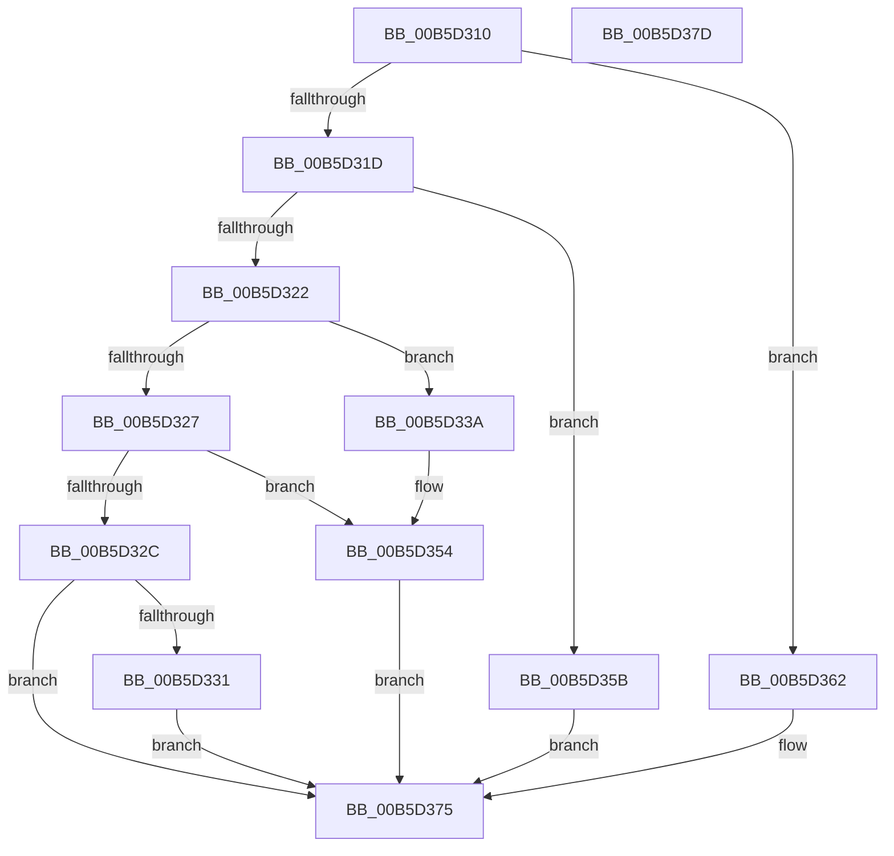

# HalpErrataInitSystem

- RVA: `0x00B5D310`–`0x00B5D37E` (길이 `110` bytes)
- VA: `0x0000000140B5D310`
- 실행 섹션: `PAGELK`
- PDB 이름 있음: `예`; PDB Function 태그: `아니요`
- unwind 정보 RVA: `0x00064C80`
- 디코드: `32`개 명령, `110/110` bytes 표시
- 미해석 바이트: `0` (있으면 어셈블리에 `.byte`로 보존)

> 이 문서는 커널 이미지의 기계어와 PDB 기호를 분석해 생성했습니다. 4번과 5번은 함수 원형과 자료형을 바이너리 사용 방식에서 추정한 C 해석이며 원본 소스 복구 결과는 아닙니다.

## 1. Dependencies

- 직접 호출 지점: **4**; 고유 호출 대상: **4**
- 직접 호출자로 확인된 함수: **0**
- RIP 상대 이미지 참조: **4**

### Outgoing calls
- `0x00B5D331` → [HalpInitChipHacks](../../init/C2/HalpInitChipHacks_function_00C24274.md) (function, `0x00C24274`)
- `0x00B5D34F` → [HalpUsbLegacyScanBusForHandoff](../../text/56/HalpUsbLegacyScanBusForHandoff_function_0056395C.md) (function, `0x0056395C`)
- `0x00B5D354` → [HalpErrataApplyPerProcessor](../B7/HalpErrataApplyPerProcessor_function_00B7E46C.md) (function, `0x00B7E46C`)
- `0x00B5D35B` → [HalpErrataInitDiscard](../../init/C1/HalpErrataInitDiscard_function_00C1F9C8.md) (function, `0x00C1F9C8`)

### Direct callers
- 이 함수 시작 RVA로 연결되는 직접 call은 확인되지 않았습니다. 간접 호출은 완전히 역산할 수 없습니다.

### Static image references
- `0x00B5D33A` → RVA `0x00F8FB80` (`.data`; read)
- `0x00B5D341` → RVA `0x00F8FB88` (`.data`; write)
- `0x00B5D348` → RVA `0x00F8FB80` (`.data`; write)
- `0x00B5D36F` → RVA `0x00E103FC` (`.data`; write)

## 2. Other-region calls and transfers

- 다른 실행 섹션으로 향하는 call: **3**
  - `0x00B5D331` → [HalpInitChipHacks](../../init/C2/HalpInitChipHacks_function_00C24274.md) (`PAGELK` → `INIT`)
  - `0x00B5D34F` → [HalpUsbLegacyScanBusForHandoff](../../text/56/HalpUsbLegacyScanBusForHandoff_function_0056395C.md) (`PAGELK` → `.text`)
  - `0x00B5D35B` → [HalpErrataInitDiscard](../../init/C1/HalpErrataInitDiscard_function_00C1F9C8.md) (`PAGELK` → `INIT`)
- 별도 외부 분기/꼬리 이동을 확인하지 못했습니다.

## 3. Assembly (complete function range)

```asm
00B5D310  40 53                           push rbx
00B5D312  48 83 EC 30                     sub rsp, 0x30
00B5D316  33 DB                           xor ebx, ebx
00B5D318  83 F9 02                        cmp ecx, 2
00B5D31B  74 45                           je 0x140b5d362
00B5D31D  83 F9 07                        cmp ecx, 7
00B5D320  74 39                           je 0x140b5d35b
00B5D322  83 F9 11                        cmp ecx, 0x11
00B5D325  74 13                           je 0x140b5d33a
00B5D327  83 F9 13                        cmp ecx, 0x13
00B5D32A  74 28                           je 0x140b5d354
00B5D32C  83 F9 1B                        cmp ecx, 0x1b
00B5D32F  75 44                           jne 0x140b5d375
00B5D331  E8 3E 6F 0C 00                  call 0x140c24274
00B5D336  8B D8                           mov ebx, eax
00B5D338  EB 3B                           jmp 0x140b5d375
00B5D33A  48 8D 05 3F 28 43 00            lea rax, [rip + 0x43283f]
00B5D341  48 89 05 40 28 43 00            mov qword ptr [rip + 0x432840], rax
00B5D348  48 89 05 31 28 43 00            mov qword ptr [rip + 0x432831], rax
00B5D34F  E8 08 66 A0 FF                  call 0x14056395c
00B5D354  E8 13 11 02 00                  call 0x140b7e46c
00B5D359  EB 1A                           jmp 0x140b5d375
00B5D35B  E8 68 26 0C 00                  call 0x140c1f9c8
00B5D360  EB 13                           jmp 0x140b5d375
00B5D362  49 8B 80 F0 00 00 00            mov rax, qword ptr [r8 + 0xf0]
00B5D369  8B 88 A0 0D 00 00               mov ecx, dword ptr [rax + 0xda0]
00B5D36F  89 0D 87 30 2B 00               mov dword ptr [rip + 0x2b3087], ecx
00B5D375  8B C3                           mov eax, ebx
00B5D377  48 83 C4 30                     add rsp, 0x30
00B5D37B  5B                              pop rbx
00B5D37C  C3                              ret
00B5D37D  CC                              int3
```

## 4. C-style interpretation (structured pseudocode)

```c
__int64 __fastcall HalpErrataInitSystem(int a1, __int64 a2, __int64 a3)
{
    __int64 result;
    __int64 v_rbx;
    __int64 v_rsp;

    v_rsp = (v_rsp) - (48);
    v_rbx = 0;
    if (a1 == 2) goto loc_00B5D362;
    if (a1 == 7) goto loc_00B5D35B;
    if (a1 == 17) goto loc_00B5D33A;
    if (a1 == 19) goto loc_00B5D354;
    if (a1 != 27) goto loc_00B5D375;
    result = HalpInitChipHacks(a1, a2, a3, a4);
    goto loc_00B5D375;
loc_00B5D33A:
    *(unsigned __int64 *)(v_rip + 4401216) = v_rip + 4401215;
    *(unsigned __int64 *)(v_rip + 4401201) = v_rip + 4401215;
    result = HalpUsbLegacyScanBusForHandoff(a1, a2, a3, a4);
loc_00B5D354:
    result = HalpErrataApplyPerProcessor(a1, a2, a3, a4);
    goto loc_00B5D375;
loc_00B5D35B:
    result = HalpErrataInitDiscard(a1, a2, a3, a4);
    goto loc_00B5D375;
loc_00B5D362:
    *(unsigned int *)(v_rip + 2830471) = (unsigned int)((unsigned int)(*(unsigned int *)(*(unsigned __int64 *)(a3 + 240) + 3488)));
loc_00B5D375:
    v_rsp = (v_rsp) + (48);
    return (unsigned int)((unsigned int)((unsigned int)((unsigned int)(result))));
}
```

## 5. (Beta) C Style

```c
int64_t HalpErrataInitSystem(int32_t Arg1, int64_t Arg2, void *Arg3)
{
    uint8_t *arg3 = (uint8_t *)Arg3;

    int64_t result;
    int64_t local_rbx;
    int64_t local_rsp;

    local_rsp = (local_rsp) - (48);
    local_rbx = 0;
    if (Arg1 == 2) goto loc_00B5D362;
    if (Arg1 == 7) goto loc_00B5D35B;
    if (Arg1 == 17) goto loc_00B5D33A;
    if (Arg1 == 19) goto loc_00B5D354;
    if (Arg1 != 27) goto loc_00B5D375;
    result = HalpInitChipHacks(Arg1, Arg2, Arg3, a4);
    goto loc_00B5D375;
loc_00B5D33A:
    *(uint64_t *)(v_rip + 0x432840) = v_rip + 4401215;
    *(uint64_t *)(v_rip + 0x432831) = v_rip + 4401215;
    result = HalpUsbLegacyScanBusForHandoff(Arg1, Arg2, Arg3, a4);
loc_00B5D354:
    result = HalpErrataApplyPerProcessor(Arg1, Arg2, Arg3, a4);
    goto loc_00B5D375;
loc_00B5D35B:
    result = HalpErrataInitDiscard(Arg1, Arg2, Arg3, a4);
    goto loc_00B5D375;
loc_00B5D362:
    *(uint32_t *)(v_rip + 0x2B3087) = (uint32_t)((uint32_t)(*(uint32_t *)(*(uint64_t *)(arg3 + 0xF0) + 0xDA0)));
loc_00B5D375:
    local_rsp = (local_rsp) + (48);
    return (uint32_t)((uint32_t)((uint32_t)((uint32_t)(result))));
}
```

### 관측된 메모리 오프셋

구조체 형식이 확인되지 않은 접근은 인자 기준의 오프셋으로만 기록했습니다.

| 기준 인자 | 오프셋 표현 | 폭 (bit) | 접근 |
|---|---:|---:|---|
| `Arg3` | `+ 0xF0` | `64` | `R` |

## 6. Execution-region graph

[열기: 2D/3D 그래프와 함수 탐색 컨트롤 패널](../../../control-panel.html?section=pagelk&rva=0x00B5D310&view=graph)

- 2D 그래프는 위에서 아래로 흐르고, 3D 그래프는 빈 공간을 드래그해 회전합니다. Shift+드래그는 이동, 휠은 확대·축소, 함수 노드 선택은 대상 보고서 이동입니다.

### Static fallback


