# HalpExtEnvInitSystem

- RVA: `0x00B5D1A0`–`0x00B5D224` (길이 `132` bytes)
- VA: `0x0000000140B5D1A0`
- 실행 섹션: `PAGELK`
- PDB 이름 있음: `예`; PDB Function 태그: `아니요`
- unwind 정보 RVA: `0x000DB714`
- 디코드: `32`개 명령, `132/132` bytes 표시
- 미해석 바이트: `0` (있으면 어셈블리에 `.byte`로 보존)

> 이 문서는 커널 이미지의 기계어와 PDB 기호를 분석해 생성했습니다. 4번과 5번은 함수 원형과 자료형을 바이너리 사용 방식에서 추정한 C 해석이며 원본 소스 복구 결과는 아닙니다.

## 1. Dependencies

- 직접 호출 지점: **0**; 고유 호출 대상: **0**
- 직접 호출자로 확인된 함수: **0**
- RIP 상대 이미지 참조: **10**

### Outgoing calls
- 직접 디코드된 call 명령이 없습니다.

### Direct callers
- 이 함수 시작 RVA로 연결되는 직접 call은 확인되지 않았습니다. 간접 호출은 완전히 역산할 수 없습니다.

### Static image references
- `0x00B5D1C3` → RVA `0x00E103D8` (`.data`; write)
- `0x00B5D1CF` → RVA `0x00FC1A20` (`.data`; read/write)
- `0x00B5D1E5` → RVA `0x00F8FC40` (`.data`; read/write)
- `0x00B5D1ED` → RVA `0x00F8FC30` (`.data`; read)
- `0x00B5D1F4` → RVA `0x00F8FC38` (`.data`; write)
- `0x00B5D1FB` → RVA `0x00F8FC30` (`.data`; write)
- `0x00B5D202` → RVA `0x00F8FC20` (`.data`; read)
- `0x00B5D209` → RVA `0x00F8FC28` (`.data`; write)
- `0x00B5D210` → RVA `0x00F8FC20` (`.data`; write)
- `0x00B5D219` → RVA `0x00FC1A20` (`.data`; write)

## 2. Other-region calls and transfers

- 다른 실행 섹션으로 향하는 call: **0**
- 별도 외부 분기/꼬리 이동을 확인하지 못했습니다.

## 3. Assembly (complete function range)

```asm
00B5D1A0  83 E9 01                        sub ecx, 1
00B5D1A3  74 74                           je 0x140b5d219
00B5D1A5  83 E9 06                        sub ecx, 6
00B5D1A8  74 3B                           je 0x140b5d1e5
00B5D1AA  83 E9 08                        sub ecx, 8
00B5D1AD  74 2A                           je 0x140b5d1d9
00B5D1AF  83 E9 02                        sub ecx, 2
00B5D1B2  74 0F                           je 0x140b5d1c3
00B5D1B4  83 E9 01                        sub ecx, 1
00B5D1B7  74 20                           je 0x140b5d1d9
00B5D1B9  83 E9 02                        sub ecx, 2
00B5D1BC  74 11                           je 0x140b5d1cf
00B5D1BE  83 F9 01                        cmp ecx, 1
00B5D1C1  75 5D                           jne 0x140b5d220
00B5D1C3  C7 05 0B 32 2B 00 01 00 00 00   mov dword ptr [rip + 0x2b320b], 1
00B5D1CD  EB 51                           jmp 0x140b5d220
00B5D1CF  48 83 25 49 48 46 00 00         and qword ptr [rip + 0x464849], 0
00B5D1D7  EB 47                           jmp 0x140b5d220
00B5D1D9  C7 05 F5 31 2B 00 02 00 00 00   mov dword ptr [rip + 0x2b31f5], 2
00B5D1E3  EB 3B                           jmp 0x140b5d220
00B5D1E5  48 83 25 53 2A 43 00 00         and qword ptr [rip + 0x432a53], 0
00B5D1ED  48 8D 05 3C 2A 43 00            lea rax, [rip + 0x432a3c]
00B5D1F4  48 89 05 3D 2A 43 00            mov qword ptr [rip + 0x432a3d], rax
00B5D1FB  48 89 05 2E 2A 43 00            mov qword ptr [rip + 0x432a2e], rax
00B5D202  48 8D 05 17 2A 43 00            lea rax, [rip + 0x432a17]
00B5D209  48 89 05 18 2A 43 00            mov qword ptr [rip + 0x432a18], rax
00B5D210  48 89 05 09 2A 43 00            mov qword ptr [rip + 0x432a09], rax
00B5D217  EB 07                           jmp 0x140b5d220
00B5D219  4C 89 05 00 48 46 00            mov qword ptr [rip + 0x464800], r8
00B5D220  33 C0                           xor eax, eax
00B5D222  C3                              ret
00B5D223  CC                              int3
```

## 4. C-style interpretation (structured pseudocode)

```c
__int64 __fastcall HalpExtEnvInitSystem(int a1, __int64 a2, __int64 a3)
{
    __int64 result;

    a1 = (unsigned int)((a1) - (1));
    if (condition_is_equal) goto loc_00B5D219;
    a1 = (unsigned int)((a1) - (6));
    if (condition_is_equal) goto loc_00B5D1E5;
    a1 = (unsigned int)((a1) - (8));
    if (condition_is_equal) goto loc_00B5D1D9;
    a1 = (unsigned int)((a1) - (2));
    if (condition_is_equal) goto loc_00B5D1C3;
    a1 = (unsigned int)((a1) - (1));
    if (condition_is_equal) goto loc_00B5D1D9;
    a1 = (unsigned int)((a1) - (2));
    if (condition_is_equal) goto loc_00B5D1CF;
    if (a1 != 1) goto loc_00B5D220;
loc_00B5D1C3:
    *(unsigned int *)(v_rip + 2830859) = 1;
    goto loc_00B5D220;
loc_00B5D1CF:
    goto loc_00B5D220;
loc_00B5D1D9:
    *(unsigned int *)(v_rip + 2830837) = 2;
    goto loc_00B5D220;
loc_00B5D1E5:
    *(unsigned __int64 *)(v_rip + 4401725) = v_rip + 4401724;
    *(unsigned __int64 *)(v_rip + 4401710) = v_rip + 4401724;
    *(unsigned __int64 *)(v_rip + 4401688) = v_rip + 4401687;
    *(unsigned __int64 *)(v_rip + 4401673) = v_rip + 4401687;
    goto loc_00B5D220;
loc_00B5D219:
    *(unsigned __int64 *)(v_rip + 4605952) = a3;
loc_00B5D220:
    result = 0;
    return result;
}
```

## 5. (Beta) C Style

```c
int64_t HalpExtEnvInitSystem(int32_t Arg1, int64_t Arg2, int64_t Arg3)
{
    int64_t result;

    Arg1 = (uint32_t)((Arg1) - (1));
    if (condition_is_equal) goto loc_00B5D219;
    Arg1 = (uint32_t)((Arg1) - (6));
    if (condition_is_equal) goto loc_00B5D1E5;
    Arg1 = (uint32_t)((Arg1) - (8));
    if (condition_is_equal) goto loc_00B5D1D9;
    Arg1 = (uint32_t)((Arg1) - (2));
    if (condition_is_equal) goto loc_00B5D1C3;
    Arg1 = (uint32_t)((Arg1) - (1));
    if (condition_is_equal) goto loc_00B5D1D9;
    Arg1 = (uint32_t)((Arg1) - (2));
    if (condition_is_equal) goto loc_00B5D1CF;
    if (Arg1 != 1) goto loc_00B5D220;
loc_00B5D1C3:
    *(uint32_t *)(v_rip + 0x2B320B) = 1;
    goto loc_00B5D220;
loc_00B5D1CF:
    goto loc_00B5D220;
loc_00B5D1D9:
    *(uint32_t *)(v_rip + 0x2B31F5) = 2;
    goto loc_00B5D220;
loc_00B5D1E5:
    *(uint64_t *)(v_rip + 0x432A3D) = v_rip + 4401724;
    *(uint64_t *)(v_rip + 0x432A2E) = v_rip + 4401724;
    *(uint64_t *)(v_rip + 0x432A18) = v_rip + 4401687;
    *(uint64_t *)(v_rip + 0x432A09) = v_rip + 4401687;
    goto loc_00B5D220;
loc_00B5D219:
    *(uint64_t *)(v_rip + 0x464800) = Arg3;
loc_00B5D220:
    result = 0;
    return result;
}
```

## 6. Execution-region graph

[열기: 2D/3D 그래프와 함수 탐색 컨트롤 패널](../../../control-panel.html?section=pagelk&rva=0x00B5D1A0&view=graph)

- 2D 그래프는 위에서 아래로 흐르고, 3D 그래프는 빈 공간을 드래그해 회전합니다. Shift+드래그는 이동, 휠은 확대·축소, 함수 노드 선택은 대상 보고서 이동입니다.

### Static fallback

```mermaid
flowchart TD
  bb_00B5D1A0[BB_00B5D1A0]
  bb_00B5D1A5[BB_00B5D1A5]
  bb_00B5D1AA[BB_00B5D1AA]
  bb_00B5D1AF[BB_00B5D1AF]
  bb_00B5D1B4[BB_00B5D1B4]
  bb_00B5D1B9[BB_00B5D1B9]
  bb_00B5D1BE[BB_00B5D1BE]
  bb_00B5D1C3[BB_00B5D1C3]
  bb_00B5D1CF[BB_00B5D1CF]
  bb_00B5D1D9[BB_00B5D1D9]
  bb_00B5D1E5[BB_00B5D1E5]
  bb_00B5D219[BB_00B5D219]
  bb_00B5D220[BB_00B5D220]
  bb_00B5D223[BB_00B5D223]
  bb_00B5D1A0 -->|branch| bb_00B5D219
  bb_00B5D1A0 -->|fallthrough| bb_00B5D1A5
  bb_00B5D1A5 -->|branch| bb_00B5D1E5
  bb_00B5D1A5 -->|fallthrough| bb_00B5D1AA
  bb_00B5D1AA -->|branch| bb_00B5D1D9
  bb_00B5D1AA -->|fallthrough| bb_00B5D1AF
  bb_00B5D1AF -->|branch| bb_00B5D1C3
  bb_00B5D1AF -->|fallthrough| bb_00B5D1B4
  bb_00B5D1B4 -->|branch| bb_00B5D1D9
  bb_00B5D1B4 -->|fallthrough| bb_00B5D1B9
  bb_00B5D1B9 -->|branch| bb_00B5D1CF
  bb_00B5D1B9 -->|fallthrough| bb_00B5D1BE
  bb_00B5D1BE -->|branch| bb_00B5D220
  bb_00B5D1BE -->|fallthrough| bb_00B5D1C3
  bb_00B5D1C3 -->|branch| bb_00B5D220
  bb_00B5D1CF -->|branch| bb_00B5D220
  bb_00B5D1D9 -->|branch| bb_00B5D220
  bb_00B5D1E5 -->|branch| bb_00B5D220
  bb_00B5D219 -->|flow| bb_00B5D220
```


