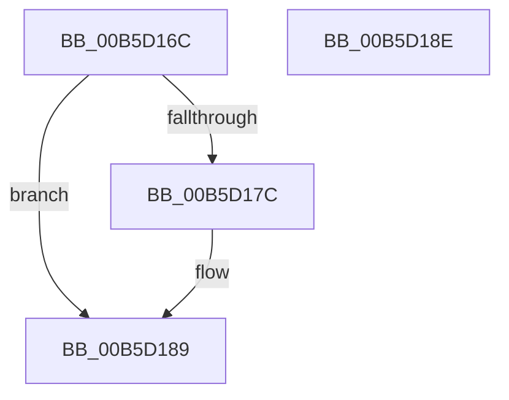

# HalpFreeResumeStructures

- RVA: `0x00B5D16C`–`0x00B5D18F` (길이 `35` bytes)
- VA: `0x0000000140B5D16C`
- 실행 섹션: `PAGELK`
- PDB 이름 있음: `예`; PDB Function 태그: `아니요`
- unwind 정보 RVA: `0x0005C788`
- 디코드: `9`개 명령, `35/35` bytes 표시
- 미해석 바이트: `0` (있으면 어셈블리에 `.byte`로 보존)

> 이 문서는 커널 이미지의 기계어와 PDB 기호를 분석해 생성했습니다. 4번과 5번은 함수 원형과 자료형을 바이너리 사용 방식에서 추정한 C 해석이며 원본 소스 복구 결과는 아닙니다.

## 1. Dependencies

- 직접 호출 지점: **1**; 고유 호출 대상: **1**
- 직접 호출자로 확인된 함수: **1**
- RIP 상대 이미지 참조: **2**

### Outgoing calls
- `0x00B5D17C` → [HalpMmAllocCtxFree](../../text/3E/HalpMmAllocCtxFree_function_003E1904.md) (function, `0x003E1904`)

### Direct callers
- [HalpDispatchSystemStateTransition](../../text/4C/HalpDispatchSystemStateTransition_function_004C8E34.md) at `0x004C8EDA`

### Static image references
- `0x00B5D170` → RVA `0x00FC1A90` (`.data`; read)
- `0x00B5D181` → RVA `0x00FC1A90` (`.data`; read/write)

## 2. Other-region calls and transfers

- 다른 실행 섹션으로 향하는 call: **1**
  - `0x00B5D17C` → [HalpMmAllocCtxFree](../../text/3E/HalpMmAllocCtxFree_function_003E1904.md) (`PAGELK` → `.text`)
- 별도 외부 분기/꼬리 이동을 확인하지 못했습니다.

## 3. Assembly (complete function range)

```asm
00B5D16C  48 83 EC 28                     sub rsp, 0x28
00B5D170  48 8B 15 19 49 46 00            mov rdx, qword ptr [rip + 0x464919]
00B5D177  48 85 D2                        test rdx, rdx
00B5D17A  74 0D                           je 0x140b5d189
00B5D17C  E8 83 47 88 FF                  call 0x1403e1904
00B5D181  48 83 25 07 49 46 00 00         and qword ptr [rip + 0x464907], 0
00B5D189  48 83 C4 28                     add rsp, 0x28
00B5D18D  C3                              ret
00B5D18E  CC                              int3
```

## 4. C-style interpretation (structured pseudocode)

```c
__int64 __fastcall HalpFreeResumeStructures(void)
{
    __int64 result;
    __int64 v_rsp;

    v_rsp = (v_rsp) - (40);
    if (*(unsigned __int64 *)(v_rip + 4606233) != 0) {
        result = HalpMmAllocCtxFree(a1, *(unsigned __int64 *)(v_rip + 4606233), a3, a4);
    }
    v_rsp = (v_rsp) + (40);
    return result;
}
```

## 5. (Beta) C Style

```c
void HalpFreeResumeStructures(void)
{
    int64_t result;
    int64_t local_rsp;

    local_rsp = (local_rsp) - (40);
    if (*(uint64_t *)(v_rip + 0x464919) != 0) {
        result = HalpMmAllocCtxFree(a1, *(uint64_t *)(v_rip + 0x464919), a3, a4);
    }
    local_rsp = (local_rsp) + (40);
    return result;
}
```

## 6. Execution-region graph

[열기: 2D/3D 그래프와 함수 탐색 컨트롤 패널](../../../control-panel.html?section=pagelk&rva=0x00B5D16C&view=graph)

- 2D 그래프는 위에서 아래로 흐르고, 3D 그래프는 빈 공간을 드래그해 회전합니다. Shift+드래그는 이동, 휠은 확대·축소, 함수 노드 선택은 대상 보고서 이동입니다.

### Static fallback


