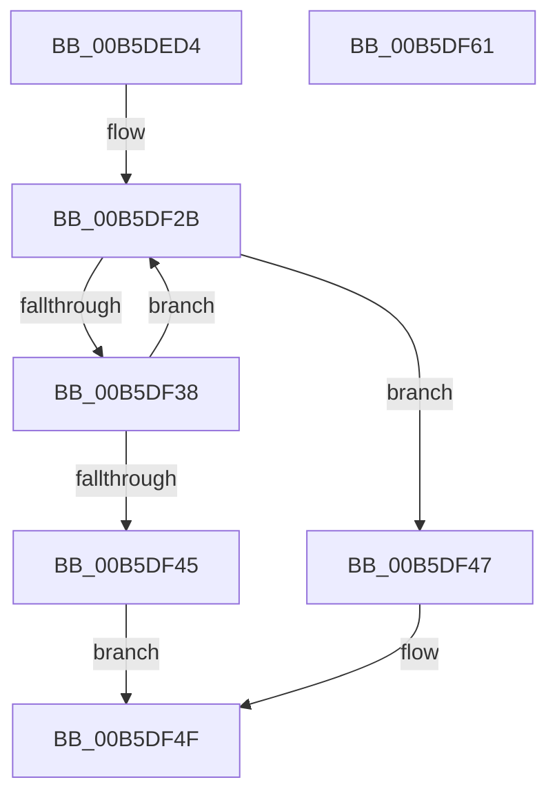

# HalpGenInitialRead

- RVA: `0x00B5DED4`–`0x00B5DF62` (길이 `142` bytes)
- VA: `0x0000000140B5DED4`
- 실행 섹션: `PAGELK`
- PDB 이름 있음: `예`; PDB Function 태그: `아니요`
- unwind 정보 RVA: `0x00079788`
- 디코드: `35`개 명령, `142/142` bytes 표시
- 미해석 바이트: `0` (있으면 어셈블리에 `.byte`로 보존)

> 이 문서는 커널 이미지의 기계어와 PDB 기호를 분석해 생성했습니다. 4번과 5번은 함수 원형과 자료형을 바이너리 사용 방식에서 추정한 C 해석이며 원본 소스 복구 결과는 아닙니다.

## 1. Dependencies

- 직접 호출 지점: **3**; 고유 호출 대상: **3**
- 직접 호출자로 확인된 함수: **1**
- RIP 상대 이미지 참조: **6**

### Outgoing calls
- `0x00B5DF2E` → [HalpFindGhesEntry](../../text/55/HalpFindGhesEntry_function_00555B88.md) (function, `0x00555B88`)
- `0x00B5DF4A` → [HalpCheckAndReportGhes](../../text/4A/HalpCheckAndReportGhes_function_004A9CDC.md) (function, `0x004A9CDC`)
- `0x00B5DF57` → [_security_check_cookie](../../text/6A/_security_check_cookie_function_006AC640.md) (function, `0x006AC640`)

### Direct callers
- [HalpInitializeGenericErrorSource](HalpInitializeGenericErrorSource_function_00B5E564.md) at `0x00B5E8B3`

### Static image references
- `0x00B5DEDB` → RVA `0x00E0A740` (`.data`; read)
- `0x00B5DEED` → RVA `0x00FC1550` (`.data`; read)
- `0x00B5DEFC` → RVA `0x00FC1680` (`.data`; read)
- `0x00B5DF0A` → RVA `0x00FC1540` (`.data`; read)
- `0x00B5DF15` → RVA `0x00FC1690` (`.data`; read)
- `0x00B5DF20` → RVA `0x00FC1560` (`.data`; read)

## 2. Other-region calls and transfers

- 다른 실행 섹션으로 향하는 call: **3**
  - `0x00B5DF2E` → [HalpFindGhesEntry](../../text/55/HalpFindGhesEntry_function_00555B88.md) (`PAGELK` → `.text`)
  - `0x00B5DF4A` → [HalpCheckAndReportGhes](../../text/4A/HalpCheckAndReportGhes_function_004A9CDC.md) (`PAGELK` → `.text`)
  - `0x00B5DF57` → [_security_check_cookie](../../text/6A/_security_check_cookie_function_006AC640.md) (`PAGELK` → `.text`)
- 별도 외부 분기/꼬리 이동을 확인하지 못했습니다.

## 3. Assembly (complete function range)

```asm
00B5DED4  4C 8B DC                        mov r11, rsp
00B5DED7  48 83 EC 58                     sub rsp, 0x58
00B5DEDB  48 8B 05 5E C8 2A 00            mov rax, qword ptr [rip + 0x2ac85e]
00B5DEE2  48 33 C4                        xor rax, rsp
00B5DEE5  48 89 44 24 48                  mov qword ptr [rsp + 0x48], rax
00B5DEEA  8B 49 1C                        mov ecx, dword ptr [rcx + 0x1c]
00B5DEED  48 8D 05 5C 36 46 00            lea rax, [rip + 0x46365c]
00B5DEF4  49 89 43 C8                     mov qword ptr [r11 - 0x38], rax
00B5DEF8  4D 8D 4B C8                     lea r9, [r11 - 0x38]
00B5DEFC  48 8D 05 7D 37 46 00            lea rax, [rip + 0x46377d]
00B5DF03  45 33 C0                        xor r8d, r8d
00B5DF06  49 89 43 D0                     mov qword ptr [r11 - 0x30], rax
00B5DF0A  48 8D 05 2F 36 46 00            lea rax, [rip + 0x46362f]
00B5DF11  49 89 43 D8                     mov qword ptr [r11 - 0x28], rax
00B5DF15  48 8D 05 74 37 46 00            lea rax, [rip + 0x463774]
00B5DF1C  49 89 43 E0                     mov qword ptr [r11 - 0x20], rax
00B5DF20  48 8D 05 39 36 46 00            lea rax, [rip + 0x463639]
00B5DF27  49 89 43 E8                     mov qword ptr [r11 - 0x18], rax
00B5DF2B  49 8B 11                        mov rdx, qword ptr [r9]
00B5DF2E  E8 55 7C 9F FF                  call 0x140555b88
00B5DF33  48 85 C0                        test rax, rax
00B5DF36  75 0F                           jne 0x140b5df47
00B5DF38  41 FF C0                        inc r8d
00B5DF3B  49 83 C1 08                     add r9, 8
00B5DF3F  41 83 F8 05                     cmp r8d, 5
00B5DF43  72 E6                           jb 0x140b5df2b
00B5DF45  EB 08                           jmp 0x140b5df4f
00B5DF47  48 8B C8                        mov rcx, rax
00B5DF4A  E8 8D BD 94 FF                  call 0x1404a9cdc
00B5DF4F  48 8B 4C 24 48                  mov rcx, qword ptr [rsp + 0x48]
00B5DF54  48 33 CC                        xor rcx, rsp
00B5DF57  E8 E4 E6 B4 FF                  call 0x1406ac640
00B5DF5C  48 83 C4 58                     add rsp, 0x58
00B5DF60  C3                              ret
00B5DF61  CC                              int3
```

## 4. C-style interpretation (structured pseudocode)

```c
__int64 __fastcall HalpGenInitialRead(__int64 a1, __int64 a2, int a3)
{
    __int64 result;
    __int64 v_rsp;
    unsigned __int64 v_stack_m10;

    v_rsp = (v_rsp) - (88);
    result = (*(unsigned __int64 *)(v_rip + 2803806)) ^ (v_rsp);
    v_stack_m10 = result;
    *(unsigned __int64 *)(v_rsp - 56) = v_rip + 4601436;
    a3 = 0;
    *(unsigned __int64 *)(v_rsp - 48) = v_rip + 4601725;
    *(unsigned __int64 *)(v_rsp - 40) = v_rip + 4601391;
    *(unsigned __int64 *)(v_rsp - 32) = v_rip + 4601716;
    *(unsigned __int64 *)(v_rsp - 24) = v_rip + 4601401;
loc_00B5DF2B:
    result = HalpFindGhesEntry((unsigned int)(*(unsigned int *)(a1 + 28)), *(unsigned __int64 *)(v_rsp - 56), a3, v_rsp - 56);
    if (result != 0) goto loc_00B5DF47;
    a3 = (unsigned int)((a3) + 1);
    a4 = (v_rsp - 56) + (8);
    if (a3 < 5) goto loc_00B5DF2B;
    goto loc_00B5DF4F;
loc_00B5DF47:
    result = HalpCheckAndReportGhes(result, *(unsigned __int64 *)(v_rsp - 56), a3, a4);
loc_00B5DF4F:
    a1 = (v_stack_m10) ^ (v_rsp);
    result = _security_check_cookie(a1, *(unsigned __int64 *)(v_rsp - 56), a3, a4);
    v_rsp = (v_rsp) + (88);
    return result;
}
```

## 5. (Beta) C Style

```c
int64_t HalpGenInitialRead(void *Arg1, int64_t Arg2, int32_t Arg3)
{
    uint8_t *arg1 = (uint8_t *)Arg1;

    int64_t result;
    int64_t local_rsp;
    uint64_t v_stack_m10;

    local_rsp = (local_rsp) - (88);
    result = (*(uint64_t *)(v_rip + 0x2AC85E)) ^ (local_rsp);
    v_stack_m10 = result;
    *(uint64_t *)(local_rsp - 0x38) = v_rip + 4601436;
    Arg3 = 0;
    *(uint64_t *)(local_rsp - 0x30) = v_rip + 4601725;
    *(uint64_t *)(local_rsp - 0x28) = v_rip + 4601391;
    *(uint64_t *)(local_rsp - 0x20) = v_rip + 4601716;
    *(uint64_t *)(local_rsp - 0x18) = v_rip + 4601401;
loc_00B5DF2B:
    result = HalpFindGhesEntry((uint32_t)(*(uint32_t *)(arg1 + 0x1C)), *(uint64_t *)(local_rsp - 0x38), Arg3, local_rsp - 56);
    if (result != 0) goto loc_00B5DF47;
    Arg3 = (uint32_t)((Arg3) + 1);
    a4 = (local_rsp - 56) + (8);
    if (Arg3 < 5) goto loc_00B5DF2B;
    goto loc_00B5DF4F;
loc_00B5DF47:
    result = HalpCheckAndReportGhes(result, *(uint64_t *)(local_rsp - 0x38), Arg3, a4);
loc_00B5DF4F:
    Arg1 = (v_stack_m10) ^ (local_rsp);
    result = _security_check_cookie(Arg1, *(uint64_t *)(local_rsp - 0x38), Arg3, a4);
    local_rsp = (local_rsp) + (88);
    return result;
}
```

### 관측된 메모리 오프셋

구조체 형식이 확인되지 않은 접근은 인자 기준의 오프셋으로만 기록했습니다.

| 기준 인자 | 오프셋 표현 | 폭 (bit) | 접근 |
|---|---:|---:|---|
| `Arg1` | `+ 0x1C` | `32` | `R` |

## 6. Execution-region graph

[열기: 2D/3D 그래프와 함수 탐색 컨트롤 패널](../../../control-panel.html?section=pagelk&rva=0x00B5DED4&view=graph)

- 2D 그래프는 위에서 아래로 흐르고, 3D 그래프는 빈 공간을 드래그해 회전합니다. Shift+드래그는 이동, 휠은 확대·축소, 함수 노드 선택은 대상 보고서 이동입니다.

### Static fallback


