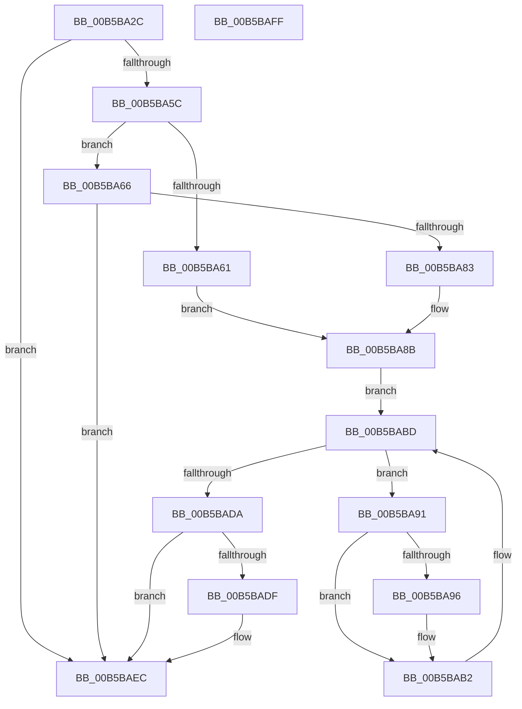

# HalpHandlePreviousMcaErrorsOnProcessor

- RVA: `0x00B5BA2C`–`0x00B5BB00` (길이 `212` bytes)
- VA: `0x0000000140B5BA2C`
- 실행 섹션: `PAGELK`
- PDB 이름 있음: `예`; PDB Function 태그: `아니요`
- unwind 정보 RVA: `0x000B4164`
- 디코드: `62`개 명령, `212/212` bytes 표시
- 미해석 바이트: `0` (있으면 어셈블리에 `.byte`로 보존)

> 이 문서는 커널 이미지의 기계어와 PDB 기호를 분석해 생성했습니다. 4번과 5번은 함수 원형과 자료형을 바이너리 사용 방식에서 추정한 C 해석이며 원본 소스 복구 결과는 아닙니다.

## 1. Dependencies

- 직접 호출 지점: **7**; 고유 호출 대상: **7**
- 직접 호출자로 확인된 함수: **2**
- RIP 상대 이미지 참조: **0**

### Outgoing calls
- `0x00B5BA4F` → [HalpMcaReadErrorPresence](../../text/48/HalpMcaReadErrorPresence_function_004878D4.md) (function, `0x004878D4`)
- `0x00B5BA76` → [ExAllocatePool2](../../poolcode/B8/ExAllocatePool2_function_00B820F0.md) (function, `0x00B820F0`)
- `0x00B5BA86` → [HalpMceInitializeErrorPacketContents](../B7/HalpMceInitializeErrorPacketContents_function_00B7D548.md) (function, `0x00B7D548`)
- `0x00B5BAAD` → [HalpMcaReportError](../../text/54/HalpMcaReportError_function_00541D04.md) (function, `0x00541D04`)
- `0x00B5BAB8` → [HalpMcaClearError](../../text/54/HalpMcaClearError_function_00541478.md) (function, `0x00541478`)
- `0x00B5BAD1` → [HalpMcaReadError](../../text/54/HalpMcaReadError_function_00541A2C.md) (function, `0x00541A2C`)
- `0x00B5BAE7` → [ExFreePoolWithTag](../../poolcode/B8/ExFreePoolWithTag_function_00B82870.md) (function, `0x00B82870`)

### Direct callers
- [HalpHandlePreviousMcaErrors](HalpHandlePreviousMcaErrors_function_00B5B8E4.md) at `0x00B5B9C6`
- [HalpInitializeMce](HalpInitializeMce_function_00B5BC04.md) at `0x00B5BD9F`

### Static image references
- 디코드된 RIP-relative 메모리 참조가 없습니다.

## 2. Other-region calls and transfers

- 다른 실행 섹션으로 향하는 call: **6**
  - `0x00B5BA4F` → [HalpMcaReadErrorPresence](../../text/48/HalpMcaReadErrorPresence_function_004878D4.md) (`PAGELK` → `.text`)
  - `0x00B5BA76` → [ExAllocatePool2](../../poolcode/B8/ExAllocatePool2_function_00B820F0.md) (`PAGELK` → `POOLCODE`)
  - `0x00B5BAAD` → [HalpMcaReportError](../../text/54/HalpMcaReportError_function_00541D04.md) (`PAGELK` → `.text`)
  - `0x00B5BAB8` → [HalpMcaClearError](../../text/54/HalpMcaClearError_function_00541478.md) (`PAGELK` → `.text`)
  - `0x00B5BAD1` → [HalpMcaReadError](../../text/54/HalpMcaReadError_function_00541A2C.md) (`PAGELK` → `.text`)
  - `0x00B5BAE7` → [ExFreePoolWithTag](../../poolcode/B8/ExFreePoolWithTag_function_00B82870.md) (`PAGELK` → `POOLCODE`)
- 별도 외부 분기/꼬리 이동을 확인하지 못했습니다.

## 3. Assembly (complete function range)

```asm
00B5BA2C  48 89 5C 24 08                  mov qword ptr [rsp + 8], rbx
00B5BA31  48 89 6C 24 10                  mov qword ptr [rsp + 0x10], rbp
00B5BA36  56                              push rsi
00B5BA37  57                              push rdi
00B5BA38  41 56                           push r14
00B5BA3A  48 83 EC 30                     sub rsp, 0x30
00B5BA3E  83 64 24 68 00                  and dword ptr [rsp + 0x68], 0
00B5BA43  48 8B F2                        mov rsi, rdx
00B5BA46  49 8B D0                        mov rdx, r8
00B5BA49  49 8B D8                        mov rbx, r8
00B5BA4C  44 8A F1                        mov r14b, cl
00B5BA4F  E8 80 BE 92 FF                  call 0x1404878d4
00B5BA54  85 C0                           test eax, eax
00B5BA56  0F 88 90 00 00 00               js 0x140b5baec
00B5BA5C  48 85 F6                        test rsi, rsi
00B5BA5F  74 05                           je 0x140b5ba66
00B5BA61  48 8B FE                        mov rdi, rsi
00B5BA64  EB 25                           jmp 0x140b5ba8b
00B5BA66  BA F8 04 00 00                  mov edx, 0x4f8
00B5BA6B  B9 40 00 00 00                  mov ecx, 0x40
00B5BA70  41 B8 48 61 6C 57               mov r8d, 0x576c6148
00B5BA76  E8 75 66 02 00                  call 0x140b820f0
00B5BA7B  48 8B F8                        mov rdi, rax
00B5BA7E  48 85 C0                        test rax, rax
00B5BA81  74 69                           je 0x140b5baec
00B5BA83  48 8B C8                        mov rcx, rax
00B5BA86  E8 BD 1A 02 00                  call 0x140b7d548
00B5BA8B  48 8D 6F 50                     lea rbp, [rdi + 0x50]
00B5BA8F  EB 2C                           jmp 0x140b5babd
00B5BA91  45 84 F6                        test r14b, r14b
00B5BA94  74 1C                           je 0x140b5bab2
00B5BA96  8B 44 24 68                     mov eax, dword ptr [rsp + 0x68]
00B5BA9A  4C 8B C3                        mov r8, rbx
00B5BA9D  48 8B D5                        mov rdx, rbp
00B5BAA0  89 47 14                        mov dword ptr [rdi + 0x14], eax
00B5BAA3  48 8B CF                        mov rcx, rdi
00B5BAA6  C7 47 0C 01 00 00 00            mov dword ptr [rdi + 0xc], 1
00B5BAAD  E8 52 62 9E FF                  call 0x140541d04
00B5BAB2  48 8B D3                        mov rdx, rbx
00B5BAB5  48 8B CD                        mov rcx, rbp
00B5BAB8  E8 BB 59 9E FF                  call 0x140541478
00B5BABD  45 33 C9                        xor r9d, r9d
00B5BAC0  48 89 5C 24 20                  mov qword ptr [rsp + 0x20], rbx
00B5BAC5  4C 8D 44 24 68                  lea r8, [rsp + 0x68]
00B5BACA  48 8B D5                        mov rdx, rbp
00B5BACD  41 8D 49 11                     lea ecx, [r9 + 0x11]
00B5BAD1  E8 56 5F 9E FF                  call 0x140541a2c
00B5BAD6  85 C0                           test eax, eax
00B5BAD8  79 B7                           jns 0x140b5ba91
00B5BADA  48 85 F6                        test rsi, rsi
00B5BADD  75 0D                           jne 0x140b5baec
00B5BADF  BA 48 61 6C 57                  mov edx, 0x576c6148
00B5BAE4  48 8B CF                        mov rcx, rdi
00B5BAE7  E8 84 6D 02 00                  call 0x140b82870
00B5BAEC  48 8B 5C 24 50                  mov rbx, qword ptr [rsp + 0x50]
00B5BAF1  48 8B 6C 24 58                  mov rbp, qword ptr [rsp + 0x58]
00B5BAF6  48 83 C4 30                     add rsp, 0x30
00B5BAFA  41 5E                           pop r14
00B5BAFC  5F                              pop rdi
00B5BAFD  5E                              pop rsi
00B5BAFE  C3                              ret
00B5BAFF  CC                              int3
```

## 4. C-style interpretation (structured pseudocode)

```c
__int64 __fastcall HalpHandlePreviousMcaErrorsOnProcessor(unsigned __int8 a1, __int64 a2, __int64 a3, int a4)
{
    __int64 result;
    __int64 v_rsp;
    unsigned __int64 v_stack_m28;
    unsigned __int64 v_stack_p10;
    unsigned int v_stack_p20;
    unsigned __int64 v_stack_p8;

    v_stack_p8 = v_rbx;
    v_stack_p10 = v_rbp;
    v_rsp = (v_rsp) - (48);
    result = HalpMcaReadErrorPresence(a1, a3, a3, a4);
    if (sign_flag) goto loc_00B5BAEC;
    if (a2 == 0) goto loc_00B5BA66;
    goto loc_00B5BA8B;
loc_00B5BA66:
    result = ExAllocatePool2(64, (unsigned int)(0x4F8ULL), (unsigned int)(0x576C6148ULL), a4);
    if (result == 0) goto loc_00B5BAEC;
    result = HalpMceInitializeErrorPacketContents(result, (unsigned int)(0x4F8ULL), (unsigned int)(0x576C6148ULL), a4);
loc_00B5BA8B:
    goto loc_00B5BABD;
loc_00B5BA91:
    if (a1 != 0) {
        result = v_stack_p20;
        a3 = a3;
        a2 = result + 80;
        *(unsigned int *)(result + 20) = (unsigned int)(result);
        a1 = result;
        *(unsigned int *)(result + 12) = 1;
        result = HalpMcaReportError(a1, a2, a3, a4);
    }
    result = HalpMcaClearError(result + 80, a3, a3, a4);
loc_00B5BABD:
    a4 = 0;
    v_stack_m28 = a3;
    result = HalpMcaReadError(a4 + 17, result + 80, v_stack_p20, a4);
    if (!sign_flag) goto loc_00B5BA91;
    if (a2 == 0) {
        a2 = 0x576C6148ULL;
        a1 = result;
        result = ExFreePoolWithTag(a1, a2, v_stack_p20, a4);
    }
    v_rsp = (v_rsp) + (48);
    return result;
}
```

## 5. (Beta) C Style

```c
int64_t HalpHandlePreviousMcaErrorsOnProcessor(uint8_t Arg1, int64_t Arg2, int64_t Arg3, int32_t Arg4)
{
    int64_t result;
    int64_t local_rsp;
    uint64_t v_stack_m28;
    uint64_t v_stack_p10;
    uint32_t v_stack_p20;
    uint64_t v_stack_p8;

    v_stack_p8 = local_rbx;
    v_stack_p10 = local_rbp;
    local_rsp = (local_rsp) - (48);
    result = HalpMcaReadErrorPresence(Arg1, Arg3, Arg3, Arg4);
    if (sign_flag) goto loc_00B5BAEC;
    if (Arg2 == 0) goto loc_00B5BA66;
    goto loc_00B5BA8B;
loc_00B5BA66:
    result = ExAllocatePool2(64, (uint32_t)(0x4F8ULL), (uint32_t)(0x576C6148ULL), Arg4);
    if (result == 0) goto loc_00B5BAEC;
    result = HalpMceInitializeErrorPacketContents(result, (uint32_t)(0x4F8ULL), (uint32_t)(0x576C6148ULL), Arg4);
loc_00B5BA8B:
    goto loc_00B5BABD;
loc_00B5BA91:
    if (Arg1 != 0) {
        result = v_stack_p20;
        Arg3 = Arg3;
        Arg2 = result + 80;
        *(uint32_t *)(result + 0x14) = (uint32_t)(result);
        Arg1 = result;
        *(uint32_t *)(result + 0xC) = 1;
        result = HalpMcaReportError(Arg1, Arg2, Arg3, Arg4);
    }
    result = HalpMcaClearError(result + 80, Arg3, Arg3, Arg4);
loc_00B5BABD:
    Arg4 = 0;
    v_stack_m28 = Arg3;
    result = HalpMcaReadError(Arg4 + 17, result + 80, v_stack_p20, Arg4);
    if (!sign_flag) goto loc_00B5BA91;
    if (Arg2 == 0) {
        Arg2 = 0x576C6148ULL;
        Arg1 = result;
        result = ExFreePoolWithTag(Arg1, Arg2, v_stack_p20, Arg4);
    }
    local_rsp = (local_rsp) + (48);
    return result;
}
```

## 6. Execution-region graph

[열기: 2D/3D 그래프와 함수 탐색 컨트롤 패널](../../../control-panel.html?section=pagelk&rva=0x00B5BA2C&view=graph)

- 2D 그래프는 위에서 아래로 흐르고, 3D 그래프는 빈 공간을 드래그해 회전합니다. Shift+드래그는 이동, 휠은 확대·축소, 함수 노드 선택은 대상 보고서 이동입니다.

### Static fallback


