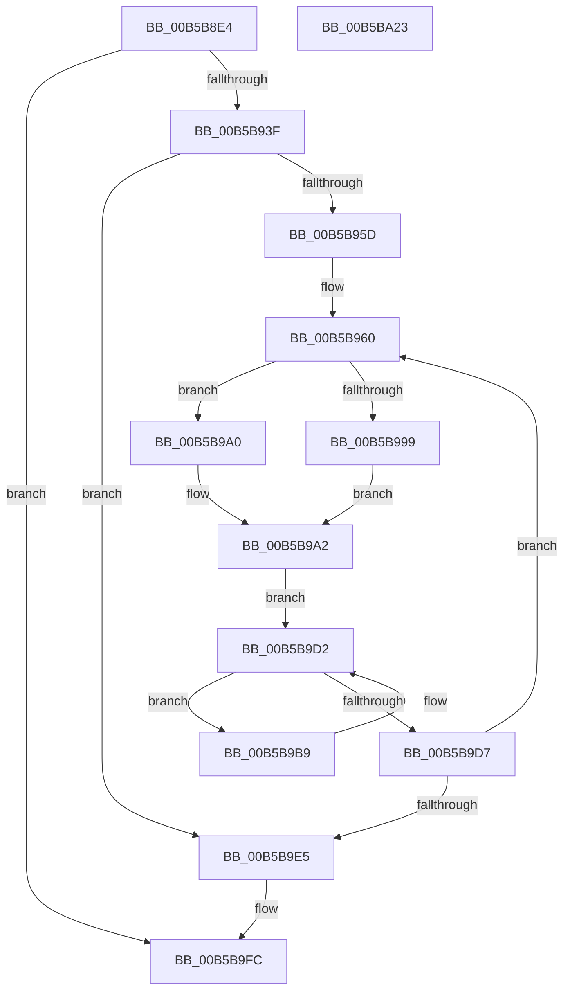

# HalpHandlePreviousMcaErrors

- RVA: `0x00B5B8E4`–`0x00B5BA24` (길이 `320` bytes)
- VA: `0x0000000140B5B8E4`
- 실행 섹션: `PAGELK`
- PDB 이름 있음: `예`; PDB Function 태그: `아니요`
- unwind 정보 RVA: `0x000C3B18`
- 디코드: `82`개 명령, `320/320` bytes 표시
- 미해석 바이트: `0` (있으면 어셈블리에 `.byte`로 보존)

> 이 문서는 커널 이미지의 기계어와 PDB 기호를 분석해 생성했습니다. 4번과 5번은 함수 원형과 자료형을 바이너리 사용 방식에서 추정한 C 해석이며 원본 소스 복구 결과는 아닙니다.

## 1. Dependencies

- 직접 호출 지점: **8**; 고유 호출 대상: **8**
- 직접 호출자로 확인된 함수: **1**
- RIP 상대 이미지 참조: **2**

### Outgoing calls
- `0x00B5B92E` → [ExAllocatePool2](../../poolcode/B8/ExAllocatePool2_function_00B820F0.md) (function, `0x00B820F0`)
- `0x00B5B942` → [HalpMceInitializeErrorPacketContents](../B7/HalpMceInitializeErrorPacketContents_function_00B7D548.md) (function, `0x00B7D548`)
- `0x00B5B94C` → [KeQueryActiveProcessorCountEx](../../text/24/KeQueryActiveProcessorCountEx_function_00249EF0.md) (function, `0x00249EF0`)
- `0x00B5B9A2` → [KeSetSystemGroupAffinityThread](../../text/39/KeSetSystemGroupAffinityThread_function_00399140.md) (function, `0x00399140`)
- `0x00B5B9C6` → [HalpHandlePreviousMcaErrorsOnProcessor](HalpHandlePreviousMcaErrorsOnProcessor_function_00B5BA2C.md) (function, `0x00B5BA2C`)
- `0x00B5B9EA` → [KeRevertToUserGroupAffinityThread](../../text/39/KeRevertToUserGroupAffinityThread_function_00398EC0.md) (function, `0x00398EC0`)
- `0x00B5B9F7` → [ExFreePoolWithTag](../../poolcode/B8/ExFreePoolWithTag_function_00B82870.md) (function, `0x00B82870`)
- `0x00B5BA04` → [_security_check_cookie](../../text/6A/_security_check_cookie_function_006AC640.md) (function, `0x006AC640`)

### Direct callers
- [HalpInitializeMce](HalpInitializeMce_function_00B5BC04.md) at `0x00B5BCB5`

### Static image references
- `0x00B5B8FC` → RVA `0x00E0A740` (`.data`; read)
- `0x00B5B960` → RVA `0x00F231B0` (`.data`; read)

## 2. Other-region calls and transfers

- 다른 실행 섹션으로 향하는 call: **6**
  - `0x00B5B92E` → [ExAllocatePool2](../../poolcode/B8/ExAllocatePool2_function_00B820F0.md) (`PAGELK` → `POOLCODE`)
  - `0x00B5B94C` → [KeQueryActiveProcessorCountEx](../../text/24/KeQueryActiveProcessorCountEx_function_00249EF0.md) (`PAGELK` → `.text`)
  - `0x00B5B9A2` → [KeSetSystemGroupAffinityThread](../../text/39/KeSetSystemGroupAffinityThread_function_00399140.md) (`PAGELK` → `.text`)
  - `0x00B5B9EA` → [KeRevertToUserGroupAffinityThread](../../text/39/KeRevertToUserGroupAffinityThread_function_00398EC0.md) (`PAGELK` → `.text`)
  - `0x00B5B9F7` → [ExFreePoolWithTag](../../poolcode/B8/ExFreePoolWithTag_function_00B82870.md) (`PAGELK` → `POOLCODE`)
  - `0x00B5BA04` → [_security_check_cookie](../../text/6A/_security_check_cookie_function_006AC640.md) (`PAGELK` → `.text`)
- 별도 외부 분기/꼬리 이동을 확인하지 못했습니다.

## 3. Assembly (complete function range)

```asm
00B5B8E4  48 89 5C 24 08                  mov qword ptr [rsp + 8], rbx
00B5B8E9  48 89 6C 24 10                  mov qword ptr [rsp + 0x10], rbp
00B5B8EE  48 89 74 24 18                  mov qword ptr [rsp + 0x18], rsi
00B5B8F3  57                              push rdi
00B5B8F4  41 56                           push r14
00B5B8F6  41 57                           push r15
00B5B8F8  48 83 EC 50                     sub rsp, 0x50
00B5B8FC  48 8B 05 3D EE 2A 00            mov rax, qword ptr [rip + 0x2aee3d]
00B5B903  48 33 C4                        xor rax, rsp
00B5B906  48 89 44 24 40                  mov qword ptr [rsp + 0x40], rax
00B5B90B  44 8A F9                        mov r15b, cl
00B5B90E  0F 57 C0                        xorps xmm0, xmm0
00B5B911  0F 57 C9                        xorps xmm1, xmm1
00B5B914  B9 40 00 00 00                  mov ecx, 0x40
00B5B919  BA F8 04 00 00                  mov edx, 0x4f8
00B5B91E  41 B8 48 61 6C 57               mov r8d, 0x576c6148
00B5B924  0F 11 44 24 20                  movups xmmword ptr [rsp + 0x20], xmm0
00B5B929  0F 11 4C 24 30                  movups xmmword ptr [rsp + 0x30], xmm1
00B5B92E  E8 BD 67 02 00                  call 0x140b820f0
00B5B933  48 8B F0                        mov rsi, rax
00B5B936  48 85 C0                        test rax, rax
00B5B939  0F 84 BD 00 00 00               je 0x140b5b9fc
00B5B93F  48 8B C8                        mov rcx, rax
00B5B942  E8 01 1C 02 00                  call 0x140b7d548
00B5B947  B9 FF FF 00 00                  mov ecx, 0xffff
00B5B94C  E8 9F E5 6E FF                  call 0x140249ef0
00B5B951  33 FF                           xor edi, edi
00B5B953  8B E8                           mov ebp, eax
00B5B955  85 C0                           test eax, eax
00B5B957  0F 84 88 00 00 00               je 0x140b5b9e5
00B5B95D  45 33 F6                        xor r14d, r14d
00B5B960  48 8B 0D 49 78 3C 00            mov rcx, qword ptr [rip + 0x3c7849]
00B5B967  33 C0                           xor eax, eax
00B5B969  89 44 24 2A                     mov dword ptr [rsp + 0x2a], eax
00B5B96D  66 89 44 24 2E                  mov word ptr [rsp + 0x2e], ax
00B5B972  41 8B 0C 0E                     mov ecx, dword ptr [r14 + rcx]
00B5B976  8B C1                           mov eax, ecx
00B5B978  C1 E8 06                        shr eax, 6
00B5B97B  83 E1 3F                        and ecx, 0x3f
00B5B97E  66 89 44 24 28                  mov word ptr [rsp + 0x28], ax
00B5B983  B8 01 00 00 00                  mov eax, 1
00B5B988  48 D3 E0                        shl rax, cl
00B5B98B  48 8D 4C 24 20                  lea rcx, [rsp + 0x20]
00B5B990  48 89 44 24 20                  mov qword ptr [rsp + 0x20], rax
00B5B995  85 FF                           test edi, edi
00B5B997  75 07                           jne 0x140b5b9a0
00B5B999  48 8D 54 24 30                  lea rdx, [rsp + 0x30]
00B5B99E  EB 02                           jmp 0x140b5b9a2
00B5B9A0  33 D2                           xor edx, edx
00B5B9A2  E8 99 D7 83 FF                  call 0x140399140
00B5B9A7  65 48 8B 04 25 18 00 00 00      mov rax, qword ptr gs:[0x18]
00B5B9B0  48 8B 98 D8 00 00 00            mov rbx, qword ptr [rax + 0xd8]
00B5B9B7  EB 19                           jmp 0x140b5b9d2
00B5B9B9  4C 8B 83 AC 00 00 00            mov r8, qword ptr [rbx + 0xac]
00B5B9C0  48 8B D6                        mov rdx, rsi
00B5B9C3  41 8A CF                        mov cl, r15b
00B5B9C6  E8 61 00 00 00                  call 0x140b5ba2c
00B5B9CB  48 8B 9B B8 00 00 00            mov rbx, qword ptr [rbx + 0xb8]
00B5B9D2  48 85 DB                        test rbx, rbx
00B5B9D5  75 E2                           jne 0x140b5b9b9
00B5B9D7  FF C7                           inc edi
00B5B9D9  49 83 C6 04                     add r14, 4
00B5B9DD  3B FD                           cmp edi, ebp
00B5B9DF  0F 82 7B FF FF FF               jb 0x140b5b960
00B5B9E5  48 8D 4C 24 30                  lea rcx, [rsp + 0x30]
00B5B9EA  E8 D1 D4 83 FF                  call 0x140398ec0
00B5B9EF  BA 48 61 6C 57                  mov edx, 0x576c6148
00B5B9F4  48 8B CE                        mov rcx, rsi
00B5B9F7  E8 74 6E 02 00                  call 0x140b82870
00B5B9FC  48 8B 4C 24 40                  mov rcx, qword ptr [rsp + 0x40]
00B5BA01  48 33 CC                        xor rcx, rsp
00B5BA04  E8 37 0C B5 FF                  call 0x1406ac640
00B5BA09  4C 8D 5C 24 50                  lea r11, [rsp + 0x50]
00B5BA0E  49 8B 5B 20                     mov rbx, qword ptr [r11 + 0x20]
00B5BA12  49 8B 6B 28                     mov rbp, qword ptr [r11 + 0x28]
00B5BA16  49 8B 73 30                     mov rsi, qword ptr [r11 + 0x30]
00B5BA1A  49 8B E3                        mov rsp, r11
00B5BA1D  41 5F                           pop r15
00B5BA1F  41 5E                           pop r14
00B5BA21  5F                              pop rdi
00B5BA22  C3                              ret
00B5BA23  CC                              int3
```

## 4. C-style interpretation (structured pseudocode)

```c
__int64 __fastcall HalpHandlePreviousMcaErrors(unsigned __int8 a1)
{
    __int64 result;
    __int64 v_r14;
    __int64 v_rdi;
    __int64 v_rsp;
    unsigned __int64 v_stack_m18;
    unsigned __int64 v_stack_m28;
    unsigned __int64 v_stack_m38;
    unsigned __int16 v_stack_m3A;
    unsigned int v_stack_m3E;
    unsigned __int16 v_stack_m40;
    unsigned __int64 v_stack_m48;
    unsigned __int64 v_stack_p10;
    unsigned __int64 v_stack_p18;
    unsigned __int64 v_stack_p8;

    v_stack_p8 = v_rbx;
    v_stack_p10 = v_rbp;
    v_stack_p18 = v_rsi;
    v_rsp = (v_rsp) - (80);
    result = (*(unsigned __int64 *)(v_rip + 2813501)) ^ (v_rsp);
    v_stack_m28 = result;
    v_stack_m48 = v_xmm0;
    v_stack_m38 = v_xmm1;
    result = ExAllocatePool2(64, (unsigned int)(0x4F8ULL), (unsigned int)(0x576C6148ULL), a4);
    if (result == 0) goto loc_00B5B9FC;
    result = HalpMceInitializeErrorPacketContents(result, (unsigned int)(0x4F8ULL), (unsigned int)(0x576C6148ULL), a4);
    result = KeQueryActiveProcessorCountEx((unsigned int)(0xFFFFULL), (unsigned int)(0x4F8ULL), (unsigned int)(0x576C6148ULL), a4);
    v_rdi = 0;
    if ((unsigned int)(result) == 0) goto loc_00B5B9E5;
    v_r14 = 0;
loc_00B5B960:
    result = 0;
    v_stack_m3E = 0;
    v_stack_m3A = 0;
    result = (unsigned int)(((unsigned int)((unsigned int)((unsigned int)(*(unsigned int *)(v_r14 + *(unsigned __int64 *)(v_rip + 3962953) * 1))))) >> (6));
    a1 = (unsigned int)(((unsigned int)(*(unsigned int *)(v_r14 + *(unsigned __int64 *)(v_rip + 3962953) * 1))) & (63));
    v_stack_m40 = (unsigned __int16)(result);
    result = (1) << (a1);
    v_stack_m48 = result;
    if (0 != 0) goto loc_00B5B9A0;
    goto loc_00B5B9A2;
loc_00B5B9A0:
    a2 = 0;
loc_00B5B9A2:
    result = KeSetSystemGroupAffinityThread(v_stack_m48, a2, (unsigned int)(0x576C6148ULL), a4);
    goto loc_00B5B9D2;
loc_00B5B9B9:
    result = HalpHandlePreviousMcaErrorsOnProcessor(a1, result, *(unsigned __int64 *)(*(unsigned __int64 *)(*(unsigned __int64 *)(gs_base + (0 + 24)) + 216) + 172), a4);
loc_00B5B9D2:
    if (*(unsigned __int64 *)(*(unsigned __int64 *)(*(unsigned __int64 *)(gs_base + (0 + 24)) + 216) + 184) != 0) goto loc_00B5B9B9;
    v_rdi = (unsigned int)((v_rdi) + 1);
    v_r14 = (v_r14) + (4);
    if (((unsigned int)(v_rdi)) < ((unsigned int)((unsigned int)((unsigned int)(result))))) goto loc_00B5B960;
loc_00B5B9E5:
    result = KeRevertToUserGroupAffinityThread(v_stack_m38, result, *(unsigned __int64 *)(*(unsigned __int64 *)(*(unsigned __int64 *)(gs_base + (0 + 24)) + 216) + 172), a4);
    result = ExFreePoolWithTag(result, (unsigned int)(0x576C6148ULL), *(unsigned __int64 *)(*(unsigned __int64 *)(*(unsigned __int64 *)(gs_base + (0 + 24)) + 216) + 172), a4);
loc_00B5B9FC:
    a1 = (v_stack_m28) ^ (v_rsp);
    result = _security_check_cookie(a1, (unsigned int)(0x576C6148ULL), *(unsigned __int64 *)(*(unsigned __int64 *)(*(unsigned __int64 *)(gs_base + (0 + 24)) + 216) + 172), a4);
    return result;
}
```

## 5. (Beta) C Style

```c
int64_t HalpHandlePreviousMcaErrors(uint8_t Arg1)
{
    int64_t result;
    int64_t local_r14;
    int64_t local_rdi;
    int64_t local_rsp;
    uint64_t v_stack_m18;
    uint64_t v_stack_m28;
    uint64_t v_stack_m38;
    uint16_t v_stack_m3A;
    uint32_t v_stack_m3E;
    uint16_t v_stack_m40;
    uint64_t v_stack_m48;
    uint64_t v_stack_p10;
    uint64_t v_stack_p18;
    uint64_t v_stack_p8;

    v_stack_p8 = local_rbx;
    v_stack_p10 = local_rbp;
    v_stack_p18 = local_rsi;
    local_rsp = (local_rsp) - (80);
    result = (*(uint64_t *)(v_rip + 0x2AEE3D)) ^ (local_rsp);
    v_stack_m28 = result;
    v_stack_m48 = v_xmm0;
    v_stack_m38 = v_xmm1;
    result = ExAllocatePool2(64, (uint32_t)(0x4F8ULL), (uint32_t)(0x576C6148ULL), a4);
    if (result == 0) goto loc_00B5B9FC;
    result = HalpMceInitializeErrorPacketContents(result, (uint32_t)(0x4F8ULL), (uint32_t)(0x576C6148ULL), a4);
    result = KeQueryActiveProcessorCountEx((uint32_t)(0xFFFFULL), (uint32_t)(0x4F8ULL), (uint32_t)(0x576C6148ULL), a4);
    local_rdi = 0;
    if ((uint32_t)(result) == 0) goto loc_00B5B9E5;
    local_r14 = 0;
loc_00B5B960:
    result = 0;
    v_stack_m3E = 0;
    v_stack_m3A = 0;
    result = (uint32_t)(((uint32_t)((uint32_t)((uint32_t)(*(uint32_t *)(local_r14 + *(uint64_t *)(v_rip + 0x3C7849) * 1))))) >> (6));
    Arg1 = (uint32_t)(((uint32_t)(*(uint32_t *)(local_r14 + *(uint64_t *)(v_rip + 0x3C7849) * 1))) & (63));
    v_stack_m40 = (uint16_t)(result);
    result = (1) << (Arg1);
    v_stack_m48 = result;
    if (0 != 0) goto loc_00B5B9A0;
    goto loc_00B5B9A2;
loc_00B5B9A0:
    a2 = 0;
loc_00B5B9A2:
    result = KeSetSystemGroupAffinityThread(v_stack_m48, a2, (uint32_t)(0x576C6148ULL), a4);
    goto loc_00B5B9D2;
loc_00B5B9B9:
    result = HalpHandlePreviousMcaErrorsOnProcessor(Arg1, result, *(uint64_t *)(*(uint64_t *)(*(uint64_t *)(gs_base + (0 + 0x18)) + 0xD8) + 0xAC), a4);
loc_00B5B9D2:
    if (*(uint64_t *)(*(uint64_t *)(*(uint64_t *)(gs_base + (0 + 0x18)) + 0xD8) + 0xB8) != 0) goto loc_00B5B9B9;
    local_rdi = (uint32_t)((local_rdi) + 1);
    local_r14 = (local_r14) + (4);
    if (((uint32_t)(local_rdi)) < ((uint32_t)((uint32_t)((uint32_t)(result))))) goto loc_00B5B960;
loc_00B5B9E5:
    result = KeRevertToUserGroupAffinityThread(v_stack_m38, result, *(uint64_t *)(*(uint64_t *)(*(uint64_t *)(gs_base + (0 + 0x18)) + 0xD8) + 0xAC), a4);
    result = ExFreePoolWithTag(result, (uint32_t)(0x576C6148ULL), *(uint64_t *)(*(uint64_t *)(*(uint64_t *)(gs_base + (0 + 0x18)) + 0xD8) + 0xAC), a4);
loc_00B5B9FC:
    Arg1 = (v_stack_m28) ^ (local_rsp);
    result = _security_check_cookie(Arg1, (uint32_t)(0x576C6148ULL), *(uint64_t *)(*(uint64_t *)(*(uint64_t *)(gs_base + (0 + 0x18)) + 0xD8) + 0xAC), a4);
    return result;
}
```

## 6. Execution-region graph

[열기: 2D/3D 그래프와 함수 탐색 컨트롤 패널](../../../control-panel.html?section=pagelk&rva=0x00B5B8E4&view=graph)

- 2D 그래프는 위에서 아래로 흐르고, 3D 그래프는 빈 공간을 드래그해 회전합니다. Shift+드래그는 이동, 휠은 확대·축소, 함수 노드 선택은 대상 보고서 이동입니다.

### Static fallback


