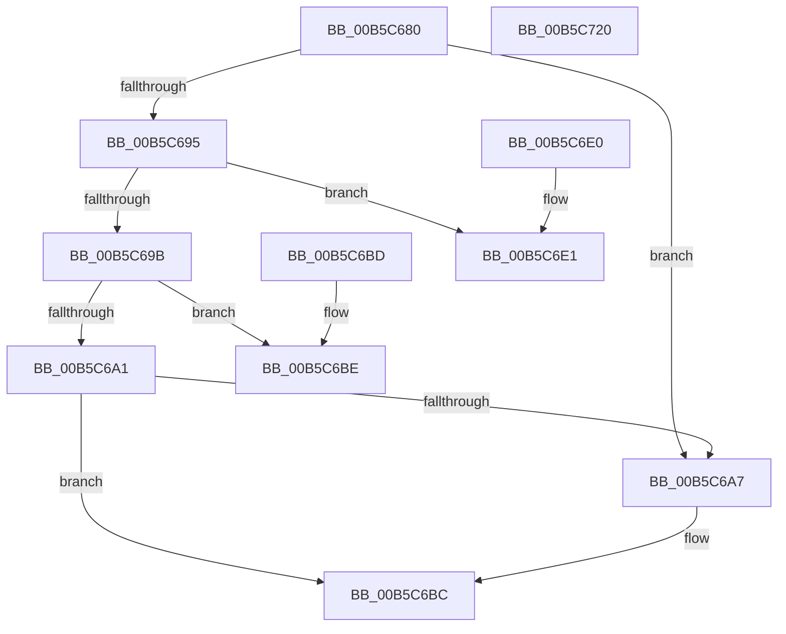

# HalpHvBuildDeviceId

- RVA: `0x00B5C680`–`0x00B5C721` (길이 `161` bytes)
- VA: `0x0000000140B5C680`
- 실행 섹션: `PAGELK`
- PDB 이름 있음: `예`; PDB Function 태그: `아니요`
- unwind 정보 RVA: `0x000DB714`
- 디코드: `50`개 명령, `161/161` bytes 표시
- 미해석 바이트: `0` (있으면 어셈블리에 `.byte`로 보존)

> 이 문서는 커널 이미지의 기계어와 PDB 기호를 분석해 생성했습니다. 4번과 5번은 함수 원형과 자료형을 바이너리 사용 방식에서 추정한 C 해석이며 원본 소스 복구 결과는 아닙니다.

## 1. Dependencies

- 직접 호출 지점: **0**; 고유 호출 대상: **0**
- 직접 호출자로 확인된 함수: **3**
- RIP 상대 이미지 참조: **0**

### Outgoing calls
- 직접 디코드된 call 명령이 없습니다.

### Direct callers
- [HalpTimerInitializeHypervisorTimer](../../text/54/HalpTimerInitializeHypervisorTimer_function_0054B8F4.md) at `0x0054BA16`
- [HalpHvMapDeviceMsiRange](HalpHvMapDeviceMsiRange_function_00B5C728.md) at `0x00B5C7A4`
- [HalpHvUnmapDeviceMsiRange](HalpHvUnmapDeviceMsiRange_function_00B5C930.md) at `0x00B5C983`

### Static image references
- 디코드된 RIP-relative 메모리 참조가 없습니다.

## 2. Other-region calls and transfers

- 다른 실행 섹션으로 향하는 call: **0**
- 별도 외부 분기/꼬리 이동을 확인하지 못했습니다.

## 3. Assembly (complete function range)

```asm
00B5C680  44 8B 12                        mov r10d, dword ptr [rdx]
00B5C683  48 B8 00 00 00 00 00 00 00 40   movabs rax, 0x4000000000000000
00B5C68D  49 89 01                        mov qword ptr [r9], rax
00B5C690  45 85 D2                        test r10d, r10d
00B5C693  74 12                           je 0x140b5c6a7
00B5C695  41 83 EA 01                     sub r10d, 1
00B5C699  74 46                           je 0x140b5c6e1
00B5C69B  41 83 EA 01                     sub r10d, 1
00B5C69F  74 1D                           je 0x140b5c6be
00B5C6A1  41 83 FA 01                     cmp r10d, 1
00B5C6A5  75 15                           jne 0x140b5c6bc
00B5C6A7  0F B7 41 02                     movzx eax, word ptr [rcx + 2]
00B5C6AB  66 41 89 41 02                  mov word ptr [r9 + 2], ax
00B5C6B0  8A 41 01                        mov al, byte ptr [rcx + 1]
00B5C6B3  41 88 41 01                     mov byte ptr [r9 + 1], al
00B5C6B7  8A 01                           mov al, byte ptr [rcx]
00B5C6B9  41 88 01                        mov byte ptr [r9], al
00B5C6BC  C3                              ret
00B5C6BD  CC                              int3
00B5C6BE  0F B7 42 04                     movzx eax, word ptr [rdx + 4]
00B5C6C2  8A 4A 0A                        mov cl, byte ptr [rdx + 0xa]
00B5C6C5  66 41 89 41 02                  mov word ptr [r9 + 2], ax
00B5C6CA  80 E1 07                        and cl, 7
00B5C6CD  8A 42 08                        mov al, byte ptr [rdx + 8]
00B5C6D0  41 88 41 01                     mov byte ptr [r9 + 1], al
00B5C6D4  8A 42 09                        mov al, byte ptr [rdx + 9]
00B5C6D7  C0 E0 03                        shl al, 3
00B5C6DA  0A C8                           or cl, al
00B5C6DC  41 88 09                        mov byte ptr [r9], cl
00B5C6DF  C3                              ret
00B5C6E0  CC                              int3
00B5C6E1  0F B7 42 04                     movzx eax, word ptr [rdx + 4]
00B5C6E5  41 80 E0 03                     and r8b, 3
00B5C6E9  8A 4A 0A                        mov cl, byte ptr [rdx + 0xa]
00B5C6EC  66 41 89 41 02                  mov word ptr [r9 + 2], ax
00B5C6F1  80 E1 07                        and cl, 7
00B5C6F4  8A 42 08                        mov al, byte ptr [rdx + 8]
00B5C6F7  41 88 41 01                     mov byte ptr [r9 + 1], al
00B5C6FB  8A 42 09                        mov al, byte ptr [rdx + 9]
00B5C6FE  BA FC FF 00 00                  mov edx, 0xfffc
00B5C703  C0 E0 03                        shl al, 3
00B5C706  0A C8                           or cl, al
00B5C708  41 0F B7 41 06                  movzx eax, word ptr [r9 + 6]
00B5C70D  41 88 09                        mov byte ptr [r9], cl
00B5C710  66 23 C2                        and ax, dx
00B5C713  41 0F B6 C8                     movzx ecx, r8b
00B5C717  66 0B C8                        or cx, ax
00B5C71A  66 41 89 49 06                  mov word ptr [r9 + 6], cx
00B5C71F  C3                              ret
00B5C720  CC                              int3
```

## 4. C-style interpretation (structured pseudocode)

```c
__int64 __fastcall HalpHvBuildDeviceId(__int64 a1, __int64 a2, unsigned __int8 a3, __int64 a4)
{
    __int64 result;
    __int64 v_r10;

    *(unsigned __int64 *)(a4) = result;
    if ((unsigned int)((unsigned int)(*(unsigned int *)(a2))) == 0) goto loc_00B5C6A7;
    v_r10 = (unsigned int)(((unsigned int)(*(unsigned int *)(a2))) - (1));
    if (condition_is_equal) goto loc_00B5C6E1;
    v_r10 = (unsigned int)((v_r10) - (1));
    if (condition_is_equal) goto loc_00B5C6BE;
    if (((unsigned int)(v_r10)) == 1) {
        result = *(unsigned __int16 *)(a1 + 2);
        *(unsigned __int16 *)(a4 + 2) = (unsigned __int16)(result);
        result = *(unsigned __int8 *)(a1 + 1);
        *(unsigned __int8 *)(a4 + 1) = (unsigned __int8)(result);
        result = *(unsigned __int8 *)(a1);
        *(unsigned __int8 *)(a4) = (unsigned __int8)(result);
    }
    return result;
loc_00B5C6BE:
    *(unsigned __int16 *)(a4 + 2) = (unsigned __int16)(*(unsigned __int16 *)(a2 + 4));
    a1 = (unsigned __int8)((*(unsigned __int8 *)(a2 + 10)) & (7));
    *(unsigned __int8 *)(a4 + 1) = (unsigned __int8)(*(unsigned __int8 *)(a2 + 8));
    result = (unsigned __int8)((*(unsigned __int8 *)(a2 + 9)) << (3));
    a1 = (unsigned __int8)((a1) | ((unsigned __int8)(result)));
    *(unsigned __int8 *)(a4) = (unsigned __int8)(a1);
    return result;
loc_00B5C6E1:
    a3 = (unsigned __int8)((a3) & (3));
    *(unsigned __int16 *)(a4 + 2) = (unsigned __int16)(*(unsigned __int16 *)(a2 + 4));
    a1 = (unsigned __int8)((*(unsigned __int8 *)(a2 + 10)) & (7));
    *(unsigned __int8 *)(a4 + 1) = (unsigned __int8)(*(unsigned __int8 *)(a2 + 8));
    result = (unsigned __int8)((*(unsigned __int8 *)(a2 + 9)) << (3));
    a1 = (unsigned __int8)((a1) | ((unsigned __int8)(result)));
    *(unsigned __int8 *)(a4) = (unsigned __int8)(a1);
    result = (unsigned __int16)((*(unsigned __int16 *)(a4 + 6)) & ((unsigned __int16)((unsigned int)(0xFFFCULL))));
    a1 = (unsigned __int16)((a3) | ((unsigned __int16)(result)));
    *(unsigned __int16 *)(a4 + 6) = (unsigned __int16)(a1);
    return result;
}
```

## 5. (Beta) C Style

```c
int64_t HalpHvBuildDeviceId(void *Arg1, void *Arg2, uint8_t Arg3, void *Arg4)
{
    uint8_t *arg1 = (uint8_t *)Arg1;
    uint8_t *arg2 = (uint8_t *)Arg2;
    uint8_t *arg4 = (uint8_t *)Arg4;

    int64_t result;
    int64_t local_r10;

    *(uint64_t *)(arg4) = result;
    if ((uint32_t)((uint32_t)(*(uint32_t *)(arg2))) == 0) goto loc_00B5C6A7;
    local_r10 = (uint32_t)(((uint32_t)(*(uint32_t *)(arg2))) - (1));
    if (condition_is_equal) goto loc_00B5C6E1;
    local_r10 = (uint32_t)((local_r10) - (1));
    if (condition_is_equal) goto loc_00B5C6BE;
    if (((uint32_t)(local_r10)) == 1) {
        result = *(uint16_t *)(arg1 + 0x2);
        *(uint16_t *)(arg4 + 0x2) = (uint16_t)(result);
        result = *(uint8_t *)(arg1 + 0x1);
        *(uint8_t *)(arg4 + 0x1) = (uint8_t)(result);
        result = *(uint8_t *)(arg1);
        *(uint8_t *)(arg4) = (uint8_t)(result);
    }
    return result;
loc_00B5C6BE:
    *(uint16_t *)(arg4 + 0x2) = (uint16_t)(*(uint16_t *)(arg2 + 0x4));
    Arg1 = (uint8_t)((*(uint8_t *)(arg2 + 0xA)) & (7));
    *(uint8_t *)(arg4 + 0x1) = (uint8_t)(*(uint8_t *)(arg2 + 0x8));
    result = (uint8_t)((*(uint8_t *)(arg2 + 0x9)) << (3));
    Arg1 = (uint8_t)((Arg1) | ((uint8_t)(result)));
    *(uint8_t *)(arg4) = (uint8_t)(Arg1);
    return result;
loc_00B5C6E1:
    Arg3 = (uint8_t)((Arg3) & (3));
    *(uint16_t *)(arg4 + 0x2) = (uint16_t)(*(uint16_t *)(arg2 + 0x4));
    Arg1 = (uint8_t)((*(uint8_t *)(arg2 + 0xA)) & (7));
    *(uint8_t *)(arg4 + 0x1) = (uint8_t)(*(uint8_t *)(arg2 + 0x8));
    result = (uint8_t)((*(uint8_t *)(arg2 + 0x9)) << (3));
    Arg1 = (uint8_t)((Arg1) | ((uint8_t)(result)));
    *(uint8_t *)(arg4) = (uint8_t)(Arg1);
    result = (uint16_t)((*(uint16_t *)(arg4 + 0x6)) & ((uint16_t)((uint32_t)(0xFFFCULL))));
    Arg1 = (uint16_t)((Arg3) | ((uint16_t)(result)));
    *(uint16_t *)(arg4 + 0x6) = (uint16_t)(Arg1);
    return result;
}
```

### 관측된 메모리 오프셋

구조체 형식이 확인되지 않은 접근은 인자 기준의 오프셋으로만 기록했습니다.

| 기준 인자 | 오프셋 표현 | 폭 (bit) | 접근 |
|---|---:|---:|---|
| `Arg1` | `+ 0x0` | `8` | `R` |
| `Arg1` | `+ 0x1` | `8` | `R` |
| `Arg1` | `+ 0x2` | `16` | `R` |
| `Arg2` | `+ 0x0` | `32` | `R` |
| `Arg2` | `+ 0x4` | `16` | `R` |
| `Arg2` | `+ 0x8` | `8` | `R` |
| `Arg2` | `+ 0x9` | `8` | `R` |
| `Arg2` | `+ 0xA` | `8` | `R` |
| `Arg4` | `+ 0x0` | `8` | `W` |
| `Arg4` | `+ 0x0` | `64` | `W` |
| `Arg4` | `+ 0x1` | `8` | `W` |
| `Arg4` | `+ 0x2` | `16` | `W` |
| `Arg4` | `+ 0x6` | `16` | `R` |
| `Arg4` | `+ 0x6` | `16` | `W` |

## 6. Execution-region graph

[열기: 2D/3D 그래프와 함수 탐색 컨트롤 패널](../../../control-panel.html?section=pagelk&rva=0x00B5C680&view=graph)

- 2D 그래프는 위에서 아래로 흐르고, 3D 그래프는 빈 공간을 드래그해 회전합니다. Shift+드래그는 이동, 휠은 확대·축소, 함수 노드 선택은 대상 보고서 이동입니다.

### Static fallback


