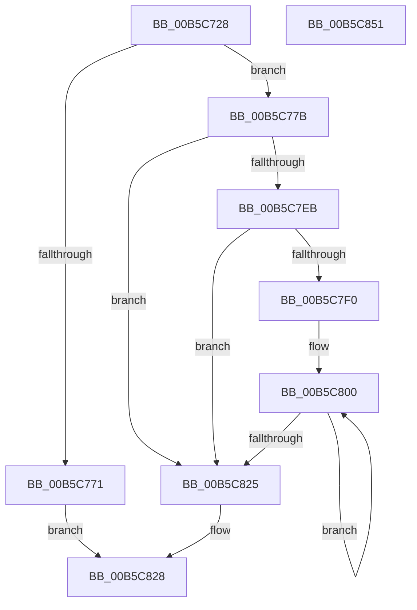

# HalpHvMapDeviceMsiRange

- RVA: `0x00B5C728`–`0x00B5C852` (길이 `298` bytes)
- VA: `0x0000000140B5C728`
- 실행 섹션: `PAGELK`
- PDB 이름 있음: `예`; PDB Function 태그: `아니요`
- unwind 정보 RVA: `0x000C4044`
- 디코드: `86`개 명령, `298/298` bytes 표시
- 미해석 바이트: `0` (있으면 어셈블리에 `.byte`로 보존)

> 이 문서는 커널 이미지의 기계어와 PDB 기호를 분석해 생성했습니다. 4번과 5번은 함수 원형과 자료형을 바이너리 사용 방식에서 추정한 C 해석이며 원본 소스 복구 결과는 아닙니다.

## 1. Dependencies

- 직접 호출 지점: **3**; 고유 호출 대상: **3**
- 직접 호출자로 확인된 함수: **1**
- RIP 상대 이미지 참조: **2**

### Outgoing calls
- `0x00B5C7A4` → [HalpHvBuildDeviceId](HalpHvBuildDeviceId_function_00B5C680.md) (function, `0x00B5C680`)
- `0x00B5C7DF` → [guard_dispatch_icall](../../text/6B/guard_dispatch_icall_function_006BAAD0.md) (function, `0x006BAAD0`)
- `0x00B5C82F` → [_security_check_cookie](../../text/6A/_security_check_cookie_function_006AC640.md) (function, `0x006AC640`)

### Direct callers
- [HalpInterruptRemap](../../text/54/HalpInterruptRemap_function_00542AE4.md) at `0x00542D21`

### Static image references
- `0x00B5C746` → RVA `0x00E0A740` (`.data`; read)
- `0x00B5C7C6` → RVA `0x00FC1CA8` (`.data`; read)

## 2. Other-region calls and transfers

- 다른 실행 섹션으로 향하는 call: **2**
  - `0x00B5C7DF` → [guard_dispatch_icall](../../text/6B/guard_dispatch_icall_function_006BAAD0.md) (`PAGELK` → `.text`)
  - `0x00B5C82F` → [_security_check_cookie](../../text/6A/_security_check_cookie_function_006AC640.md) (`PAGELK` → `.text`)
- 별도 외부 분기/꼬리 이동을 확인하지 못했습니다.

## 3. Assembly (complete function range)

```asm
00B5C728  48 8B C4                        mov rax, rsp
00B5C72B  48 89 58 08                     mov qword ptr [rax + 8], rbx
00B5C72F  48 89 70 10                     mov qword ptr [rax + 0x10], rsi
00B5C733  48 89 78 18                     mov qword ptr [rax + 0x18], rdi
00B5C737  4C 89 70 20                     mov qword ptr [rax + 0x20], r14
00B5C73B  55                              push rbp
00B5C73C  48 8B EC                        mov rbp, rsp
00B5C73F  48 81 EC 80 00 00 00            sub rsp, 0x80
00B5C746  48 8B 05 F3 DF 2A 00            mov rax, qword ptr [rip + 0x2adff3]
00B5C74D  48 33 C4                        xor rax, rsp
00B5C750  48 89 45 F0                     mov qword ptr [rbp - 0x10], rax
00B5C754  48 8B 75 30                     mov rsi, qword ptr [rbp + 0x30]
00B5C758  33 FF                           xor edi, edi
00B5C75A  41 83 38 03                     cmp dword ptr [r8], 3
00B5C75E  0F 57 C0                        xorps xmm0, xmm0
00B5C761  45 8A D9                        mov r11b, r9b
00B5C764  48 89 7D B8                     mov qword ptr [rbp - 0x48], rdi
00B5C768  4D 8B D0                        mov r10, r8
00B5C76B  0F 11 45 C0                     movups xmmword ptr [rbp - 0x40], xmm0
00B5C76F  75 0A                           jne 0x140b5c77b
00B5C771  B8 BB 00 00 C0                  mov eax, 0xc00000bb
00B5C776  E9 AD 00 00 00                  jmp 0x140b5c828
00B5C77B  8B C1                           mov eax, ecx
00B5C77D  88 4D B1                        mov byte ptr [rbp - 0x4f], cl
00B5C780  C1 E8 08                        shr eax, 8
00B5C783  4C 8D 4D B8                     lea r9, [rbp - 0x48]
00B5C787  66 89 45 B2                     mov word ptr [rbp - 0x4e], ax
00B5C78B  48 8D 4D B0                     lea rcx, [rbp - 0x50]
00B5C78F  8B C2                           mov eax, edx
00B5C791  45 8A C3                        mov r8b, r11b
00B5C794  C1 E8 05                        shr eax, 5
00B5C797  C0 E2 03                        shl dl, 3
00B5C79A  24 07                           and al, 7
00B5C79C  0A C2                           or al, dl
00B5C79E  49 8B D2                        mov rdx, r10
00B5C7A1  88 45 B0                        mov byte ptr [rbp - 0x50], al
00B5C7A4  E8 D7 FE FF FF                  call 0x140b5c680
00B5C7A9  8B 46 04                        mov eax, dword ptr [rsi + 4]
00B5C7AC  4C 8D 46 18                     lea r8, [rsi + 0x18]
00B5C7B0  48 8B 5D B8                     mov rbx, qword ptr [rbp - 0x48]
00B5C7B4  4C 8D 4D C0                     lea r9, [rbp - 0x40]
00B5C7B8  44 8B 75 38                     mov r14d, dword ptr [rbp + 0x38]
00B5C7BC  48 8D 55 D0                     lea rdx, [rbp - 0x30]
00B5C7C0  89 45 E0                        mov dword ptr [rbp - 0x20], eax
00B5C7C3  48 8B CB                        mov rcx, rbx
00B5C7C6  48 8B 05 DB 54 46 00            mov rax, qword ptr [rip + 0x4654db]
00B5C7CD  89 7D DC                        mov dword ptr [rbp - 0x24], edi
00B5C7D0  48 89 7D E4                     mov qword ptr [rbp - 0x1c], rdi
00B5C7D4  89 7D EC                        mov dword ptr [rbp - 0x14], edi
00B5C7D7  48 89 7D D0                     mov qword ptr [rbp - 0x30], rdi
00B5C7DB  44 89 75 D8                     mov dword ptr [rbp - 0x28], r14d
00B5C7DF  E8 EC E2 B5 FF                  call 0x1406baad0
00B5C7E4  44 8B D0                        mov r10d, eax
00B5C7E7  85 C0                           test eax, eax
00B5C7E9  78 3A                           js 0x140b5c825
00B5C7EB  45 85 F6                        test r14d, r14d
00B5C7EE  74 35                           je 0x140b5c825
00B5C7F0  44 8B 45 CC                     mov r8d, dword ptr [rbp - 0x34]
00B5C7F4  48 8D 4E 34                     lea rcx, [rsi + 0x34]
00B5C7F8  44 8B 4D C8                     mov r9d, dword ptr [rbp - 0x38]
00B5C7FC  48 8D 56 2C                     lea rdx, [rsi + 0x2c]
00B5C800  33 C0                           xor eax, eax
00B5C802  48 89 02                        mov qword ptr [rdx], rax
00B5C805  89 42 08                        mov dword ptr [rdx + 8], eax
00B5C808  48 8D 52 58                     lea rdx, [rdx + 0x58]
00B5C80C  41 8D 04 38                     lea eax, [r8 + rdi]
00B5C810  44 89 49 FC                     mov dword ptr [rcx - 4], r9d
00B5C814  FF C7                           inc edi
00B5C816  89 01                           mov dword ptr [rcx], eax
00B5C818  48 89 59 0C                     mov qword ptr [rcx + 0xc], rbx
00B5C81C  48 8D 49 58                     lea rcx, [rcx + 0x58]
00B5C820  41 3B FE                        cmp edi, r14d
00B5C823  72 DB                           jb 0x140b5c800
00B5C825  41 8B C2                        mov eax, r10d
00B5C828  48 8B 4D F0                     mov rcx, qword ptr [rbp - 0x10]
00B5C82C  48 33 CC                        xor rcx, rsp
00B5C82F  E8 0C FE B4 FF                  call 0x1406ac640
00B5C834  4C 8D 9C 24 80 00 00 00         lea r11, [rsp + 0x80]
00B5C83C  49 8B 5B 10                     mov rbx, qword ptr [r11 + 0x10]
00B5C840  49 8B 73 18                     mov rsi, qword ptr [r11 + 0x18]
00B5C844  49 8B 7B 20                     mov rdi, qword ptr [r11 + 0x20]
00B5C848  4D 8B 73 28                     mov r14, qword ptr [r11 + 0x28]
00B5C84C  49 8B E3                        mov rsp, r11
00B5C84F  5D                              pop rbp
00B5C850  C3                              ret
00B5C851  CC                              int3
```

## 4. C-style interpretation (structured pseudocode)

```c
__int64 __fastcall HalpHvMapDeviceMsiRange(int a1, int a2, __int64 a3, unsigned __int8 a4, __int64 a5, unsigned int a6)
{
    __int64 result;
    __int64 v_rdi;
    __int64 v_rsp;
    unsigned __int64 v_stack_m18;
    unsigned int v_stack_m1C;
    unsigned __int64 v_stack_m24;
    unsigned int v_stack_m28;
    unsigned int v_stack_m2C;
    unsigned int v_stack_m30;
    unsigned __int64 v_stack_m38;
    unsigned int v_stack_m3C;
    unsigned int v_stack_m40;
    unsigned __int64 v_stack_m48;
    unsigned __int64 v_stack_m50;
    unsigned __int16 v_stack_m56;
    unsigned __int8 v_stack_m57;
    unsigned __int64 v_stack_m58;
    unsigned __int64 v_stack_m8;

    *(unsigned __int64 *)(v_rsp + 8) = v_rbx;
    *(unsigned __int64 *)(v_rsp + 16) = v_rsi;
    *(unsigned __int64 *)(v_rsp + 24) = v_rdi;
    *(unsigned __int64 *)(v_rsp + 32) = v_r14;
    v_rsp = (v_rsp) - (128);
    result = (*(unsigned __int64 *)(v_rip + 2809843)) ^ (v_rsp);
    v_stack_m18 = result;
    v_rdi = 0;
    v_stack_m50 = 0;
    v_stack_m48 = v_xmm0;
    if ((*(unsigned int *)(a3)) != 3) goto loc_00B5C77B;
    goto loc_00B5C828;
loc_00B5C77B:
    v_stack_m57 = (unsigned __int8)(a1);
    result = (unsigned int)(((unsigned int)(a1)) >> (8));
    v_stack_m56 = (unsigned __int16)(result);
    result = (unsigned int)(((unsigned int)(a2)) >> (5));
    a2 = (unsigned __int8)((a2) << (3));
    result = (unsigned __int8)((result) & (7));
    result = (unsigned __int8)((result) | ((unsigned __int8)(a2)));
    v_stack_m58 = (unsigned __int8)(result);
    result = HalpHvBuildDeviceId(v_stack_m58, a3, a4, v_stack_m50);
    v_stack_m28 = (unsigned int)((unsigned int)(*(unsigned int *)(a5 + 4)));
    v_stack_m2C = 0;
    v_stack_m24 = 0;
    v_stack_m1C = 0;
    v_stack_m38 = 0;
    v_stack_m30 = (unsigned int)((unsigned int)(a6));
    result = guard_dispatch_icall(v_stack_m50, v_stack_m38, a5 + 24, v_stack_m48);
    if (sign_flag) goto loc_00B5C825;
    if ((unsigned int)((unsigned int)(a6)) == 0) goto loc_00B5C825;
loc_00B5C800:
    result = 0;
    *(unsigned __int64 *)(a5 + 44) = 0;
    *(unsigned int *)(a5 + 44 + 8) = 0;
    *(unsigned int *)(a5 + 52 - 4) = (unsigned int)((unsigned int)(v_stack_m40));
    v_rdi = (unsigned int)((v_rdi) + 1);
    *(unsigned int *)(a5 + 52) = (unsigned int)((unsigned int)(v_stack_m3C) + v_rdi * 1);
    *(unsigned __int64 *)(a5 + 52 + 12) = v_stack_m50;
    if (((unsigned int)(v_rdi)) < ((unsigned int)((unsigned int)(a6)))) goto loc_00B5C800;
loc_00B5C825:
loc_00B5C828:
    a1 = (v_stack_m18) ^ (v_rsp);
    result = _security_check_cookie(a1, a5 + 44 + 88, (unsigned int)(v_stack_m3C), (unsigned int)(v_stack_m40));
    return result;
}
```

## 5. (Beta) C Style

```c
int64_t HalpHvMapDeviceMsiRange(int32_t Arg1, int32_t Arg2, void *Arg3, uint8_t Arg4, void *Arg5, uint32_t Arg6)
{
    uint8_t *arg3 = (uint8_t *)Arg3;
    uint8_t *arg5 = (uint8_t *)Arg5;

    int64_t result;
    int64_t local_rdi;
    int64_t local_rsp;
    uint64_t v_stack_m18;
    uint32_t v_stack_m1C;
    uint64_t v_stack_m24;
    uint32_t v_stack_m28;
    uint32_t v_stack_m2C;
    uint32_t v_stack_m30;
    uint64_t v_stack_m38;
    uint32_t v_stack_m3C;
    uint32_t v_stack_m40;
    uint64_t v_stack_m48;
    uint64_t v_stack_m50;
    uint16_t v_stack_m56;
    uint8_t v_stack_m57;
    uint64_t v_stack_m58;
    uint64_t v_stack_m8;

    *(uint64_t *)(local_rsp + 0x8) = local_rbx;
    *(uint64_t *)(local_rsp + 0x10) = local_rsi;
    *(uint64_t *)(local_rsp + 0x18) = local_rdi;
    *(uint64_t *)(local_rsp + 0x20) = local_r14;
    local_rsp = (local_rsp) - (128);
    result = (*(uint64_t *)(v_rip + 0x2ADFF3)) ^ (local_rsp);
    v_stack_m18 = result;
    local_rdi = 0;
    v_stack_m50 = 0;
    v_stack_m48 = v_xmm0;
    if ((*(uint32_t *)(arg3)) != 3) goto loc_00B5C77B;
    goto loc_00B5C828;
loc_00B5C77B:
    v_stack_m57 = (uint8_t)(Arg1);
    result = (uint32_t)(((uint32_t)(Arg1)) >> (8));
    v_stack_m56 = (uint16_t)(result);
    result = (uint32_t)(((uint32_t)(Arg2)) >> (5));
    Arg2 = (uint8_t)((Arg2) << (3));
    result = (uint8_t)((result) & (7));
    result = (uint8_t)((result) | ((uint8_t)(Arg2)));
    v_stack_m58 = (uint8_t)(result);
    result = HalpHvBuildDeviceId(v_stack_m58, Arg3, Arg4, v_stack_m50);
    v_stack_m28 = (uint32_t)((uint32_t)(*(uint32_t *)(arg5 + 0x4)));
    v_stack_m2C = 0;
    v_stack_m24 = 0;
    v_stack_m1C = 0;
    v_stack_m38 = 0;
    v_stack_m30 = (uint32_t)((uint32_t)(Arg6));
    result = guard_dispatch_icall(v_stack_m50, v_stack_m38, Arg5 + 24, v_stack_m48);
    if (sign_flag) goto loc_00B5C825;
    if ((uint32_t)((uint32_t)(Arg6)) == 0) goto loc_00B5C825;
loc_00B5C800:
    result = 0;
    *(uint64_t *)(arg5 + 0x2C) = 0;
    *(uint32_t *)(arg5 + 0x2C + 0x8) = 0;
    *(uint32_t *)(arg5 + 0x34 - 0x4) = (uint32_t)((uint32_t)(v_stack_m40));
    local_rdi = (uint32_t)((local_rdi) + 1);
    *(uint32_t *)(arg5 + 0x34) = (uint32_t)((uint32_t)(v_stack_m3C) + local_rdi * 1);
    *(uint64_t *)(arg5 + 0x34 + 0xC) = v_stack_m50;
    if (((uint32_t)(local_rdi)) < ((uint32_t)((uint32_t)(Arg6)))) goto loc_00B5C800;
loc_00B5C825:
loc_00B5C828:
    Arg1 = (v_stack_m18) ^ (local_rsp);
    result = _security_check_cookie(Arg1, Arg5 + 44 + 88, (uint32_t)(v_stack_m3C), (uint32_t)(v_stack_m40));
    return result;
}
```

### 관측된 메모리 오프셋

구조체 형식이 확인되지 않은 접근은 인자 기준의 오프셋으로만 기록했습니다.

| 기준 인자 | 오프셋 표현 | 폭 (bit) | 접근 |
|---|---:|---:|---|
| `Arg3` | `+ 0x0` | `32` | `R` |
| `Arg5` | `- 0x4` | `32` | `W` |
| `Arg5` | `+ 0x0` | `32` | `W` |
| `Arg5` | `+ 0x0` | `64` | `W` |
| `Arg5` | `+ 0x4` | `32` | `R` |
| `Arg5` | `+ 0x8` | `32` | `W` |
| `Arg5` | `+ 0xC` | `64` | `W` |
| `Arg5` | `+ 0x18` | `64` | `R` |
| `Arg5` | `+ 0x2C` | `64` | `R` |
| `Arg5` | `+ 0x34` | `64` | `R` |
| `Arg5` | `+ 0x58` | `64` | `R` |

## 6. Execution-region graph

[열기: 2D/3D 그래프와 함수 탐색 컨트롤 패널](../../../control-panel.html?section=pagelk&rva=0x00B5C728&view=graph)

- 2D 그래프는 위에서 아래로 흐르고, 3D 그래프는 빈 공간을 드래그해 회전합니다. Shift+드래그는 이동, 휠은 확대·축소, 함수 노드 선택은 대상 보고서 이동입니다.

### Static fallback


