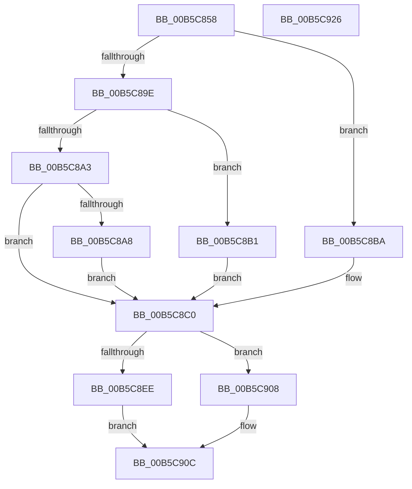

# HalpHvMapIoApicDeviceInterrupt

- RVA: `0x00B5C858`–`0x00B5C927` (길이 `207` bytes)
- VA: `0x0000000140B5C858`
- 실행 섹션: `PAGELK`
- PDB 이름 있음: `예`; PDB Function 태그: `아니요`
- unwind 정보 RVA: `0x000C4068`
- 디코드: `56`개 명령, `207/207` bytes 표시
- 미해석 바이트: `0` (있으면 어셈블리에 `.byte`로 보존)

> 이 문서는 커널 이미지의 기계어와 PDB 기호를 분석해 생성했습니다. 4번과 5번은 함수 원형과 자료형을 바이너리 사용 방식에서 추정한 C 해석이며 원본 소스 복구 결과는 아닙니다.

## 1. Dependencies

- 직접 호출 지점: **2**; 고유 호출 대상: **2**
- 직접 호출자로 확인된 함수: **3**
- RIP 상대 이미지 참조: **2**

### Outgoing calls
- `0x00B5C8E5` → [guard_dispatch_icall](../../text/6B/guard_dispatch_icall_function_006BAAD0.md) (function, `0x006BAAD0`)
- `0x00B5C913` → [_security_check_cookie](../../text/6A/_security_check_cookie_function_006AC640.md) (function, `0x006AC640`)

### Direct callers
- [HalpInterruptRemap](../../text/54/HalpInterruptRemap_function_00542AE4.md) at `0x00542F00`
- [HalpInterruptRemapFixedLines](../../text/54/HalpInterruptRemapFixedLines_function_00544210.md) at `0x0054439E`
- [sub_006FA83C](../../text/6F/Unknown_function_006FA83C.md) at `0x006FAA38`

### Static image references
- `0x00B5C865` → RVA `0x00E0A740` (`.data`; read)
- `0x00B5C8DE` → RVA `0x00FC1CA8` (`.data`; read)

## 2. Other-region calls and transfers

- 다른 실행 섹션으로 향하는 call: **2**
  - `0x00B5C8E5` → [guard_dispatch_icall](../../text/6B/guard_dispatch_icall_function_006BAAD0.md) (`PAGELK` → `.text`)
  - `0x00B5C913` → [_security_check_cookie](../../text/6A/_security_check_cookie_function_006AC640.md) (`PAGELK` → `.text`)
- 별도 외부 분기/꼬리 이동을 확인하지 못했습니다.

## 3. Assembly (complete function range)

```asm
00B5C858  48 89 5C 24 20                  mov qword ptr [rsp + 0x20], rbx
00B5C85D  55                              push rbp
00B5C85E  48 8B EC                        mov rbp, rsp
00B5C861  48 83 EC 70                     sub rsp, 0x70
00B5C865  48 8B 05 D4 DE 2A 00            mov rax, qword ptr [rip + 0x2aded4]
00B5C86C  48 33 C4                        xor rax, rsp
00B5C86F  48 89 45 F8                     mov qword ptr [rbp - 8], rax
00B5C873  0F 57 C0                        xorps xmm0, xmm0
00B5C876  48 B8 00 00 00 00 00 00 00 80   movabs rax, 0x8000000000000000
00B5C880  48 89 45 C0                     mov qword ptr [rbp - 0x40], rax
00B5C884  48 8B DA                        mov rbx, rdx
00B5C887  88 4D C0                        mov byte ptr [rbp - 0x40], cl
00B5C88A  8B 4A 14                        mov ecx, dword ptr [rdx + 0x14]
00B5C88D  0F 11 45 C8                     movups xmmword ptr [rbp - 0x38], xmm0
00B5C891  0F 11 45 D8                     movups xmmword ptr [rbp - 0x28], xmm0
00B5C895  0F 11 45 E8                     movups xmmword ptr [rbp - 0x18], xmm0
00B5C899  83 E9 01                        sub ecx, 1
00B5C89C  74 1C                           je 0x140b5c8ba
00B5C89E  83 E9 01                        sub ecx, 1
00B5C8A1  74 0E                           je 0x140b5c8b1
00B5C8A3  83 F9 01                        cmp ecx, 1
00B5C8A6  75 18                           jne 0x140b5c8c0
00B5C8A8  C7 45 D8 02 00 00 00            mov dword ptr [rbp - 0x28], 2
00B5C8AF  EB 0F                           jmp 0x140b5c8c0
00B5C8B1  C7 45 D8 04 00 00 00            mov dword ptr [rbp - 0x28], 4
00B5C8B8  EB 06                           jmp 0x140b5c8c0
00B5C8BA  8B 42 30                        mov eax, dword ptr [rdx + 0x30]
00B5C8BD  89 45 E8                        mov dword ptr [rbp - 0x18], eax
00B5C8C0  48 8B 4D C0                     mov rcx, qword ptr [rbp - 0x40]
00B5C8C4  4C 8D 4D C8                     lea r9, [rbp - 0x38]
00B5C8C8  33 C0                           xor eax, eax
00B5C8CA  C7 45 E0 01 00 00 00            mov dword ptr [rbp - 0x20], 1
00B5C8D1  39 42 08                        cmp dword ptr [rdx + 8], eax
00B5C8D4  48 8D 55 D8                     lea rdx, [rbp - 0x28]
00B5C8D8  0F 94 C0                        sete al
00B5C8DB  89 45 DC                        mov dword ptr [rbp - 0x24], eax
00B5C8DE  48 8B 05 C3 53 46 00            mov rax, qword ptr [rip + 0x4653c3]
00B5C8E5  E8 E6 E1 B5 FF                  call 0x1406baad0
00B5C8EA  85 C0                           test eax, eax
00B5C8EC  78 1A                           js 0x140b5c908
00B5C8EE  48 8B 55 D0                     mov rdx, qword ptr [rbp - 0x30]
00B5C8F2  8B 4D D4                        mov ecx, dword ptr [rbp - 0x2c]
00B5C8F5  89 53 20                        mov dword ptr [rbx + 0x20], edx
00B5C8F8  48 89 53 28                     mov qword ptr [rbx + 0x28], rdx
00B5C8FC  C7 43 18 08 00 00 00            mov dword ptr [rbx + 0x18], 8
00B5C903  89 4B 24                        mov dword ptr [rbx + 0x24], ecx
00B5C906  EB 04                           jmp 0x140b5c90c
00B5C908  83 63 0C EF                     and dword ptr [rbx + 0xc], 0xffffffef
00B5C90C  48 8B 4D F8                     mov rcx, qword ptr [rbp - 8]
00B5C910  48 33 CC                        xor rcx, rsp
00B5C913  E8 28 FD B4 FF                  call 0x1406ac640
00B5C918  48 8B 9C 24 98 00 00 00         mov rbx, qword ptr [rsp + 0x98]
00B5C920  48 83 C4 70                     add rsp, 0x70
00B5C924  5D                              pop rbp
00B5C925  C3                              ret
00B5C926  CC                              int3
```

## 4. C-style interpretation (structured pseudocode)

```c
__int64 __fastcall HalpHvMapIoApicDeviceInterrupt(unsigned __int8 a1, __int64 a2)
{
    __int64 result;
    __int64 v_rsp;
    unsigned __int64 v_stack_m10;
    unsigned __int64 v_stack_m20;
    unsigned int v_stack_m28;
    unsigned int v_stack_m2C;
    unsigned __int64 v_stack_m30;
    unsigned int v_stack_m34;
    unsigned __int64 v_stack_m38;
    unsigned __int64 v_stack_m40;
    unsigned __int64 v_stack_m48;
    unsigned __int64 v_stack_p20;

    v_stack_p20 = v_rbx;
    v_rsp = (v_rsp) - (112);
    result = (*(unsigned __int64 *)(v_rip + 2809556)) ^ (v_rsp);
    v_stack_m10 = result;
    v_stack_m48 = result;
    v_stack_m48 = a1;
    v_stack_m40 = v_xmm0;
    v_stack_m30 = v_xmm0;
    v_stack_m20 = v_xmm0;
    a1 = (unsigned int)(((unsigned int)(*(unsigned int *)(a2 + 20))) - (1));
    if (condition_is_equal) goto loc_00B5C8BA;
    a1 = (unsigned int)((a1) - (1));
    if (condition_is_equal) goto loc_00B5C8B1;
    if (a1 != 1) goto loc_00B5C8C0;
    v_stack_m30 = 2;
    goto loc_00B5C8C0;
loc_00B5C8B1:
    v_stack_m30 = 4;
    goto loc_00B5C8C0;
loc_00B5C8BA:
    v_stack_m20 = (unsigned int)((unsigned int)(*(unsigned int *)(a2 + 48)));
loc_00B5C8C0:
    result = 0;
    v_stack_m28 = 1;
    result = ((*(unsigned int *)(a2 + 8)) == 0) ? 1 : 0;
    v_stack_m2C = (unsigned int)(result);
    result = guard_dispatch_icall(v_stack_m48, v_stack_m30, a3, v_stack_m40);
    if (sign_flag) goto loc_00B5C908;
    *(unsigned int *)(a2 + 32) = (unsigned int)(v_stack_m38);
    *(unsigned __int64 *)(a2 + 40) = v_stack_m38;
    *(unsigned int *)(a2 + 24) = 8;
    *(unsigned int *)(a2 + 36) = (unsigned int)((unsigned int)(v_stack_m34));
    goto loc_00B5C90C;
loc_00B5C908:
loc_00B5C90C:
    a1 = (v_stack_m10) ^ (v_rsp);
    result = _security_check_cookie(a1, v_stack_m38, a3, v_stack_m40);
    v_rsp = (v_rsp) + (112);
    return result;
}
```

## 5. (Beta) C Style

```c
int64_t HalpHvMapIoApicDeviceInterrupt(uint8_t Arg1, void *Arg2)
{
    uint8_t *arg2 = (uint8_t *)Arg2;

    int64_t result;
    int64_t local_rsp;
    uint64_t v_stack_m10;
    uint64_t v_stack_m20;
    uint32_t v_stack_m28;
    uint32_t v_stack_m2C;
    uint64_t v_stack_m30;
    uint32_t v_stack_m34;
    uint64_t v_stack_m38;
    uint64_t v_stack_m40;
    uint64_t v_stack_m48;
    uint64_t v_stack_p20;

    v_stack_p20 = local_rbx;
    local_rsp = (local_rsp) - (112);
    result = (*(uint64_t *)(v_rip + 0x2ADED4)) ^ (local_rsp);
    v_stack_m10 = result;
    v_stack_m48 = result;
    v_stack_m48 = Arg1;
    v_stack_m40 = v_xmm0;
    v_stack_m30 = v_xmm0;
    v_stack_m20 = v_xmm0;
    Arg1 = (uint32_t)(((uint32_t)(*(uint32_t *)(arg2 + 0x14))) - (1));
    if (condition_is_equal) goto loc_00B5C8BA;
    Arg1 = (uint32_t)((Arg1) - (1));
    if (condition_is_equal) goto loc_00B5C8B1;
    if (Arg1 != 1) goto loc_00B5C8C0;
    v_stack_m30 = 2;
    goto loc_00B5C8C0;
loc_00B5C8B1:
    v_stack_m30 = 4;
    goto loc_00B5C8C0;
loc_00B5C8BA:
    v_stack_m20 = (uint32_t)((uint32_t)(*(uint32_t *)(arg2 + 0x30)));
loc_00B5C8C0:
    result = 0;
    v_stack_m28 = 1;
    result = ((*(uint32_t *)(arg2 + 0x8)) == 0) ? 1 : 0;
    v_stack_m2C = (uint32_t)(result);
    result = guard_dispatch_icall(v_stack_m48, v_stack_m30, a3, v_stack_m40);
    if (sign_flag) goto loc_00B5C908;
    *(uint32_t *)(arg2 + 0x20) = (uint32_t)(v_stack_m38);
    *(uint64_t *)(arg2 + 0x28) = v_stack_m38;
    *(uint32_t *)(arg2 + 0x18) = 8;
    *(uint32_t *)(arg2 + 0x24) = (uint32_t)((uint32_t)(v_stack_m34));
    goto loc_00B5C90C;
loc_00B5C908:
loc_00B5C90C:
    Arg1 = (v_stack_m10) ^ (local_rsp);
    result = _security_check_cookie(Arg1, v_stack_m38, a3, v_stack_m40);
    local_rsp = (local_rsp) + (112);
    return result;
}
```

### 관측된 메모리 오프셋

구조체 형식이 확인되지 않은 접근은 인자 기준의 오프셋으로만 기록했습니다.

| 기준 인자 | 오프셋 표현 | 폭 (bit) | 접근 |
|---|---:|---:|---|
| `Arg2` | `+ 0x8` | `32` | `R` |
| `Arg2` | `+ 0xC` | `32` | `R/W` |
| `Arg2` | `+ 0x14` | `32` | `R` |
| `Arg2` | `+ 0x18` | `32` | `W` |
| `Arg2` | `+ 0x20` | `32` | `W` |
| `Arg2` | `+ 0x24` | `32` | `W` |
| `Arg2` | `+ 0x28` | `64` | `W` |
| `Arg2` | `+ 0x30` | `32` | `R` |

## 6. Execution-region graph

[열기: 2D/3D 그래프와 함수 탐색 컨트롤 패널](../../../control-panel.html?section=pagelk&rva=0x00B5C858&view=graph)

- 2D 그래프는 위에서 아래로 흐르고, 3D 그래프는 빈 공간을 드래그해 회전합니다. Shift+드래그는 이동, 휠은 확대·축소, 함수 노드 선택은 대상 보고서 이동입니다.

### Static fallback


