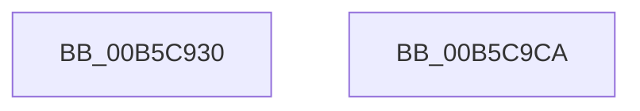

# HalpHvUnmapDeviceMsiRange

- RVA: `0x00B5C930`–`0x00B5C9CB` (길이 `155` bytes)
- VA: `0x0000000140B5C930`
- 실행 섹션: `PAGELK`
- PDB 이름 있음: `예`; PDB Function 태그: `아니요`
- unwind 정보 RVA: `0x000C4080`
- 디코드: `44`개 명령, `155/155` bytes 표시
- 미해석 바이트: `0` (있으면 어셈블리에 `.byte`로 보존)

> 이 문서는 커널 이미지의 기계어와 PDB 기호를 분석해 생성했습니다. 4번과 5번은 함수 원형과 자료형을 바이너리 사용 방식에서 추정한 C 해석이며 원본 소스 복구 결과는 아닙니다.

## 1. Dependencies

- 직접 호출 지점: **3**; 고유 호출 대상: **3**
- 직접 호출자로 확인된 함수: **1**
- RIP 상대 이미지 참조: **2**

### Outgoing calls
- `0x00B5C983` → [HalpHvBuildDeviceId](HalpHvBuildDeviceId_function_00B5C680.md) (function, `0x00B5C680`)
- `0x00B5C9AE` → [guard_dispatch_icall](../../text/6B/guard_dispatch_icall_function_006BAAD0.md) (function, `0x006BAAD0`)
- `0x00B5C9BA` → [_security_check_cookie](../../text/6A/_security_check_cookie_function_006AC640.md) (function, `0x006AC640`)

### Direct callers
- [HalpInterruptUnmap](../../page/70/HalpInterruptUnmap_function_00707408.md) at `0x0070749F`

### Static image references
- `0x00B5C93D` → RVA `0x00E0A740` (`.data`; read)
- `0x00B5C9A0` → RVA `0x00FC1CB0` (`.data`; read)

## 2. Other-region calls and transfers

- 다른 실행 섹션으로 향하는 call: **2**
  - `0x00B5C9AE` → [guard_dispatch_icall](../../text/6B/guard_dispatch_icall_function_006BAAD0.md) (`PAGELK` → `.text`)
  - `0x00B5C9BA` → [_security_check_cookie](../../text/6A/_security_check_cookie_function_006AC640.md) (`PAGELK` → `.text`)
- 별도 외부 분기/꼬리 이동을 확인하지 못했습니다.

## 3. Assembly (complete function range)

```asm
00B5C930  48 89 5C 24 08                  mov qword ptr [rsp + 8], rbx
00B5C935  55                              push rbp
00B5C936  48 8B EC                        mov rbp, rsp
00B5C939  48 83 EC 50                     sub rsp, 0x50
00B5C93D  48 8B 05 FC DD 2A 00            mov rax, qword ptr [rip + 0x2addfc]
00B5C944  48 33 C4                        xor rax, rsp
00B5C947  48 89 45 F0                     mov qword ptr [rbp - 0x10], rax
00B5C94B  48 8B 5D 30                     mov rbx, qword ptr [rbp + 0x30]
00B5C94F  8B C1                           mov eax, ecx
00B5C951  48 83 65 D8 00                  and qword ptr [rbp - 0x28], 0
00B5C956  45 8A D1                        mov r10b, r9b
00B5C959  C1 E8 08                        shr eax, 8
00B5C95C  4C 8D 4D D8                     lea r9, [rbp - 0x28]
00B5C960  66 89 45 D2                     mov word ptr [rbp - 0x2e], ax
00B5C964  4D 8B D8                        mov r11, r8
00B5C967  8B C2                           mov eax, edx
00B5C969  88 4D D1                        mov byte ptr [rbp - 0x2f], cl
00B5C96C  C1 E8 05                        shr eax, 5
00B5C96F  48 8D 4D D0                     lea rcx, [rbp - 0x30]
00B5C973  C0 E2 03                        shl dl, 3
00B5C976  24 07                           and al, 7
00B5C978  0A C2                           or al, dl
00B5C97A  45 8A C2                        mov r8b, r10b
00B5C97D  49 8B D3                        mov rdx, r11
00B5C980  88 45 D0                        mov byte ptr [rbp - 0x30], al
00B5C983  E8 F8 FC FF FF                  call 0x140b5c680
00B5C988  8B 43 30                        mov eax, dword ptr [rbx + 0x30]
00B5C98B  48 8D 55 E0                     lea rdx, [rbp - 0x20]
00B5C98F  83 65 E4 00                     and dword ptr [rbp - 0x1c], 0
00B5C993  48 8B 4D D8                     mov rcx, qword ptr [rbp - 0x28]
00B5C997  89 45 E8                        mov dword ptr [rbp - 0x18], eax
00B5C99A  8B 43 34                        mov eax, dword ptr [rbx + 0x34]
00B5C99D  89 45 EC                        mov dword ptr [rbp - 0x14], eax
00B5C9A0  48 8B 05 09 53 46 00            mov rax, qword ptr [rip + 0x465309]
00B5C9A7  C7 45 E0 01 00 00 00            mov dword ptr [rbp - 0x20], 1
00B5C9AE  E8 1D E1 B5 FF                  call 0x1406baad0
00B5C9B3  48 8B 4D F0                     mov rcx, qword ptr [rbp - 0x10]
00B5C9B7  48 33 CC                        xor rcx, rsp
00B5C9BA  E8 81 FC B4 FF                  call 0x1406ac640
00B5C9BF  48 8B 5C 24 60                  mov rbx, qword ptr [rsp + 0x60]
00B5C9C4  48 83 C4 50                     add rsp, 0x50
00B5C9C8  5D                              pop rbp
00B5C9C9  C3                              ret
00B5C9CA  CC                              int3
```

## 4. C-style interpretation (structured pseudocode)

```c
__int64 __fastcall HalpHvUnmapDeviceMsiRange(int a1, int a2, __int64 a3, unsigned __int8 a4, __int64 a5)
{
    __int64 result;
    __int64 v_rsp;
    unsigned __int64 v_stack_m18;
    unsigned int v_stack_m1C;
    unsigned int v_stack_m20;
    unsigned int v_stack_m24;
    unsigned __int64 v_stack_m28;
    unsigned __int64 v_stack_m30;
    unsigned __int16 v_stack_m36;
    unsigned __int8 v_stack_m37;
    unsigned __int64 v_stack_m38;
    unsigned __int64 v_stack_p8;

    v_stack_p8 = v_rbx;
    v_rsp = (v_rsp) - (80);
    result = (*(unsigned __int64 *)(v_rip + 2809340)) ^ (v_rsp);
    v_stack_m18 = result;
    result = (unsigned int)(((unsigned int)(a1)) >> (8));
    v_stack_m36 = (unsigned __int16)(result);
    v_stack_m37 = (unsigned __int8)(a1);
    result = (unsigned int)(((unsigned int)(a2)) >> (5));
    a2 = (unsigned __int8)((a2) << (3));
    result = (unsigned __int8)((result) & (7));
    result = (unsigned __int8)((result) | ((unsigned __int8)(a2)));
    v_stack_m38 = (unsigned __int8)(result);
    result = HalpHvBuildDeviceId(v_stack_m38, a3, a4, v_stack_m30);
    v_stack_m20 = (unsigned int)((unsigned int)(*(unsigned int *)(a5 + 48)));
    v_stack_m1C = (unsigned int)((unsigned int)(*(unsigned int *)(a5 + 52)));
    v_stack_m28 = 1;
    result = guard_dispatch_icall(v_stack_m30, v_stack_m28, a4, v_stack_m30);
    a1 = (v_stack_m18) ^ (v_rsp);
    result = _security_check_cookie(a1, v_stack_m28, a4, v_stack_m30);
    v_rsp = (v_rsp) + (80);
    return result;
}
```

## 5. (Beta) C Style

```c
int64_t HalpHvUnmapDeviceMsiRange(int32_t Arg1, int32_t Arg2, int64_t Arg3, uint8_t Arg4, void *Arg5)
{
    uint8_t *arg5 = (uint8_t *)Arg5;

    int64_t result;
    int64_t local_rsp;
    uint64_t v_stack_m18;
    uint32_t v_stack_m1C;
    uint32_t v_stack_m20;
    uint32_t v_stack_m24;
    uint64_t v_stack_m28;
    uint64_t v_stack_m30;
    uint16_t v_stack_m36;
    uint8_t v_stack_m37;
    uint64_t v_stack_m38;
    uint64_t v_stack_p8;

    v_stack_p8 = local_rbx;
    local_rsp = (local_rsp) - (80);
    result = (*(uint64_t *)(v_rip + 0x2ADDFC)) ^ (local_rsp);
    v_stack_m18 = result;
    result = (uint32_t)(((uint32_t)(Arg1)) >> (8));
    v_stack_m36 = (uint16_t)(result);
    v_stack_m37 = (uint8_t)(Arg1);
    result = (uint32_t)(((uint32_t)(Arg2)) >> (5));
    Arg2 = (uint8_t)((Arg2) << (3));
    result = (uint8_t)((result) & (7));
    result = (uint8_t)((result) | ((uint8_t)(Arg2)));
    v_stack_m38 = (uint8_t)(result);
    result = HalpHvBuildDeviceId(v_stack_m38, Arg3, Arg4, v_stack_m30);
    v_stack_m20 = (uint32_t)((uint32_t)(*(uint32_t *)(arg5 + 0x30)));
    v_stack_m1C = (uint32_t)((uint32_t)(*(uint32_t *)(arg5 + 0x34)));
    v_stack_m28 = 1;
    result = guard_dispatch_icall(v_stack_m30, v_stack_m28, Arg4, v_stack_m30);
    Arg1 = (v_stack_m18) ^ (local_rsp);
    result = _security_check_cookie(Arg1, v_stack_m28, Arg4, v_stack_m30);
    local_rsp = (local_rsp) + (80);
    return result;
}
```

### 관측된 메모리 오프셋

구조체 형식이 확인되지 않은 접근은 인자 기준의 오프셋으로만 기록했습니다.

| 기준 인자 | 오프셋 표현 | 폭 (bit) | 접근 |
|---|---:|---:|---|
| `Arg5` | `+ 0x30` | `32` | `R` |
| `Arg5` | `+ 0x34` | `32` | `R` |

## 6. Execution-region graph

[열기: 2D/3D 그래프와 함수 탐색 컨트롤 패널](../../../control-panel.html?section=pagelk&rva=0x00B5C930&view=graph)

- 2D 그래프는 위에서 아래로 흐르고, 3D 그래프는 빈 공간을 드래그해 회전합니다. Shift+드래그는 이동, 휠은 확대·축소, 함수 노드 선택은 대상 보고서 이동입니다.

### Static fallback


