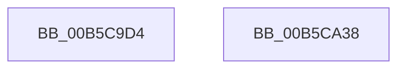

# HalpHvUnmapIoApicDeviceInterrupt

- RVA: `0x00B5C9D4`–`0x00B5CA39` (길이 `101` bytes)
- VA: `0x0000000140B5C9D4`
- 실행 섹션: `PAGELK`
- PDB 이름 있음: `예`; PDB Function 태그: `아니요`
- unwind 정보 RVA: `0x000C4098`
- 디코드: `21`개 명령, `101/101` bytes 표시
- 미해석 바이트: `0` (있으면 어셈블리에 `.byte`로 보존)

> 이 문서는 커널 이미지의 기계어와 PDB 기호를 분석해 생성했습니다. 4번과 5번은 함수 원형과 자료형을 바이너리 사용 방식에서 추정한 C 해석이며 원본 소스 복구 결과는 아닙니다.

## 1. Dependencies

- 직접 호출 지점: **2**; 고유 호출 대상: **2**
- 직접 호출자로 확인된 함수: **1**
- RIP 상대 이미지 참조: **2**

### Outgoing calls
- `0x00B5CA21` → [guard_dispatch_icall](../../text/6B/guard_dispatch_icall_function_006BAAD0.md) (function, `0x006BAAD0`)
- `0x00B5CA2E` → [_security_check_cookie](../../text/6A/_security_check_cookie_function_006AC640.md) (function, `0x006AC640`)

### Direct callers
- [HalpInterruptUnmap](../../page/70/HalpInterruptUnmap_function_00707408.md) at `0x007075BA`

### Static image references
- `0x00B5C9D8` → RVA `0x00E0A740` (`.data`; read)
- `0x00B5CA12` → RVA `0x00FC1CB0` (`.data`; read)

## 2. Other-region calls and transfers

- 다른 실행 섹션으로 향하는 call: **2**
  - `0x00B5CA21` → [guard_dispatch_icall](../../text/6B/guard_dispatch_icall_function_006BAAD0.md) (`PAGELK` → `.text`)
  - `0x00B5CA2E` → [_security_check_cookie](../../text/6A/_security_check_cookie_function_006AC640.md) (`PAGELK` → `.text`)
- 별도 외부 분기/꼬리 이동을 확인하지 못했습니다.

## 3. Assembly (complete function range)

```asm
00B5C9D4  48 83 EC 48                     sub rsp, 0x48
00B5C9D8  48 8B 05 61 DD 2A 00            mov rax, qword ptr [rip + 0x2add61]
00B5C9DF  48 33 C4                        xor rax, rsp
00B5C9E2  48 89 44 24 38                  mov qword ptr [rsp + 0x38], rax
00B5C9E7  83 64 24 2C 00                  and dword ptr [rsp + 0x2c], 0
00B5C9EC  48 B8 00 00 00 00 00 00 00 80   movabs rax, 0x8000000000000000
00B5C9F6  48 89 44 24 20                  mov qword ptr [rsp + 0x20], rax
00B5C9FB  48 8B 42 28                     mov rax, qword ptr [rdx + 0x28]
00B5C9FF  48 8D 54 24 28                  lea rdx, [rsp + 0x28]
00B5CA04  88 4C 24 20                     mov byte ptr [rsp + 0x20], cl
00B5CA08  48 8B 4C 24 20                  mov rcx, qword ptr [rsp + 0x20]
00B5CA0D  48 89 44 24 30                  mov qword ptr [rsp + 0x30], rax
00B5CA12  48 8B 05 97 52 46 00            mov rax, qword ptr [rip + 0x465297]
00B5CA19  C7 44 24 28 02 00 00 00         mov dword ptr [rsp + 0x28], 2
00B5CA21  E8 AA E0 B5 FF                  call 0x1406baad0
00B5CA26  48 8B 4C 24 38                  mov rcx, qword ptr [rsp + 0x38]
00B5CA2B  48 33 CC                        xor rcx, rsp
00B5CA2E  E8 0D FC B4 FF                  call 0x1406ac640
00B5CA33  48 83 C4 48                     add rsp, 0x48
00B5CA37  C3                              ret
00B5CA38  CC                              int3
```

## 4. C-style interpretation (structured pseudocode)

```c
__int64 __fastcall HalpHvUnmapIoApicDeviceInterrupt(unsigned __int8 a1, __int64 a2)
{
    __int64 result;
    __int64 v_rsp;
    unsigned __int64 v_stack_m10;
    unsigned __int64 v_stack_m18;
    unsigned int v_stack_m1C;
    unsigned __int64 v_stack_m20;
    unsigned __int64 v_stack_m28;

    v_rsp = (v_rsp) - (72);
    result = (*(unsigned __int64 *)(v_rip + 2809185)) ^ (v_rsp);
    v_stack_m10 = result;
    v_stack_m28 = result;
    v_stack_m28 = a1;
    v_stack_m18 = *(unsigned __int64 *)(a2 + 40);
    v_stack_m20 = 2;
    result = guard_dispatch_icall(v_stack_m28, v_stack_m20, a3, a4);
    a1 = (v_stack_m10) ^ (v_rsp);
    result = _security_check_cookie(a1, v_stack_m20, a3, a4);
    v_rsp = (v_rsp) + (72);
    return result;
}
```

## 5. (Beta) C Style

```c
int64_t HalpHvUnmapIoApicDeviceInterrupt(uint8_t Arg1, void *Arg2)
{
    uint8_t *arg2 = (uint8_t *)Arg2;

    int64_t result;
    int64_t local_rsp;
    uint64_t v_stack_m10;
    uint64_t v_stack_m18;
    uint32_t v_stack_m1C;
    uint64_t v_stack_m20;
    uint64_t v_stack_m28;

    local_rsp = (local_rsp) - (72);
    result = (*(uint64_t *)(v_rip + 0x2ADD61)) ^ (local_rsp);
    v_stack_m10 = result;
    v_stack_m28 = result;
    v_stack_m28 = Arg1;
    v_stack_m18 = *(uint64_t *)(arg2 + 0x28);
    v_stack_m20 = 2;
    result = guard_dispatch_icall(v_stack_m28, v_stack_m20, a3, a4);
    Arg1 = (v_stack_m10) ^ (local_rsp);
    result = _security_check_cookie(Arg1, v_stack_m20, a3, a4);
    local_rsp = (local_rsp) + (72);
    return result;
}
```

### 관측된 메모리 오프셋

구조체 형식이 확인되지 않은 접근은 인자 기준의 오프셋으로만 기록했습니다.

| 기준 인자 | 오프셋 표현 | 폭 (bit) | 접근 |
|---|---:|---:|---|
| `Arg2` | `+ 0x28` | `64` | `R` |

## 6. Execution-region graph

[열기: 2D/3D 그래프와 함수 탐색 컨트롤 패널](../../../control-panel.html?section=pagelk&rva=0x00B5C9D4&view=graph)

- 2D 그래프는 위에서 아래로 흐르고, 3D 그래프는 빈 공간을 드래그해 회전합니다. Shift+드래그는 이동, 휠은 확대·축소, 함수 노드 선택은 대상 보고서 이동입니다.

### Static fallback


