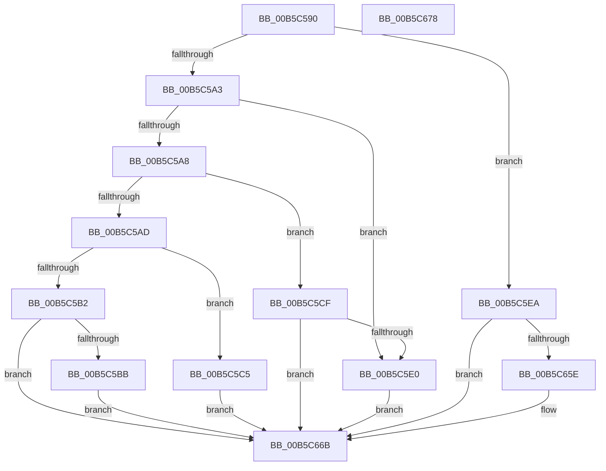

# HalpHwPerfCntInitSystem

- RVA: `0x00B5C590`–`0x00B5C679` (길이 `233` bytes)
- VA: `0x0000000140B5C590`
- 실행 섹션: `PAGELK`
- PDB 이름 있음: `예`; PDB Function 태그: `아니요`
- unwind 정보 RVA: `0x0005CAAC`
- 디코드: `54`개 명령, `233/233` bytes 표시
- 미해석 바이트: `0` (있으면 어셈블리에 `.byte`로 보존)

> 이 문서는 커널 이미지의 기계어와 PDB 기호를 분석해 생성했습니다. 4번과 5번은 함수 원형과 자료형을 바이너리 사용 방식에서 추정한 C 해석이며 원본 소스 복구 결과는 아닙니다.

## 1. Dependencies

- 직접 호출 지점: **7**; 고유 호출 대상: **6**
- 직접 호출자로 확인된 함수: **0**
- RIP 상대 이미지 참조: **15**

### Outgoing calls
- `0x00B5C5BB` → [HalpPmuArbiterQueryRegistryQuantum](../../page/70/HalpPmuArbiterQueryRegistryQuantum_function_00707D04.md) (function, `0x00707D04`)
- `0x00B5C5C5` → [HalpInitializeUncoreProfiling](../../text/55/HalpInitializeUncoreProfiling_function_0055BE70.md) (function, `0x0055BE70`)
- `0x00B5C5D1` → [HalpInitializeProfiling](HalpInitializeProfiling_function_00B5EF00.md) (function, `0x00B5EF00`)
- `0x00B5C5E0` → [HalpCompleteInitializeProfiling](HalpCompleteInitializeProfiling_function_00B5EED8.md) (function, `0x00B5EED8`)
- `0x00B5C64C` → [HalpInitializePmcCounterSetInfo](../../init/C1/HalpInitializePmcCounterSetInfo_function_00C1EEC4.md) (function, `0x00C1EEC4`)
- `0x00B5C653` → [HalpInitializeProfiling](HalpInitializeProfiling_function_00B5EF00.md) (function, `0x00B5EF00`)
- `0x00B5C666` → [HalpInitializePmuArbiter](../../init/C1/HalpInitializePmuArbiter_function_00C1EFA8.md) (function, `0x00C1EFA8`)

### Direct callers
- 이 함수 시작 RVA로 연결되는 직접 call은 확인되지 않았습니다. 간접 호출은 완전히 역산할 수 없습니다.

### Static image references
- `0x00B5C5EA` → RVA `0x00546D10` (`HalpAllocatePmcCounterSet`; read)
- `0x00B5C5F1` → RVA `0x00E00A30` (`.data`; write)
- `0x00B5C5F8` → RVA `0x004C5E70` (`HalpAllocatePmcCounterSetEx`; read)
- `0x00B5C5FF` → RVA `0x00E00CA0` (`.data`; write)
- `0x00B5C606` → RVA `0x00547310` (`HalpFreePmcCounterSet`; read)
- `0x00B5C60D` → RVA `0x00E00A40` (`.data`; write)
- `0x00B5C614` → RVA `0x002FD080` (`HalpCollectPmcCounters`; read)
- `0x00B5C61B` → RVA `0x00E00A38` (`.data`; write)
- `0x00B5C622` → RVA `0x00547840` (`HalpStartProfileInterruptEx`; read)
- `0x00B5C629` → RVA `0x00E00CA8` (`.data`; write)
- `0x00B5C630` → RVA `0x00ADB340` (`HalpRequestPmuAccess`; read)
- `0x00B5C637` → RVA `0x00E00CE0` (`.data`; write)
- `0x00B5C63E` → RVA `0x005477A0` (`HalpReleasePmuAccessRequest`; read)
- `0x00B5C645` → RVA `0x00E00CF0` (`.data`; write)
- `0x00B5C65E` → RVA `0x00FC2C50` (`.data`; read/write)

## 2. Other-region calls and transfers

- 다른 실행 섹션으로 향하는 call: **4**
  - `0x00B5C5BB` → [HalpPmuArbiterQueryRegistryQuantum](../../page/70/HalpPmuArbiterQueryRegistryQuantum_function_00707D04.md) (`PAGELK` → `PAGE`)
  - `0x00B5C5C5` → [HalpInitializeUncoreProfiling](../../text/55/HalpInitializeUncoreProfiling_function_0055BE70.md) (`PAGELK` → `.text`)
  - `0x00B5C64C` → [HalpInitializePmcCounterSetInfo](../../init/C1/HalpInitializePmcCounterSetInfo_function_00C1EEC4.md) (`PAGELK` → `INIT`)
  - `0x00B5C666` → [HalpInitializePmuArbiter](../../init/C1/HalpInitializePmuArbiter_function_00C1EFA8.md) (`PAGELK` → `INIT`)
- 별도 외부 분기/꼬리 이동을 확인하지 못했습니다.

## 3. Assembly (complete function range)

```asm
00B5C590  48 89 5C 24 08                  mov qword ptr [rsp + 8], rbx
00B5C595  57                              push rdi
00B5C596  48 83 EC 20                     sub rsp, 0x20
00B5C59A  33 DB                           xor ebx, ebx
00B5C59C  8B FA                           mov edi, edx
00B5C59E  83 F9 0D                        cmp ecx, 0xd
00B5C5A1  74 47                           je 0x140b5c5ea
00B5C5A3  83 F9 11                        cmp ecx, 0x11
00B5C5A6  74 38                           je 0x140b5c5e0
00B5C5A8  83 F9 13                        cmp ecx, 0x13
00B5C5AB  74 22                           je 0x140b5c5cf
00B5C5AD  83 F9 15                        cmp ecx, 0x15
00B5C5B0  74 13                           je 0x140b5c5c5
00B5C5B2  83 F9 1B                        cmp ecx, 0x1b
00B5C5B5  0F 85 B0 00 00 00               jne 0x140b5c66b
00B5C5BB  E8 44 B7 BA FF                  call 0x140707d04
00B5C5C0  E9 A6 00 00 00                  jmp 0x140b5c66b
00B5C5C5  E8 A6 F8 9F FF                  call 0x14055be70
00B5C5CA  E9 9C 00 00 00                  jmp 0x140b5c66b
00B5C5CF  8B CF                           mov ecx, edi
00B5C5D1  E8 2A 29 00 00                  call 0x140b5ef00
00B5C5D6  8B D8                           mov ebx, eax
00B5C5D8  85 C0                           test eax, eax
00B5C5DA  0F 88 8B 00 00 00               js 0x140b5c66b
00B5C5E0  E8 F3 28 00 00                  call 0x140b5eed8
00B5C5E5  E9 81 00 00 00                  jmp 0x140b5c66b
00B5C5EA  48 8D 05 1F A7 9E FF            lea rax, [rip - 0x6158e1]
00B5C5F1  48 89 05 38 44 2A 00            mov qword ptr [rip + 0x2a4438], rax
00B5C5F8  48 8D 05 71 98 96 FF            lea rax, [rip - 0x69678f]
00B5C5FF  48 89 05 9A 46 2A 00            mov qword ptr [rip + 0x2a469a], rax
00B5C606  48 8D 05 03 AD 9E FF            lea rax, [rip - 0x6152fd]
00B5C60D  48 89 05 2C 44 2A 00            mov qword ptr [rip + 0x2a442c], rax
00B5C614  48 8D 05 65 0A 7A FF            lea rax, [rip - 0x85f59b]
00B5C61B  48 89 05 16 44 2A 00            mov qword ptr [rip + 0x2a4416], rax
00B5C622  48 8D 05 17 B2 9E FF            lea rax, [rip - 0x614de9]
00B5C629  48 89 05 78 46 2A 00            mov qword ptr [rip + 0x2a4678], rax
00B5C630  48 8D 05 09 ED F7 FF            lea rax, [rip - 0x812f7]
00B5C637  48 89 05 A2 46 2A 00            mov qword ptr [rip + 0x2a46a2], rax
00B5C63E  48 8D 05 5B B1 9E FF            lea rax, [rip - 0x614ea5]
00B5C645  48 89 05 A4 46 2A 00            mov qword ptr [rip + 0x2a46a4], rax
00B5C64C  E8 73 28 0C 00                  call 0x140c1eec4
00B5C651  8B CF                           mov ecx, edi
00B5C653  E8 A8 28 00 00                  call 0x140b5ef00
00B5C658  8B D8                           mov ebx, eax
00B5C65A  85 C0                           test eax, eax
00B5C65C  78 0D                           js 0x140b5c66b
00B5C65E  48 83 25 EA 65 46 00 00         and qword ptr [rip + 0x4665ea], 0
00B5C666  E8 3D 29 0C 00                  call 0x140c1efa8
00B5C66B  8B C3                           mov eax, ebx
00B5C66D  48 8B 5C 24 30                  mov rbx, qword ptr [rsp + 0x30]
00B5C672  48 83 C4 20                     add rsp, 0x20
00B5C676  5F                              pop rdi
00B5C677  C3                              ret
00B5C678  CC                              int3
```

## 4. C-style interpretation (structured pseudocode)

```c
__int64 __fastcall HalpHwPerfCntInitSystem(int a1, int a2)
{
    __int64 result;
    __int64 v_rbx;
    __int64 v_rsp;
    unsigned __int64 v_stack_p8;

    v_stack_p8 = v_rbx;
    v_rsp = (v_rsp) - (32);
    v_rbx = 0;
    if (a1 == 13) goto loc_00B5C5EA;
    if (a1 == 17) goto loc_00B5C5E0;
    if (a1 == 19) goto loc_00B5C5CF;
    if (a1 == 21) goto loc_00B5C5C5;
    if (a1 != 27) goto loc_00B5C66B;
    result = HalpPmuArbiterQueryRegistryQuantum(a1, a2, a3, a4);
    goto loc_00B5C66B;
loc_00B5C5C5:
    result = HalpInitializeUncoreProfiling(a1, a2, a3, a4);
    goto loc_00B5C66B;
loc_00B5C5CF:
    result = HalpInitializeProfiling((unsigned int)((unsigned int)((unsigned int)(a2))), a2, a3, a4);
    if (sign_flag) goto loc_00B5C66B;
loc_00B5C5E0:
    result = HalpCompleteInitializeProfiling((unsigned int)((unsigned int)((unsigned int)(a2))), a2, a3, a4);
    goto loc_00B5C66B;
loc_00B5C5EA:
    *(unsigned __int64 *)(v_rip + 2769976) = v_rip - 6379745;
    *(unsigned __int64 *)(v_rip + 2770586) = v_rip - 6907791;
    *(unsigned __int64 *)(v_rip + 2769964) = v_rip - 6378237;
    *(unsigned __int64 *)(v_rip + 2769942) = v_rip - 8779163;
    *(unsigned __int64 *)(v_rip + 2770552) = v_rip - 6376937;
    *(unsigned __int64 *)(v_rip + 2770594) = v_rip - 529143;
    *(unsigned __int64 *)(v_rip + 2770596) = v_rip - 6377125;
    result = HalpInitializePmcCounterSetInfo((unsigned int)((unsigned int)((unsigned int)(a2))), a2, a3, a4);
    result = HalpInitializeProfiling((unsigned int)((unsigned int)((unsigned int)(a2))), a2, a3, a4);
    if (!(sign_flag)) {
        result = HalpInitializePmuArbiter((unsigned int)((unsigned int)((unsigned int)(a2))), a2, a3, a4);
    }
    v_rsp = (v_rsp) + (32);
    return (unsigned int)((unsigned int)((unsigned int)((unsigned int)(result))));
}
```

## 5. (Beta) C Style

```c
int64_t HalpHwPerfCntInitSystem(int32_t Arg1, int32_t Arg2)
{
    int64_t result;
    int64_t local_rbx;
    int64_t local_rsp;
    uint64_t v_stack_p8;

    v_stack_p8 = local_rbx;
    local_rsp = (local_rsp) - (32);
    local_rbx = 0;
    if (Arg1 == 13) goto loc_00B5C5EA;
    if (Arg1 == 17) goto loc_00B5C5E0;
    if (Arg1 == 19) goto loc_00B5C5CF;
    if (Arg1 == 21) goto loc_00B5C5C5;
    if (Arg1 != 27) goto loc_00B5C66B;
    result = HalpPmuArbiterQueryRegistryQuantum(Arg1, Arg2, a3, a4);
    goto loc_00B5C66B;
loc_00B5C5C5:
    result = HalpInitializeUncoreProfiling(Arg1, Arg2, a3, a4);
    goto loc_00B5C66B;
loc_00B5C5CF:
    result = HalpInitializeProfiling((uint32_t)((uint32_t)((uint32_t)(Arg2))), Arg2, a3, a4);
    if (sign_flag) goto loc_00B5C66B;
loc_00B5C5E0:
    result = HalpCompleteInitializeProfiling((uint32_t)((uint32_t)((uint32_t)(Arg2))), Arg2, a3, a4);
    goto loc_00B5C66B;
loc_00B5C5EA:
    *(uint64_t *)(v_rip + 0x2A4438) = v_rip - 6379745;
    *(uint64_t *)(v_rip + 0x2A469A) = v_rip - 6907791;
    *(uint64_t *)(v_rip + 0x2A442C) = v_rip - 6378237;
    *(uint64_t *)(v_rip + 0x2A4416) = v_rip - 8779163;
    *(uint64_t *)(v_rip + 0x2A4678) = v_rip - 6376937;
    *(uint64_t *)(v_rip + 0x2A46A2) = v_rip - 529143;
    *(uint64_t *)(v_rip + 0x2A46A4) = v_rip - 6377125;
    result = HalpInitializePmcCounterSetInfo((uint32_t)((uint32_t)((uint32_t)(Arg2))), Arg2, a3, a4);
    result = HalpInitializeProfiling((uint32_t)((uint32_t)((uint32_t)(Arg2))), Arg2, a3, a4);
    if (!(sign_flag)) {
        result = HalpInitializePmuArbiter((uint32_t)((uint32_t)((uint32_t)(Arg2))), Arg2, a3, a4);
    }
    local_rsp = (local_rsp) + (32);
    return (uint32_t)((uint32_t)((uint32_t)((uint32_t)(result))));
}
```

## 6. Execution-region graph

[열기: 2D/3D 그래프와 함수 탐색 컨트롤 패널](../../../control-panel.html?section=pagelk&rva=0x00B5C590&view=graph)

- 2D 그래프는 위에서 아래로 흐르고, 3D 그래프는 빈 공간을 드래그해 회전합니다. Shift+드래그는 이동, 휠은 확대·축소, 함수 노드 선택은 대상 보고서 이동입니다.

### Static fallback


