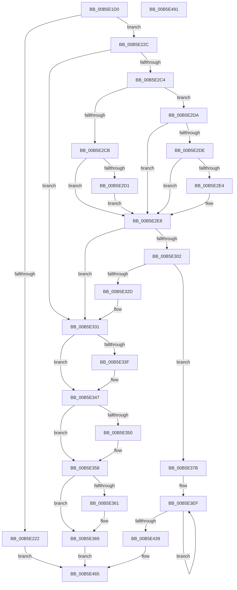

# HalpInitGenericErrorSourceEntryV2

- RVA: `0x00B5E1D0`–`0x00B5E492` (길이 `706` bytes)
- VA: `0x0000000140B5E1D0`
- 실행 섹션: `PAGELK`
- PDB 이름 있음: `예`; PDB Function 태그: `아니요`
- unwind 정보 RVA: `0x000B8D94`
- 디코드: `187`개 명령, `706/706` bytes 표시
- 미해석 바이트: `0` (있으면 어셈블리에 `.byte`로 보존)

> 이 문서는 커널 이미지의 기계어와 PDB 기호를 분석해 생성했습니다. 4번과 5번은 함수 원형과 자료형을 바이너리 사용 방식에서 추정한 C 해석이며 원본 소스 복구 결과는 아닙니다.

## 1. Dependencies

- 직접 호출 지점: **11**; 고유 호출 대상: **7**
- 직접 호출자로 확인된 함수: **1**
- RIP 상대 이미지 참조: **3**

### Outgoing calls
- `0x00B5E215` → [ExAllocatePool2](../../poolcode/B8/ExAllocatePool2_function_00B820F0.md) (function, `0x00B820F0`)
- `0x00B5E245` → [MmMapIoSpaceEx](../../text/32/MmMapIoSpaceEx_function_00327830.md) (function, `0x00327830`)
- `0x00B5E2B0` → [RtlStringCchCopyA](../../text/46/RtlStringCchCopyA_function_00460628.md) (function, `0x00460628`)
- `0x00B5E2B9` → [WheaLogInternalEvent](../../text/66/WheaLogInternalEvent_function_006605B0.md) (function, `0x006605B0`)
- `0x00B5E2F1` → [ExAllocatePool2](../../poolcode/B8/ExAllocatePool2_function_00B820F0.md) (function, `0x00B820F0`)
- `0x00B5E31F` → [ExAllocatePool2](../../poolcode/B8/ExAllocatePool2_function_00B820F0.md) (function, `0x00B820F0`)
- `0x00B5E342` → [MmUnmapIoSpace](../../text/3F/MmUnmapIoSpace_function_003F78F0.md) (function, `0x003F78F0`)
- `0x00B5E353` → [ExFreePoolWithTag](../../poolcode/B8/ExFreePoolWithTag_function_00B82870.md) (function, `0x00B82870`)
- `0x00B5E364` → [ExFreePoolWithTag](../../poolcode/B8/ExFreePoolWithTag_function_00B82870.md) (function, `0x00B82870`)
- `0x00B5E36F` → [ExFreePoolWithTag](../../poolcode/B8/ExFreePoolWithTag_function_00B82870.md) (function, `0x00B82870`)
- `0x00B5E471` → [_security_check_cookie](../../text/6A/_security_check_cookie_function_006AC640.md) (function, `0x006AC640`)

### Direct callers
- [HalpInitializeGenericErrorSource](HalpInitializeGenericErrorSource_function_00B5E564.md) at `0x00B5E68B`
- [HalpInitializeGenericErrorSource](HalpInitializeGenericErrorSource_function_00B5E564.md) at `0x00B5E6FA`
- [HalpInitializeGenericErrorSource](HalpInitializeGenericErrorSource_function_00B5E564.md) at `0x00B5E75E`
- [HalpInitializeGenericErrorSource](HalpInitializeGenericErrorSource_function_00B5E564.md) at `0x00B5E7BB`
- [HalpInitializeGenericErrorSource](HalpInitializeGenericErrorSource_function_00B5E564.md) at `0x00B5E85A`

### Static image references
- `0x00B5E1EA` → RVA `0x00E0A740` (`.data`; read)
- `0x00B5E24E` → RVA `0x00024F90` (`.rdata`; read)
- `0x00B5E37B` → RVA `0x00024C68` (`.rdata`; read)

## 2. Other-region calls and transfers

- 다른 실행 섹션으로 향하는 call: **11**
  - `0x00B5E215` → [ExAllocatePool2](../../poolcode/B8/ExAllocatePool2_function_00B820F0.md) (`PAGELK` → `POOLCODE`)
  - `0x00B5E245` → [MmMapIoSpaceEx](../../text/32/MmMapIoSpaceEx_function_00327830.md) (`PAGELK` → `.text`)
  - `0x00B5E2B0` → [RtlStringCchCopyA](../../text/46/RtlStringCchCopyA_function_00460628.md) (`PAGELK` → `.text`)
  - `0x00B5E2B9` → [WheaLogInternalEvent](../../text/66/WheaLogInternalEvent_function_006605B0.md) (`PAGELK` → `.text`)
  - `0x00B5E2F1` → [ExAllocatePool2](../../poolcode/B8/ExAllocatePool2_function_00B820F0.md) (`PAGELK` → `POOLCODE`)
  - `0x00B5E31F` → [ExAllocatePool2](../../poolcode/B8/ExAllocatePool2_function_00B820F0.md) (`PAGELK` → `POOLCODE`)
  - `0x00B5E342` → [MmUnmapIoSpace](../../text/3F/MmUnmapIoSpace_function_003F78F0.md) (`PAGELK` → `.text`)
  - `0x00B5E353` → [ExFreePoolWithTag](../../poolcode/B8/ExFreePoolWithTag_function_00B82870.md) (`PAGELK` → `POOLCODE`)
  - `0x00B5E364` → [ExFreePoolWithTag](../../poolcode/B8/ExFreePoolWithTag_function_00B82870.md) (`PAGELK` → `POOLCODE`)
  - `0x00B5E36F` → [ExFreePoolWithTag](../../poolcode/B8/ExFreePoolWithTag_function_00B82870.md) (`PAGELK` → `POOLCODE`)
  - `0x00B5E471` → [_security_check_cookie](../../text/6A/_security_check_cookie_function_006AC640.md) (`PAGELK` → `.text`)
- 별도 외부 분기/꼬리 이동을 확인하지 못했습니다.

## 3. Assembly (complete function range)

```asm
00B5E1D0  48 89 5C 24 18                  mov qword ptr [rsp + 0x18], rbx
00B5E1D5  55                              push rbp
00B5E1D6  56                              push rsi
00B5E1D7  57                              push rdi
00B5E1D8  41 54                           push r12
00B5E1DA  41 55                           push r13
00B5E1DC  41 56                           push r14
00B5E1DE  41 57                           push r15
00B5E1E0  48 8B EC                        mov rbp, rsp
00B5E1E3  48 81 EC 80 00 00 00            sub rsp, 0x80
00B5E1EA  48 8B 05 4F C5 2A 00            mov rax, qword ptr [rip + 0x2ac54f]
00B5E1F1  48 33 C4                        xor rax, rsp
00B5E1F4  48 89 45 F0                     mov qword ptr [rbp - 0x10], rax
00B5E1F8  4C 8B FA                        mov r15, rdx
00B5E1FB  48 8B D9                        mov rbx, rcx
00B5E1FE  33 F6                           xor esi, esi
00B5E200  41 BC 48 61 6C 57               mov r12d, 0x576c6148
00B5E206  45 8B C4                        mov r8d, r12d
00B5E209  BA 28 04 00 00                  mov edx, 0x428
00B5E20E  44 8D 6E 40                     lea r13d, [rsi + 0x40]
00B5E212  41 8B CD                        mov ecx, r13d
00B5E215  E8 D6 3E 02 00                  call 0x140b820f0
00B5E21A  48 8B F8                        mov rdi, rax
00B5E21D  48 85 C0                        test rax, rax
00B5E220  75 0A                           jne 0x140b5e22c
00B5E222  BE 9A 00 00 C0                  mov esi, 0xc000009a
00B5E227  E9 39 02 00 00                  jmp 0x140b5e465
00B5E22C  8B 43 2C                        mov eax, dword ptr [rbx + 0x2c]
00B5E22F  41 BE 08 00 00 00               mov r14d, 8
00B5E235  89 47 30                        mov dword ptr [rdi + 0x30], eax
00B5E238  41 8B D6                        mov edx, r14d
00B5E23B  48 8B 4B 38                     mov rcx, qword ptr [rbx + 0x38]
00B5E23F  41 B8 04 02 00 00               mov r8d, 0x204
00B5E245  E8 E6 95 7C FF                  call 0x140327830
00B5E24A  48 89 47 28                     mov qword ptr [rdi + 0x28], rax
00B5E24E  4C 8D 05 3B 6D 4C FF            lea r8, [rip - 0xb392c5]
00B5E255  48 8B 43 38                     mov rax, qword ptr [rbx + 0x38]
00B5E259  41 8D 56 18                     lea edx, [r14 + 0x18]
00B5E25D  21 75 AC                        and dword ptr [rbp - 0x54], esi
00B5E260  48 8D 4D C0                     lea rcx, [rbp - 0x40]
00B5E264  48 89 45 E0                     mov qword ptr [rbp - 0x20], rax
00B5E268  0F 57 C0                        xorps xmm0, xmm0
00B5E26B  8B 43 2C                        mov eax, dword ptr [rbx + 0x2c]
00B5E26E  0F 57 C9                        xorps xmm1, xmm1
00B5E271  48 89 45 E8                     mov qword ptr [rbp - 0x18], rax
00B5E275  66 0F 7F 45 C0                  movdqa xmmword ptr [rbp - 0x40], xmm0
00B5E27A  66 0F 7F 4D D0                  movdqa xmmword ptr [rbp - 0x30], xmm1
00B5E27F  C7 45 A0 57 68 4C 67            mov dword ptr [rbp - 0x60], 0x674c6857
00B5E286  C7 45 A4 01 00 00 00            mov dword ptr [rbp - 0x5c], 1
00B5E28D  C7 45 A8 50 00 00 00            mov dword ptr [rbp - 0x58], 0x50
00B5E294  C7 45 B4 21 00 00 80            mov dword ptr [rbp - 0x4c], 0x80000021
00B5E29B  C7 45 B0 4B 52 4E 4C            mov dword ptr [rbp - 0x50], 0x4c4e524b
00B5E2A2  C7 45 B8 02 00 00 00            mov dword ptr [rbp - 0x48], 2
00B5E2A9  C7 45 BC 30 00 00 00            mov dword ptr [rbp - 0x44], 0x30
00B5E2B0  E8 73 23 90 FF                  call 0x140460628
00B5E2B5  48 8D 4D A0                     lea rcx, [rbp - 0x60]
00B5E2B9  E8 F2 22 B0 FF                  call 0x1406605b0
00B5E2BE  48 39 77 28                     cmp qword ptr [rdi + 0x28], rsi
00B5E2C2  74 6D                           je 0x140b5e331
00B5E2C4  8A 43 5F                        mov al, byte ptr [rbx + 0x5f]
00B5E2C7  3C 03                           cmp al, 3
00B5E2C9  75 0F                           jne 0x140b5e2da
00B5E2CB  80 7B 5D 20                     cmp byte ptr [rbx + 0x5d], 0x20
00B5E2CF  75 17                           jne 0x140b5e2e8
00B5E2D1  C7 47 48 04 00 00 00            mov dword ptr [rdi + 0x48], 4
00B5E2D8  EB 0E                           jmp 0x140b5e2e8
00B5E2DA  3C 04                           cmp al, 4
00B5E2DC  75 0A                           jne 0x140b5e2e8
00B5E2DE  44 38 6B 5D                     cmp byte ptr [rbx + 0x5d], r13b
00B5E2E2  75 04                           jne 0x140b5e2e8
00B5E2E4  44 89 77 48                     mov dword ptr [rdi + 0x48], r14d
00B5E2E8  45 8B C4                        mov r8d, r12d
00B5E2EB  49 8B D6                        mov rdx, r14
00B5E2EE  49 8B CD                        mov rcx, r13
00B5E2F1  E8 FA 3D 02 00                  call 0x140b820f0
00B5E2F6  48 89 47 40                     mov qword ptr [rdi + 0x40], rax
00B5E2FA  48 8B C8                        mov rcx, rax
00B5E2FD  48 85 C0                        test rax, rax
00B5E300  74 2F                           je 0x140b5e331
00B5E302  48 8B 43 60                     mov rax, qword ptr [rbx + 0x60]
00B5E306  45 8B C4                        mov r8d, r12d
00B5E309  48 89 01                        mov qword ptr [rcx], rax
00B5E30C  49 8B CD                        mov rcx, r13
00B5E30F  8B 53 10                        mov edx, dword ptr [rbx + 0x10]
00B5E312  44 8B 77 30                     mov r14d, dword ptr [rdi + 0x30]
00B5E316  83 C2 50                        add edx, 0x50
00B5E319  44 03 F2                        add r14d, edx
00B5E31C  41 8B D6                        mov edx, r14d
00B5E31F  E8 CC 3D 02 00                  call 0x140b820f0
00B5E324  48 89 47 18                     mov qword ptr [rdi + 0x18], rax
00B5E328  48 85 C0                        test rax, rax
00B5E32B  75 4E                           jne 0x140b5e37b
00B5E32D  44 8D 70 08                     lea r14d, [rax + 8]
00B5E331  48 8B 4F 28                     mov rcx, qword ptr [rdi + 0x28]
00B5E335  BE 9A 00 00 C0                  mov esi, 0xc000009a
00B5E33A  48 85 C9                        test rcx, rcx
00B5E33D  74 08                           je 0x140b5e347
00B5E33F  49 8B D6                        mov rdx, r14
00B5E342  E8 A9 95 89 FF                  call 0x1403f78f0
00B5E347  48 8B 4F 40                     mov rcx, qword ptr [rdi + 0x40]
00B5E34B  48 85 C9                        test rcx, rcx
00B5E34E  74 08                           je 0x140b5e358
00B5E350  41 8B D4                        mov edx, r12d
00B5E353  E8 18 45 02 00                  call 0x140b82870
00B5E358  48 8B 4F 18                     mov rcx, qword ptr [rdi + 0x18]
00B5E35C  48 85 C9                        test rcx, rcx
00B5E35F  74 08                           je 0x140b5e369
00B5E361  41 8B D4                        mov edx, r12d
00B5E364  E8 07 45 02 00                  call 0x140b82870
00B5E369  41 8B D4                        mov edx, r12d
00B5E36C  48 8B CF                        mov rcx, rdi
00B5E36F  E8 FC 44 02 00                  call 0x140b82870
00B5E374  33 FF                           xor edi, edi
00B5E376  E9 EA 00 00 00                  jmp 0x140b5e465
00B5E37B  0F 10 05 E6 68 4C FF            movups xmm0, xmmword ptr [rip - 0xb3971a]
00B5E382  C7 00 57 48 45 41               mov dword ptr [rax], 0x41454857
00B5E388  48 8D 57 58                     lea rdx, [rdi + 0x58]
00B5E38C  48 8B 47 18                     mov rax, qword ptr [rdi + 0x18]
00B5E390  41 B8 07 00 00 00               mov r8d, 7
00B5E396  C7 40 04 03 00 00 00            mov dword ptr [rax + 4], 3
00B5E39D  48 8B 47 18                     mov rax, qword ptr [rdi + 0x18]
00B5E3A1  44 89 70 08                     mov dword ptr [rax + 8], r14d
00B5E3A5  48 8B 47 18                     mov rax, qword ptr [rdi + 0x18]
00B5E3A9  C7 40 10 06 00 00 00            mov dword ptr [rax + 0x10], 6
00B5E3B0  48 8B 4F 18                     mov rcx, qword ptr [rdi + 0x18]
00B5E3B4  8B 43 1C                        mov eax, dword ptr [rbx + 0x1c]
00B5E3B7  89 41 18                        mov dword ptr [rcx + 0x18], eax
00B5E3BA  48 8B 47 18                     mov rax, qword ptr [rdi + 0x18]
00B5E3BE  C7 40 1C 05 00 00 00            mov dword ptr [rax + 0x1c], 5
00B5E3C5  48 8B 47 18                     mov rax, qword ptr [rdi + 0x18]
00B5E3C9  F3 0F 7F 40 20                  movdqu xmmword ptr [rax + 0x20], xmm0
00B5E3CE  48 8B 47 18                     mov rax, qword ptr [rdi + 0x18]
00B5E3D2  44 89 40 38                     mov dword ptr [rax + 0x38], r8d
00B5E3D6  48 8B 47 18                     mov rax, qword ptr [rdi + 0x18]
00B5E3DA  C7 40 40 50 00 00 00            mov dword ptr [rax + 0x40], 0x50
00B5E3E1  8B 47 30                        mov eax, dword ptr [rdi + 0x30]
00B5E3E4  48 8B 4F 18                     mov rcx, qword ptr [rdi + 0x18]
00B5E3E8  89 41 44                        mov dword ptr [rcx + 0x44], eax
00B5E3EB  41 8D 40 79                     lea eax, [r8 + 0x79]
00B5E3EF  0F 10 03                        movups xmm0, xmmword ptr [rbx]
00B5E3F2  0F 11 02                        movups xmmword ptr [rdx], xmm0
00B5E3F5  0F 10 4B 10                     movups xmm1, xmmword ptr [rbx + 0x10]
00B5E3F9  0F 11 4A 10                     movups xmmword ptr [rdx + 0x10], xmm1
00B5E3FD  0F 10 43 20                     movups xmm0, xmmword ptr [rbx + 0x20]
00B5E401  0F 11 42 20                     movups xmmword ptr [rdx + 0x20], xmm0
00B5E405  0F 10 4B 30                     movups xmm1, xmmword ptr [rbx + 0x30]
00B5E409  0F 11 4A 30                     movups xmmword ptr [rdx + 0x30], xmm1
00B5E40D  0F 10 43 40                     movups xmm0, xmmword ptr [rbx + 0x40]
00B5E411  0F 11 42 40                     movups xmmword ptr [rdx + 0x40], xmm0
00B5E415  0F 10 4B 50                     movups xmm1, xmmword ptr [rbx + 0x50]
00B5E419  0F 11 4A 50                     movups xmmword ptr [rdx + 0x50], xmm1
00B5E41D  0F 10 43 60                     movups xmm0, xmmword ptr [rbx + 0x60]
00B5E421  0F 11 42 60                     movups xmmword ptr [rdx + 0x60], xmm0
00B5E425  48 03 D0                        add rdx, rax
00B5E428  0F 10 4B 70                     movups xmm1, xmmword ptr [rbx + 0x70]
00B5E42C  48 03 D8                        add rbx, rax
00B5E42F  0F 11 4A F0                     movups xmmword ptr [rdx - 0x10], xmm1
00B5E433  49 83 E8 01                     sub r8, 1
00B5E437  75 B6                           jne 0x140b5e3ef
00B5E439  0F 10 03                        movups xmm0, xmmword ptr [rbx]
00B5E43C  0F 11 02                        movups xmmword ptr [rdx], xmm0
00B5E43F  0F 10 4B 10                     movups xmm1, xmmword ptr [rbx + 0x10]
00B5E443  0F 11 4A 10                     movups xmmword ptr [rdx + 0x10], xmm1
00B5E447  0F 10 43 20                     movups xmm0, xmmword ptr [rbx + 0x20]
00B5E44B  0F 11 42 20                     movups xmmword ptr [rdx + 0x20], xmm0
00B5E44F  0F 10 4B 30                     movups xmm1, xmmword ptr [rbx + 0x30]
00B5E453  0F 11 4A 30                     movups xmmword ptr [rdx + 0x30], xmm1
00B5E457  48 8B 4B 40                     mov rcx, qword ptr [rbx + 0x40]
00B5E45B  48 89 4A 40                     mov qword ptr [rdx + 0x40], rcx
00B5E45F  8B 4B 48                        mov ecx, dword ptr [rbx + 0x48]
00B5E462  89 4A 48                        mov dword ptr [rdx + 0x48], ecx
00B5E465  49 89 3F                        mov qword ptr [r15], rdi
00B5E468  8B C6                           mov eax, esi
00B5E46A  48 8B 4D F0                     mov rcx, qword ptr [rbp - 0x10]
00B5E46E  48 33 CC                        xor rcx, rsp
00B5E471  E8 CA E1 B4 FF                  call 0x1406ac640
00B5E476  48 8B 9C 24 D0 00 00 00         mov rbx, qword ptr [rsp + 0xd0]
00B5E47E  48 81 C4 80 00 00 00            add rsp, 0x80
00B5E485  41 5F                           pop r15
00B5E487  41 5E                           pop r14
00B5E489  41 5D                           pop r13
00B5E48B  41 5C                           pop r12
00B5E48D  5F                              pop rdi
00B5E48E  5E                              pop rsi
00B5E48F  5D                              pop rbp
00B5E490  C3                              ret
00B5E491  CC                              int3
```

## 4. C-style interpretation (structured pseudocode)

```c
__int64 __fastcall HalpInitGenericErrorSourceEntryV2(__int64 a1, __int64 a2)
{
    __int64 result;
    __int64 v_r14;
    __int64 v_rbx;
    __int64 v_rdi;
    __int64 v_rsi;
    __int64 v_rsp;
    unsigned __int64 v_stack_m48;
    unsigned __int64 v_stack_m50;
    unsigned __int64 v_stack_m58;
    unsigned __int64 v_stack_m68;
    unsigned __int64 v_stack_m78;
    unsigned int v_stack_m7C;
    unsigned int v_stack_m80;
    unsigned int v_stack_m84;
    unsigned int v_stack_m88;
    unsigned int v_stack_m8C;
    unsigned int v_stack_m90;
    unsigned int v_stack_m94;
    unsigned int v_stack_m98;
    unsigned __int64 v_stack_p18;

    v_stack_p18 = v_rbx;
    v_rsp = (v_rsp) - (128);
    result = (*(unsigned __int64 *)(v_rip + 2803023)) ^ (v_rsp);
    v_stack_m48 = result;
    v_rsi = 0;
    result = ExAllocatePool2((unsigned int)((unsigned int)(v_rsi + 64)), (unsigned int)(0x428ULL), (unsigned int)((unsigned int)((unsigned int)(0x576C6148ULL))), a4);
    if (result != 0) goto loc_00B5E22C;
    goto loc_00B5E465;
loc_00B5E22C:
    *(unsigned int *)(result + 48) = (unsigned int)((unsigned int)(*(unsigned int *)(a1 + 44)));
    result = MmMapIoSpaceEx(*(unsigned __int64 *)(a1 + 56), 8, 516, a4);
    *(unsigned __int64 *)(result + 40) = result;
    v_stack_m58 = *(unsigned __int64 *)(a1 + 56);
    v_stack_m50 = (unsigned int)(*(unsigned int *)(a1 + 44));
    v_stack_m78 = v_xmm0;
    v_stack_m68 = v_xmm1;
    v_stack_m98 = 0x674C6857ULL;
    v_stack_m94 = 1;
    v_stack_m90 = 80;
    v_stack_m84 = 0x80000021ULL;
    v_stack_m88 = 0x4C4E524BULL;
    v_stack_m80 = 2;
    v_stack_m7C = 48;
    result = RtlStringCchCopyA(v_stack_m78, 8 + 24, v_rip - 11768517, a4);
    result = WheaLogInternalEvent(v_stack_m98, 8 + 24, v_rip - 11768517, a4);
    if ((*(unsigned __int64 *)(result + 40)) == ((unsigned int)(0xC000009AULL))) goto loc_00B5E331;
    if (((unsigned __int8)(*(unsigned __int8 *)(a1 + 95))) != 3) goto loc_00B5E2DA;
    if ((*(unsigned __int8 *)(a1 + 93)) != 32) goto loc_00B5E2E8;
    *(unsigned int *)(result + 72) = 4;
    goto loc_00B5E2E8;
loc_00B5E2DA:
    if (((unsigned __int8)(*(unsigned __int8 *)(a1 + 95))) != 4) goto loc_00B5E2E8;
    if ((*(unsigned __int8 *)(a1 + 93)) == ((unsigned __int8)(v_rsi + 64))) {
        *(unsigned int *)(result + 72) = 8;
    }
    result = ExAllocatePool2(v_rsi + 64, 8, (unsigned int)((unsigned int)((unsigned int)(0x576C6148ULL))), a4);
    *(unsigned __int64 *)(result + 64) = result;
    if (result == 0) goto loc_00B5E331;
    *(unsigned __int64 *)(result) = *(unsigned __int64 *)(a1 + 96);
    a2 = (unsigned int)(((unsigned int)(*(unsigned int *)(a1 + 16))) + (80));
    v_r14 = (unsigned int)(((unsigned int)(*(unsigned int *)(result + 48))) + ((unsigned int)(a2)));
    result = ExAllocatePool2(v_rsi + 64, (unsigned int)((unsigned int)(v_r14)), (unsigned int)((unsigned int)((unsigned int)(0x576C6148ULL))), a4);
    *(unsigned __int64 *)(result + 24) = result;
    if (result != 0) goto loc_00B5E37B;
loc_00B5E331:
    if (*(unsigned __int64 *)(result + 40) != 0) {
        a2 = result + 8;
        result = MmUnmapIoSpace(*(unsigned __int64 *)(result + 40), a2, (unsigned int)((unsigned int)((unsigned int)(0x576C6148ULL))), a4);
    }
    if (*(unsigned __int64 *)(result + 64) != 0) {
        a2 = (unsigned int)((unsigned int)(0x576C6148ULL));
        result = ExFreePoolWithTag(*(unsigned __int64 *)(result + 64), a2, (unsigned int)((unsigned int)((unsigned int)(0x576C6148ULL))), a4);
    }
    if (*(unsigned __int64 *)(result + 24) != 0) {
        a2 = (unsigned int)((unsigned int)(0x576C6148ULL));
        result = ExFreePoolWithTag(*(unsigned __int64 *)(result + 24), a2, (unsigned int)((unsigned int)((unsigned int)(0x576C6148ULL))), a4);
    }
    result = ExFreePoolWithTag(result, (unsigned int)((unsigned int)((unsigned int)(0x576C6148ULL))), (unsigned int)((unsigned int)((unsigned int)(0x576C6148ULL))), a4);
    v_rdi = 0;
    goto loc_00B5E465;
loc_00B5E37B:
    *(unsigned int *)(result) = 0x41454857ULL;
    *(unsigned int *)(*(unsigned __int64 *)(v_rdi + 24) + 4) = 3;
    *(unsigned int *)(*(unsigned __int64 *)(v_rdi + 24) + 8) = (unsigned int)(result + 8);
    *(unsigned int *)(*(unsigned __int64 *)(v_rdi + 24) + 16) = 6;
    *(unsigned int *)(*(unsigned __int64 *)(v_rdi + 24) + 24) = (unsigned int)((unsigned int)(*(unsigned int *)(a1 + 28)));
    *(unsigned int *)(*(unsigned __int64 *)(v_rdi + 24) + 28) = 5;
    *(unsigned __int64 *)(*(unsigned __int64 *)(v_rdi + 24) + 32) = v_xmm0;
    *(unsigned int *)(*(unsigned __int64 *)(v_rdi + 24) + 56) = 7;
    *(unsigned int *)(*(unsigned __int64 *)(v_rdi + 24) + 64) = 80;
    *(unsigned int *)(*(unsigned __int64 *)(v_rdi + 24) + 68) = (unsigned int)((unsigned int)(*(unsigned int *)(v_rdi + 48)));
loc_00B5E3EF:
    *(unsigned __int64 *)(v_rdi + 88) = v_xmm0;
    *(unsigned __int64 *)(v_rdi + 88 + 16) = v_xmm1;
    *(unsigned __int64 *)(v_rdi + 88 + 32) = v_xmm0;
    *(unsigned __int64 *)(v_rdi + 88 + 48) = v_xmm1;
    *(unsigned __int64 *)(v_rdi + 88 + 64) = v_xmm0;
    *(unsigned __int64 *)(v_rdi + 88 + 80) = v_xmm1;
    *(unsigned __int64 *)(v_rdi + 88 + 96) = v_xmm0;
    a2 = (v_rdi + 88) + (7 + 121);
    v_rbx = (a1) + (7 + 121);
    *(unsigned __int64 *)(a2 - 16) = v_xmm1;
    a3 = (7) - (1);
    if (condition_is_not_equal) goto loc_00B5E3EF;
    *(unsigned __int64 *)(a2) = v_xmm0;
    *(unsigned __int64 *)(a2 + 16) = v_xmm1;
    *(unsigned __int64 *)(a2 + 32) = v_xmm0;
    *(unsigned __int64 *)(a2 + 48) = v_xmm1;
    *(unsigned __int64 *)(a2 + 64) = *(unsigned __int64 *)(v_rbx + 64);
    *(unsigned int *)(a2 + 72) = (unsigned int)((unsigned int)(*(unsigned int *)(v_rbx + 72)));
loc_00B5E465:
    *(unsigned __int64 *)(a2) = 0;
    a1 = (v_stack_m48) ^ (v_rsp);
    result = _security_check_cookie(a1, a2, a3, a4);
    v_rsp = (v_rsp) + (128);
    return result;
}
```

## 5. (Beta) C Style

```c
int64_t HalpInitGenericErrorSourceEntryV2(void *Arg1, void *Arg2)
{
    uint8_t *arg1 = (uint8_t *)Arg1;
    uint8_t *arg2 = (uint8_t *)Arg2;

    int64_t result;
    int64_t local_r14;
    int64_t local_rbx;
    int64_t local_rdi;
    int64_t local_rsi;
    int64_t local_rsp;
    uint64_t v_stack_m48;
    uint64_t v_stack_m50;
    uint64_t v_stack_m58;
    uint64_t v_stack_m68;
    uint64_t v_stack_m78;
    uint32_t v_stack_m7C;
    uint32_t v_stack_m80;
    uint32_t v_stack_m84;
    uint32_t v_stack_m88;
    uint32_t v_stack_m8C;
    uint32_t v_stack_m90;
    uint32_t v_stack_m94;
    uint32_t v_stack_m98;
    uint64_t v_stack_p18;

    v_stack_p18 = local_rbx;
    local_rsp = (local_rsp) - (128);
    result = (*(uint64_t *)(v_rip + 0x2AC54F)) ^ (local_rsp);
    v_stack_m48 = result;
    local_rsi = 0;
    result = ExAllocatePool2((uint32_t)((uint32_t)(local_rsi + 64)), (uint32_t)(0x428ULL), (uint32_t)((uint32_t)((uint32_t)(0x576C6148ULL))), a4);
    if (result != 0) goto loc_00B5E22C;
    goto loc_00B5E465;
loc_00B5E22C:
    *(uint32_t *)(result + 0x30) = (uint32_t)((uint32_t)(*(uint32_t *)(arg1 + 0x2C)));
    result = MmMapIoSpaceEx(*(uint64_t *)(arg1 + 0x38), 8, 516, a4);
    *(uint64_t *)(result + 0x28) = result;
    v_stack_m58 = *(uint64_t *)(arg1 + 0x38);
    v_stack_m50 = (uint32_t)(*(uint32_t *)(arg1 + 0x2C));
    v_stack_m78 = v_xmm0;
    v_stack_m68 = v_xmm1;
    v_stack_m98 = 0x674C6857ULL;
    v_stack_m94 = 1;
    v_stack_m90 = 80;
    v_stack_m84 = 0x80000021ULL;
    v_stack_m88 = 0x4C4E524BULL;
    v_stack_m80 = 2;
    v_stack_m7C = 48;
    result = RtlStringCchCopyA(v_stack_m78, 8 + 24, v_rip - 11768517, a4);
    result = WheaLogInternalEvent(v_stack_m98, 8 + 24, v_rip - 11768517, a4);
    if ((*(uint64_t *)(result + 0x28)) == ((uint32_t)(0xC000009AULL))) goto loc_00B5E331;
    if (((uint8_t)(*(uint8_t *)(arg1 + 0x5F))) != 3) goto loc_00B5E2DA;
    if ((*(uint8_t *)(arg1 + 0x5D)) != 32) goto loc_00B5E2E8;
    *(uint32_t *)(result + 0x48) = 4;
    goto loc_00B5E2E8;
loc_00B5E2DA:
    if (((uint8_t)(*(uint8_t *)(arg1 + 0x5F))) != 4) goto loc_00B5E2E8;
    if ((*(uint8_t *)(arg1 + 0x5D)) == ((uint8_t)(local_rsi + 64))) {
        *(uint32_t *)(result + 0x48) = 8;
    }
    result = ExAllocatePool2(local_rsi + 64, 8, (uint32_t)((uint32_t)((uint32_t)(0x576C6148ULL))), a4);
    *(uint64_t *)(result + 0x40) = result;
    if (result == 0) goto loc_00B5E331;
    *(uint64_t *)(result) = *(uint64_t *)(arg1 + 0x60);
    Arg2 = (uint32_t)(((uint32_t)(*(uint32_t *)(arg1 + 0x10))) + (80));
    local_r14 = (uint32_t)(((uint32_t)(*(uint32_t *)(result + 0x30))) + ((uint32_t)(Arg2)));
    result = ExAllocatePool2(local_rsi + 64, (uint32_t)((uint32_t)(local_r14)), (uint32_t)((uint32_t)((uint32_t)(0x576C6148ULL))), a4);
    *(uint64_t *)(result + 0x18) = result;
    if (result != 0) goto loc_00B5E37B;
loc_00B5E331:
    if (*(uint64_t *)(result + 0x28) != 0) {
        Arg2 = result + 8;
        result = MmUnmapIoSpace(*(uint64_t *)(result + 0x28), Arg2, (uint32_t)((uint32_t)((uint32_t)(0x576C6148ULL))), a4);
    }
    if (*(uint64_t *)(result + 0x40) != 0) {
        Arg2 = (uint32_t)((uint32_t)(0x576C6148ULL));
        result = ExFreePoolWithTag(*(uint64_t *)(result + 0x40), Arg2, (uint32_t)((uint32_t)((uint32_t)(0x576C6148ULL))), a4);
    }
    if (*(uint64_t *)(result + 0x18) != 0) {
        Arg2 = (uint32_t)((uint32_t)(0x576C6148ULL));
        result = ExFreePoolWithTag(*(uint64_t *)(result + 0x18), Arg2, (uint32_t)((uint32_t)((uint32_t)(0x576C6148ULL))), a4);
    }
    result = ExFreePoolWithTag(result, (uint32_t)((uint32_t)((uint32_t)(0x576C6148ULL))), (uint32_t)((uint32_t)((uint32_t)(0x576C6148ULL))), a4);
    local_rdi = 0;
    goto loc_00B5E465;
loc_00B5E37B:
    *(uint32_t *)(result) = 0x41454857ULL;
    *(uint32_t *)(*(uint64_t *)(local_rdi + 0x18) + 0x4) = 3;
    *(uint32_t *)(*(uint64_t *)(local_rdi + 0x18) + 0x8) = (uint32_t)(result + 8);
    *(uint32_t *)(*(uint64_t *)(local_rdi + 0x18) + 0x10) = 6;
    *(uint32_t *)(*(uint64_t *)(local_rdi + 0x18) + 0x18) = (uint32_t)((uint32_t)(*(uint32_t *)(arg1 + 0x1C)));
    *(uint32_t *)(*(uint64_t *)(local_rdi + 0x18) + 0x1C) = 5;
    *(uint64_t *)(*(uint64_t *)(local_rdi + 0x18) + 0x20) = v_xmm0;
    *(uint32_t *)(*(uint64_t *)(local_rdi + 0x18) + 0x38) = 7;
    *(uint32_t *)(*(uint64_t *)(local_rdi + 0x18) + 0x40) = 80;
    *(uint32_t *)(*(uint64_t *)(local_rdi + 0x18) + 0x44) = (uint32_t)((uint32_t)(*(uint32_t *)(local_rdi + 0x30)));
loc_00B5E3EF:
    *(uint64_t *)(local_rdi + 0x58) = v_xmm0;
    *(uint64_t *)(local_rdi + 0x58 + 0x10) = v_xmm1;
    *(uint64_t *)(local_rdi + 0x58 + 0x20) = v_xmm0;
    *(uint64_t *)(local_rdi + 0x58 + 0x30) = v_xmm1;
    *(uint64_t *)(local_rdi + 0x58 + 0x40) = v_xmm0;
    *(uint64_t *)(local_rdi + 0x58 + 0x50) = v_xmm1;
    *(uint64_t *)(local_rdi + 0x58 + 0x60) = v_xmm0;
    Arg2 = (local_rdi + 88) + (7 + 121);
    local_rbx = (Arg1) + (7 + 121);
    *(uint64_t *)(arg2 - 0x10) = v_xmm1;
    a3 = (7) - (1);
    if (condition_is_not_equal) goto loc_00B5E3EF;
    *(uint64_t *)(arg2) = v_xmm0;
    *(uint64_t *)(arg2 + 0x10) = v_xmm1;
    *(uint64_t *)(arg2 + 0x20) = v_xmm0;
    *(uint64_t *)(arg2 + 0x30) = v_xmm1;
    *(uint64_t *)(arg2 + 0x40) = *(uint64_t *)(local_rbx + 0x40);
    *(uint32_t *)(arg2 + 0x48) = (uint32_t)((uint32_t)(*(uint32_t *)(local_rbx + 0x48)));
loc_00B5E465:
    *(uint64_t *)(arg2) = 0;
    Arg1 = (v_stack_m48) ^ (local_rsp);
    result = _security_check_cookie(Arg1, Arg2, a3, a4);
    local_rsp = (local_rsp) + (128);
    return result;
}
```

### 관측된 메모리 오프셋

구조체 형식이 확인되지 않은 접근은 인자 기준의 오프셋으로만 기록했습니다.

| 기준 인자 | 오프셋 표현 | 폭 (bit) | 접근 |
|---|---:|---:|---|
| `Arg1` | `+ 0x0` | `128` | `R` |
| `Arg1` | `+ 0x10` | `32` | `R` |
| `Arg1` | `+ 0x10` | `128` | `R` |
| `Arg1` | `+ 0x1C` | `32` | `R` |
| `Arg1` | `+ 0x20` | `128` | `R` |
| `Arg1` | `+ 0x2C` | `32` | `R` |
| `Arg1` | `+ 0x30` | `128` | `R` |
| `Arg1` | `+ 0x38` | `64` | `R` |
| `Arg1` | `+ 0x40` | `64` | `R` |
| `Arg1` | `+ 0x40` | `128` | `R` |
| `Arg1` | `+ 0x48` | `32` | `R` |
| `Arg1` | `+ 0x50` | `128` | `R` |
| `Arg1` | `+ 0x5D` | `8` | `R` |
| `Arg1` | `+ 0x5F` | `8` | `R` |
| `Arg1` | `+ 0x60` | `64` | `R` |
| `Arg1` | `+ 0x60` | `128` | `R` |
| `Arg1` | `+ 0x70` | `128` | `R` |
| `Arg2` | `+ 0x0` | `64` | `W` |

## 6. Execution-region graph

[열기: 2D/3D 그래프와 함수 탐색 컨트롤 패널](../../../control-panel.html?section=pagelk&rva=0x00B5E1D0&view=graph)

- 2D 그래프는 위에서 아래로 흐르고, 3D 그래프는 빈 공간을 드래그해 회전합니다. Shift+드래그는 이동, 휠은 확대·축소, 함수 노드 선택은 대상 보고서 이동입니다.

### Static fallback


