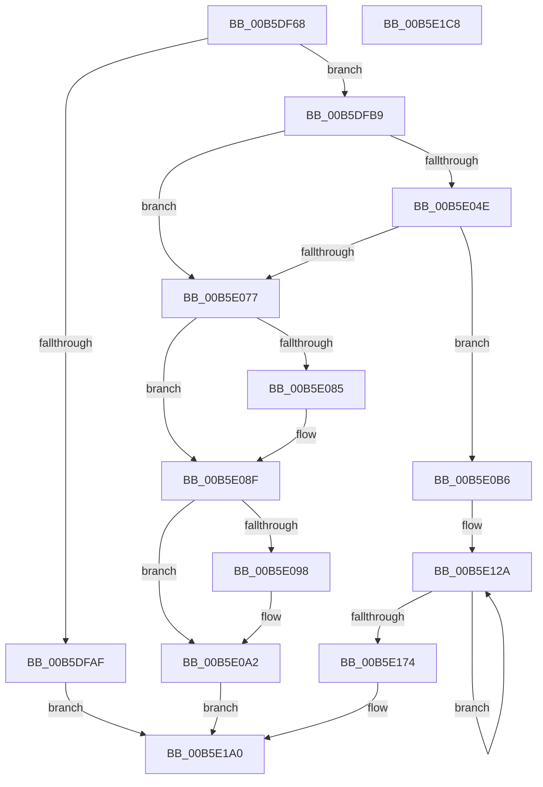

# HalpInitGenericErrorSourceEntry

- RVA: `0x00B5DF68`–`0x00B5E1C9` (길이 `609` bytes)
- VA: `0x0000000140B5DF68`
- 실행 섹션: `PAGELK`
- PDB 이름 있음: `예`; PDB Function 태그: `아니요`
- unwind 정보 RVA: `0x000C4550`
- 디코드: `152`개 명령, `609/609` bytes 표시
- 미해석 바이트: `0` (있으면 어셈블리에 `.byte`로 보존)

> 이 문서는 커널 이미지의 기계어와 PDB 기호를 분석해 생성했습니다. 4번과 5번은 함수 원형과 자료형을 바이너리 사용 방식에서 추정한 C 해석이며 원본 소스 복구 결과는 아닙니다.

## 1. Dependencies

- 직접 호출 지점: **9**; 고유 호출 대상: **7**
- 직접 호출자로 확인된 함수: **1**
- RIP 상대 이미지 참조: **3**

### Outgoing calls
- `0x00B5DFA2` → [ExAllocatePool2](../../poolcode/B8/ExAllocatePool2_function_00B820F0.md) (function, `0x00B820F0`)
- `0x00B5DFCE` → [MmMapIoSpaceEx](../../text/32/MmMapIoSpaceEx_function_00327830.md) (function, `0x00327830`)
- `0x00B5E03A` → [RtlStringCchCopyA](../../text/46/RtlStringCchCopyA_function_00460628.md) (function, `0x00460628`)
- `0x00B5E043` → [WheaLogInternalEvent](../../text/66/WheaLogInternalEvent_function_006605B0.md) (function, `0x006605B0`)
- `0x00B5E069` → [ExAllocatePool2](../../poolcode/B8/ExAllocatePool2_function_00B820F0.md) (function, `0x00B820F0`)
- `0x00B5E08A` → [MmUnmapIoSpace](../../text/3F/MmUnmapIoSpace_function_003F78F0.md) (function, `0x003F78F0`)
- `0x00B5E09D` → [ExFreePoolWithTag](../../poolcode/B8/ExFreePoolWithTag_function_00B82870.md) (function, `0x00B82870`)
- `0x00B5E0AA` → [ExFreePoolWithTag](../../poolcode/B8/ExFreePoolWithTag_function_00B82870.md) (function, `0x00B82870`)
- `0x00B5E1AC` → [_security_check_cookie](../../text/6A/_security_check_cookie_function_006AC640.md) (function, `0x006AC640`)

### Direct callers
- [HalpInitializeGenericErrorSource](HalpInitializeGenericErrorSource_function_00B5E564.md) at `0x00B5E684`
- [HalpInitializeGenericErrorSource](HalpInitializeGenericErrorSource_function_00B5E564.md) at `0x00B5E6F3`
- [HalpInitializeGenericErrorSource](HalpInitializeGenericErrorSource_function_00B5E564.md) at `0x00B5E757`
- [HalpInitializeGenericErrorSource](HalpInitializeGenericErrorSource_function_00B5E564.md) at `0x00B5E7B4`
- [HalpInitializeGenericErrorSource](HalpInitializeGenericErrorSource_function_00B5E564.md) at `0x00B5E853`

### Static image references
- `0x00B5DF7E` → RVA `0x00E0A740` (`.data`; read)
- `0x00B5DFD7` → RVA `0x00024F90` (`.rdata`; read)
- `0x00B5E0B6` → RVA `0x00024C68` (`.rdata`; read)

## 2. Other-region calls and transfers

- 다른 실행 섹션으로 향하는 call: **9**
  - `0x00B5DFA2` → [ExAllocatePool2](../../poolcode/B8/ExAllocatePool2_function_00B820F0.md) (`PAGELK` → `POOLCODE`)
  - `0x00B5DFCE` → [MmMapIoSpaceEx](../../text/32/MmMapIoSpaceEx_function_00327830.md) (`PAGELK` → `.text`)
  - `0x00B5E03A` → [RtlStringCchCopyA](../../text/46/RtlStringCchCopyA_function_00460628.md) (`PAGELK` → `.text`)
  - `0x00B5E043` → [WheaLogInternalEvent](../../text/66/WheaLogInternalEvent_function_006605B0.md) (`PAGELK` → `.text`)
  - `0x00B5E069` → [ExAllocatePool2](../../poolcode/B8/ExAllocatePool2_function_00B820F0.md) (`PAGELK` → `POOLCODE`)
  - `0x00B5E08A` → [MmUnmapIoSpace](../../text/3F/MmUnmapIoSpace_function_003F78F0.md) (`PAGELK` → `.text`)
  - `0x00B5E09D` → [ExFreePoolWithTag](../../poolcode/B8/ExFreePoolWithTag_function_00B82870.md) (`PAGELK` → `POOLCODE`)
  - `0x00B5E0AA` → [ExFreePoolWithTag](../../poolcode/B8/ExFreePoolWithTag_function_00B82870.md) (`PAGELK` → `POOLCODE`)
  - `0x00B5E1AC` → [_security_check_cookie](../../text/6A/_security_check_cookie_function_006AC640.md) (`PAGELK` → `.text`)
- 별도 외부 분기/꼬리 이동을 확인하지 못했습니다.

## 3. Assembly (complete function range)

```asm
00B5DF68  48 89 5C 24 18                  mov qword ptr [rsp + 0x18], rbx
00B5DF6D  55                              push rbp
00B5DF6E  56                              push rsi
00B5DF6F  57                              push rdi
00B5DF70  41 56                           push r14
00B5DF72  41 57                           push r15
00B5DF74  48 8B EC                        mov rbp, rsp
00B5DF77  48 81 EC 80 00 00 00            sub rsp, 0x80
00B5DF7E  48 8B 05 BB C7 2A 00            mov rax, qword ptr [rip + 0x2ac7bb]
00B5DF85  48 33 C4                        xor rax, rsp
00B5DF88  48 89 45 F0                     mov qword ptr [rbp - 0x10], rax
00B5DF8C  4C 8B FA                        mov r15, rdx
00B5DF8F  48 8B D9                        mov rbx, rcx
00B5DF92  33 F6                           xor esi, esi
00B5DF94  BA 28 04 00 00                  mov edx, 0x428
00B5DF99  41 B8 48 61 6C 57               mov r8d, 0x576c6148
00B5DF9F  8D 4E 40                        lea ecx, [rsi + 0x40]
00B5DFA2  E8 49 41 02 00                  call 0x140b820f0
00B5DFA7  48 8B F8                        mov rdi, rax
00B5DFAA  48 85 C0                        test rax, rax
00B5DFAD  75 0A                           jne 0x140b5dfb9
00B5DFAF  BE 9A 00 00 C0                  mov esi, 0xc000009a
00B5DFB4  E9 E7 01 00 00                  jmp 0x140b5e1a0
00B5DFB9  8B 43 2C                        mov eax, dword ptr [rbx + 0x2c]
00B5DFBC  BA 08 00 00 00                  mov edx, 8
00B5DFC1  89 47 30                        mov dword ptr [rdi + 0x30], eax
00B5DFC4  41 B8 04 02 00 00               mov r8d, 0x204
00B5DFCA  48 8B 4B 38                     mov rcx, qword ptr [rbx + 0x38]
00B5DFCE  E8 5D 98 7C FF                  call 0x140327830
00B5DFD3  48 89 47 28                     mov qword ptr [rdi + 0x28], rax
00B5DFD7  4C 8D 05 B2 6F 4C FF            lea r8, [rip - 0xb3904e]
00B5DFDE  48 8B 43 38                     mov rax, qword ptr [rbx + 0x38]
00B5DFE2  48 8D 4D C0                     lea rcx, [rbp - 0x40]
00B5DFE6  21 75 AC                        and dword ptr [rbp - 0x54], esi
00B5DFE9  0F 57 C0                        xorps xmm0, xmm0
00B5DFEC  48 89 45 E0                     mov qword ptr [rbp - 0x20], rax
00B5DFF0  0F 57 C9                        xorps xmm1, xmm1
00B5DFF3  8B 43 2C                        mov eax, dword ptr [rbx + 0x2c]
00B5DFF6  BA 20 00 00 00                  mov edx, 0x20
00B5DFFB  48 89 45 E8                     mov qword ptr [rbp - 0x18], rax
00B5DFFF  66 0F 7F 45 C0                  movdqa xmmword ptr [rbp - 0x40], xmm0
00B5E004  66 0F 7F 4D D0                  movdqa xmmword ptr [rbp - 0x30], xmm1
00B5E009  C7 45 A0 57 68 4C 67            mov dword ptr [rbp - 0x60], 0x674c6857
00B5E010  C7 45 A4 01 00 00 00            mov dword ptr [rbp - 0x5c], 1
00B5E017  C7 45 A8 50 00 00 00            mov dword ptr [rbp - 0x58], 0x50
00B5E01E  C7 45 B4 21 00 00 80            mov dword ptr [rbp - 0x4c], 0x80000021
00B5E025  C7 45 B0 4B 52 4E 4C            mov dword ptr [rbp - 0x50], 0x4c4e524b
00B5E02C  C7 45 B8 02 00 00 00            mov dword ptr [rbp - 0x48], 2
00B5E033  C7 45 BC 30 00 00 00            mov dword ptr [rbp - 0x44], 0x30
00B5E03A  E8 E9 25 90 FF                  call 0x140460628
00B5E03F  48 8D 4D A0                     lea rcx, [rbp - 0x60]
00B5E043  E8 68 25 B0 FF                  call 0x1406605b0
00B5E048  48 39 77 28                     cmp qword ptr [rdi + 0x28], rsi
00B5E04C  74 29                           je 0x140b5e077
00B5E04E  8B 53 10                        mov edx, dword ptr [rbx + 0x10]
00B5E051  B9 40 00 00 00                  mov ecx, 0x40
00B5E056  44 8B 77 30                     mov r14d, dword ptr [rdi + 0x30]
00B5E05A  83 C2 50                        add edx, 0x50
00B5E05D  44 03 F2                        add r14d, edx
00B5E060  41 B8 48 61 6C 57               mov r8d, 0x576c6148
00B5E066  41 8B D6                        mov edx, r14d
00B5E069  E8 82 40 02 00                  call 0x140b820f0
00B5E06E  48 89 47 18                     mov qword ptr [rdi + 0x18], rax
00B5E072  48 85 C0                        test rax, rax
00B5E075  75 3F                           jne 0x140b5e0b6
00B5E077  48 8B 4F 28                     mov rcx, qword ptr [rdi + 0x28]
00B5E07B  BE 9A 00 00 C0                  mov esi, 0xc000009a
00B5E080  48 85 C9                        test rcx, rcx
00B5E083  74 0A                           je 0x140b5e08f
00B5E085  BA 08 00 00 00                  mov edx, 8
00B5E08A  E8 61 98 89 FF                  call 0x1403f78f0
00B5E08F  48 8B 4F 18                     mov rcx, qword ptr [rdi + 0x18]
00B5E093  48 85 C9                        test rcx, rcx
00B5E096  74 0A                           je 0x140b5e0a2
00B5E098  BA 48 61 6C 57                  mov edx, 0x576c6148
00B5E09D  E8 CE 47 02 00                  call 0x140b82870
00B5E0A2  BA 48 61 6C 57                  mov edx, 0x576c6148
00B5E0A7  48 8B CF                        mov rcx, rdi
00B5E0AA  E8 C1 47 02 00                  call 0x140b82870
00B5E0AF  33 FF                           xor edi, edi
00B5E0B1  E9 EA 00 00 00                  jmp 0x140b5e1a0
00B5E0B6  0F 10 05 AB 6B 4C FF            movups xmm0, xmmword ptr [rip - 0xb39455]
00B5E0BD  C7 00 57 48 45 41               mov dword ptr [rax], 0x41454857
00B5E0C3  48 8D 57 58                     lea rdx, [rdi + 0x58]
00B5E0C7  48 8B 47 18                     mov rax, qword ptr [rdi + 0x18]
00B5E0CB  41 B8 07 00 00 00               mov r8d, 7
00B5E0D1  C7 40 04 03 00 00 00            mov dword ptr [rax + 4], 3
00B5E0D8  48 8B 47 18                     mov rax, qword ptr [rdi + 0x18]
00B5E0DC  44 89 70 08                     mov dword ptr [rax + 8], r14d
00B5E0E0  48 8B 47 18                     mov rax, qword ptr [rdi + 0x18]
00B5E0E4  C7 40 10 06 00 00 00            mov dword ptr [rax + 0x10], 6
00B5E0EB  48 8B 4F 18                     mov rcx, qword ptr [rdi + 0x18]
00B5E0EF  8B 43 1C                        mov eax, dword ptr [rbx + 0x1c]
00B5E0F2  89 41 18                        mov dword ptr [rcx + 0x18], eax
00B5E0F5  48 8B 47 18                     mov rax, qword ptr [rdi + 0x18]
00B5E0F9  C7 40 1C 05 00 00 00            mov dword ptr [rax + 0x1c], 5
00B5E100  48 8B 47 18                     mov rax, qword ptr [rdi + 0x18]
00B5E104  F3 0F 7F 40 20                  movdqu xmmword ptr [rax + 0x20], xmm0
00B5E109  48 8B 47 18                     mov rax, qword ptr [rdi + 0x18]
00B5E10D  44 89 40 38                     mov dword ptr [rax + 0x38], r8d
00B5E111  48 8B 47 18                     mov rax, qword ptr [rdi + 0x18]
00B5E115  C7 40 40 50 00 00 00            mov dword ptr [rax + 0x40], 0x50
00B5E11C  8B 47 30                        mov eax, dword ptr [rdi + 0x30]
00B5E11F  48 8B 4F 18                     mov rcx, qword ptr [rdi + 0x18]
00B5E123  89 41 44                        mov dword ptr [rcx + 0x44], eax
00B5E126  41 8D 40 79                     lea eax, [r8 + 0x79]
00B5E12A  0F 10 03                        movups xmm0, xmmword ptr [rbx]
00B5E12D  0F 11 02                        movups xmmword ptr [rdx], xmm0
00B5E130  0F 10 4B 10                     movups xmm1, xmmword ptr [rbx + 0x10]
00B5E134  0F 11 4A 10                     movups xmmword ptr [rdx + 0x10], xmm1
00B5E138  0F 10 43 20                     movups xmm0, xmmword ptr [rbx + 0x20]
00B5E13C  0F 11 42 20                     movups xmmword ptr [rdx + 0x20], xmm0
00B5E140  0F 10 4B 30                     movups xmm1, xmmword ptr [rbx + 0x30]
00B5E144  0F 11 4A 30                     movups xmmword ptr [rdx + 0x30], xmm1
00B5E148  0F 10 43 40                     movups xmm0, xmmword ptr [rbx + 0x40]
00B5E14C  0F 11 42 40                     movups xmmword ptr [rdx + 0x40], xmm0
00B5E150  0F 10 4B 50                     movups xmm1, xmmword ptr [rbx + 0x50]
00B5E154  0F 11 4A 50                     movups xmmword ptr [rdx + 0x50], xmm1
00B5E158  0F 10 43 60                     movups xmm0, xmmword ptr [rbx + 0x60]
00B5E15C  0F 11 42 60                     movups xmmword ptr [rdx + 0x60], xmm0
00B5E160  48 03 D0                        add rdx, rax
00B5E163  0F 10 4B 70                     movups xmm1, xmmword ptr [rbx + 0x70]
00B5E167  48 03 D8                        add rbx, rax
00B5E16A  0F 11 4A F0                     movups xmmword ptr [rdx - 0x10], xmm1
00B5E16E  49 83 E8 01                     sub r8, 1
00B5E172  75 B6                           jne 0x140b5e12a
00B5E174  0F 10 03                        movups xmm0, xmmword ptr [rbx]
00B5E177  0F 11 02                        movups xmmword ptr [rdx], xmm0
00B5E17A  0F 10 4B 10                     movups xmm1, xmmword ptr [rbx + 0x10]
00B5E17E  0F 11 4A 10                     movups xmmword ptr [rdx + 0x10], xmm1
00B5E182  0F 10 43 20                     movups xmm0, xmmword ptr [rbx + 0x20]
00B5E186  0F 11 42 20                     movups xmmword ptr [rdx + 0x20], xmm0
00B5E18A  0F 10 4B 30                     movups xmm1, xmmword ptr [rbx + 0x30]
00B5E18E  0F 11 4A 30                     movups xmmword ptr [rdx + 0x30], xmm1
00B5E192  48 8B 4B 40                     mov rcx, qword ptr [rbx + 0x40]
00B5E196  48 89 4A 40                     mov qword ptr [rdx + 0x40], rcx
00B5E19A  8B 4B 48                        mov ecx, dword ptr [rbx + 0x48]
00B5E19D  89 4A 48                        mov dword ptr [rdx + 0x48], ecx
00B5E1A0  49 89 3F                        mov qword ptr [r15], rdi
00B5E1A3  8B C6                           mov eax, esi
00B5E1A5  48 8B 4D F0                     mov rcx, qword ptr [rbp - 0x10]
00B5E1A9  48 33 CC                        xor rcx, rsp
00B5E1AC  E8 8F E4 B4 FF                  call 0x1406ac640
00B5E1B1  48 8B 9C 24 C0 00 00 00         mov rbx, qword ptr [rsp + 0xc0]
00B5E1B9  48 81 C4 80 00 00 00            add rsp, 0x80
00B5E1C0  41 5F                           pop r15
00B5E1C2  41 5E                           pop r14
00B5E1C4  5F                              pop rdi
00B5E1C5  5E                              pop rsi
00B5E1C6  5D                              pop rbp
00B5E1C7  C3                              ret
00B5E1C8  CC                              int3
```

## 4. C-style interpretation (structured pseudocode)

```c
__int64 __fastcall HalpInitGenericErrorSourceEntry(__int64 a1, __int64 a2)
{
    __int64 result;
    __int64 v_r14;
    __int64 v_rbx;
    __int64 v_rdi;
    __int64 v_rsi;
    __int64 v_rsp;
    unsigned __int64 v_stack_m38;
    unsigned __int64 v_stack_m40;
    unsigned __int64 v_stack_m48;
    unsigned __int64 v_stack_m58;
    unsigned __int64 v_stack_m68;
    unsigned int v_stack_m6C;
    unsigned int v_stack_m70;
    unsigned int v_stack_m74;
    unsigned int v_stack_m78;
    unsigned int v_stack_m7C;
    unsigned int v_stack_m80;
    unsigned int v_stack_m84;
    unsigned int v_stack_m88;
    unsigned __int64 v_stack_p18;

    v_stack_p18 = v_rbx;
    v_rsp = (v_rsp) - (128);
    result = (*(unsigned __int64 *)(v_rip + 2803643)) ^ (v_rsp);
    v_stack_m38 = result;
    v_rsi = 0;
    result = ExAllocatePool2(v_rsi + 64, (unsigned int)(0x428ULL), (unsigned int)(0x576C6148ULL), a4);
    if (result != 0) goto loc_00B5DFB9;
    goto loc_00B5E1A0;
loc_00B5DFB9:
    *(unsigned int *)(result + 48) = (unsigned int)((unsigned int)(*(unsigned int *)(a1 + 44)));
    result = MmMapIoSpaceEx(*(unsigned __int64 *)(a1 + 56), 8, 516, a4);
    *(unsigned __int64 *)(result + 40) = result;
    v_stack_m48 = *(unsigned __int64 *)(a1 + 56);
    v_stack_m40 = (unsigned int)(*(unsigned int *)(a1 + 44));
    v_stack_m68 = v_xmm0;
    v_stack_m58 = v_xmm1;
    v_stack_m88 = 0x674C6857ULL;
    v_stack_m84 = 1;
    v_stack_m80 = 80;
    v_stack_m74 = 0x80000021ULL;
    v_stack_m78 = 0x4C4E524BULL;
    v_stack_m70 = 2;
    v_stack_m6C = 48;
    result = RtlStringCchCopyA(v_stack_m68, 32, v_rip - 11767886, a4);
    result = WheaLogInternalEvent(v_stack_m88, 32, v_rip - 11767886, a4);
    if ((*(unsigned __int64 *)(result + 40)) == ((unsigned int)(0xC000009AULL))) goto loc_00B5E077;
    a2 = (unsigned int)(((unsigned int)(*(unsigned int *)(a1 + 16))) + (80));
    v_r14 = (unsigned int)(((unsigned int)(*(unsigned int *)(result + 48))) + ((unsigned int)(a2)));
    result = ExAllocatePool2(64, (unsigned int)((unsigned int)(v_r14)), (unsigned int)(0x576C6148ULL), a4);
    *(unsigned __int64 *)(result + 24) = result;
    if (result != 0) goto loc_00B5E0B6;
loc_00B5E077:
    if (*(unsigned __int64 *)(result + 40) != 0) {
        a2 = 8;
        result = MmUnmapIoSpace(*(unsigned __int64 *)(result + 40), a2, (unsigned int)(0x576C6148ULL), a4);
    }
    if (*(unsigned __int64 *)(result + 24) != 0) {
        a2 = 0x576C6148ULL;
        result = ExFreePoolWithTag(*(unsigned __int64 *)(result + 24), a2, (unsigned int)(0x576C6148ULL), a4);
    }
    result = ExFreePoolWithTag(result, (unsigned int)(0x576C6148ULL), (unsigned int)(0x576C6148ULL), a4);
    v_rdi = 0;
    goto loc_00B5E1A0;
loc_00B5E0B6:
    *(unsigned int *)(result) = 0x41454857ULL;
    *(unsigned int *)(*(unsigned __int64 *)(v_rdi + 24) + 4) = 3;
    *(unsigned int *)(*(unsigned __int64 *)(v_rdi + 24) + 8) = (unsigned int)(v_r14);
    *(unsigned int *)(*(unsigned __int64 *)(v_rdi + 24) + 16) = 6;
    *(unsigned int *)(*(unsigned __int64 *)(v_rdi + 24) + 24) = (unsigned int)((unsigned int)(*(unsigned int *)(a1 + 28)));
    *(unsigned int *)(*(unsigned __int64 *)(v_rdi + 24) + 28) = 5;
    *(unsigned __int64 *)(*(unsigned __int64 *)(v_rdi + 24) + 32) = v_xmm0;
    *(unsigned int *)(*(unsigned __int64 *)(v_rdi + 24) + 56) = 7;
    *(unsigned int *)(*(unsigned __int64 *)(v_rdi + 24) + 64) = 80;
    *(unsigned int *)(*(unsigned __int64 *)(v_rdi + 24) + 68) = (unsigned int)((unsigned int)(*(unsigned int *)(v_rdi + 48)));
loc_00B5E12A:
    *(unsigned __int64 *)(v_rdi + 88) = v_xmm0;
    *(unsigned __int64 *)(v_rdi + 88 + 16) = v_xmm1;
    *(unsigned __int64 *)(v_rdi + 88 + 32) = v_xmm0;
    *(unsigned __int64 *)(v_rdi + 88 + 48) = v_xmm1;
    *(unsigned __int64 *)(v_rdi + 88 + 64) = v_xmm0;
    *(unsigned __int64 *)(v_rdi + 88 + 80) = v_xmm1;
    *(unsigned __int64 *)(v_rdi + 88 + 96) = v_xmm0;
    a2 = (v_rdi + 88) + (7 + 121);
    v_rbx = (a1) + (7 + 121);
    *(unsigned __int64 *)(a2 - 16) = v_xmm1;
    a3 = (7) - (1);
    if (condition_is_not_equal) goto loc_00B5E12A;
    *(unsigned __int64 *)(a2) = v_xmm0;
    *(unsigned __int64 *)(a2 + 16) = v_xmm1;
    *(unsigned __int64 *)(a2 + 32) = v_xmm0;
    *(unsigned __int64 *)(a2 + 48) = v_xmm1;
    *(unsigned __int64 *)(a2 + 64) = *(unsigned __int64 *)(v_rbx + 64);
    *(unsigned int *)(a2 + 72) = (unsigned int)((unsigned int)(*(unsigned int *)(v_rbx + 72)));
loc_00B5E1A0:
    *(unsigned __int64 *)(a2) = 0;
    a1 = (v_stack_m38) ^ (v_rsp);
    result = _security_check_cookie(a1, a2, a3, a4);
    v_rsp = (v_rsp) + (128);
    return result;
}
```

## 5. (Beta) C Style

```c
int64_t HalpInitGenericErrorSourceEntry(void *Arg1, void *Arg2)
{
    uint8_t *arg1 = (uint8_t *)Arg1;
    uint8_t *arg2 = (uint8_t *)Arg2;

    int64_t result;
    int64_t local_r14;
    int64_t local_rbx;
    int64_t local_rdi;
    int64_t local_rsi;
    int64_t local_rsp;
    uint64_t v_stack_m38;
    uint64_t v_stack_m40;
    uint64_t v_stack_m48;
    uint64_t v_stack_m58;
    uint64_t v_stack_m68;
    uint32_t v_stack_m6C;
    uint32_t v_stack_m70;
    uint32_t v_stack_m74;
    uint32_t v_stack_m78;
    uint32_t v_stack_m7C;
    uint32_t v_stack_m80;
    uint32_t v_stack_m84;
    uint32_t v_stack_m88;
    uint64_t v_stack_p18;

    v_stack_p18 = local_rbx;
    local_rsp = (local_rsp) - (128);
    result = (*(uint64_t *)(v_rip + 0x2AC7BB)) ^ (local_rsp);
    v_stack_m38 = result;
    local_rsi = 0;
    result = ExAllocatePool2(local_rsi + 64, (uint32_t)(0x428ULL), (uint32_t)(0x576C6148ULL), a4);
    if (result != 0) goto loc_00B5DFB9;
    goto loc_00B5E1A0;
loc_00B5DFB9:
    *(uint32_t *)(result + 0x30) = (uint32_t)((uint32_t)(*(uint32_t *)(arg1 + 0x2C)));
    result = MmMapIoSpaceEx(*(uint64_t *)(arg1 + 0x38), 8, 516, a4);
    *(uint64_t *)(result + 0x28) = result;
    v_stack_m48 = *(uint64_t *)(arg1 + 0x38);
    v_stack_m40 = (uint32_t)(*(uint32_t *)(arg1 + 0x2C));
    v_stack_m68 = v_xmm0;
    v_stack_m58 = v_xmm1;
    v_stack_m88 = 0x674C6857ULL;
    v_stack_m84 = 1;
    v_stack_m80 = 80;
    v_stack_m74 = 0x80000021ULL;
    v_stack_m78 = 0x4C4E524BULL;
    v_stack_m70 = 2;
    v_stack_m6C = 48;
    result = RtlStringCchCopyA(v_stack_m68, 32, v_rip - 11767886, a4);
    result = WheaLogInternalEvent(v_stack_m88, 32, v_rip - 11767886, a4);
    if ((*(uint64_t *)(result + 0x28)) == ((uint32_t)(0xC000009AULL))) goto loc_00B5E077;
    Arg2 = (uint32_t)(((uint32_t)(*(uint32_t *)(arg1 + 0x10))) + (80));
    local_r14 = (uint32_t)(((uint32_t)(*(uint32_t *)(result + 0x30))) + ((uint32_t)(Arg2)));
    result = ExAllocatePool2(64, (uint32_t)((uint32_t)(local_r14)), (uint32_t)(0x576C6148ULL), a4);
    *(uint64_t *)(result + 0x18) = result;
    if (result != 0) goto loc_00B5E0B6;
loc_00B5E077:
    if (*(uint64_t *)(result + 0x28) != 0) {
        Arg2 = 8;
        result = MmUnmapIoSpace(*(uint64_t *)(result + 0x28), Arg2, (uint32_t)(0x576C6148ULL), a4);
    }
    if (*(uint64_t *)(result + 0x18) != 0) {
        Arg2 = 0x576C6148ULL;
        result = ExFreePoolWithTag(*(uint64_t *)(result + 0x18), Arg2, (uint32_t)(0x576C6148ULL), a4);
    }
    result = ExFreePoolWithTag(result, (uint32_t)(0x576C6148ULL), (uint32_t)(0x576C6148ULL), a4);
    local_rdi = 0;
    goto loc_00B5E1A0;
loc_00B5E0B6:
    *(uint32_t *)(result) = 0x41454857ULL;
    *(uint32_t *)(*(uint64_t *)(local_rdi + 0x18) + 0x4) = 3;
    *(uint32_t *)(*(uint64_t *)(local_rdi + 0x18) + 0x8) = (uint32_t)(local_r14);
    *(uint32_t *)(*(uint64_t *)(local_rdi + 0x18) + 0x10) = 6;
    *(uint32_t *)(*(uint64_t *)(local_rdi + 0x18) + 0x18) = (uint32_t)((uint32_t)(*(uint32_t *)(arg1 + 0x1C)));
    *(uint32_t *)(*(uint64_t *)(local_rdi + 0x18) + 0x1C) = 5;
    *(uint64_t *)(*(uint64_t *)(local_rdi + 0x18) + 0x20) = v_xmm0;
    *(uint32_t *)(*(uint64_t *)(local_rdi + 0x18) + 0x38) = 7;
    *(uint32_t *)(*(uint64_t *)(local_rdi + 0x18) + 0x40) = 80;
    *(uint32_t *)(*(uint64_t *)(local_rdi + 0x18) + 0x44) = (uint32_t)((uint32_t)(*(uint32_t *)(local_rdi + 0x30)));
loc_00B5E12A:
    *(uint64_t *)(local_rdi + 0x58) = v_xmm0;
    *(uint64_t *)(local_rdi + 0x58 + 0x10) = v_xmm1;
    *(uint64_t *)(local_rdi + 0x58 + 0x20) = v_xmm0;
    *(uint64_t *)(local_rdi + 0x58 + 0x30) = v_xmm1;
    *(uint64_t *)(local_rdi + 0x58 + 0x40) = v_xmm0;
    *(uint64_t *)(local_rdi + 0x58 + 0x50) = v_xmm1;
    *(uint64_t *)(local_rdi + 0x58 + 0x60) = v_xmm0;
    Arg2 = (local_rdi + 88) + (7 + 121);
    local_rbx = (Arg1) + (7 + 121);
    *(uint64_t *)(arg2 - 0x10) = v_xmm1;
    a3 = (7) - (1);
    if (condition_is_not_equal) goto loc_00B5E12A;
    *(uint64_t *)(arg2) = v_xmm0;
    *(uint64_t *)(arg2 + 0x10) = v_xmm1;
    *(uint64_t *)(arg2 + 0x20) = v_xmm0;
    *(uint64_t *)(arg2 + 0x30) = v_xmm1;
    *(uint64_t *)(arg2 + 0x40) = *(uint64_t *)(local_rbx + 0x40);
    *(uint32_t *)(arg2 + 0x48) = (uint32_t)((uint32_t)(*(uint32_t *)(local_rbx + 0x48)));
loc_00B5E1A0:
    *(uint64_t *)(arg2) = 0;
    Arg1 = (v_stack_m38) ^ (local_rsp);
    result = _security_check_cookie(Arg1, Arg2, a3, a4);
    local_rsp = (local_rsp) + (128);
    return result;
}
```

### 관측된 메모리 오프셋

구조체 형식이 확인되지 않은 접근은 인자 기준의 오프셋으로만 기록했습니다.

| 기준 인자 | 오프셋 표현 | 폭 (bit) | 접근 |
|---|---:|---:|---|
| `Arg1` | `+ 0x0` | `128` | `R` |
| `Arg1` | `+ 0x10` | `32` | `R` |
| `Arg1` | `+ 0x10` | `128` | `R` |
| `Arg1` | `+ 0x1C` | `32` | `R` |
| `Arg1` | `+ 0x20` | `128` | `R` |
| `Arg1` | `+ 0x2C` | `32` | `R` |
| `Arg1` | `+ 0x30` | `128` | `R` |
| `Arg1` | `+ 0x38` | `64` | `R` |
| `Arg1` | `+ 0x40` | `64` | `R` |
| `Arg1` | `+ 0x40` | `128` | `R` |
| `Arg1` | `+ 0x48` | `32` | `R` |
| `Arg1` | `+ 0x50` | `128` | `R` |
| `Arg1` | `+ 0x60` | `128` | `R` |
| `Arg1` | `+ 0x70` | `128` | `R` |
| `Arg2` | `+ 0x0` | `64` | `W` |

## 6. Execution-region graph

[열기: 2D/3D 그래프와 함수 탐색 컨트롤 패널](../../../control-panel.html?section=pagelk&rva=0x00B5DF68&view=graph)

- 2D 그래프는 위에서 아래로 흐르고, 3D 그래프는 빈 공간을 드래그해 회전합니다. Shift+드래그는 이동, 휠은 확대·축소, 함수 노드 선택은 대상 보고서 이동입니다.

### Static fallback


