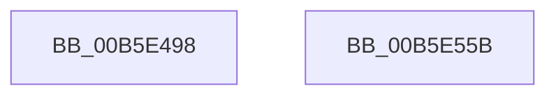

# HalpInitGenericErrorSourcePollingRoutine

- RVA: `0x00B5E498`–`0x00B5E55C` (길이 `196` bytes)
- VA: `0x0000000140B5E498`
- 실행 섹션: `PAGELK`
- PDB 이름 있음: `예`; PDB Function 태그: `아니요`
- unwind 정보 RVA: `0x000794E0`
- 디코드: `38`개 명령, `196/196` bytes 표시
- 미해석 바이트: `0` (있으면 어셈블리에 `.byte`로 보존)

> 이 문서는 커널 이미지의 기계어와 PDB 기호를 분석해 생성했습니다. 4번과 5번은 함수 원형과 자료형을 바이너리 사용 방식에서 추정한 C 해석이며 원본 소스 복구 결과는 아닙니다.

## 1. Dependencies

- 직접 호출 지점: **4**; 고유 호출 대상: **4**
- 직접 호출자로 확인된 함수: **1**
- RIP 상대 이미지 참조: **13**

### Outgoing calls
- `0x00B5E4D0` → [KeInitializeMutex](../../text/48/KeInitializeMutex_function_004830E0.md) (function, `0x004830E0`)
- `0x00B5E4FD` → [KeInitializeDpc](../../text/45/KeInitializeDpc_function_0045BBD0.md) (function, `0x0045BBD0`)
- `0x00B5E528` → [KeInitializeTimerEx](../../text/45/KeInitializeTimerEx_function_004563F0.md) (function, `0x004563F0`)
- `0x00B5E546` → [KiSetTimerEx](../../text/23/KiSetTimerEx_function_00232CB0.md) (function, `0x00232CB0`)

### Direct callers
- [HalpInitializeGenericErrorSource](HalpInitializeGenericErrorSource_function_00B5E564.md) at `0x00B5E8AB`

### Static image references
- `0x00B5E4A7` → RVA `0x00FC1588` (`.data`; read/write)
- `0x00B5E4AF` → RVA `0x00FC1638` (`.data`; read)
- `0x00B5E4B6` → RVA `0x00FC1674` (`.data`; read/write)
- `0x00B5E4BF` → RVA `0x00FC1670` (`.data`; read/write)
- `0x00B5E4C6` → RVA `0x00FC1580` (`.data`; write)
- `0x00B5E4D5` → RVA `0x00FC1580` (`.data`; read)
- `0x00B5E4E2` → RVA `0x00FC1590` (`.data`; read)
- `0x00B5E4EF` → RVA `0x004BA330` (`HalpGenericPolledDpcRoutine`; read)
- `0x00B5E502` → RVA `0x00FC15D0` (`.data`; read/write)
- `0x00B5E50A` → RVA `0x004A9C70` (`HalpGenericPolledWorkerRoutine`; read)
- `0x00B5E513` → RVA `0x00FC15E0` (`.data`; write)
- `0x00B5E51A` → RVA `0x00FC15F0` (`.data`; read)
- `0x00B5E521` → RVA `0x00FC15E8` (`.data`; write)

## 2. Other-region calls and transfers

- 다른 실행 섹션으로 향하는 call: **4**
  - `0x00B5E4D0` → [KeInitializeMutex](../../text/48/KeInitializeMutex_function_004830E0.md) (`PAGELK` → `.text`)
  - `0x00B5E4FD` → [KeInitializeDpc](../../text/45/KeInitializeDpc_function_0045BBD0.md) (`PAGELK` → `.text`)
  - `0x00B5E528` → [KeInitializeTimerEx](../../text/45/KeInitializeTimerEx_function_004563F0.md) (`PAGELK` → `.text`)
  - `0x00B5E546` → [KiSetTimerEx](../../text/23/KiSetTimerEx_function_00232CB0.md) (`PAGELK` → `.text`)
- 별도 외부 분기/꼬리 이동을 확인하지 못했습니다.

## 3. Assembly (complete function range)

```asm
00B5E498  48 89 5C 24 08                  mov qword ptr [rsp + 8], rbx
00B5E49D  48 89 74 24 10                  mov qword ptr [rsp + 0x10], rsi
00B5E4A2  57                              push rdi
00B5E4A3  48 83 EC 30                     sub rsp, 0x30
00B5E4A7  48 83 25 D9 30 46 00 00         and qword ptr [rip + 0x4630d9], 0
00B5E4AF  48 8D 0D 82 31 46 00            lea rcx, [rip + 0x463182]
00B5E4B6  83 25 B7 31 46 00 00            and dword ptr [rip + 0x4631b7], 0
00B5E4BD  33 D2                           xor edx, edx
00B5E4BF  83 25 AA 31 46 00 00            and dword ptr [rip + 0x4631aa], 0
00B5E4C6  C7 05 B0 30 46 00 F4 01 00 00   mov dword ptr [rip + 0x4630b0], 0x1f4
00B5E4D0  E8 0B 4C 92 FF                  call 0x1404830e0
00B5E4D5  8B 05 A5 30 46 00               mov eax, dword ptr [rip + 0x4630a5]
00B5E4DB  48 8D 3D 9E 30 46 00            lea rdi, [rip + 0x46309e]
00B5E4E2  48 8D 35 A7 30 46 00            lea rsi, [rip + 0x4630a7]
00B5E4E9  4C 8B C7                        mov r8, rdi
00B5E4EC  48 8B CE                        mov rcx, rsi
00B5E4EF  48 8D 15 3A BE 95 FF            lea rdx, [rip - 0x6a41c6]
00B5E4F6  48 69 D8 F0 D8 FF FF            imul rbx, rax, -0x2710
00B5E4FD  E8 CE D6 8F FF                  call 0x14045bbd0
00B5E502  48 83 25 C6 30 46 00 00         and qword ptr [rip + 0x4630c6], 0
00B5E50A  48 8D 05 5F B7 94 FF            lea rax, [rip - 0x6b48a1]
00B5E511  33 D2                           xor edx, edx
00B5E513  48 89 05 C6 30 46 00            mov qword ptr [rip + 0x4630c6], rax
00B5E51A  48 8D 0D CF 30 46 00            lea rcx, [rip + 0x4630cf]
00B5E521  48 89 3D C0 30 46 00            mov qword ptr [rip + 0x4630c0], rdi
00B5E528  E8 C3 7E 8F FF                  call 0x1404563f0
00B5E52D  44 8B 05 4C 30 46 00            mov r8d, dword ptr [rip + 0x46304c]
00B5E534  48 8D 0D B5 30 46 00            lea rcx, [rip + 0x4630b5]
00B5E53B  45 33 C9                        xor r9d, r9d
00B5E53E  48 89 74 24 20                  mov qword ptr [rsp + 0x20], rsi
00B5E543  48 8B D3                        mov rdx, rbx
00B5E546  E8 65 47 6D FF                  call 0x140232cb0
00B5E54B  48 8B 5C 24 40                  mov rbx, qword ptr [rsp + 0x40]
00B5E550  48 8B 74 24 48                  mov rsi, qword ptr [rsp + 0x48]
00B5E555  48 83 C4 30                     add rsp, 0x30
00B5E559  5F                              pop rdi
00B5E55A  C3                              ret
00B5E55B  CC                              int3
```

## 4. C-style interpretation (structured pseudocode)

```c
__int64 __fastcall HalpInitGenericErrorSourcePollingRoutine(__int64 a1, int a2, __int64 a3, int a4)
{
    __int64 result;
    __int64 v_rbx;
    __int64 v_rsp;
    unsigned __int64 v_stack_m18;
    unsigned __int64 v_stack_p10;
    unsigned __int64 v_stack_p8;

    v_stack_p8 = v_rbx;
    v_stack_p10 = v_rsi;
    v_rsp = (v_rsp) - (48);
    a2 = 0;
    *(unsigned int *)(v_rip + 4599984) = 500;
    result = KeInitializeMutex(v_rip + 4600194, a2, a3, a4);
    v_rbx = (v_rbx) * ((unsigned int)(*(unsigned int *)(v_rip + 4599973)));
    result = KeInitializeDpc(v_rip + 4599975, v_rip - 6963654, v_rip + 4599966, a4);
    a2 = 0;
    *(unsigned __int64 *)(v_rip + 4600006) = v_rip - 7030945;
    *(unsigned __int64 *)(v_rip + 4600000) = v_rip + 4599966;
    result = KeInitializeTimerEx(v_rip + 4600015, a2, v_rip + 4599966, a4);
    a4 = 0;
    v_stack_m18 = v_rip + 4599975;
    result = KiSetTimerEx(v_rip + 4599989, v_rbx, (unsigned int)(*(unsigned int *)(v_rip + 4599884)), a4);
    v_rsp = (v_rsp) + (48);
    return result;
}
```

## 5. (Beta) C Style

```c
int64_t HalpInitGenericErrorSourcePollingRoutine(int64_t Arg1, int32_t Arg2, int64_t Arg3, int32_t Arg4)
{
    int64_t result;
    int64_t local_rbx;
    int64_t local_rsp;
    uint64_t v_stack_m18;
    uint64_t v_stack_p10;
    uint64_t v_stack_p8;

    v_stack_p8 = local_rbx;
    v_stack_p10 = local_rsi;
    local_rsp = (local_rsp) - (48);
    Arg2 = 0;
    *(uint32_t *)(v_rip + 0x4630B0) = 500;
    result = KeInitializeMutex(v_rip + 4600194, Arg2, Arg3, Arg4);
    local_rbx = (local_rbx) * ((uint32_t)(*(uint32_t *)(v_rip + 0x4630A5)));
    result = KeInitializeDpc(v_rip + 4599975, v_rip - 6963654, v_rip + 4599966, Arg4);
    Arg2 = 0;
    *(uint64_t *)(v_rip + 0x4630C6) = v_rip - 7030945;
    *(uint64_t *)(v_rip + 0x4630C0) = v_rip + 4599966;
    result = KeInitializeTimerEx(v_rip + 4600015, Arg2, v_rip + 4599966, Arg4);
    Arg4 = 0;
    v_stack_m18 = v_rip + 4599975;
    result = KiSetTimerEx(v_rip + 4599989, local_rbx, (uint32_t)(*(uint32_t *)(v_rip + 0x46304C)), Arg4);
    local_rsp = (local_rsp) + (48);
    return result;
}
```

## 6. Execution-region graph

[열기: 2D/3D 그래프와 함수 탐색 컨트롤 패널](../../../control-panel.html?section=pagelk&rva=0x00B5E498&view=graph)

- 2D 그래프는 위에서 아래로 흐르고, 3D 그래프는 빈 공간을 드래그해 회전합니다. Shift+드래그는 이동, 휠은 확대·축소, 함수 노드 선택은 대상 보고서 이동입니다.

### Static fallback


