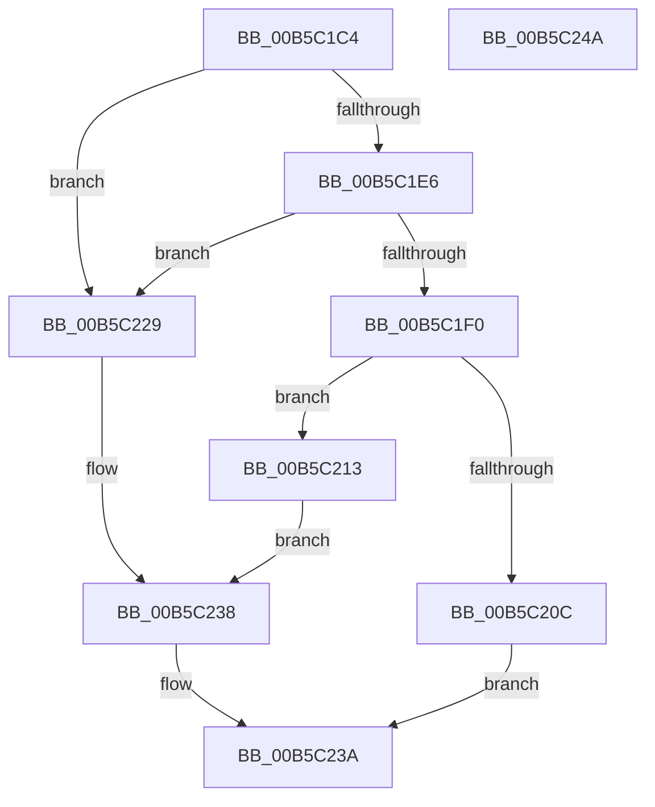

# HalpInitMemoryCachingRequirementsTable

- RVA: `0x00B5C1C4`–`0x00B5C24B` (길이 `135` bytes)
- VA: `0x0000000140B5C1C4`
- 실행 섹션: `PAGELK`
- PDB 이름 있음: `예`; PDB Function 태그: `아니요`
- unwind 정보 RVA: `0x00060BC4`
- 디코드: `35`개 명령, `135/135` bytes 표시
- 미해석 바이트: `0` (있으면 어셈블리에 `.byte`로 보존)

> 이 문서는 커널 이미지의 기계어와 PDB 기호를 분석해 생성했습니다. 4번과 5번은 함수 원형과 자료형을 바이너리 사용 방식에서 추정한 C 해석이며 원본 소스 복구 결과는 아닙니다.

## 1. Dependencies

- 직접 호출 지점: **2**; 고유 호출 대상: **2**
- 직접 호출자로 확인된 함수: **1**
- RIP 상대 이미지 참조: **4**

### Outgoing calls
- `0x00B5C1FB` → [HalpMmAllocCtxAlloc](../../text/3E/HalpMmAllocCtxAlloc_function_003E10B8.md) (function, `0x003E10B8`)
- `0x00B5C222` → [memcpy](../../text/6C/memcpy_function_006C6840.md) (function, `0x006C6840`)

### Direct callers
- [HalpMmInitSystem](HalpMmInitSystem_function_00B5DA60.md) at `0x00B5DA82`

### Static image references
- `0x00B5C200` → RVA `0x00FC2CC0` (`.data`; write)
- `0x00B5C216` → RVA `0x00FC2CC8` (`.data`; write)
- `0x00B5C229` → RVA `0x00FC2CC8` (`.data`; read/write)
- `0x00B5C230` → RVA `0x00FC2CC0` (`.data`; read/write)

## 2. Other-region calls and transfers

- 다른 실행 섹션으로 향하는 call: **2**
  - `0x00B5C1FB` → [HalpMmAllocCtxAlloc](../../text/3E/HalpMmAllocCtxAlloc_function_003E10B8.md) (`PAGELK` → `.text`)
  - `0x00B5C222` → [memcpy](../../text/6C/memcpy_function_006C6840.md) (`PAGELK` → `.text`)
- 별도 외부 분기/꼬리 이동을 확인하지 못했습니다.

## 3. Assembly (complete function range)

```asm
00B5C1C4  48 89 5C 24 08                  mov qword ptr [rsp + 8], rbx
00B5C1C9  48 89 74 24 10                  mov qword ptr [rsp + 0x10], rsi
00B5C1CE  57                              push rdi
00B5C1CF  48 83 EC 20                     sub rsp, 0x20
00B5C1D3  48 8B 99 F0 00 00 00            mov rbx, qword ptr [rcx + 0xf0]
00B5C1DA  48 8B B3 50 01 00 00            mov rsi, qword ptr [rbx + 0x150]
00B5C1E1  48 85 F6                        test rsi, rsi
00B5C1E4  74 43                           je 0x140b5c229
00B5C1E6  8B 9B 48 01 00 00               mov ebx, dword ptr [rbx + 0x148]
00B5C1EC  85 DB                           test ebx, ebx
00B5C1EE  74 39                           je 0x140b5c229
00B5C1F0  48 8D 3C 5B                     lea rdi, [rbx + rbx*2]
00B5C1F4  48 C1 E7 03                     shl rdi, 3
00B5C1F8  48 8B D7                        mov rdx, rdi
00B5C1FB  E8 B8 4E 88 FF                  call 0x1403e10b8
00B5C200  48 89 05 B9 6A 46 00            mov qword ptr [rip + 0x466ab9], rax
00B5C207  48 85 C0                        test rax, rax
00B5C20A  75 07                           jne 0x140b5c213
00B5C20C  B8 9A 00 00 C0                  mov eax, 0xc000009a
00B5C211  EB 27                           jmp 0x140b5c23a
00B5C213  4C 8B C7                        mov r8, rdi
00B5C216  89 1D AC 6A 46 00               mov dword ptr [rip + 0x466aac], ebx
00B5C21C  48 8B D6                        mov rdx, rsi
00B5C21F  48 8B C8                        mov rcx, rax
00B5C222  E8 19 A6 B6 FF                  call 0x1406c6840
00B5C227  EB 0F                           jmp 0x140b5c238
00B5C229  83 25 98 6A 46 00 00            and dword ptr [rip + 0x466a98], 0
00B5C230  48 83 25 88 6A 46 00 00         and qword ptr [rip + 0x466a88], 0
00B5C238  33 C0                           xor eax, eax
00B5C23A  48 8B 5C 24 30                  mov rbx, qword ptr [rsp + 0x30]
00B5C23F  48 8B 74 24 38                  mov rsi, qword ptr [rsp + 0x38]
00B5C244  48 83 C4 20                     add rsp, 0x20
00B5C248  5F                              pop rdi
00B5C249  C3                              ret
00B5C24A  CC                              int3
```

## 4. C-style interpretation (structured pseudocode)

```c
__int64 __fastcall HalpInitMemoryCachingRequirementsTable(__int64 a1)
{
    __int64 result;
    __int64 v_rdi;
    __int64 v_rsp;
    unsigned __int64 v_stack_p10;
    unsigned __int64 v_stack_p8;

    v_stack_p8 = v_rbx;
    v_stack_p10 = v_rsi;
    v_rsp = (v_rsp) - (32);
    if (*(unsigned __int64 *)(*(unsigned __int64 *)(a1 + 240) + 336) == 0) goto loc_00B5C229;
    if ((unsigned int)((unsigned int)(*(unsigned int *)(*(unsigned __int64 *)(a1 + 240) + 328))) == 0) goto loc_00B5C229;
    v_rdi = ((unsigned int)(*(unsigned int *)(*(unsigned __int64 *)(a1 + 240) + 328)) + (unsigned int)(*(unsigned int *)(*(unsigned __int64 *)(a1 + 240) + 328)) * 2) << (3);
    result = HalpMmAllocCtxAlloc(a1, v_rdi, a3, a4);
    *(unsigned __int64 *)(v_rip + 4614841) = result;
    if (result != 0) goto loc_00B5C213;
    goto loc_00B5C23A;
loc_00B5C213:
    *(unsigned int *)(v_rip + 4614828) = (unsigned int)((unsigned int)(*(unsigned int *)(*(unsigned __int64 *)(a1 + 240) + 328)));
    result = memcpy((unsigned int)(0xC000009AULL), *(unsigned __int64 *)(*(unsigned __int64 *)(a1 + 240) + 336), v_rdi, a4);
    goto loc_00B5C238;
loc_00B5C229:
loc_00B5C238:
    result = 0;
loc_00B5C23A:
    v_rsp = (v_rsp) + (32);
    return result;
}
```

## 5. (Beta) C Style

```c
int64_t HalpInitMemoryCachingRequirementsTable(void *Arg1)
{
    uint8_t *arg1 = (uint8_t *)Arg1;

    int64_t result;
    int64_t local_rdi;
    int64_t local_rsp;
    uint64_t v_stack_p10;
    uint64_t v_stack_p8;

    v_stack_p8 = local_rbx;
    v_stack_p10 = local_rsi;
    local_rsp = (local_rsp) - (32);
    if (*(uint64_t *)(*(uint64_t *)(arg1 + 0xF0) + 0x150) == 0) goto loc_00B5C229;
    if ((uint32_t)((uint32_t)(*(uint32_t *)(*(uint64_t *)(arg1 + 0xF0) + 0x148))) == 0) goto loc_00B5C229;
    local_rdi = ((uint32_t)(*(uint32_t *)(*(uint64_t *)(arg1 + 0xF0) + 0x148)) + (uint32_t)(*(uint32_t *)(*(uint64_t *)(arg1 + 0xF0) + 0x148)) * 2) << (3);
    result = HalpMmAllocCtxAlloc(Arg1, local_rdi, a3, a4);
    *(uint64_t *)(v_rip + 0x466AB9) = result;
    if (result != 0) goto loc_00B5C213;
    goto loc_00B5C23A;
loc_00B5C213:
    *(uint32_t *)(v_rip + 0x466AAC) = (uint32_t)((uint32_t)(*(uint32_t *)(*(uint64_t *)(arg1 + 0xF0) + 0x148)));
    result = memcpy((uint32_t)(0xC000009AULL), *(uint64_t *)(*(uint64_t *)(arg1 + 0xF0) + 0x150), local_rdi, a4);
    goto loc_00B5C238;
loc_00B5C229:
loc_00B5C238:
    result = 0;
loc_00B5C23A:
    local_rsp = (local_rsp) + (32);
    return result;
}
```

### 관측된 메모리 오프셋

구조체 형식이 확인되지 않은 접근은 인자 기준의 오프셋으로만 기록했습니다.

| 기준 인자 | 오프셋 표현 | 폭 (bit) | 접근 |
|---|---:|---:|---|
| `Arg1` | `+ 0xF0` | `64` | `R` |

## 6. Execution-region graph

[열기: 2D/3D 그래프와 함수 탐색 컨트롤 패널](../../../control-panel.html?section=pagelk&rva=0x00B5C1C4&view=graph)

- 2D 그래프는 위에서 아래로 흐르고, 3D 그래프는 빈 공간을 드래그해 회전합니다. Shift+드래그는 이동, 휠은 확대·축소, 함수 노드 선택은 대상 보고서 이동입니다.

### Static fallback


